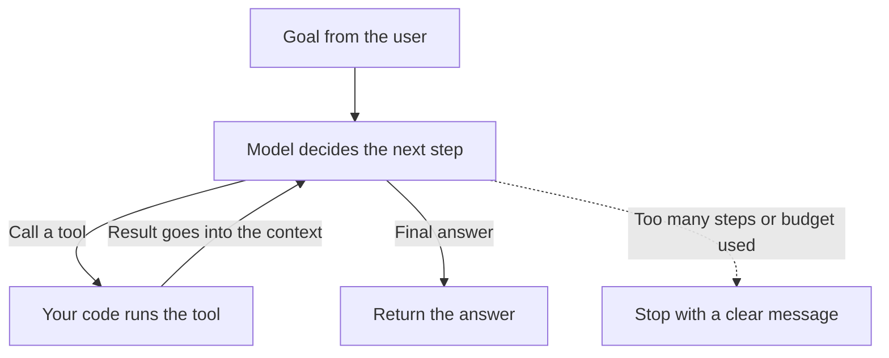

# AI Agents

<Outcomes items={[
  "Explain the agent loop and its parts: model, tools, memory and stop rules",
  "Tell an agent apart from a fixed workflow, and choose between them",
  "List the guardrails that keep an agent safe, cheap and predictable",
]} />

## What an agent is

An **AI agent** is a program where an LLM decides what to do next, in a loop, using **tools**. You give it a goal. It picks an action (for example search, read a file, call an API), your code runs that tool and returns the result, and the model decides the next step. It repeats until it can give a final answer or a limit is reached.



## The parts

| Part | Role |
| --- | --- |
| **Model** | Reads the context and chooses the next action or the final answer. |
| **Instructions** | The system prompt: the goal, rules, and when to stop. |
| **Tools** | Functions the model may call, each with a name, a description and typed inputs. |
| **Context and memory** | The history of steps and results, plus any saved notes (see [context engineering](../prompting/context-engineering.md)). |
| **Loop controller** | Your code: runs tools, adds results, enforces limits. |
| **Guardrails** | Limits and checks: step cap, budget, permissions, human approval. |

The model never runs anything itself. It only asks for a tool call, and your code decides whether and how to run it. That is where safety lives.

## Workflow or agent?

A **workflow** follows steps that you decided in advance (for example extract, then classify, then write). An **agent** lets the model decide the steps.

| | Workflow | Agent |
| --- | --- | --- |
| **Steps** | Fixed by your code. | Chosen by the model. |
| **Predictability** | High. | Lower. |
| **Cost and time** | Known in advance. | Varies, often higher. |
| **Good for** | Tasks with a known process. | Open-ended tasks where the steps depend on what is found. |

Start with the simplest thing that works: a single call, then a workflow. Use an agent only when the task really needs the model to choose its own path.

## Example: an agent loop with a step limit

The model here is a scripted stand-in, so the example runs without an API key. The loop is the real structure: ask the model, run the tool it chose, add the result, repeat, and stop at the limit.

```java
import java.util.ArrayList;
import java.util.List;
import java.util.Map;
import java.util.function.Function;

public class AgentDemo {

    /** What the model decides each turn: call a tool, or give the final answer. */
    record Decision(String tool, String argument, String answer) {
        static Decision call(String tool, String argument) { return new Decision(tool, argument, null); }
        static Decision finish(String answer)               { return new Decision(null, null, answer); }
        boolean isFinal() { return answer != null; }
    }

    interface Model {
        Decision next(List<String> history);
    }

    static String run(Model model, Map<String, Function<String, String>> tools, String task, int maxSteps) {
        List<String> history = new ArrayList<>();
        history.add("task: " + task);
        for (int step = 1; step <= maxSteps; step++) {          // hard limit, so it cannot loop forever
            Decision decision = model.next(history);
            if (decision.isFinal()) {
                return decision.answer();
            }
            String result = tools.getOrDefault(decision.tool(), arg -> "unknown tool").apply(decision.argument());
            history.add("called " + decision.tool() + "(" + decision.argument() + ") -> " + result);
        }
        return "stopped: step limit reached";
    }

    public static void main(String[] args) {
        Map<String, Function<String, String>> tools = Map.of(
                "weather", city -> city.equals("Paris") ? "18C, cloudy" : "no data");

        // A scripted stand-in for a real model: first look the weather up, then answer from the result.
        Model fakeModel = history -> history.size() == 1
                ? Decision.call("weather", "Paris")
                : Decision.finish("It is 18C and cloudy in Paris.");

        System.out.println(run(fakeModel, tools, "What is the weather in Paris?", 5));

        Model stuck = history -> Decision.call("weather", "Paris");   // never finishes
        System.out.println(run(stuck, tools, "loop forever", 3));
    }
}
```

Output (tested):

```text
It is 18C and cloudy in Paris.
stopped: step limit reached
```

The second run shows why the limit exists: a model that never finishes would otherwise loop and keep spending money.

## Try it: step through an agent

Choose a task, then step through the loop. Turn on "tool fails" or lower the step limit and watch how the agent stops.

<AgentLab />

## System design considerations

- **Cap steps, tokens and time per task.** Every loop iteration costs a model call, and a stuck agent can empty your credits.
- **Least privilege for tools.** Give each tool the minimum access. Prefer read-only tools, and separate "look up" from "change".
- **Human approval for risky actions** such as payments, deletes and sending messages.
- **Make tools safe to repeat (idempotent)** or add an idempotency key, because the model may call a tool twice. Also note that hitting a step limit stops the agent but does not undo actions it already took, as the lab above shows.
- **Validate tool inputs in code.** Do not trust the arguments the model produced.
- **Treat tool output as untrusted.** A web page or email returned by a tool can contain instructions (prompt injection). Never let it grant new permissions.
- **Log every step** (model input, tool call, result, cost) so failures can be replayed and explained.
- **Test with evaluation sets** of tasks, including failure cases, and re-run them when you change the model, the prompt or a tool.
- **Keep context small.** Trim tool results and summarise old steps, or the agent slows down and loses focus.

## Common interview questions

**1. What is an AI agent?**
An LLM in a loop that can call tools. It decides the next action, your code runs the tool, the result goes back into the context, and this repeats until a final answer or a limit.

**2. Agent versus workflow?**
A workflow has steps fixed by your code. An agent lets the model choose the steps. Workflows are more predictable and cheaper, so use an agent only for open-ended tasks.

**3. How does tool calling work?**
You describe each tool (name, purpose, input fields). The model replies with a request to call a tool with certain arguments. Your code validates and runs it and returns the result to the model.

**4. How do you stop an agent from running forever or costing too much?**
Set a maximum number of steps, a token or cost budget and a timeout, and return a clear message when a limit is reached.

**5. What are the main security risks?**
Prompt injection through tool output or retrieved content, tools with too much permission, and unsafe actions without approval. Reduce them with least privilege, input validation, approval for risky actions and separating untrusted text.

**6. How do you evaluate an agent?**
Build a set of tasks with known good outcomes, run the agent on them, and check the final results and the steps taken (correct tools, number of steps, cost). Re-run after every change.

## Pitfalls

- Using an agent when a fixed workflow would be simpler and cheaper.
- No step or budget limit.
- Tools that can do too much, with no approval for dangerous actions.
- Trusting instructions that come back inside tool results.
- Tools that are not safe to repeat, such as sending the same payment twice.
- Not logging steps, so nobody can explain what the agent did.
- Letting the history grow without trimming.

## Check yourself

<Checkpoint questions={[
  {
    q: "Who actually runs a tool in an agent?",
    options: ["The model runs it directly", "Your code runs it after the model asks", "The user", "The vector database"],
    answer: 1,
    why: "The model only asks for a tool call. Your code validates and runs it, which is where you enforce safety.",
  },
  {
    q: "A task always follows the same three steps. What should you build?",
    options: ["An agent so the model can decide", "A fixed workflow", "A multi-agent system", "A larger model"],
    answer: 1,
    why: "When the steps are known, a workflow is more predictable and cheaper. Use an agent when the path depends on what is found.",
  },
  {
    q: "Which guardrail prevents an agent from looping and spending endlessly?",
    options: ["A longer system prompt", "A maximum number of steps and a budget", "Higher temperature", "More tools"],
    answer: 1,
    why: "A hard limit on steps and spend stops a stuck loop, no matter what the model decides.",
  },
]} />

## Key takeaways

- An agent is an LLM in a loop that picks actions, with your code running the tools.
- Use a fixed workflow when the steps are known, and an agent only for open-ended tasks.
- Always set limits: steps, budget and time.
- Give tools least privilege, validate inputs and ask for approval on risky actions.
- Treat tool output as untrusted, and log every step.
