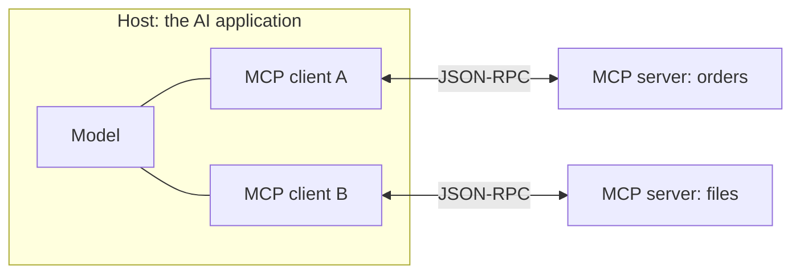

# Model Context Protocol (MCP)

<Outcomes items={[
  "Explain what MCP is and what problem it solves",
  "Name the parts (host, client, server) and what a server can offer",
  "Read the basic messages and list the security checks before using a server",
]} />

## What MCP is

The **Model Context Protocol (MCP)** is an open standard for connecting AI applications to tools and data. An **MCP server** exposes capabilities (look up an order, read a file, query a database) in a standard way, and any **MCP-capable AI application** can use them without custom code for each one.

The problem it solves: without a standard, every AI app needs its own connector for every tool, so the work multiplies. With one protocol, a tool is written once as a server and works with many apps. It is often compared to a universal plug.

## The parts



| Part | Role |
| --- | --- |
| **Host** | The AI application the user talks to (a chat app, an IDE, your own service). |
| **Client** | A connector inside the host. There is one client per server connection. |
| **Server** | A program that exposes capabilities. It can run locally or remotely. |

## What a server can offer

| Capability | What it is | Example |
| --- | --- | --- |
| **Tools** | Actions the model can ask to run. | `order_status`, `create_ticket`. |
| **Resources** | Read-only data the app can load into context. | A file, a database record, a document. |
| **Prompts** | Reusable prompt templates the user can pick. | "Summarise this ticket". |

**Transports:** a server can talk over **stdio** (the host starts it as a local process) or over **HTTP** (for remote servers). Messages use **JSON-RPC 2.0**.

## Example: the messages

This small server answers two methods. A real server also handles connection set-up and capability negotiation first, which this demo skips so the shape of the messages stays clear.

```java
import com.fasterxml.jackson.databind.JsonNode;
import com.fasterxml.jackson.databind.ObjectMapper;
import com.fasterxml.jackson.databind.node.ObjectNode;

public class McpDemo {

    private static final ObjectMapper JSON = new ObjectMapper();

    /** A tiny server that answers two MCP-style JSON-RPC methods. */
    static JsonNode handle(JsonNode request) {
        ObjectNode response = JSON.createObjectNode();
        response.put("jsonrpc", "2.0");
        response.set("id", request.get("id"));
        String method = request.get("method").asText();

        switch (method) {
            case "tools/list" -> {
                ObjectNode tool = JSON.createObjectNode();
                tool.put("name", "order_status");
                tool.put("description", "Look up the status of an order by its id");
                tool.set("inputSchema", JSON.createObjectNode()
                        .put("type", "object")
                        .set("properties", JSON.createObjectNode().set("orderId", JSON.createObjectNode().put("type", "string"))));
                response.set("result", JSON.createObjectNode().set("tools", JSON.createArrayNode().add(tool)));
            }
            case "tools/call" -> {
                String orderId = request.get("params").get("arguments").get("orderId").asText();
                ObjectNode text = JSON.createObjectNode().put("type", "text").put("text", "order " + orderId + " has shipped");
                response.set("result", JSON.createObjectNode().set("content", JSON.createArrayNode().add(text)));
            }
            default -> response.set("error", JSON.createObjectNode().put("code", -32601).put("message", "Method not found"));
        }
        return response;
    }

    public static void main(String[] args) throws Exception {
        String list = "{\"jsonrpc\":\"2.0\",\"id\":1,\"method\":\"tools/list\"}";
        String call = "{\"jsonrpc\":\"2.0\",\"id\":2,\"method\":\"tools/call\",\"params\":{\"name\":\"order_status\",\"arguments\":{\"orderId\":\"42\"}}}";
        String bad = "{\"jsonrpc\":\"2.0\",\"id\":3,\"method\":\"shutdown\"}";

        for (String request : new String[]{list, call, bad}) {
            System.out.println("-> " + request);
            System.out.println("<- " + JSON.writeValueAsString(handle(JSON.readTree(request))));
        }
    }
}
```

Output (tested):

```text
-> {"jsonrpc":"2.0","id":1,"method":"tools/list"}
<- {"jsonrpc":"2.0","id":1,"result":{"tools":[{"name":"order_status","description":"Look up the status of an order by its id","inputSchema":{"type":"object","properties":{"orderId":{"type":"string"}}}}]}}
-> {"jsonrpc":"2.0","id":2,"method":"tools/call","params":{"name":"order_status","arguments":{"orderId":"42"}}}
<- {"jsonrpc":"2.0","id":2,"result":{"content":[{"type":"text","text":"order 42 has shipped"}]}}
-> {"jsonrpc":"2.0","id":3,"method":"shutdown"}
<- {"jsonrpc":"2.0","id":3,"error":{"code":-32601,"message":"Method not found"}}
```

The client first asks which tools exist (`tools/list`). The tool list uses the same name, description and input schema as normal tool calling. Then the client calls one (`tools/call`). An unknown method gets a standard JSON-RPC error.

In Java you normally do not write this yourself: the official MCP Java SDK and Spring AI provide MCP client and server support (see [Spring AI and LangChain4j](../production/spring-ai-and-langchain4j.md)).

## System design considerations

- **Treat every server as code you are running.** A local stdio server runs on the user's machine with their permissions. Only install servers you trust.
- **Treat tool descriptions and results as untrusted text.** A malicious or compromised server can hide instructions in them (see [Prompt injection](../safety/prompt-injection-and-security.md)).
- **Least privilege.** Give a server only the access it needs, prefer read-only tools, and keep separate servers for separate trust levels.
- **Ask the user before risky tools run,** and show what will happen.
- **Authenticate remote servers.** The specification describes OAuth-based authorisation for remote servers. Never put long-lived secrets in tool descriptions or prompts.
- **Limit what enters the context.** A server with many tools adds all their descriptions to every call. Offer only the tools a task needs.
- **Version and monitor.** Pin server versions, log tool calls, and review what a server can do after each update.

## Common interview questions

**1. What is MCP?**
An open protocol that lets AI applications connect to tools and data through standard servers, so a connector is written once and reused by many applications.

**2. What problem does it solve?**
Without a standard, each AI app needs a custom integration for every tool. MCP replaces that with one protocol on both sides.

**3. What are tools, resources and prompts?**
Tools are actions the model can request, resources are read-only data to load into context, and prompts are reusable templates.

**4. How do clients and servers communicate?**
With JSON-RPC 2.0 messages, over stdio for local servers or over HTTP for remote ones.

**5. How is MCP different from ordinary tool calling?**
Tool calling is how a model asks for an action inside one application. MCP is the standard way to package and share those tools across applications.

**6. What are the main security risks?**
Untrusted servers running with your permissions, hidden instructions in tool descriptions or results, over-broad access, and weak authentication on remote servers.

## Pitfalls

- Installing a server without checking who wrote it.
- Giving a server write access when read-only is enough.
- Trusting tool descriptions as safe instructions.
- Connecting many servers and flooding the context with tool descriptions.
- Putting secrets into prompts or tool descriptions.

## Check yourself

<Checkpoint questions={[
  {
    q: "What does MCP mainly standardise?",
    options: ["How models are trained", "How AI applications connect to tools and data", "How tokens are counted", "How vectors are stored"],
    answer: 1,
    why: "MCP is a protocol for connecting AI applications to tools and data through servers.",
  },
  {
    q: "Which capability is read-only data that an app can load into the context?",
    options: ["Tools", "Resources", "Transports", "Hosts"],
    answer: 1,
    why: "Resources provide data to load as context. Tools are actions, and prompts are templates.",
  },
  {
    q: "A local MCP server runs over stdio. What is the main security point?",
    options: ["It cannot be attacked", "It runs on your machine with your permissions, so only use trusted servers", "It is always sandboxed by the model", "It has no access to files"],
    answer: 1,
    why: "A local server is a program you run. Treat it like any other software you install.",
  },
]} />

## Key takeaways

- MCP is a standard way to connect AI applications to tools and data.
- A host contains clients, and each client talks to one server using JSON-RPC.
- Servers can offer tools, resources and prompts, over stdio or HTTP.
- Treat servers and their descriptions as untrusted: use least privilege and ask before risky actions.
- Offer only the tools a task needs, to keep the context small.
