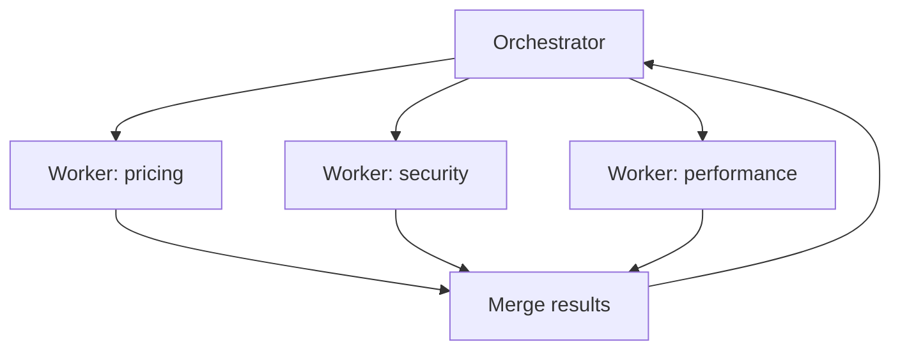

# Multi-Agent Patterns

<Outcomes items={[
  "Name the main multi-agent patterns and what each is good for",
  "Say what multi-agent designs cost, and when to avoid them",
  "Run workers in parallel and keep the main context small",
]} />

## One agent or several?

A **multi-agent system** uses more than one model-driven agent that work together on a task, each with its own instructions, tools and context. It sounds powerful, but it adds cost and complexity. **Start with a single agent**, or even a fixed workflow, and split only when you have a clear reason.

Good reasons to split:

- **The context overflows.** One agent cannot hold everything, so separate agents each read a part.
- **Work can run in parallel.** Independent sub-tasks finish faster at the same time.
- **Different jobs need different tools or rules.** A reviewer should not hold the same powers as a writer.

## The common patterns

| Pattern | How it works | Good for |
| --- | --- | --- |
| **Orchestrator and workers** | One agent splits the task, sends the parts to worker agents, then combines their results. | Research, large changes with independent parts. |
| **Pipeline (hand-off)** | Agents work in sequence: the output of one is the input of the next. | Draft, then review, then format. |
| **Parallel (sectioning or voting)** | Several agents do the same or different parts at once, and the results are merged or compared. | Speed, or higher confidence by comparing answers. |
| **Router** | A first step decides which specialist should handle the request. | Mixed requests such as billing, technical and sales. |
| **Evaluator loop** | One agent produces work, another critiques it, and the first improves it, until it passes or a limit is hit. | Writing and code where quality can be judged. |



## What it costs

- **More tokens.** Every agent makes its own model calls, and the total is often several times that of one agent.
- **Coordination errors.** Agents can misunderstand each other, repeat work or disagree.
- **Harder debugging.** A wrong final answer may come from any step in several runs.
- **More to limit.** Each agent needs its own step cap and budget, plus an overall cap.

## Example: workers in parallel

The orchestrator sends three independent sub-tasks to workers that run at the same time. It only sees each worker's short result, not its full working context. The workers are stand-ins that wait 200 ms.

```java
import java.util.List;
import java.util.concurrent.CompletableFuture;

public class MultiAgentDemo {

    record Result(String topic, String summary, int tokensUsed) {}

    /** A stand-in for a worker agent: it gets its own small context and returns a short result. */
    static Result research(String topic) {
        try {
            Thread.sleep(200);                        // pretend the worker is calling a model and tools
        } catch (InterruptedException e) {
            Thread.currentThread().interrupt();
        }
        return new Result(topic, "3 key facts about " + topic, 1_200);
    }

    public static void main(String[] args) {
        // Orchestrator: split the job into independent sub-tasks (here, fixed; normally the model decides).
        List<String> topics = List.of("pricing", "security", "performance");

        long start = System.currentTimeMillis();
        List<CompletableFuture<Result>> workers = topics.stream()
                .map(t -> CompletableFuture.supplyAsync(() -> research(t)))   // workers run at the same time
                .toList();
        List<Result> results = workers.stream().map(CompletableFuture::join).toList();
        long millis = System.currentTimeMillis() - start;

        // The orchestrator only sees the short results, not each worker's full working context.
        results.forEach(r -> System.out.println(r.topic() + ": " + r.summary()));
        int tokens = results.stream().mapToInt(Result::tokensUsed).sum();
        System.out.println("workers: " + results.size() + ", total tokens: " + tokens
                + ", ran in parallel: " + (millis < 500 ? "yes" : "no"));
    }
}
```

Output (tested):

```text
pricing: 3 key facts about pricing
security: 3 key facts about security
performance: 3 key facts about performance
workers: 3, total tokens: 3600, ran in parallel: yes
```

Three workers that each take 200 ms finish in about 200 ms in total, not 600. The cost is that the tokens add up: 3,600 across the workers.

## System design considerations

- **Give every sub-agent a narrow job and a short, structured result.** Long free-text hand-offs flood the next agent's context.
- **Cap everything:** steps and tokens per agent, a total budget per task, and a depth limit so agents cannot spawn agents endlessly.
- **Use the least privilege per agent.** A research agent needs read tools, not write tools.
- **Keep a shared trace.** Log which agent did what, with one trace id for the whole task, so you can replay it.
- **Handle partial failure.** If one worker fails, decide whether to retry, continue without it or stop.
- **Test the whole system with evals,** not only each agent. Quality problems often come from the hand-offs.

## Common interview questions

**1. When would you use more than one agent?**
When one context cannot hold the work, when sub-tasks can run in parallel, or when different parts need different tools and permissions. Otherwise one agent or a fixed workflow is simpler and cheaper.

**2. Describe the orchestrator and workers pattern.**
An orchestrator splits a task into sub-tasks, sends them to worker agents, and combines the results. Workers have their own focused contexts and return short results.

**3. What are the downsides of multi-agent systems?**
Higher token cost, coordination mistakes, harder debugging and more limits to manage.

**4. What is an evaluator loop?**
One agent produces output and another critiques it, and the producer improves it, until a quality bar is met or a step limit is reached.

**5. How do you stop agents from running away?**
Cap steps, tokens and depth per agent, add a total budget, and stop with a clear message.

**6. How do you debug a multi-agent run?**
Use one trace id across all agents, log each agent's inputs, outputs and tool calls, and replay the run on a test case.

## Pitfalls

- Using many agents where a single agent or workflow would do.
- Long free-text hand-offs that fill the next agent's context.
- No overall budget, so costs multiply unnoticed.
- Letting agents create more agents without a depth limit.
- Giving every agent the same broad permissions.
- Testing only individual agents and not the whole system.

## Check yourself

<Checkpoint questions={[
  {
    q: "What is the best first design for a new AI feature?",
    options: ["A team of five agents", "A single call or a fixed workflow", "A router with ten specialists", "An evaluator loop with no limit"],
    answer: 1,
    why: "Start with the simplest design that works and add agents only for a clear reason.",
  },
  {
    q: "Three independent research tasks each take 200 ms. How long do three parallel workers take?",
    options: ["About 600 ms", "About 200 ms", "About 800 ms", "They cannot run in parallel"],
    answer: 1,
    why: "Independent workers run at the same time, so the total is about the longest one. The token cost still adds up.",
  },
  {
    q: "Why should workers return short, structured results?",
    options: ["It makes the model smarter", "It keeps the orchestrator's context small and focused", "It removes the need for limits", "It is required by every provider"],
    answer: 1,
    why: "Long hand-offs fill the next agent's context, which costs more and distracts it.",
  },
]} />

## Key takeaways

- Start with one agent or a workflow. Add agents only for a clear reason: overflowing context, parallel work or different permissions.
- Main patterns: orchestrator and workers, pipeline, parallel, router and evaluator loop.
- Multi-agent systems cost more tokens and are harder to debug.
- Keep hand-offs short, cap steps and budgets, and use least privilege per agent.
- Trace the whole run and test the whole system.
