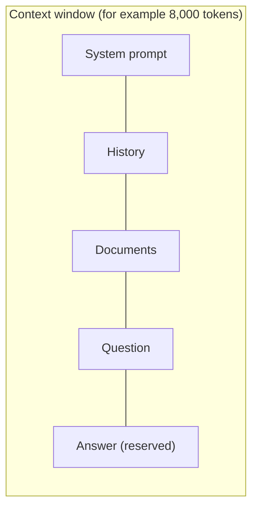

# Tokens and the Context Window

<Outcomes items={[
  "Explain what a token is and estimate how many a text uses",
  "Say what the context window limits, and why output counts too",
  "Check in code whether a prompt fits before you send it",
]} />

## What a token is

A **token** is the unit a model reads and writes. It is usually a piece of a word, a whole short word, a number chunk or a punctuation mark. For example, `unbelievable` may become three tokens and `the` is one.

Rough rules for English text:

- 1 token is about **4 characters**, or about **three quarters of a word**.
- 100 tokens is roughly 75 words.
- Code, numbers, and languages other than English usually use **more tokens** for the same amount of text.

These are estimates only. Every model family has its own tokenizer, so the same text can have different counts on different models. For exact numbers, use the provider's token counter or the usage figures returned with each response.

## The context window

The **context window** is the maximum number of tokens the model can handle in a single call. It covers **everything**: your instructions, the conversation history, any documents you add, and the answer the model writes.



Two consequences:

- If the input is too long, the call fails or the provider cuts something off.
- If you allow a long answer, you must leave room for it. Input plus output must fit.

Window sizes differ by model and change over time, from a few thousand tokens to a million or more. A bigger window does not mean you should fill it: more tokens cost more, take longer, and a very long context can make the model miss details.

## Why tokens matter

| Area | Effect |
| --- | --- |
| **Cost** | Providers bill per token, with separate prices for input and output. |
| **Speed** | More input tokens take longer to process, and every output token is generated one by one. |
| **Limits** | Providers cap tokens per minute as well as requests per minute (rate limits). |
| **Quality** | Too little context loses facts. Too much can bury the important part. |

## Example: check that a prompt fits

This estimates tokens at 4 characters each, checks that input plus the reserved output fits, and shows why chat history is expensive.

```java
public class BudgetDemo {

    /** A rough guess for English text: about 4 characters per token. Real counts come from the provider. */
    static int estimateTokens(String text) {
        return (int) Math.ceil(text.length() / 4.0);
    }

    static boolean fits(int contextWindow, int promptTokens, int maxOutputTokens) {
        return promptTokens + maxOutputTokens <= contextWindow;   // input AND output share the window
    }

    /** Tokens sent over a whole chat if every turn resends the full history. */
    static long tokensSentWithHistory(int turns, int tokensAddedPerTurn) {
        long total = 0;
        for (int turn = 1; turn <= turns; turn++) {
            total += (long) tokensAddedPerTurn * turn;
        }
        return total;
    }

    public static void main(String[] args) {
        String prompt = "Summarise the following support ticket in two sentences. ".repeat(40);
        int promptTokens = estimateTokens(prompt);
        System.out.println("estimated prompt tokens: " + promptTokens);
        System.out.println("fits in an 8,000 token window with 1,000 for the answer? " + fits(8_000, promptTokens, 1_000));
        System.out.println("fits in a 1,500 token window with 1,000 for the answer? " + fits(1_500, promptTokens, 1_000));

        System.out.println("10 turns of 500 tokens, history resent each time: " + tokensSentWithHistory(10, 500) + " tokens");
        System.out.println("10 turns of 500 tokens, no history resent:        " + 10 * 500 + " tokens");
    }
}
```

Output (tested):

```text
estimated prompt tokens: 570
fits in an 8,000 token window with 1,000 for the answer? true
fits in a 1,500 token window with 1,000 for the answer? false
10 turns of 500 tokens, history resent each time: 27500 tokens
10 turns of 500 tokens, no history resent:        5000 tokens
```

The last two lines are the important ones: because the whole history is resent, ten turns send 27,500 tokens, not 5,000.

## Try it: estimate tokens and cost

Paste any text. The lab gives an approximate token count and shows how much of a chosen context window it uses. It uses the 4-characters rule, so treat the numbers as estimates.

<TokenCostLab />

## Common interview questions

**1. What is a token?**
The unit a model reads and writes: a word piece, a short word or a symbol. In English, about four characters on average.

**2. What is the context window?**
The maximum number of tokens in one call, covering instructions, history, documents and the answer together.

**3. Why do longer chats cost more?**
The model has no memory, so the application resends the history on every turn. The input grows with each turn, and total tokens grow roughly with the square of the number of turns.

**4. Why can the same text have different token counts on different models?**
Each model family uses its own tokenizer with its own vocabulary of pieces.

**5. A request fails with a "context length exceeded" error. What can you do?**
Shorten the input: trim or summarise old history, retrieve fewer or smaller chunks, remove unneeded instructions, or use a model with a larger window. Also lower the reserved output size.

**6. Is a bigger context window always better?**
No. It costs more, is slower, and models can miss details buried in very long inputs. Send only what the task needs.

## Pitfalls

- Counting characters or words instead of tokens when checking limits.
- Forgetting that the answer also uses the window.
- Resending an ever-growing history without trimming or summarising it.
- Assuming one tokenizer's counts apply to another model.
- Filling the window because it is allowed, and paying for it.

## Check yourself

<Checkpoint questions={[
  {
    q: "A model has an 8,000 token window. Your prompt is 7,500 tokens and you allow 1,000 tokens of output. What happens?",
    options: ["It works, output is free", "It does not fit, because input plus output is 8,500", "It works but the answer is cut to 500 words", "The model compresses the prompt"],
    answer: 1,
    why: "Input and output share the window. 7,500 plus 1,000 is 8,500, which is more than 8,000.",
  },
  {
    q: "Roughly how many tokens is a 400-word English text?",
    options: ["About 100", "About 530", "About 4,000", "About 40"],
    answer: 1,
    why: "A token is about three quarters of a word, so 400 words is about 400 divided by 0.75, around 530 tokens.",
  },
  {
    q: "Why is a very long conversation expensive even if each message is short?",
    options: ["Short messages cost more per token", "The whole history is sent again on every turn", "The model charges per message, not per token", "Long chats force a bigger model"],
    answer: 1,
    why: "The model is stateless, so each turn sends all earlier messages again. Total tokens grow quickly with the number of turns.",
  },
]} />

## Key takeaways

- A token is a word piece. In English, about four characters or three quarters of a word.
- The context window limits input and output together.
- Counts differ between models, so estimate in your code and read the real usage from the provider.
- Chat history is resent each turn, so trim or summarise it.
- Tokens drive cost, speed, rate limits and quality.
