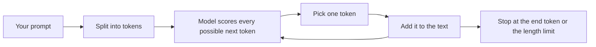

# What Is an LLM?

<Outcomes items={[
  "Explain in one minute how an LLM produces text",
  "Describe training in three steps and what each step adds",
  "List the limits of an LLM that your application must work around",
]} />

## How an LLM produces text

An LLM only does one thing: given some text, it predicts the **next token** (a small piece of a word). To write a whole answer, it predicts one token, adds it to the text, and predicts again.



The model does not look facts up. It has learned patterns from a huge amount of text, and it continues your text in the most fitting way. That is why it can write fluent, correct-looking sentences that are still wrong.

## Training in three steps

| Step | What happens | What it adds |
| --- | --- | --- |
| **Pretraining** | The model reads a huge amount of text and learns to predict the next token. | Language, general knowledge and reasoning patterns. |
| **Instruction tuning** | It is trained on examples of questions and good answers. | It follows instructions instead of just continuing text. |
| **Preference tuning** | People (or other models) rate answers, and the model is nudged toward the better ones. | Helpful, safer and better-styled answers. |

After training, the model's knowledge is frozen. It has a **knowledge cutoff**: it knows nothing about events after its training data ended, unless you give it that information in the prompt.

## Settings that change the output

| Setting | What it does | Typical use |
| --- | --- | --- |
| **Temperature** | Low values make the model pick the most likely token. High values let it pick less likely ones. | Low for facts and code, higher for creative writing. |
| **Top-p** | Only the most likely tokens that add up to this share are considered. | Another way to control randomness. Change one setting, not both. |
| **Max output tokens** | A hard limit on the length of the answer. | Control cost and stop runaway answers. |

Even with a low temperature, the same prompt can give slightly different answers. Do not build code that depends on exact wording.

## Limits you must design around

- **No memory.** Every call is separate. The model only sees what you send in that call. A chat that "remembers" works because your application resends the earlier messages every time.
- **Knowledge cutoff.** Recent or private information must be added to the prompt (this is what RAG does).
- **Hallucination.** The model can state wrong things with full confidence, especially when it has no information.
- **Limited context window.** There is a maximum amount of text per call (see [Tokens and the context window](tokens-and-context-window.md)).
- **Cost and delay.** Every token you send and receive costs time and money.

## Example: the model is stateless

This runs with a stand-in model, so you can see the idea without an API key. A real model behaves the same way: it only knows what is in the messages you send.

```java
import java.util.ArrayList;
import java.util.List;

public class ChatDemo {

    record Message(String role, String content) {}

    interface Model {
        String reply(List<Message> messages);
    }

    public static void main(String[] args) {
        // A stand-in model. A real model is also stateless: it only sees what you send in this call.
        Model model = messages -> "I can see " + messages.size() + " message(s). The last one says: "
                + messages.get(messages.size() - 1).content();

        List<Message> history = new ArrayList<>();
        history.add(new Message("system", "You are a helpful assistant."));

        for (String userText : List.of("My name is Asha.", "What is my name?")) {
            history.add(new Message("user", userText));
            String answer = model.reply(history);          // the WHOLE history is sent every time
            history.add(new Message("assistant", answer));
            System.out.println("user: " + userText);
            System.out.println("model: " + answer);
        }
    }
}
```

Output (tested):

```text
user: My name is Asha.
model: I can see 2 message(s). The last one says: My name is Asha.
user: What is my name?
model: I can see 4 message(s). The last one says: What is my name?
```

The second call sees four messages because the application sent the earlier ones again. If it had sent only the new question, the model could not know the name.

## Common interview questions

**1. What is an LLM?**
A large neural network trained on a huge amount of text to predict the next token. By predicting one token at a time, it can write answers, summaries, code and more.

**2. Why do LLMs hallucinate?**
The model produces the most likely continuation, not a verified fact. When it lacks the information, it still produces fluent text. You reduce this by giving it the facts (RAG), asking it to say "I do not know", and checking important outputs.

**3. What does temperature do?**
It controls randomness when picking the next token. Low temperature gives more predictable answers, and high temperature gives more varied ones.

**4. Does the model remember earlier messages?**
No. Each call is independent. Chat memory is the application resending earlier messages, which also means longer chats cost more.

**5. What is the difference between pretraining and fine-tuning?**
Pretraining teaches general language and knowledge from a huge dataset. Fine-tuning continues training on a smaller dataset to change behaviour or style for a specific purpose.

**6. Why can the same prompt give different answers?**
The model picks tokens with some randomness, controlled by temperature and top-p. Also, providers update models over time.

## Pitfalls

- Treating the model as a database of facts instead of a text generator.
- Using an answer without checking it when a wrong answer would be costly.
- Assuming the model knows recent events or your private data.
- Forgetting to resend the history, so the model "forgets" the conversation.
- Sending secrets or personal data without checking the provider's data policy.

## Check yourself

<Checkpoint questions={[
  {
    q: "A user asks about a company policy that changed last week. Why might the model answer incorrectly?",
    options: ["Its knowledge stops at its training cutoff, so it does not know the change", "It refuses to read policies", "Temperature was set too low", "It stores a copy of each user's data"],
    answer: 0,
    why: "The model's knowledge is frozen at training time. Recent or private information must be placed in the prompt.",
  },
  {
    q: "How does a chatbot appear to remember the conversation?",
    options: ["The model stores each chat in its memory", "The application resends the earlier messages with every call", "The model re-trains after every message", "The provider keeps a private copy for the model"],
    answer: 1,
    why: "Models are stateless. The application sends the history each time, which is why long chats use more tokens.",
  },
  {
    q: "Which setting would you lower for a task that needs consistent, factual answers?",
    options: ["Max output tokens to zero", "Temperature", "The number of messages", "The model's size"],
    answer: 1,
    why: "A low temperature makes the model choose the most likely token, so answers are more predictable.",
  },
]} />

## Key takeaways

- An LLM predicts the next token, one at a time, from patterns learned in training.
- It has no memory between calls and no knowledge after its cutoff.
- It can state wrong things confidently, so give it facts and check important answers.
- Temperature controls how predictable the output is.
- Everything the model knows about your situation must be in the prompt.
