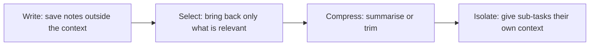

# Context Engineering

<Outcomes items={[
  "Explain how context engineering differs from prompt engineering",
  "List what goes into a model's context at each step",
  "Use four moves (write, select, compress, isolate) to keep context small and useful",
]} />

## What it is

The **context** is everything the model sees in one call. **Context engineering** is deciding, for each call, which information goes in, in what order, and how much. Prompt engineering is about wording instructions. Context engineering is about the whole package of information, and it matters most for applications that run many steps, such as agents.

## What goes into the context

| Source | Example |
| --- | --- |
| **Instructions** | The system prompt, rules, tone. |
| **Tool descriptions** | The list of tools the model may call and how to use them. |
| **Knowledge** | Documents found by retrieval (see [RAG](../retrieval/rag.md)). |
| **History** | Earlier messages in the conversation. |
| **Tool results** | What a tool returned, such as search results or file contents. |
| **Memory** | Facts saved from earlier sessions. |
| **The task** | The user's current request. |

The window is limited and every token costs money, so the real job is choosing the right things to include.

## Why more is not better

- **Cost and speed:** every extra token is paid for and slows the call.
- **Distraction:** irrelevant text competes with what matters. Models can miss details in very long inputs, especially in the middle.
- **Conflicts:** two documents that disagree make the answer uncertain.
- **Bad information stays:** a wrong statement in the context keeps influencing later steps.

The goal is the smallest set of information that lets the model do the task well.

## Four moves



| Move | What it means | Example |
| --- | --- | --- |
| **Write** | Store information outside the context so it does not take space. | Save progress notes or facts to a file or database. |
| **Select** | Pull in only what is relevant to this step. | Retrieve three matching documents, not the whole library. |
| **Compress** | Shrink old content while keeping what matters. | Summarise old chat history, drop old tool output. |
| **Isolate** | Split work so each part has a small, focused context. | A sub-agent researches a topic and returns a short result. |

## Example: build a context within a token budget

Each item has a priority. The code keeps the most important items that fit the budget and puts them back in their original order. Token counts here are the 4-characters estimate.

```java
import java.util.ArrayList;
import java.util.Comparator;
import java.util.List;

public class ContextDemo {

    /** A piece of information that could go into the model's context. Higher priority = more important. */
    record Item(String name, String text, int priority) {
        int tokens() { return (int) Math.ceil(text.length() / 4.0); }   // rough estimate
    }

    /** Keep the most important items that fit the budget, then restore the original order. */
    static List<Item> select(List<Item> items, int budget) {
        List<Item> byImportance = new ArrayList<>(items);
        byImportance.sort(Comparator.comparingInt(Item::priority).reversed());

        List<Item> chosen = new ArrayList<>();
        int used = 0;
        for (Item item : byImportance) {
            if (used + item.tokens() <= budget) {
                chosen.add(item);
                used += item.tokens();
            }
        }
        chosen.sort(Comparator.comparingInt(items::indexOf));
        return chosen;
    }

    public static void main(String[] args) {
        List<Item> items = List.of(
                new Item("system rules", "Answer only from the documents. Say so if the answer is missing.", 10),
                new Item("old chat history", "x".repeat(2_000), 2),
                new Item("retrieved document A", "Refunds are possible within 30 days of purchase.", 8),
                new Item("retrieved document B", "Shipping takes 3 to 5 working days.", 5),
                new Item("user question", "Can I get a refund after 20 days?", 10));

        for (Item item : select(items, 120)) {
            System.out.println(item.name() + " (" + item.tokens() + " tokens)");
        }
    }
}
```

Output (tested):

```text
system rules (16 tokens)
retrieved document A (12 tokens)
retrieved document B (9 tokens)
user question (9 tokens)
```

The 500-token old chat history was the first thing dropped, because it is low priority and does not fit.

## System design considerations

- **Set a context budget per step** and decide in advance what is dropped first.
- **Put stable content first** (instructions, tool descriptions) so it can benefit from prompt caching.
- **Clean up tool results.** A tool that returns 10,000 tokens of raw data should be trimmed before it enters the context.
- **Treat memory as data you manage:** decide what to save, how long to keep it, and how to correct or delete it.
- **Watch quality, not just size.** Log what was in the context for failed answers, because the cause is often a missing or misleading item.
- **Security:** anything you place in the context, including web pages and tool output, can contain instructions, so keep untrusted content clearly separated.

## Common interview questions

**1. What is context engineering?**
Choosing what information the model sees on each call: instructions, tools, documents, history, tool results and memory, within a token budget.

**2. How is it different from prompt engineering?**
Prompt engineering is how you word the instructions. Context engineering is the larger question of what information to put in front of the model at each step, which matters most in multi-step agents.

**3. Why can too much context make answers worse?**
It adds cost and delay, and irrelevant or conflicting text distracts the model. Details in the middle of long inputs are easier to miss.

**4. How do you keep a long conversation within limits?**
Summarise or trim old messages, store facts outside the context and retrieve them when needed, and drop old tool output.

**5. What is context compaction?**
Replacing long earlier content with a shorter summary that keeps the important facts, so work can continue within the window.

**6. Why give a sub-agent its own context?**
It can read a lot and return only a short result, so the main context stays small and focused.

## Pitfalls

- Putting everything in "just in case".
- Keeping every old tool result in the history.
- Letting stale or wrong information stay in memory.
- Not logging what the model saw, so failures cannot be explained.
- Treating retrieved or tool-provided text as trusted instructions.

## Check yourself

<Checkpoint questions={[
  {
    q: "Which is the best description of context engineering?",
    options: ["Writing clever wording for a single instruction", "Deciding what information the model sees on each call", "Making the model larger", "Training the model on new data"],
    answer: 1,
    why: "It is about selecting, ordering and sizing everything in the context, not only the wording of the prompt.",
  },
  {
    q: "An agent's history is full of old tool output. Which move helps most?",
    options: ["Select only relevant items and compress the old output", "Add more documents", "Raise the temperature", "Use a longer system prompt"],
    answer: 0,
    why: "Compressing or dropping old output frees space and removes distraction.",
  },
  {
    q: "Why might a sub-agent be useful?",
    options: ["It makes the model smarter", "It reads a lot in its own context and returns only a short result", "It removes the need for tokens", "It replaces the system prompt"],
    answer: 1,
    why: "Isolating work keeps the main context small and focused.",
  },
]} />

## Key takeaways

- Context is everything the model sees in one call, and you choose it.
- More context is not better: it costs more and can distract the model.
- Write, select, compress and isolate are the four ways to manage it.
- Set a token budget per step and decide what is dropped first.
- Log what the model saw, since many failures are context problems.
