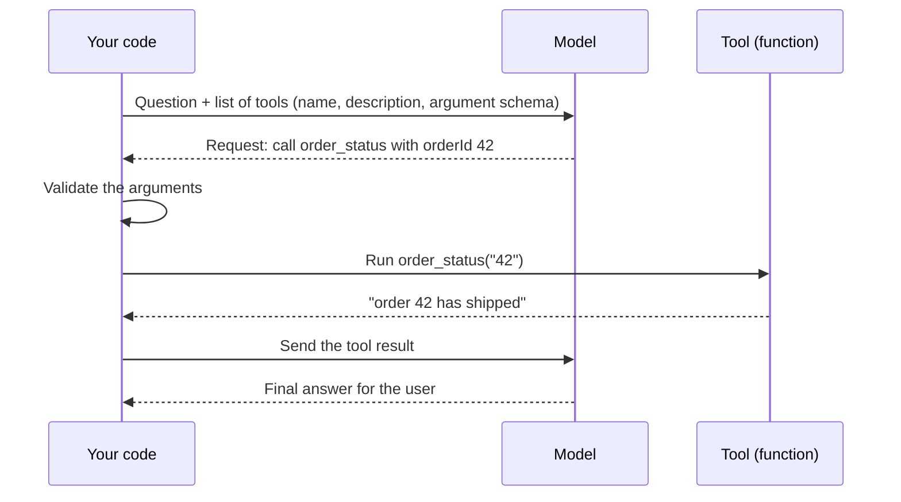

# Structured Output and Tool Calling

<Outcomes items={[
  "Get a model to return data your code can parse and validate",
  "Explain tool calling step by step, and who runs the tool",
  "Validate model-produced arguments and recover from bad output",
]} />

## Why this matters

Your program cannot do much with a paragraph of prose. It needs a label, a number or a record. Two features turn a model into a component you can program against:

- **Structured output:** the model replies in a fixed shape, usually JSON that follows a schema.
- **Tool calling (also called function calling):** the model asks your code to run a function, and then continues with the result.

## Structured output

You ask for JSON in a given shape. Providers handle this in different ways:

| Method | How it works | How strict |
| --- | --- | --- |
| **Prompt only** | You describe the shape and show an example. | The model usually complies, but not always. |
| **JSON mode** | The provider guarantees the reply is valid JSON. | Valid JSON, but not necessarily your fields. |
| **Schema-constrained output** | You give a JSON Schema and the provider forces the reply to match it. | Strongest. Use it when available. |

Even with constraints, **validate in your code**. A reply can match the shape and still hold a wrong or surprising value, such as a category that is not in your list.

## Tool calling, step by step



The key point: **the model never runs anything.** It only produces a request in a fixed format. Your code checks it, decides whether to run it, and returns the result. A tool is described by a **name**, a **description** the model reads to decide when to use it, and an **argument schema**. Clear descriptions matter, because they are the only manual the model has.

## Example: validate output and arguments

The first part parses a model reply into a Java record, checks the value and asks again when it is invalid. The second part checks tool arguments before running a tool. The model is a stand-in that fails twice, so you can see the retries.

```java
import com.fasterxml.jackson.databind.ObjectMapper;
import java.util.List;
import java.util.Map;
import java.util.function.Function;

public class StructuredOutputDemo {

    record Ticket(String category, String summary) {}

    private static final ObjectMapper JSON = new ObjectMapper();
    private static final List<String> CATEGORIES = List.of("BILLING", "TECHNICAL", "OTHER");

    interface Model {
        String reply(String prompt);
    }

    /** Parse the reply into a record, check the values, and ask again if it is not valid. */
    static Ticket classify(Model model, String ticket, int maxAttempts) {
        String prompt = "Return JSON like {\"category\": \"BILLING\", \"summary\": \"...\"}. Ticket: " + ticket;
        for (int attempt = 1; attempt <= maxAttempts; attempt++) {
            String reply = model.reply(prompt);
            try {
                Ticket t = JSON.readValue(reply, Ticket.class);
                if (!CATEGORIES.contains(t.category())) {
                    throw new IllegalArgumentException("unknown category " + t.category());
                }
                return t;
            } catch (Exception e) {
                System.out.println("attempt " + attempt + " rejected: " + e.getClass().getSimpleName());
                prompt += "\nYour last reply was invalid (" + e.getMessage().lines().findFirst().orElse("") + "). Return only valid JSON.";
            }
        }
        throw new IllegalStateException("no valid answer after " + maxAttempts + " attempts");
    }

    /** A tool the model may call. The arguments come from the model, so check them in code. */
    static String callTool(String name, Map<String, Object> args) {
        Map<String, Function<Map<String, Object>, String>> tools = Map.of(
                "order_status", a -> {
                    Object id = a.get("orderId");
                    if (!(id instanceof String s) || !s.matches("\\d{1,8}")) {
                        return "error: orderId must be 1 to 8 digits";
                    }
                    return "order " + s + " has shipped";
                });
        var tool = tools.get(name);
        return tool == null ? "error: unknown tool " + name : tool.apply(args);
    }

    public static void main(String[] args) {
        // First reply is chatty text, second has a bad value, third is correct.
        String[] replies = {
                "Sure! The category is billing.",
                "{\"category\": \"MONEY\", \"summary\": \"Wrong invoice name\"}",
                "{\"category\": \"BILLING\", \"summary\": \"Wrong invoice name\"}"};
        int[] n = {0};
        Model flaky = prompt -> replies[n[0]++];

        System.out.println(classify(flaky, "My invoice has the wrong company name", 3));

        System.out.println(callTool("order_status", Map.of("orderId", "42")));
        System.out.println(callTool("order_status", Map.of("orderId", "42; DROP TABLE")));
        System.out.println(callTool("delete_all", Map.of()));
    }
}
```

Output (tested):

```text
attempt 1 rejected: JsonParseException
attempt 2 rejected: IllegalArgumentException
Ticket[category=BILLING, summary=Wrong invoice name]
order 42 has shipped
error: orderId must be 1 to 8 digits
error: unknown tool delete_all
```

The first reply was chatty text (not JSON), the second used a category that is not allowed, and the third was valid. The tool checks stop a malformed id and an unknown tool name from running.

## System design considerations

- **Never trust model-produced arguments.** Treat them like user input: check types, ranges, formats and permissions before running anything.
- **Return errors as tool results.** A message such as "orderId must be 1 to 8 digits" lets the model correct itself on the next step.
- **Limit retries.** Allow two or three attempts, then fail clearly or use a fallback. Each retry costs tokens.
- **Keep tools small and well named.** Many overlapping tools confuse the model. Say exactly what each tool does and what it returns.
- **Make tools safe to repeat.** The model may call a tool twice, so changing operations should be idempotent or carry an idempotency key.
- **Keep read and write tools apart,** and require approval for risky writes (see [Guardrails and safety](../safety/guardrails-and-safety.md)).
- **Log every tool call** with its arguments, result and cost, so you can replay problems.

## Common interview questions

**1. How do you get reliable JSON from an LLM?**
Ask for a schema, use the provider's structured-output feature if it has one, and validate the result in code. If it is invalid, retry a limited number of times with the error message, then fall back.

**2. How does tool calling work?**
You send the model a list of tools with names, descriptions and argument schemas. When it wants one, it replies with a tool name and arguments. Your code validates and runs it, and sends the result back so the model can continue.

**3. Who executes the tool?**
Your code. The model only requests a call, which is why you can validate, limit and approve every action.

**4. Why validate arguments the model produced?**
They are generated text and can be wrong, malformed or influenced by untrusted input. Validation protects your systems.

**5. What should happen when a tool fails?**
Return a clear error as the tool result so the model can retry with fixed arguments or report the problem, and limit the number of attempts.

**6. Why do tool descriptions matter?**
The model chooses a tool and fills its arguments from the description and schema alone. Vague or overlapping descriptions lead to wrong calls.

## Pitfalls

- Parsing free text with regular expressions instead of asking for a schema.
- Trusting valid JSON as correct data.
- Passing model-produced values straight into SQL, shell commands or URLs.
- Retrying forever on invalid output.
- Tools with vague names and descriptions, or too many similar tools.
- Tools that change data without being safe to repeat.

## Check yourself

<Checkpoint questions={[
  {
    q: "The model returns valid JSON, but the category field says MONEY and your allowed values are BILLING, TECHNICAL and OTHER. What now?",
    options: ["Use it, it is valid JSON", "Reject it in code and retry with an error message", "Ignore the category", "Raise the temperature"],
    answer: 1,
    why: "Valid JSON can still hold a wrong value. Validate against your own rules and retry in a limited way.",
  },
  {
    q: "Who runs a tool that the model asks for?",
    options: ["The model", "Your code, after validating the request", "The provider's servers automatically", "The user's browser"],
    answer: 1,
    why: "The model only requests a call. Your code decides whether and how to run it.",
  },
  {
    q: "What is the best response when a tool gets an invalid argument?",
    options: ["Crash the request", "Return a clear error as the tool result so the model can correct it", "Run the tool anyway", "Delete the tool"],
    answer: 1,
    why: "A clear error result gives the model what it needs to try again with better arguments.",
  },
]} />

## Key takeaways

- Structured output and tool calling make a model programmable.
- The model requests a tool call. Your code validates and runs it.
- Always validate output and arguments in code, even when the provider enforces a schema.
- Return errors as results, limit retries and keep tools small, clear and safe to repeat.
- Log every tool call.
