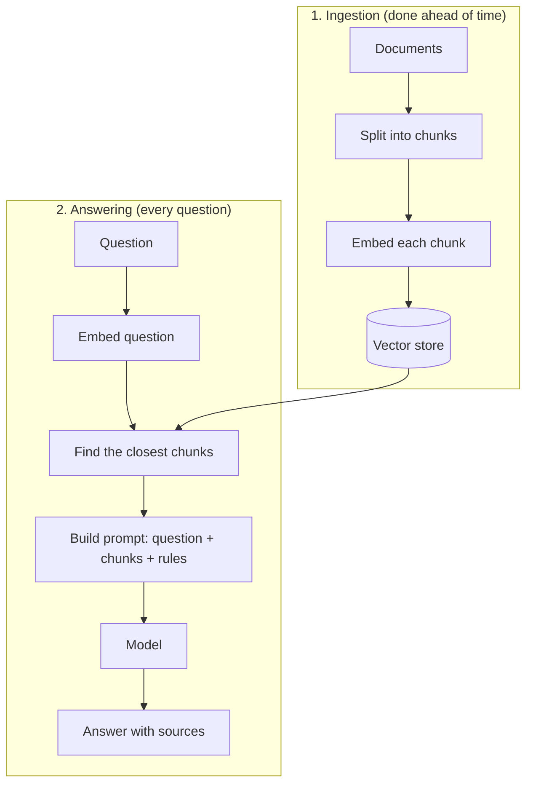

# RAG: Retrieval-Augmented Generation

<Outcomes items={[
  "Describe the two phases of RAG: ingestion and answering",
  "Choose chunk size and overlap, and say what retrieval and reranking do",
  "Tell when RAG is the right tool, and how to check that it works",
]} />

## The idea

A model does not know your private documents or last week's news. **RAG** fixes that without retraining: when a question arrives, you **retrieve** the most relevant pieces of your own data and put them in the prompt, so the model **generates** its answer from them.



## The steps in detail

**Chunking.** Documents are split into small pieces, because you want to retrieve the one paragraph that answers the question, not a whole manual. Typical chunks are a few hundred tokens. Add some overlap between neighbours so a sentence cut at a boundary is not lost, and prefer splitting at natural boundaries such as headings and paragraphs.

**Retrieval.** The question is embedded and compared with the stored chunks (see [embeddings](embeddings-vector-databases.md)). You take the top few, often 3 to 8. Combining keyword and vector search (hybrid) usually works better than vectors alone.

**Reranking (optional).** A second model re-scores the top results by reading the question and each chunk together, which is slower but more accurate. You retrieve, say, 20 and keep the best 5.

**Prompt building.** The prompt contains the question, the chunks with their sources, and rules: answer only from the documents, cite sources, and say "I do not know" if the answer is missing.

**Generation.** The model writes the answer from the supplied text, ideally with citations the user can check.

## Example: chunk and build a prompt

First, splitting text into overlapping chunks:

```java
import java.util.ArrayList;
import java.util.List;

public class ChunkDemo {

    /** Split text into chunks of about `size` words, repeating `overlap` words between neighbours. */
    static List<String> chunk(String text, int size, int overlap) {
        if (overlap >= size) {
            throw new IllegalArgumentException("overlap must be smaller than size");
        }
        String[] words = text.trim().split("\\s+");
        List<String> chunks = new ArrayList<>();
        for (int start = 0; start < words.length; start += size - overlap) {
            int end = Math.min(start + size, words.length);
            chunks.add(String.join(" ", java.util.Arrays.copyOfRange(words, start, end)));
            if (end == words.length) {
                break;
            }
        }
        return chunks;
    }

    public static void main(String[] args) {
        String text = "one two three four five six seven eight nine ten eleven twelve";
        List<String> chunks = chunk(text, 5, 2);
        for (int i = 0; i < chunks.size(); i++) {
            System.out.println(i + ": " + chunks.get(i));
        }
    }
}
```

Output (tested):

```text
0: one two three four five
1: four five six seven eight
2: seven eight nine ten eleven
3: ten eleven twelve
```

Each chunk repeats the last two words of the previous one. Next, retrieval and prompt building. Keyword overlap stands in for embeddings here, so the example needs no model:

```java
import java.util.Arrays;
import java.util.Comparator;
import java.util.List;
import java.util.Set;
import java.util.stream.Collectors;

public class RagDemo {

    record Chunk(String source, String text) {}
    record Hit(Chunk chunk, int score) {}

    private static final Set<String> STOP = Set.of("a", "an", "the", "is", "are", "can", "i", "my", "of", "to", "in", "do", "how", "what");

    private static Set<String> words(String text) {
        return Arrays.stream(text.toLowerCase().split("[^a-z]+"))
                .filter(w -> !w.isBlank() && !STOP.contains(w))
                .map(w -> w.length() > 3 && w.endsWith("s") ? w.substring(0, w.length() - 1) : w)   // "refunds" -> "refund"
                .collect(Collectors.toSet());
    }

    /** Keyword overlap stands in for embeddings here, so the example runs with no model. */
    static List<Hit> retrieve(String question, List<Chunk> chunks, int k) {
        Set<String> q = words(question);
        return chunks.stream()
                .map(c -> new Hit(c, (int) words(c.text()).stream().filter(q::contains).count()))
                .filter(h -> h.score() > 0)
                .sorted(Comparator.comparingInt(Hit::score).reversed())
                .limit(k)
                .toList();
    }

    static String buildPrompt(String question, List<Hit> hits) {
        String sources = hits.isEmpty()
                ? "(no documents found)"
                : hits.stream().map(h -> "[" + h.chunk().source() + "] " + h.chunk().text()).collect(Collectors.joining("\n"));
        return """
                Answer using only the documents below. Cite the source in brackets.
                If the documents do not contain the answer, say you do not know.

                Documents:
                %s

                Question: %s""".formatted(sources, question);
    }

    public static void main(String[] args) {
        List<Chunk> chunks = List.of(
                new Chunk("refunds.md", "Refunds are possible within 30 days of purchase with a receipt."),
                new Chunk("shipping.md", "Standard shipping takes 3 to 5 working days."),
                new Chunk("warranty.md", "Products have a one year warranty against defects."));

        String question = "How many days do I have to ask for a refund?";
        System.out.println(buildPrompt(question, retrieve(question, chunks, 2)));
        System.out.println("-----");
        String unrelated = "Do you sell gift cards?";
        System.out.println(buildPrompt(unrelated, retrieve(unrelated, chunks, 2)));
    }
}
```

Output (tested):

```text
Answer using only the documents below. Cite the source in brackets.
If the documents do not contain the answer, say you do not know.

Documents:
[refunds.md] Refunds are possible within 30 days of purchase with a receipt.
[shipping.md] Standard shipping takes 3 to 5 working days.

Question: How many days do I have to ask for a refund?
-----
Answer using only the documents below. Cite the source in brackets.
If the documents do not contain the answer, say you do not know.

Documents:
(no documents found)

Question: Do you sell gift cards?
```

Notice the second prompt: when nothing relevant is found, the prompt says so, and the rule "say you do not know" lets the model avoid inventing an answer. The first prompt also pulled in the shipping chunk because it shares the word "days", which is the kind of noise that real retrieval and reranking try to reduce.

## Try it: retrieve and build the prompt

Type a question, change how many chunks to keep, and see what is retrieved and what the final prompt looks like. It uses simple keyword matching so it runs in your browser.

<RagLab />

## System design considerations

- **Retrieval quality limits answer quality.** If the right chunk is not retrieved, the model cannot answer correctly. Test retrieval on its own.
- **Measure both parts.** For retrieval: does the right chunk appear in the top results (hit rate or recall at k)? For generation: is the answer supported by the chunks (faithfulness) and does it answer the question (relevance)?
- **Keep the index fresh.** Re-ingest changed documents, delete removed ones, and record when each chunk was indexed.
- **Enforce access control at retrieval.** Filter chunks by what the user is allowed to read before they reach the prompt.
- **Control the prompt size.** More chunks cost more and can distract, so tune k and chunk size on your own questions.
- **Show sources.** Citations let users verify answers and help you debug.
- **Handle "not found".** Decide what the product says when nothing relevant is retrieved.
- **Treat retrieved text as untrusted.** A document may contain instructions, so apply the same prompt-injection precautions as for any outside text.

## RAG, fine-tuning or a long context?

| Approach | Best for | Weak at |
| --- | --- | --- |
| **RAG** | Facts that change or are private, answers with sources, large document sets. | Needs a good retrieval pipeline. |
| **Fine-tuning** | Changing style, format or behaviour. | Poor for keeping facts current. |
| **Long context** (put whole documents in the prompt) | A few documents, one-off questions. | Costly and slow if repeated at scale, and details can be missed. |

## Common interview questions

**1. What is RAG and why use it?**
Retrieval-augmented generation retrieves relevant pieces of your data and adds them to the prompt. It gives the model current or private knowledge, reduces made-up answers, and lets you show sources, without retraining.

**2. Describe a RAG pipeline.**
Ingestion: load documents, split into chunks, embed, and store. Answering: embed the question, retrieve the top chunks, optionally rerank, build a prompt with rules and sources, generate and cite.

**3. How do you choose chunk size?**
Chunks should be big enough to hold a complete idea and small enough to be specific. Start with a few hundred tokens with some overlap, split at natural boundaries, then tune using retrieval tests on real questions.

**4. RAG or fine-tuning?**
RAG for knowledge that changes or is private. Fine-tuning for style, format or behaviour. Often RAG first, because it is cheaper and easier to update.

**5. How do you evaluate a RAG system?**
Evaluate retrieval (is the right chunk in the top k?) and generation (is the answer grounded in the chunks and does it answer the question?) separately, using a set of real questions with known answers.

**6. The system gives a confident wrong answer. How do you debug it?**
Check what was retrieved. If the right chunk is missing, fix chunking, search or filters. If it was retrieved but ignored or misread, fix the prompt, reduce noise, or rerank.

## Pitfalls

- Chunks that are too large (diluted) or too small (missing context).
- No evaluation, so nobody knows if a change helped.
- Stale index: updated documents still answer with old text.
- Skipping access filters, leaking documents between users.
- No rule for "not found", so the model guesses.
- Retrieving too many chunks and drowning the useful one.
- Trusting instructions that appear inside retrieved documents.

## Check yourself

<Checkpoint questions={[
  {
    q: "A RAG bot answers wrongly although the correct document exists. What do you check first?",
    options: ["The model temperature", "Whether the correct chunk was retrieved", "The colour of the UI", "The number of users"],
    answer: 1,
    why: "If the right chunk never reaches the prompt, the model cannot use it. Check retrieval before changing the model.",
  },
  {
    q: "Which is the best use of RAG?",
    options: ["Changing the model's writing style", "Answering from documents that change often or are private", "Making the model faster", "Reducing the number of tokens to zero"],
    answer: 1,
    why: "RAG supplies current or private knowledge at question time. Style and behaviour are better handled by prompts or fine-tuning.",
  },
  {
    q: "What should the prompt say when no relevant document is found?",
    options: ["Make the best guess", "Say you do not know", "Repeat the question", "Ask for a larger model"],
    answer: 1,
    why: "Giving the model permission to say it does not know prevents invented answers.",
  },
]} />

## Key takeaways

- RAG retrieves relevant chunks of your data and puts them in the prompt, so the model answers from them.
- Pipeline: chunk, embed, store; then embed the question, retrieve, optionally rerank, build the prompt, generate with citations.
- Retrieval quality limits answer quality, so test retrieval and generation separately.
- Filter by permissions at retrieval, keep the index fresh, and handle "not found".
- Use RAG for changing or private knowledge, and fine-tuning for style or behaviour.
