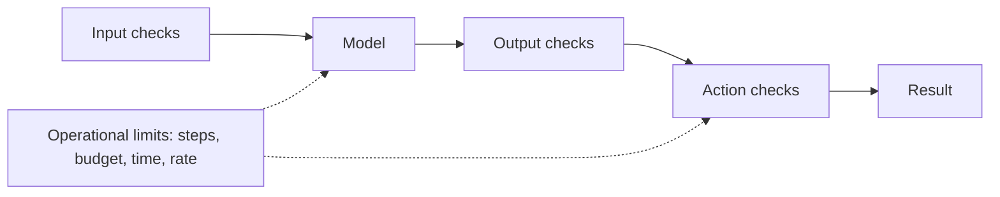

# Guardrails and Safety

<Outcomes items={[
  "Name the four layers of guardrails and give an example of each",
  "Decide in code whether an action is allowed, needs approval or is denied",
  "Choose what should happen when a check is unsure",
]} />

## What guardrails are

**Guardrails** are checks and limits that you put **around** a model, in your own code, so that a wrong or unwanted output cannot cause harm. A model can be asked politely to behave, but only code can enforce it. The model suggests, and your code decides.

## Four layers



| Layer | What it checks | Examples |
| --- | --- | --- |
| **Input** | What goes to the model. | Maximum length, allowed topics, removing personal data, blocking known abuse. |
| **Output** | What comes back. | Valid format, banned content, personal data or secrets in the text, is the answer supported by the documents. |
| **Action** | What the model wants to do. | Allowed tools only, limits on amounts, approval for risky actions. |
| **Operational** | How much it may run. | Maximum steps, token budget, timeouts, rate limits per user. |

## Human approval

For actions that are costly, hard to undo or visible to others (payments, deletions, sending messages), put a **person in the loop**. The system shows what it is about to do, and a human confirms. Use three outcomes, not two:

- **Allow:** safe and routine, run it.
- **Needs approval:** risky, wait for a person.
- **Deny:** never allowed, refuse.

## When a check is unsure

Decide in advance. For safety checks, **fail closed**: if you cannot tell whether an action is safe, do not run it and ask or stop. For low-risk features, failing open (let it through) may be acceptable, but make that a conscious choice.

Checks also give **false alarms**. A filter that blocks too much frustrates users, and one that blocks too little misses real problems. Measure both and keep a way to review blocked cases.

## Example: decide before anything runs

The model asks for an action. This code allows it, asks for approval or denies it, and also hides email addresses in the output.

```java
import java.util.Set;
import java.util.regex.Pattern;

public class GuardrailDemo {

    enum Verdict { ALLOW, NEEDS_APPROVAL, DENY }

    record Action(String tool, double amount) {}

    private static final Set<String> ALLOWED_TOOLS = Set.of("lookup_order", "refund");
    private static final double AUTO_REFUND_LIMIT = 50.0;

    /** The model asks for an action. Your code decides, before anything runs. */
    static Verdict check(Action action) {
        if (!ALLOWED_TOOLS.contains(action.tool())) {
            return Verdict.DENY;                                  // not on the list
        }
        if (action.tool().equals("refund") && action.amount() > AUTO_REFUND_LIMIT) {
            return Verdict.NEEDS_APPROVAL;                        // risky: a person must confirm
        }
        return Verdict.ALLOW;
    }

    private static final Pattern EMAIL = Pattern.compile("[\\w.+-]+@[\\w-]+\\.[\\w.]+");

    /** Check the output too: mask anything that looks like an email address before showing it. */
    static String redact(String text) {
        return EMAIL.matcher(text).replaceAll("[email hidden]");
    }

    public static void main(String[] args) {
        System.out.println(check(new Action("lookup_order", 0)));
        System.out.println(check(new Action("refund", 20)));
        System.out.println(check(new Action("refund", 500)));
        System.out.println(check(new Action("delete_database", 0)));
        System.out.println(redact("Contact asha@example.com for the invoice."));
    }
}
```

Output (tested):

```text
ALLOW
ALLOW
NEEDS_APPROVAL
DENY
Contact [email hidden] for the invoice.
```

A small refund passes, a large one needs a person, and a tool that is not on the list is denied. This runs in code, so no wording from the model can change it.

## Try it: allow, approve or deny

Pick a tool and an amount to see the decision your code would make.

<GuardrailLab />

## System design considerations

- **Enforce in code, not in the prompt.** "Never refund more than 50" in a prompt can be ignored or overridden. A check in code cannot.
- **Allowlist tools and arguments.** Deny by default, and add only what is needed.
- **Log every decision** (allowed, approved, denied) with the reason, for audit and for tuning the rules.
- **Keep checks fast.** They run on every call. Use cheap rules first, and a model-based check only where needed.
- **Handle the approval wait.** Long-running approvals need saved state, a timeout and a clear result if nobody answers.
- **Protect privacy.** Remove or mask personal data before sending it to a provider where you can, and before showing it.
- **Test the guardrails.** Keep a set of tricky and abusive inputs in your evaluation tests (see [Evals and testing](../production/evals-and-testing.md)).

## Common interview questions

**1. What are guardrails?**
Checks and limits in your code around a model: on inputs, outputs, actions and resource use. They enforce rules that a prompt alone cannot guarantee.

**2. Why not just tell the model the rules in the prompt?**
The model can misread, forget or be tricked into ignoring instructions. Code checks are deterministic and cannot be talked around.

**3. Where do you need human approval?**
For actions that are costly, irreversible or visible to others, such as payments, deletions and external messages.

**4. What does "fail closed" mean?**
If a safety check cannot decide, the system blocks the action instead of allowing it.

**5. What are examples of output guardrails?**
Validating the format, removing personal data or secrets, blocking disallowed content, and checking that the answer is supported by the given documents.

**6. How do you know the guardrails work?**
Test them with a set of normal, edge and hostile inputs, measure what is blocked and missed, and review blocked cases regularly.

## Pitfalls

- Relying on the prompt to enforce rules.
- Allowing everything except a short list of banned things, instead of denying by default.
- No approval step for irreversible actions.
- Filters that block so much that users work around them.
- No logging, so nobody can tell why something was blocked or allowed.
- Never testing with hostile inputs.

## Check yourself

<Checkpoint questions={[
  {
    q: "Where should the rule 'refunds over 50 need approval' be enforced?",
    options: ["In the system prompt only", "In code that checks the action before it runs", "In the model's training data", "In the user's browser"],
    answer: 1,
    why: "A code check is deterministic. A prompt instruction can be ignored or overridden.",
  },
  {
    q: "A safety check cannot decide whether an action is safe. What should it do?",
    options: ["Allow it to avoid annoying the user", "Fail closed: do not run it, and ask or stop", "Retry the model forever", "Delete the log"],
    answer: 1,
    why: "For safety checks, an unsure result should block the action until a person or a clearer rule decides.",
  },
  {
    q: "Which action most needs a human approval step?",
    options: ["Looking up an order status", "Sending a large refund", "Formatting a date", "Counting tokens"],
    answer: 1,
    why: "Costly, hard-to-undo actions should wait for a person. Read-only lookups usually do not need it.",
  },
]} />

## Key takeaways

- Guardrails are code around the model: input, output, action and operational checks.
- The model suggests and your code decides. Enforce rules in code, not only in the prompt.
- Use allow, needs approval and deny, and deny by default.
- Fail closed when a safety check is unsure.
- Log decisions and test the guardrails with hostile inputs.
