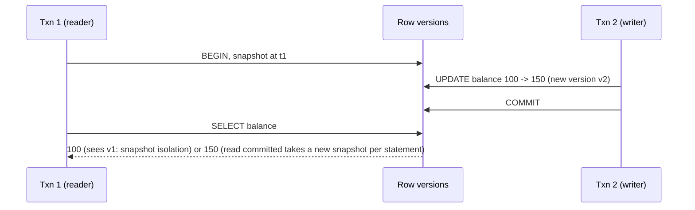
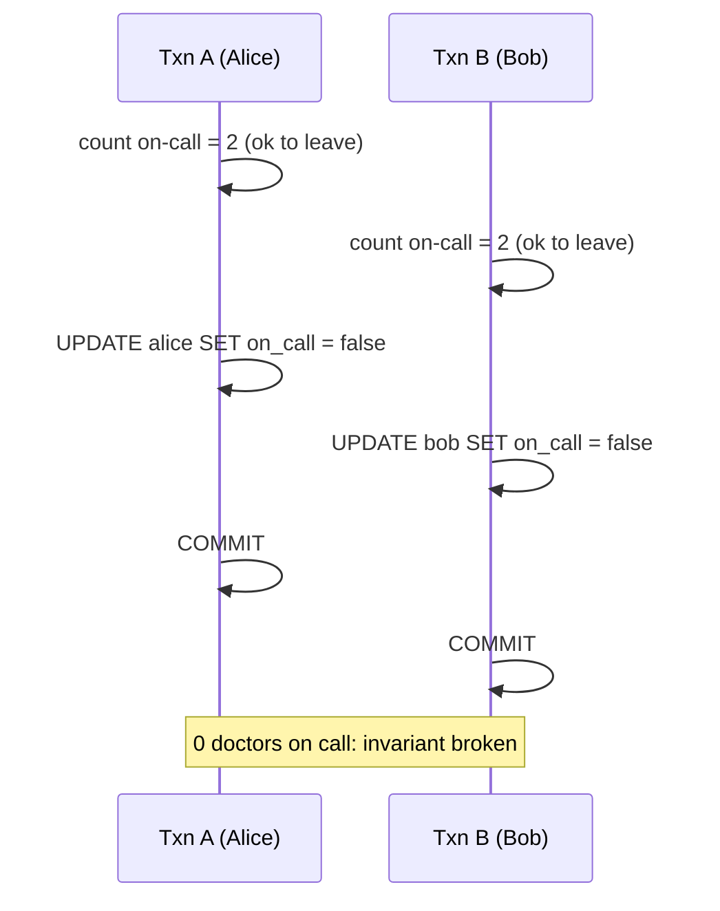

# ACID, Isolation and MVCC

<Outcomes items={[
  "Define ACID and what each letter protects",
  "Explain MVCC and why readers do not block writers",
  "Choose an isolation level and handle write skew"
]} />

## ACID

| Property | Meaning | Mechanism |
| --- | --- | --- |
| **Atomicity** | All statements of a transaction apply, or none | Undo log / rollback; write-ahead log (WAL) |
| **Consistency** | Constraints hold before and after | Constraints, triggers; plus **your** application invariants |
| **Isolation** | Concurrent transactions do not see each other's intermediate states (to a degree) | Locks and/or MVCC |
| **Durability** | Committed data survives crashes | WAL flushed to disk (`fsync`), replication |

"Consistency" in ACID is about integrity constraints, unrelated to "consistency" in CAP (linearizability) or "eventual consistency".

**Write-ahead logging**: changes are first appended to a sequential log and flushed at commit; data pages are written lazily. After a crash the database replays the log. This makes commits fast (sequential I/O) and durable. Settings such as `synchronous_commit=off` or `innodb_flush_log_at_trx_commit=2` trade durability of the last moments for throughput.

## MVCC: readers do not block writers

**Multi-Version Concurrency Control** keeps several versions of each row. A reader sees a **snapshot** consistent with some point in time and never waits for writers; writers create new versions.



- **PostgreSQL**: each row version (tuple) carries `xmin`/`xmax` transaction ids. Old versions stay in the table until **VACUUM** removes them. Long-running transactions **prevent cleanup** (table bloat), and autovacuum tuning matters.
- **MySQL InnoDB**: the clustered index holds the latest version; old versions are rebuilt from the **undo log**. Very long transactions make undo grow and reads slow.

Under MVCC, writers still block **other writers** of the same row: a second `UPDATE` waits for the first to commit or roll back (then re-evaluates, or fails under snapshot isolation).

## Isolation levels in the real world

Each level specifies which anomalies are allowed. Standard anomalies: dirty read, non-repeatable read, phantom read. **Implementations differ**:

| Level | PostgreSQL | MySQL InnoDB |
| --- | --- | --- |
| Read uncommitted | Behaves as read committed | Allows dirty reads (rarely used) |
| **Read committed** | Default. Each **statement** sees data committed before it started | Each statement uses a fresh snapshot |
| **Repeatable read** | **Snapshot isolation**: the whole transaction sees one snapshot; no phantoms; a concurrent update to a row you also update causes a **serialization failure** | Default. One snapshot per transaction for plain reads; locking reads and writes use **next-key (gap) locks** to prevent phantoms |
| **Serializable** | **SSI** (serializable snapshot isolation): detects dangerous dependency cycles and aborts one transaction with a serialization failure (`40001`) | Turns plain reads into shared locking reads: strict, more blocking and deadlocks |

Practical consequences:

- At **read committed**, two reads in one transaction can return different results, and "check then act" logic races.
- At **snapshot isolation / repeatable read**, you avoid non-repeatable reads, but you still get **write skew**.
- At **serializable**, results are equivalent to some serial order, but you must be **ready to retry** on serialization failures/deadlocks.

### Lost update

Two transactions read the same row, compute from the old value, write back; one update is lost.

```sql
-- both transactions: read balance (100), then write balance = 100 + 10  → final 110, not 120
UPDATE account SET balance = balance + 10 WHERE id = 1;     -- fix 1: atomic update (the DB applies it to the latest version)
SELECT balance FROM account WHERE id = 1 FOR UPDATE;        -- fix 2: lock the row, then update
-- fix 3: optimistic version column; fix 4: serializable with retry
```

### Write skew

Two transactions each read an overlapping set of rows, make a decision, then write **different** rows; each is valid alone but together they break an invariant. Classic: **on-call doctors**: "at least one doctor must stay on call". Both doctors check `count(on_call) >= 2` (true), both set themselves off; now zero are on call. Snapshot isolation allows this because neither writes the row the other wrote.



Defences: **serializable isolation** (with retry), **lock the rows that the decision depends on** (`SELECT ... FOR UPDATE` over the on-call set), or a **materialised conflict** (a single "schedule" row everyone updates, forcing a write-write conflict), or a database constraint that encodes the rule (exclusion/trigger).

### Phantoms and the "check then insert" race

"Insert a booking if no overlapping booking exists" races because the check reads rows that do not exist yet. Use a **unique/exclusion constraint** (the database serialises inserts), or serializable isolation, not an application-level `SELECT` followed by `INSERT`.

## Try it: which anomalies does each level allow?

Pick a scenario, then switch the isolation level to see what each transaction observes.

<IsolationLab />

## Locking in SQL

| Statement | Effect |
| --- | --- |
| `SELECT ... FOR UPDATE` | Exclusive row locks; others wait to update or lock |
| `SELECT ... FOR SHARE` | Shared locks; block writers |
| `FOR UPDATE NOWAIT` | Fail immediately if locked |
| `FOR UPDATE SKIP LOCKED` | Skip locked rows: job queues, outbox relays |
| Advisory locks (`pg_advisory_lock`) | Application-defined mutexes in the database |

Lock **in a consistent order** to avoid deadlocks; keep transactions short. The database detects deadlocks and aborts one transaction (error `40P01` in PostgreSQL, 1213 in MySQL): the application must retry.

## Operational issues from long transactions

- **Bloat and vacuum** (PostgreSQL): an idle-in-transaction session pins old row versions. Set `idle_in_transaction_session_timeout`.
- **Undo log growth** (InnoDB), replication lag from big transactions, long lock holds.
- **Connection pool exhaustion** when transactions span slow remote calls.
- Monitor: longest-running transactions (`pg_stat_activity`, `information_schema.innodb_trx`), lock waits, deadlock counts.

## Choosing isolation in applications

1. Default to the database default (read committed or repeatable read) and **design operations to be safe under it**: atomic updates, unique constraints, optimistic locking.
2. Use `SELECT FOR UPDATE` or serializable for the few invariants that span rows.
3. Always retry on serialization failures and deadlocks (with limited attempts and jittered back-off).
4. Do not raise the isolation level globally "to be safe"; it costs throughput and shifts failures to retries.

```java
@Retryable(retryFor = {CannotSerializeTransactionException.class, DeadlockLoserDataAccessException.class},
           maxAttempts = 3, backoff = @Backoff(delay = 50, multiplier = 2, random = true))
@Transactional(isolation = Isolation.SERIALIZABLE)
public void leaveOnCall(long doctorId) { ... }
```

## Check yourself

<Checkpoint questions={[
  {
    "q": "Which isolation level in PostgreSQL still allows write skew?",
    "options": [
      "Repeatable read (snapshot isolation)",
      "Serializable",
      "None, write skew cannot happen",
      "Read uncommitted only"
    ],
    "answer": 0,
    "why": "Only serializable (SSI) prevents it. Applications must retry on serialization failures."
  },
  {
    "q": "In MVCC, why do readers not block writers?",
    "options": [
      "Writes are queued until reads finish",
      "Readers see a snapshot of old row versions while writers create new ones",
      "Reads use a global lock",
      "Readers are copied to disk"
    ],
    "answer": 1,
    "why": "Multiple row versions coexist. Old versions are cleaned up later."
  },
  {
    "q": "What is the best fix for a lost update on a counter?",
    "options": [
      "Read, add one in Java, then write",
      "Increase the connection pool",
      "UPDATE counter SET n = n + 1 (an atomic update)",
      "Use a longer transaction"
    ],
    "answer": 2,
    "why": "Let the database apply the change to the latest row version."
  }
]} />

## Common interview questions

**1. What is MVCC?**
Keeping multiple row versions so each transaction reads a consistent snapshot without blocking writers; old versions are cleaned later (vacuum/undo purge).

**2. How do PostgreSQL and MySQL differ at repeatable read?**
PostgreSQL provides snapshot isolation (no phantoms, write-write conflicts abort); InnoDB uses a consistent snapshot for plain reads and next-key locks for locking reads/writes to block phantoms.

**3. What is write skew, and how do you prevent it?**
Two transactions make decisions from overlapping reads and write disjoint rows, violating an invariant. Prevent with serializable isolation, locking the read set, a materialised conflict row, or constraints.

**4. Does `READ COMMITTED` protect against lost updates?**
Not for read-modify-write in application code. Use atomic updates, `FOR UPDATE`, optimistic locking or higher isolation.

**5. What is the difference between `FOR UPDATE` and `FOR UPDATE SKIP LOCKED`?**
`FOR UPDATE` waits for locked rows; `SKIP LOCKED` skips them, letting multiple workers claim different rows.

**6. Why can long transactions hurt a PostgreSQL database?**
They prevent vacuum from removing dead row versions (bloat), hold locks, and can stall replication or maintenance.

**7. What does durability cost and how can you trade it?**
Each commit requires a log flush; relaxing flush frequency raises throughput but risks losing the most recent commits on a crash.

**8. What happens on a serialization failure?**
The database aborts one transaction; the application must retry the whole transaction.

## Pitfalls

- Believing the isolation level names mean the same on every database.
- Check-then-insert without a unique constraint.
- Increasing isolation without adding retry logic.
- Leaving sessions idle in a transaction.
- Locking rows in different orders.
- Long transactions holding locks across remote calls.

## Key takeaways

- MVCC lets readers and writers coexist; writers of the same row still conflict.
- Know your database's actual isolation behaviour; snapshot isolation allows write skew.
- Protect invariants with constraints, locks or serializable plus retry.
- Keep transactions short and monitor long ones.
