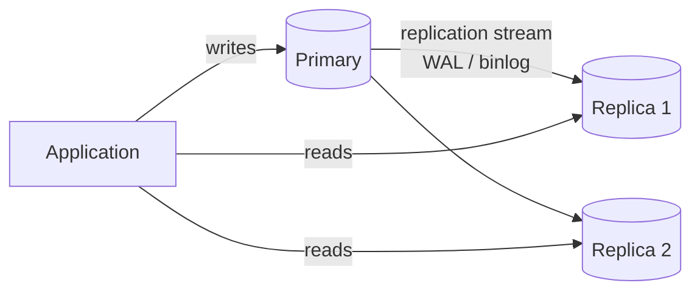
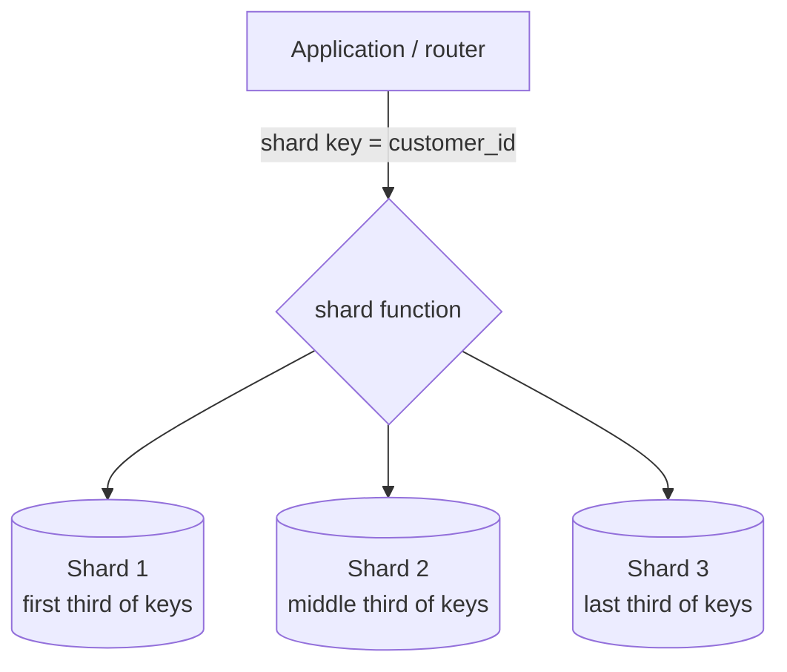

# Replication, Partitioning and Sharding

<Outcomes items={[
  "Explain replication, partitioning and sharding",
  "Handle replication lag in read paths",
  "Reason about CAP and PACELC trade-offs"
]} />

## Replication

Copy data from a **primary** (leader) to one or more **replicas** (followers).



| Mode | How | Trade-off |
| --- | --- | --- |
| **Asynchronous** | Primary commits, ships changes afterwards | Fast; replicas **lag**; a primary failure can **lose** recently committed transactions |
| **Synchronous** | Commit waits for replica acknowledgement | No loss on failover; higher write latency; availability depends on replicas |
| **Semi-synchronous / quorum** | Wait for at least N replicas | Balance (PostgreSQL `synchronous_standby_names` quorum, MySQL semi-sync, Group Replication) |

Goals: **read scalability**, **high availability** (failover), **backups and analytics** off the primary, geographic locality.

### Replication lag: the application's problem

Reads from an async replica may be stale. Common anomalies:

- **Read-your-writes**: a user posts a comment, reloads, and it is missing because the read went to a lagging replica.
- **Monotonic reads**: successive reads hit different replicas and time appears to go backwards.
- **Phantom "not found"** right after creation.

Mitigations: route a user's reads to the primary for a short time after they write (sticky by session/timestamp), pass a **log position / token** and read only from replicas that have caught up, read critical paths (payments, balances) from the primary, or accept staleness where harmless (counts, feeds). In Spring, use `AbstractRoutingDataSource` with a `@Transactional(readOnly = true)` → replica rule, remembering that `readOnly` routing alone does not solve read-your-writes.

### Failover

Promoting a replica to primary requires: failure **detection** (heartbeats, timeouts; beware false positives from network blips), **election** and fencing the old primary (STONITH, so two nodes never accept writes: **split brain**), re-pointing clients (DNS, proxy, virtual IP, driver multi-host settings), and reconfiguring remaining replicas. Use proven tooling (Patroni for PostgreSQL, managed services such as RDS/Aurora, Orchestrator for MySQL) rather than scripts. Test failover regularly; clients need sensible connection timeouts and retry logic, and transactions in flight will fail.

### Multi-primary / multi-region

Multi-leader and leaderless systems (Cassandra, DynamoDB global tables, CockroachDB, Spanner) accept writes in several places and need **conflict resolution** (last-write-wins, vector clocks, CRDTs) or consensus (Paxos/Raft) at a latency cost. Choose them for geographic write locality or extreme availability, not casually.

## Partitioning (within one database)

Split a large table into smaller physical pieces by a key; queries touching a single partition scan less data.

| Type | Example | Use |
| --- | --- | --- |
| **Range** | `placed_at` by month | Time-series, easy archival (`DROP` an old partition instantly) |
| **List** | `region IN ('EU', 'US')` | Categorical |
| **Hash** | `hash(customer_id) % 16` | Even distribution |

```sql
-- PostgreSQL declarative partitioning
CREATE TABLE events (id BIGINT, created_at TIMESTAMP NOT NULL, payload JSONB)
PARTITION BY RANGE (created_at);
CREATE TABLE events_2025_01 PARTITION OF events FOR VALUES FROM ('2025-01-01') TO ('2025-02-01');
```

Benefits: **partition pruning** (queries filtering on the partition key touch few partitions), cheap bulk deletes/archival, smaller indexes, parallelism. Costs: the partition key must be in unique/primary keys, cross-partition queries still scan everything, too many partitions slow planning, and schema changes touch all of them. Partitioning is **not** sharding: it stays on one server.

## Sharding (across servers)

Split data horizontally across **independent database nodes**; each shard holds a subset of rows.



### Choosing a shard key

The most important decision, and very hard to change. A good key has **high cardinality**, **even distribution** (avoid hot shards), and matches the **dominant access pattern** so most queries hit a single shard. `customer_id` or `tenant_id` suits many SaaS/e-commerce systems (all of a customer's data colocated, so joins and transactions stay local). Poor keys: low-cardinality (`country`), monotonically increasing (`created_at`, auto-increment with range sharding: all new writes hit one shard), or skewed (a celebrity user).

### Strategies

| Strategy | Idea | Pros | Cons |
| --- | --- | --- | --- |
| **Range** | Key ranges per shard | Range scans, simple | Hot spots with sequential keys |
| **Hash** (`hash(key) % N`) | Even spread | Uniform load | Changing `N` remaps almost all keys; no range scans |
| **Consistent hashing** | Keys and nodes on a ring; a key maps to the next node clockwise; virtual nodes smooth distribution | Adding/removing a node moves only ~1/N of keys | More complex; used by Cassandra, DynamoDB, caches |
| **Directory / lookup table** | A service maps key → shard | Flexible, easy rebalancing | Lookup is a dependency and bottleneck |

### What sharding costs you

- **Cross-shard queries and joins** become scatter-gather in the application (or a query router such as Vitess, Citus, ShardingSphere).
- **Cross-shard transactions** need sagas or two-phase commit; design so that business transactions stay within a shard.
- **Global uniqueness**: auto-increment ids collide across shards; use UUIDv7/ULID/**Snowflake** ids (timestamp + node id + sequence), or per-shard id ranges.
- **Resharding** (changing the number of shards) is a major migration: dual writes, backfill, cutover. Over-provision logical shards (for example 256 logical shards mapped onto 8 physical nodes) so you can move logical shards between nodes later without rehashing.
- Operations: schema migrations on N databases, backups, monitoring, hotspots and uneven shard sizes.

Managed distributed SQL (CockroachDB, YugabyteDB, Spanner, Aurora Limitless) and NoSQL stores shard for you; the shard-key thinking still applies.

## CAP and PACELC

**CAP**: during a **network partition**, a distributed store must choose **Consistency** (reject some requests to stay linearizable) or **Availability** (answer, possibly with stale data). Partition tolerance is not optional in distributed systems. Misreading CAP as "pick two of three at all times" is a classic error.

**PACELC** adds the normal case: if there is a **P**artition, choose **A** or **C**; **E**lse (normal operation), choose **L**atency or **C**onsistency. Replicating synchronously gives consistency at higher latency; asynchronous gives low latency and staleness.

| System | Typical position |
| --- | --- |
| Single-primary PostgreSQL with sync replica | PC/EC |
| Cassandra, DynamoDB (eventual defaults) | PA/EL (tunable per request) |
| Spanner, CockroachDB | PC/EC with TrueTime/consensus |

## Scaling reads without replicas: caching and CQRS

Often the cheaper path is a cache ([Caching](../spring/data/caching.md)) or a read model (CQRS) in a search/analytics store, keeping the transactional database small and simple.

## Decision guide

1. Is the problem **queries/indexes/N+1**? Fix those first.
2. **Read-heavy**? Cache, then read replicas (handle lag).
3. **Table too large for maintenance**? Partition by time/key.
4. **Write throughput or data volume beyond one node**? Shard, with a carefully chosen key, or use a distributed database.
5. **Availability**? Replication plus automated, tested failover; multi-region only if required.

## Check yourself

<Checkpoint questions={[
  {
    "q": "A user writes data then immediately reads from a replica and does not see it. What is this?",
    "options": [
      "Replication lag (read-your-writes violation)",
      "A deadlock",
      "A bad index",
      "A memory leak"
    ],
    "answer": 0,
    "why": "Route that user's reads to the primary for a short time or use session consistency."
  },
  {
    "q": "What decides which shard holds a row?",
    "options": [
      "The table colour",
      "The shard key",
      "The JVM",
      "The row size only"
    ],
    "answer": 1,
    "why": "A poor key creates hot shards and cross-shard queries."
  },
  {
    "q": "During a network partition, a CP system chooses...",
    "options": [
      "Availability over consistency",
      "Neither",
      "Consistency over availability",
      "Speed over durability"
    ],
    "answer": 2,
    "why": "CAP says during a partition you can keep either consistency or availability."
  }
]} />

## Common interview questions

**1. Replication vs sharding vs partitioning?**
Replication copies the same data to several nodes (availability, read scale); partitioning splits a table within one server; sharding splits data across servers (write/volume scale).

**2. What problems does asynchronous replication cause?**
Stale reads (lag), read-your-writes violations, and possible data loss on failover; mitigate with sticky reads, token-based reads, or synchronous replication where required.

**3. How do you choose a shard key?**
High cardinality, even load, and aligned with the main query pattern so most operations touch one shard; avoid monotonic or skewed keys.

**4. Why consistent hashing?**
Adding or removing nodes remaps only a fraction of keys, unlike `hash % N`, which reshuffles nearly everything; virtual nodes even out the load.

**5. How do you generate unique ids across shards?**
Snowflake-style ids (timestamp, worker id, sequence), UUIDv7/ULID, or dedicated id services; avoid per-shard auto-increment without ranges.

**6. State the CAP theorem correctly.**
Under a network partition a distributed system must trade off consistency against availability; when there is no partition both can be provided (PACELC then trades latency against consistency).

**7. What is split brain and how is it prevented?**
Two nodes both believing they are primary and accepting writes; prevent with quorum-based election, fencing and a single source of truth for leadership.

**8. How would you shard an order system?**
By `customer_id` (or `tenant_id`) so a customer's orders and items colocate, using many logical shards mapped to a few physical nodes, UUIDv7 ids, and sagas for cross-customer or cross-service operations.

**9. When would you not shard?**
When vertical scaling, indexing, caching and replicas suffice; sharding is irreversible-ish complexity.

## Pitfalls

- Sharding too early, or on a poor key.
- Sending reads needing freshness to lagging replicas.
- Failover scripts untested and without fencing.
- Assuming partitioning gives horizontal write scalability.
- Cross-shard joins in hot paths.
- `hash % N` with no plan for adding nodes.

## Key takeaways

- Climb the ladder: optimise → cache → replicas → partitions → shards.
- Replication brings lag and failover concerns; design reads accordingly.
- The shard key decides everything; keep transactions inside a shard.
- Understand CAP/PACELC as trade-offs under partition and in normal operation.
