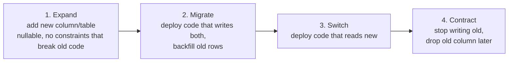

# Schema Migrations and Zero-Downtime Changes

<Outcomes items={[
  "Manage schema changes with versioned migrations",
  "Make changes backward compatible (expand and contract)",
  "Backfill and test migrations safely"
]} />

## Migrations as code

Treat the schema like source code: **versioned, reviewed, repeatable, applied by automation**, never by hand in production. Never use Hibernate `ddl-auto=update/create` outside local prototypes.

### Flyway

SQL files named `V<version>__<description>.sql` run **once, in order**, and are recorded (with a checksum) in a history table.

```text
src/main/resources/db/migration/
  V1__create_orders.sql
  V2__add_orders_status_index.sql
  R__refresh_reporting_view.sql      -- repeatable: re-applied when its checksum changes
```

```sql
-- V2__add_orders_status_index.sql
CREATE INDEX idx_orders_status ON purchase_orders (status);
```

Spring Boot runs Flyway on startup when `flyway-core` (plus the database module) is on the classpath. Key rules:

- **Never edit an applied migration**: the checksum mismatch fails startup. Add a new migration to fix forward.
- Keep migrations small and idempotent in intent; one concern per file.
- Use `baseline-on-migrate` to adopt an existing database.
- Flyway runs inside a transaction where the database supports transactional DDL (PostgreSQL yes; MySQL commits DDL implicitly, so a half-applied migration leaves a partial state; write them carefully).

### Liquibase

Changelog files (XML/YAML/SQL) of **changesets** identified by `id + author + file`; supports rollbacks, preconditions, contexts/labels per environment, and diffing. More features, more ceremony. Pick one tool per service and standardise.

### Where to run migrations

| Approach | Notes |
| --- | --- |
| On application startup (Flyway auto-run) | Simple; with several instances the tool takes a lock so one runs it; a failed migration blocks startup; slow migrations delay readiness |
| **Separate step in the pipeline / Kubernetes Job (init container)** | Preferred for larger systems: migrate once, then roll out the app; permissions can differ (the app user needs no DDL rights) |

## The core problem: old and new code run together

In a rolling or blue/green deployment, version N and N+1 of the application run **at the same time** against **one** schema, and rollbacks must remain possible. Therefore every migration must be **backwards compatible with the previous application version**. Breaking changes are split across several deployments: **expand and contract** (parallel change).



### Example: rename `customer_name` to `full_name`

A direct `ALTER TABLE ... RENAME COLUMN` breaks the running old version instantly. Instead:

1. **Release 1 (expand)**: migration adds nullable `full_name`. App v2 writes **both** columns and reads `customer_name` (or falls back).
2. **Backfill** `full_name` from `customer_name` in batches (below).
3. **Release 2**: app reads `full_name` only, still writes both (so v1 rollback stays safe).
4. **Release 3 (contract)**: stop writing `customer_name`; later migration drops it (once no running version needs it, and after a safety period).

It takes three deployments, which is the price of zero downtime; teams that skip steps incur outages.

## Risky operations and safer versions

| Operation | Risk | Safer approach |
| --- | --- | --- |
| `ADD COLUMN ... NOT NULL` without default | Fails on existing rows; old code inserting without the column fails | Add nullable, backfill, then add `NOT NULL` (in PostgreSQL 11+ `ADD COLUMN ... DEFAULT <constant>` is a fast metadata-only change) |
| `ADD COLUMN` with volatile default on a huge table (older versions) | Rewrites the whole table under a lock | Add nullable; backfill in batches; set the default afterwards |
| `CREATE INDEX` on a big table | Blocks writes (MySQL older versions, PostgreSQL default) | `CREATE INDEX CONCURRENTLY` (PostgreSQL; cannot run inside a transaction: use Flyway `executeInTransaction=false`), `ALGORITHM=INPLACE, LOCK=NONE` / online DDL (MySQL) |
| Adding a foreign key / `CHECK` / `NOT NULL` to a populated table | Full validation scan with a heavy lock | PostgreSQL: `ADD CONSTRAINT ... NOT VALID` then `VALIDATE CONSTRAINT` (lighter lock) |
| Changing a column type | Table rewrite | Add a new column, dual-write, backfill, switch, drop |
| Dropping a column/table | Old code still references it | Contract phase only, after code no longer uses it |
| Renaming a column/table | Breaks old code | Expand and contract; or an updatable view/synonym |
| Large `UPDATE`/`DELETE` | Long transaction, lock waits, replication lag, bloat | Batches by primary key ranges |

Always set **`lock_timeout`** (and `statement_timeout`) for DDL in PostgreSQL so a migration that cannot get its lock fails fast instead of queuing behind a long transaction and blocking every query behind it:

```sql
SET lock_timeout = '3s';
ALTER TABLE purchase_orders ADD COLUMN note VARCHAR(200);
```

(DDL waiting for a lock blocks later queries on that table, which can cause an outage from a "tiny" change.)

## Backfilling data safely

```sql
-- Repeat in a loop (from application code or a script) until 0 rows updated
UPDATE purchase_orders
SET full_name = customer_name
WHERE id IN (
    SELECT id FROM purchase_orders
    WHERE full_name IS NULL
    ORDER BY id
    LIMIT 5000
    FOR UPDATE SKIP LOCKED
);
```

- Small batches (a few thousand rows), commit each, sleep briefly to limit load and replication lag.
- Make the job **idempotent and resumable**; monitor progress and impact.
- Run as a separate job/migration, not inside the schema change transaction.
- For enormous tables, use online schema change tools (`gh-ost`, `pt-online-schema-change` for MySQL; `pg_repack`, logical replication-based approaches for PostgreSQL).

## Testing and safety

- Run migrations against a **production-sized copy** or at least realistic data to see durations and locks.
- Test with Testcontainers in CI: start the real database, apply all migrations from scratch, then run integration tests (see [Testcontainers](../spring/boot/testing-slices-testcontainers.md)). Also test **upgrade from the previous release's schema**.
- Review migrations like code: lock level, duration, rollback plan.
- Keep a **forward-only** mindset: down-migrations for destructive changes rarely restore data. Rollback by deploying the previous app version (which works because of backward compatibility) and fixing forward.
- Back up before risky migrations, and be able to restore.

## Reference data and seed data

Static reference data (countries, roles) belongs in versioned migrations (or repeatable migrations); test data does not: load it from test fixtures or the `dev` profile only.

## Microservices: each service owns its schema

Every service has its own database and migrations, deployed with that service ([database per service](../microservices/overview.md)). Cross-service schema coupling is forbidden, so migrations are independent; communicate changes via APIs and events with compatible contracts.

## Check yourself

<Checkpoint questions={[
  {
    "q": "Old and new application versions run at the same time during a rollout. How should you rename a column?",
    "options": [
      "Expand and contract: add the new column, migrate, then drop the old one later",
      "Rename it in one step",
      "Drop the table and recreate",
      "Stop the world for an hour"
    ],
    "answer": 0,
    "why": "Each step must work with both code versions."
  },
  {
    "q": "Why should you never edit an applied migration?",
    "options": [
      "It deletes data",
      "The tool records a checksum, and environments would diverge",
      "Git forbids it",
      "It corrupts the jar"
    ],
    "answer": 1,
    "why": "Add a new migration instead."
  },
  {
    "q": "What is a safe way to backfill a large table?",
    "options": [
      "One UPDATE of all rows in one transaction",
      "By dropping indexes and hoping",
      "In small batches with pauses, outside one giant transaction",
      "During peak traffic"
    ],
    "answer": 2,
    "why": "Batching limits locks, replication lag and WAL growth."
  }
]} />

## Common interview questions

**1. How do you manage database schema changes in a Spring Boot application?**
Versioned migrations with Flyway or Liquibase, run automatically on startup or as a pipeline step, never `ddl-auto=update` in production; history table tracks applied changes.

**2. What is the expand and contract pattern?**
Make changes in compatible steps: add new structures (expand), dual-write and backfill, switch reads, then remove old structures (contract), so old and new application versions work against the same schema during a rolling deploy.

**3. How do you rename a column with zero downtime?**
Add the new column, write both, backfill, move reads to the new column, stop writing the old one, then drop it in a later release.

**4. Why can adding an index or constraint cause an outage?**
It may take locks that block writes (or wait behind a long transaction, queueing all other queries). Use concurrent/online index creation, `NOT VALID` constraints, lock timeouts and run during low traffic.

**5. What do you do if a migration fails halfway?**
In transactional-DDL databases it rolls back; elsewhere you repair manually. Prevent with small migrations, tests on realistic data and staging rehearsals; fix forward with a new migration.

**6. Can you edit a migration that has already run?**
No. The checksum differs and Flyway refuses to start; add a new migration. (Only edit migrations that have never left your branch.)

**7. How do you backfill a huge table?**
In small idempotent batches with commits, throttled, ideally by key ranges or `SKIP LOCKED`, outside the DDL transaction, monitoring lag.

**8. Where should migrations run in a multi-instance deployment?**
Preferably as a single pipeline/init job before rolling out the app; auto-run on startup works for small systems because the tool locks the history table.

## Pitfalls

- Editing applied migrations.
- Combining schema change and data backfill in one big transaction.
- Dropping or renaming columns in the same release that stops using them.
- DDL without `lock_timeout`, queueing behind long transactions.
- Relying on down-migrations as the rollback plan.
- Migrations tested only on empty databases.
- Hibernate auto-DDL in production.

## Key takeaways

- Versioned, automated, reviewed migrations; forward-only mindset.
- Backwards-compatible changes via expand and contract across releases.
- Know which DDL locks, and use online/concurrent variants with timeouts.
- Backfill in throttled batches; rehearse on realistic data.
