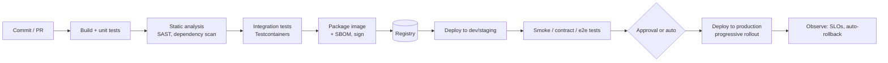
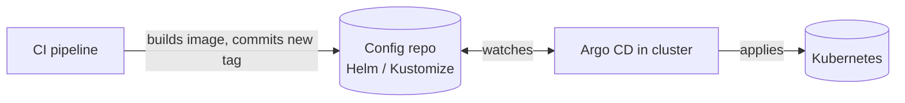

# CI/CD for Java Microservices

<Outcomes items={[
  "Lay out the stages of a good pipeline",
  "Layer tests for fast feedback",
  "Explain GitOps and DORA metrics"
]} />

## What a good pipeline does



### Principles

1. **Build once, deploy the same artifact everywhere.** The image tested in staging is byte-for-byte what runs in production; only configuration differs ([twelve-factor](twelve-factor.md)). Never rebuild per environment.
2. **Immutable, traceable versions.** Tag images with the git SHA (and a semantic version for releases), never `latest`. Every running version maps to a commit, build and SBOM.
3. **Fast feedback.** PR checks in minutes: run the quick tests first, parallelise, cache dependencies. A 40-minute pipeline gets bypassed.
4. **Trunk-based development**: short-lived branches (hours to a couple of days), merge to main often, hide incomplete work behind **feature flags** instead of long branches. Long-lived branches create merge pain and big-bang releases.
5. **Pipeline as code**: versioned with the application (GitHub Actions, GitLab CI, Jenkinsfile, Tekton).
6. **The pipeline is the only path to production.** No manual `kubectl` or hand-built artifacts; access is audited.
7. **Keep main green.** A broken main blocks everyone: fix or revert quickly.

## Test layers in CI

| Stage | What | Speed |
| --- | --- | --- |
| Unit tests | Plain JUnit/Mockito, no Spring ([testing basics](../spring/boot/testing-basics.md)) | Seconds |
| Slice tests | `@WebMvcTest`, `@DataJpaTest` | Seconds to a minute |
| Integration tests | Real dependencies via Testcontainers ([details](../spring/boot/testing-slices-testcontainers.md)) | Minutes |
| **Contract tests** | Consumer-driven contracts (Pact, Spring Cloud Contract) verify service APIs without a shared environment | Fast |
| End-to-end / smoke | A few critical journeys against a deployed environment | Slow: keep few |
| Non-functional | Load tests, security scans (DAST), resilience tests: nightly or pre-release | Slow |

Fix flaky tests promptly (quarantine, then repair): a pipeline people ignore is worse than none.

## Quality and security gates

- **Static analysis**: SonarQube, SpotBugs + Find Security Bugs, CodeQL; coverage gates on **new code**, not just overall numbers.
- **Dependency scanning (SCA)**: OWASP Dependency-Check, Dependabot/Renovate, Snyk; fail on critical CVEs; generate an **SBOM** (CycloneDX/SPDX).
- **Container scanning**: Trivy/Grype on the built image.
- **Secret scanning**: gitleaks/GitHub secret scanning on every push.
- **Image signing and provenance**: cosign, SLSA attestations; verify in the cluster (admission policy).
- **Infrastructure as code checks**: tfsec/Checkov, policy-as-code (OPA/Kyverno).
- Make gates **actionable**: block on severe, new issues; report the rest. See [common vulnerabilities](../spring/security/common-vulnerabilities.md).

## Example: GitHub Actions for a Spring Boot service

```yaml
name: ci
on:
  pull_request:
  push:
    branches: [main]

jobs:
  build:
    runs-on: ubuntu-latest
    permissions: { contents: read, packages: write, id-token: write }
    steps:
      - uses: actions/checkout@v4
      - uses: actions/setup-java@v4
        with: { distribution: temurin, java-version: 21, cache: maven }
      - name: Build and test
        run: mvn -B verify                         # unit + integration tests (Testcontainers needs Docker: available on ubuntu runners)
      - name: Dependency vulnerability scan
        run: mvn -B org.owasp:dependency-check-maven:check -DfailBuildOnCVSS=9
      - name: Build image (Jib, no Docker daemon needed)
        if: github.ref == 'refs/heads/main'
        run: >
          mvn -B -DskipTests compile jib:build
          -Djib.to.image=ghcr.io/${{ github.repository }}:${{ github.sha }}
          -Djib.to.auth.username=${{ github.actor }} -Djib.to.auth.password=${{ secrets.GITHUB_TOKEN }}
      - name: Scan image
        if: github.ref == 'refs/heads/main'
        uses: aquasecurity/trivy-action@0.28.0
        with: { image-ref: "ghcr.io/${{ github.repository }}:${{ github.sha }}", severity: "CRITICAL,HIGH", exit-code: "1" }
```

Pin third-party actions by commit SHA in sensitive pipelines, grant the **least privilege** `permissions`, and prefer short-lived **OIDC federation** to cloud providers over stored long-lived keys. The workflow that deploys this documentation site (`.github/workflows/deploy.yml`) follows the same pattern: checkout, setup, `npm ci`, build, deploy.

## Versioning and artifacts

- **Semantic versioning** for libraries (MAJOR.MINOR.PATCH); services are usually identified by **git SHA** and a build number.
- Store artifacts in a registry (Nexus/Artifactory/GHCR/ECR), with retention rules; never deploy from a developer machine.
- Maven: use the release plugin sparingly; many teams use CI-friendly versions (`${revision}`) and tag releases from the pipeline.
- Keep libraries' API stable; breaking changes need a major version and migration notes. Avoid shared "common" libraries that force lock-step upgrades across services.

## Deployment: push vs GitOps

**Push-based CD**: the pipeline runs `kubectl apply`/Helm against the cluster, which requires cluster credentials in CI.

**GitOps (pull-based)**: the desired state of each environment lives in a Git repository; an in-cluster agent (**Argo CD**, **Flux**) continuously reconciles the cluster to match.



Benefits: Git is the audit log and rollback tool (`git revert`), no cluster credentials in CI, drift detection and self-healing, uniform multi-cluster management. The application repository builds and publishes images; a separate **environment repository** (or folders per environment) records which version runs where; promotion is a pull request moving a version between environments.

Use **Helm** (templated charts) or **Kustomize** (overlays) to avoid copy-pasted YAML; keep values per environment small and reviewed.

## Environments and promotion

- Minimum: **dev → staging (production-like) → production**. Keep staging as close to production as is affordable (same images, same infrastructure types, realistic data volume) or tests lie.
- **Ephemeral preview environments** per pull request catch integration problems early.
- Database changes ride the same pipeline ([schema migrations](../databases/schema-migrations.md)), backwards compatible.
- Promote with automated checks; require manual approval only where regulation demands it.
- Configuration and secrets per environment come from the platform, not the build.

## Secrets in pipelines

- Use the CI platform's secret store or a vault integration; never print secrets, and mask them in logs.
- Prefer **short-lived credentials** (OIDC to cloud IAM, Vault dynamic secrets).
- Separate build credentials from deploy credentials; protected branches and environments with required reviewers for production.
- Treat the pipeline as a high-value target (supply-chain attacks): pin dependencies/actions, review pipeline changes, restrict who can modify workflows, isolate runners.

## Measuring delivery: DORA metrics

| Metric | Elite benchmark | Meaning |
| --- | --- | --- |
| **Deployment frequency** | On demand, many per day | How often you ship |
| **Lead time for changes** | < 1 day | Commit to production |
| **Change failure rate** | 0-15% | Share of deployments causing incidents/rollbacks |
| **Time to restore service** | < 1 hour | Recovery speed |

They measure the system, not individuals; improving them usually means smaller batches, better tests, trunk-based development, feature flags and fast rollback.

## Monorepo vs polyrepo for microservices

| | Monorepo | Polyrepo |
| --- | --- | --- |
| Pros | Atomic cross-service changes, shared tooling, easy refactoring | Clear ownership, independent pipelines and permissions, simple per-service history |
| Cons | Needs smart builds (only changed modules: Bazel/Nx/Gradle/`mvn -pl -amd`), scaling tooling | Cross-repo changes are painful; duplicated pipeline config (use shared templates) |

Either works; what matters is that each service can still **build, test and deploy independently** and pipelines only run what changed.

## Check yourself

<Checkpoint questions={[
  {
    "q": "What does \"build once, promote\" mean?",
    "options": [
      "The same artifact moves through environments rather than being rebuilt",
      "Rebuild per environment",
      "Build only on Fridays",
      "Build in production"
    ],
    "answer": 0,
    "why": "Rebuilding can produce different artifacts. Promotion keeps what you tested."
  },
  {
    "q": "Which tests should run first in CI?",
    "options": [
      "End-to-end only",
      "Fast unit tests, then slower integration and end-to-end tests",
      "Manual tests",
      "Load tests first"
    ],
    "answer": 1,
    "why": "Fast feedback keeps developers using the pipeline."
  },
  {
    "q": "Which is one of the four DORA metrics?",
    "options": [
      "Lines of code",
      "Number of tickets",
      "Deployment frequency",
      "Test count"
    ],
    "answer": 2,
    "why": "The others are lead time, change failure rate and time to restore."
  }
]} />

## Common interview questions

**1. CI vs continuous delivery vs continuous deployment?**
CI merges and tests frequently; continuous delivery keeps every build releasable with a manual release decision; continuous deployment releases every passing change automatically.

**2. What does "build once, deploy many" mean and why?**
Create one immutable artifact and promote it unchanged through environments, injecting configuration at runtime, so what you tested is what you run.

**3. How do you speed up a slow pipeline?**
Dependency and layer caching, parallel stages, running only affected modules, test selection, faster tests (fewer `@SpringBootTest`), and moving slow suites to nightly runs.

**4. What is GitOps?**
Declaring environment state in Git and having an in-cluster controller (Argo CD/Flux) reconcile the cluster to it, giving audit, easy rollback and no cluster credentials in CI.

**5. How do you secure the supply chain?**
Pinned dependencies and actions, SCA and image scanning, SBOMs, signed images/provenance verified at admission, least-privilege short-lived credentials and protected pipelines.

**6. How do you handle database changes in the pipeline?**
Versioned, backwards-compatible migrations (expand/contract) executed as a pipeline step before or with the rollout, tested against a real database.

**7. How do you roll back?**
Redeploy the previous immutable image (or `git revert` in GitOps), with backward-compatible schema; use feature flags to disable features without redeploying.

**8. What makes a good CI test suite?**
Fast, deterministic, layered (many unit tests, fewer integration tests, few e2e), isolated from shared state, and quickly fixed when flaky.

**9. What are DORA metrics?**
Deployment frequency, lead time for changes, change failure rate and time to restore: indicators of delivery performance.

## Pitfalls

- Rebuilding artifacts per environment, or deploying `latest`.
- Long-lived feature branches and big-bang merges.
- Flaky tests tolerated or retried blindly.
- Manual production hotfixes outside the pipeline.
- Secrets in repository variables printed to logs; broad CI credentials.
- Staging unlike production, so passing there means little.
- Shared libraries creating lock-step releases.

## Key takeaways

- One immutable, signed artifact flows through every environment.
- Fast layered tests plus automated security gates keep main releasable.
- GitOps gives auditability and simple rollback.
- Trunk-based development + feature flags + small changes drive better DORA metrics.

Next: [Twelve-factor apps](twelve-factor.md).
