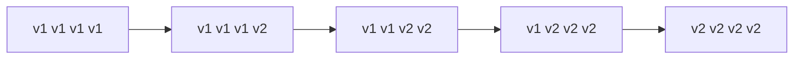
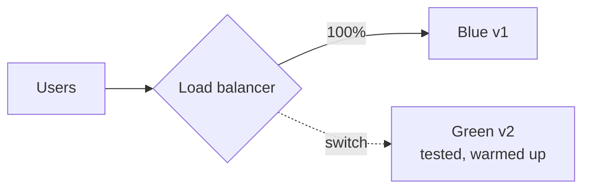
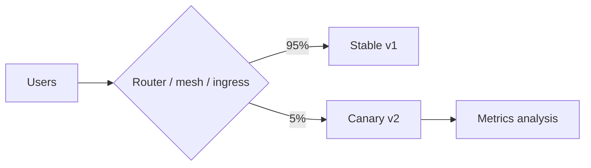

# Deployment Strategies

Every release carries risk. Strategies differ in **how much traffic hits new code, how fast you can undo it, and what it costs** in infrastructure and complexity. The strategy you pick is also constrained by your **database and message contracts**, because old and new versions often run simultaneously.

<Outcomes items={[
  "Compare rolling, blue-green and canary releases",
  "Use feature flags to separate deploy from release",
  "Keep schema and API changes backward compatible"
]} />

## The strategies

### Recreate

Stop all old instances, then start the new version. **Downtime** between versions, simplest, fine for non-critical systems, batch jobs or incompatible-version situations (a breaking schema change with no compatible path).

### Rolling update

Replace instances **gradually**: start a new Pod, wait until ready, stop an old Pod, repeat. Kubernetes' default.



- **Pros**: no extra full environment, zero downtime if readiness and graceful shutdown are right, built into Deployments (`maxSurge`, `maxUnavailable`).
- **Cons**: **v1 and v2 serve traffic at the same time**, so APIs, messages and the database schema must be compatible with both; rollback is another rolling update (minutes); no precise traffic control; a bug reaches users gradually but unobserved unless you monitor.

### Blue-green

Run two full environments: **blue** (live) and **green** (new). Deploy and test green, then **switch all traffic** at once (load balancer, DNS, Service selector, ingress). Keep blue for instant rollback.



- **Pros**: instant, simple rollback (flip back); the new version is fully tested and **warmed** before taking traffic; no mixed versions serving a single request flow.
- **Cons**: double the capacity during the switch; **stateful parts** (database) are shared, so schema compatibility still matters; long-lived connections and in-flight work need draining; all-or-nothing exposure of users to the new version.

### Canary

Release to a **small percentage** of traffic (1%, then 5%, 25%, 50%, 100%) while comparing the new version's **metrics** (error rate, latency, business KPIs) against the baseline. Promote automatically if healthy, roll back if not.



- **Pros**: limits the **blast radius**; real production validation; data-driven promotion.
- **Cons**: needs traffic-splitting infrastructure (service mesh, ingress with weights, Argo Rollouts/Flagger), good metrics and enough traffic for statistical confidence; mixed versions again; stateful side effects of canary users are real.

Options for selecting canary users: random percentage, by header/cookie, by tenant, internal users first (**dogfooding**), by region.

### Shadow (traffic mirroring)

Copy production requests to the new version and **discard its responses**. Tests performance and correctness under real load with **no user impact**. Must avoid duplicating side effects (payments, emails): stub or isolate writes.

### A/B testing

Like canary, but the goal is **measuring user behaviour** between variants (product experiments), not safety. Usually implemented with feature flags.

## Comparison

| | Recreate | Rolling | Blue-green | Canary |
| --- | --- | --- | --- | --- |
| Downtime | Yes | No | No | No |
| Extra capacity | None | Small (surge) | Full duplicate | Small |
| Rollback speed | Redeploy | Minutes | Instant | Fast (shift traffic back) |
| Blast radius | Everyone | Gradual, uncontrolled | Everyone at switch | Controlled small % |
| Mixed versions | No | Yes | Briefly | Yes |
| Complexity | Lowest | Low | Medium | Highest |

Common practice: **rolling by default**, **canary** for high-risk or high-traffic services, **blue-green** where instant rollback and warm-up matter or the platform lacks fine routing.

## Feature flags: decouple deploy from release

A **deployment** puts code on servers; a **release** exposes it to users. Feature flags (OpenFeature, Unleash, LaunchDarkly, simple config) let you ship code **dark** and turn it on gradually, for specific users or tenants, with an instant **kill switch** that needs no redeploy.

```java
if (flags.isEnabled("new-checkout", user)) {
    return newCheckout.process(cart);
}
return legacyCheckout.process(cart);
```

Discipline: name and own every flag, keep a removal date, **clean up** old flags (they multiply code paths and tests), default to "off" safely if the flag service is down, and never use flags for permanent configuration. Flags enable **trunk-based development**: merge incomplete work behind a flag ([CI/CD](ci-cd.md)).

## Compatibility is the real constraint

With rolling and canary releases, **two versions run together**, and rollbacks put the old version back against whatever the new version wrote.

- **Database**: expand and contract migrations; the new schema must work with the old code and vice versa ([schema migrations](../databases/schema-migrations.md)). Deploy additive migrations before code; remove old structures only after all code stopped using them.
- **APIs**: additive changes, tolerant readers, version when breaking; callers may be old for a long time ([service communication](../microservices/communication/service-communication.md)).
- **Messages and events**: schema evolution with compatibility rules; consumers must tolerate new fields and old messages already in topics/queues ([Kafka design](../messaging/kafka-ordering-design.md)).
- **Caches and sessions**: serialised object formats differ between versions; version cache keys or use tolerant formats.
- **Config**: new config keys must have defaults so the old version is unaffected.
- **Jobs and consumers**: a long-running job started by v1 may finish under v2; make steps idempotent.

## Making rollouts safe in Kubernetes

Checklist for a rolling update without dropped requests ([details](kubernetes-basics.md)):

1. **Readiness probe** is accurate (the Pod only gets traffic when truly ready); **startup probe** for slow JVMs.
2. `maxUnavailable: 0`, `maxSurge: 1` (or a percentage) so capacity never dips.
3. **Graceful shutdown**: `server.shutdown=graceful`, a `preStop` sleep to let endpoint removal propagate, and a `terminationGracePeriodSeconds` longer than both.
4. **PodDisruptionBudget** and enough replicas to absorb the rollout.
5. Connection draining at load balancers; keep-alive handling for gateways.
6. Warm-up: JIT and caches are cold on new Pods ([JVM warm-up](../java/concurrency-jvm/jvm-tuning-diagnostics.md)); consider a slower rollout, a warm-up endpoint, or lower initial traffic weight.
7. `minReadySeconds` so a Pod must stay healthy for a while before counting as available.

## Progressive delivery with automated analysis

Tools like **Argo Rollouts** and **Flagger** automate canary/blue-green with **analysis**:

```yaml
apiVersion: argoproj.io/v1alpha1
kind: Rollout
metadata: { name: orders }
spec:
  replicas: 5
  strategy:
    canary:
      steps:
        - setWeight: 5
        - pause: { duration: 5m }
        - analysis: { templates: [ { templateName: error-rate-and-latency } ] }   # queries Prometheus
        - setWeight: 25
        - pause: { duration: 10m }
        - setWeight: 50
        - pause: { duration: 10m }
  # selector / template as in a Deployment
```

The analysis template queries metrics (HTTP 5xx ratio, p99 latency, business KPIs such as checkout success) and **fails the rollout automatically** on regression, returning to the stable version. Define **SLO-based guardrails** before the release, not during the incident ([Observability](../microservices/observability/observability.md)).

(The manifest above illustrates the structure; adapt it to your Argo Rollouts version, and I have not applied it to a cluster here.)

## Rollback

- Prefer **fast, automated, rehearsed** rollback: redeploy the previous immutable image or flip traffic (blue-green), revert the Git commit in GitOps, or turn off the feature flag (fastest).
- **Roll forward** is sometimes better (a small fix) but only if the pipeline is fast and safe.
- Rolling back **code** is easy; rolling back **data changes** is not. Backward-compatible migrations make code rollback safe; destructive migrations make it impossible. Keep a verified restore path for data.
- Define rollback triggers up front (error budget burn, p99 latency, failed health checks) and who can pull the lever.

## Releasing safely: process habits

- Small, frequent releases: smaller change = smaller risk and easier diagnosis.
- Deploy outside peak hours for risky changes, but aim for confidence to deploy any time.
- Observe after each release: dashboards and alerts watched for a defined window.
- Post-incident reviews feed back into tests, flags and checks.
- **Chaos and game days** validate resilience and rollback procedures.

## Check yourself

<Checkpoint questions={[
  {
    "q": "Which strategy sends a small share of traffic to the new version first?",
    "options": [
      "Canary",
      "Blue-green",
      "Recreate",
      "Big bang"
    ],
    "answer": 0,
    "why": "Metrics decide whether to widen or roll back."
  },
  {
    "q": "What is the real constraint during a rolling update?",
    "options": [
      "CPU speed",
      "Old and new versions run side by side, so changes must be compatible",
      "Image size",
      "Git branch names"
    ],
    "answer": 1,
    "why": "Schema, API and event formats must work with both versions."
  },
  {
    "q": "What do feature flags allow?",
    "options": [
      "Skipping tests",
      "Avoiding databases",
      "Shipping code switched off and enabling it later without a deploy",
      "Faster compilation"
    ],
    "answer": 2,
    "why": "They decouple deployment from release."
  }
]} />

## Common interview questions

**1. Rolling vs blue-green vs canary?**
Rolling replaces instances gradually (no extra environment, mixed versions, slower rollback); blue-green switches between two full environments (instant rollback, double capacity); canary exposes a small share of traffic first with metric-based promotion (smallest blast radius, most tooling).

**2. How do you achieve zero-downtime deployment of a Spring Boot service on Kubernetes?**
Accurate readiness/startup probes, `maxUnavailable: 0`, graceful shutdown (`server.shutdown=graceful`), a `preStop` delay and adequate grace period, PodDisruptionBudgets, and backward-compatible database/API changes.

**3. How do you handle a database schema change in a rolling deployment?**
Expand and contract: additive, backward-compatible migrations first, code that works with both schemas, then remove old structures in a later release.

**4. What are feature flags for, and what are the risks?**
They separate deployment from release, enabling gradual rollout and instant kill switches; risks are flag debt, untested combinations and dependency on the flag service.

**5. What is a canary analysis and what would you measure?**
Automated comparison of the canary against the baseline on error rate, latency percentiles, saturation and business metrics, promoting or rolling back automatically.

**6. How do you roll back safely?**
Redeploy the previous immutable version or switch traffic back, rely on backward-compatible data changes, and use flags for instant disablement; rehearse it.

**7. When would you choose blue-green over canary?**
When you need instant rollback and a fully warmed, tested environment, lack fine-grained traffic splitting or metrics, or the change cannot tolerate mixed versions; accept the double infrastructure.

**8. What is shadow traffic useful for?**
Validating performance and behaviour of a new version under real load without affecting users, as long as side effects are isolated.

## Pitfalls

- Assuming rolling updates are safe without compatible schemas/APIs.
- Readiness probes that report ready too early (traffic hits cold or broken Pods).
- No graceful shutdown: dropped requests on every deploy.
- Canaries without good metrics or traffic volume.
- Feature flags never cleaned up.
- Destructive migrations bundled with the code release.
- Untested rollback procedures.

## Key takeaways

- Strategy = blast radius vs speed of rollback vs cost; rolling is the default, canary and blue-green add safety.
- Compatibility of schema, APIs and messages is the true prerequisite for zero downtime.
- Decouple deploy from release with feature flags; automate analysis and rollback.
- Make rollback fast, rehearsed and independent of risky data changes.
