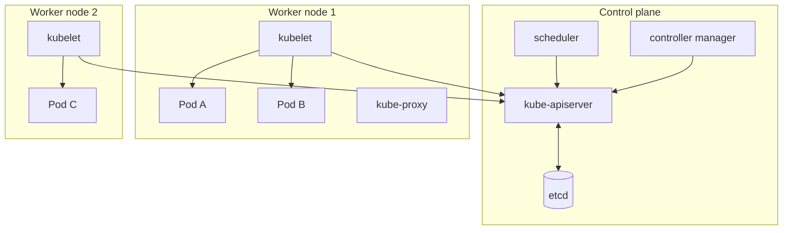

# Kubernetes Basics for Java Developers

<Outcomes items={[
  "Describe Pods, Deployments, Services and probes",
  "Size requests and limits for JVM workloads",
  "Debug CrashLoopBackOff and OOMKilled"
]} />

## Architecture in one picture



- **API server**: the front door; everything (`kubectl`, controllers, kubelets) talks to it.
- **etcd**: consistent key-value store holding cluster state.
- **Scheduler**: places Pods on nodes based on requests, affinity, taints.
- **Controllers**: reconcile loops (Deployment, ReplicaSet, Node, Job...).
- **kubelet**: node agent that runs the containers and reports status. **kube-proxy** programs Service routing.

## Core objects

| Object | Purpose |
| --- | --- |
| **Pod** | Smallest unit: one or more containers sharing network and storage. Ephemeral: never rely on a Pod's IP or lifetime |
| **ReplicaSet** | Keeps N identical Pods running |
| **Deployment** | Declarative updates for stateless apps: manages ReplicaSets, rolling updates and rollbacks |
| **Service** | Stable virtual IP and DNS name load-balancing across matching Pods (`ClusterIP`, `NodePort`, `LoadBalancer`, headless) |
| **Ingress / Gateway API** | HTTP(S) routing from outside the cluster to Services (host/path rules, TLS) |
| **ConfigMap / Secret** | Configuration and sensitive data injected as environment variables or files |
| **Namespace** | Logical isolation for teams/environments, quotas and policies |
| **StatefulSet** | Stable identity and storage for stateful workloads (databases, Kafka brokers) |
| **Job / CronJob** | Run-to-completion and scheduled work (migrations, batch) |
| **HPA** | Horizontal Pod Autoscaler: scales replicas by CPU/memory/custom metrics |
| **PodDisruptionBudget** | Limits voluntary disruptions (node drains) to preserve availability |

Because Pods come and go, clients talk to a **Service**, which selects Pods by **labels**. This is Kubernetes' built-in [service discovery](../microservices/infrastructure/service-discovery.md): `http://inventory-service` resolves through cluster DNS.

## A production-shaped Spring Boot Deployment

```yaml
apiVersion: apps/v1
kind: Deployment
metadata:
  name: orders
  labels: { app: orders }
spec:
  replicas: 3
  strategy:
    type: RollingUpdate
    rollingUpdate: { maxSurge: 1, maxUnavailable: 0 }       # never reduce capacity during a rollout
  selector:
    matchLabels: { app: orders }
  template:
    metadata:
      labels: { app: orders }
    spec:
      terminationGracePeriodSeconds: 45
      securityContext: { runAsNonRoot: true, runAsUser: 1000 }
      containers:
        - name: orders
          image: registry.example.com/shop/orders:1.4.2        # immutable tag, never :latest
          ports: [ { containerPort: 8080 } ]
          env:
            - name: SPRING_PROFILES_ACTIVE
              value: prod
            - name: SPRING_DATASOURCE_PASSWORD
              valueFrom: { secretKeyRef: { name: orders-db, key: password } }
          envFrom:
            - configMapRef: { name: orders-config }
          resources:
            requests: { cpu: 500m, memory: 768Mi }
            limits:   { memory: 768Mi }                         # memory request = limit; no CPU limit (see below)
          readinessProbe:
            httpGet: { path: /actuator/health/readiness, port: 8080 }
            periodSeconds: 5
            failureThreshold: 3
          livenessProbe:
            httpGet: { path: /actuator/health/liveness, port: 8080 }
            periodSeconds: 10
            failureThreshold: 3
          startupProbe:
            httpGet: { path: /actuator/health/liveness, port: 8080 }
            periodSeconds: 5
            failureThreshold: 30                                 # up to 150 s to start before liveness takes over
          lifecycle:
            preStop:
              exec: { command: ["sh", "-c", "sleep 10"] }       # let endpoint removal propagate before SIGTERM handling
---
apiVersion: v1
kind: Service
metadata: { name: orders }
spec:
  selector: { app: orders }
  ports: [ { port: 80, targetPort: 8080 } ]
---
apiVersion: policy/v1
kind: PodDisruptionBudget
metadata: { name: orders }
spec:
  minAvailable: 2
  selector: { matchLabels: { app: orders } }
```

(These manifests illustrate the fields and conventions; I did not apply them to a cluster here, so validate with `kubectl apply --dry-run=server` and your policy tooling.)

## Probes: tie them to Actuator

| Probe | Question | On failure |
| --- | --- | --- |
| **Startup** | Has the app finished starting? | Keeps liveness/readiness disabled until it passes; kills the container if it never does |
| **Readiness** | Should this Pod receive traffic **now**? | Removed from Service endpoints (no restart) |
| **Liveness** | Is the process broken beyond recovery? | Container is **restarted** |

Spring Boot exposes `/actuator/health/liveness` and `/actuator/health/readiness` (enabled automatically on Kubernetes; see [Actuator](../spring/boot/actuator.md)). Rules:

- **Do not put external dependencies (database, Kafka) in liveness.** If the DB is down, restarting every Pod does not help and turns an outage into a restart storm. Readiness may include dependencies the service cannot work without, but beware that a shared dependency outage then takes all Pods out of rotation at once.
- Make probes cheap; a slow probe under load triggers false failures and cascading restarts.
- Use a **startup probe** for slow-starting JVMs rather than a huge `initialDelaySeconds`.
- Readiness also reflects Boot's `ReadinessState`, which flips to "refusing traffic" during graceful shutdown.

## Resources: requests, limits and the JVM

- **Requests** are what the scheduler reserves; they determine placement and (for CPU) the share under contention.
- **Limits** are enforced: exceeding the **memory limit** gets the container **OOMKilled** (exit 137); exceeding the **CPU limit** gets it **throttled** (latency spikes, GC and JIT threads suffer).
- QoS classes: `Guaranteed` (requests = limits), `Burstable`, `BestEffort` (evicted first).

Guidance for JVM services:

- Set **memory request = limit** (memory is not compressible), and size the heap with `-XX:MaxRAMPercentage` (about 70-75%) leaving headroom for non-heap memory (see [Docker for Java](docker-for-java.md)).
- CPU: set a realistic **request**; many teams omit the CPU **limit** to avoid throttling, accepting noisier neighbours. If you set one, avoid values below 2 CPUs for large heaps (the JVM picks Serial GC and tiny pools below that).
- JVM startup uses much more CPU than steady state; a low CPU request/limit makes startups slow and probes fail. Consider startup probes and, in newer clusters, in-place resource resize or a temporary boost.

## Configuration and secrets

```yaml
apiVersion: v1
kind: ConfigMap
metadata: { name: orders-config }
data:
  SERVER_SHUTDOWN: graceful
  SPRING_LIFECYCLE_TIMEOUT_PER_SHUTDOWN_PHASE: 30s
  FEATURE_NEW_CHECKOUT: "false"
```

- Environment variables from ConfigMaps/Secrets are read at **container start**; changing them needs a rollout. Mounted **files** update eventually and can be re-read (Spring `configtree:` import, or Spring Cloud Kubernetes reload).
- **Secrets are base64-encoded, not encrypted**, unless you enable encryption at rest and RBAC; prefer an external secrets operator (External Secrets, Vault, cloud secret managers) syncing into the cluster.
- Keep environment-specific values out of the image; see the [twelve-factor](twelve-factor.md) page and [Spring configuration](../spring/boot/configuration.md).

## Zero-downtime and graceful termination

Pod termination is a race between **endpoint removal** and **SIGTERM**:

1. Pod is marked Terminating and removed from Service endpoints (asynchronously, so some proxies still send traffic for a moment).
2. `preStop` hook runs.
3. SIGTERM is sent to the container's PID 1.
4. After `terminationGracePeriodSeconds`, SIGKILL.

If the app shuts down instantly on SIGTERM, requests routed during the propagation delay fail. Mitigate with a short `preStop` sleep (5-10 s), `server.shutdown=graceful` with a timeout shorter than the grace period, and readiness that goes unready on shutdown. Set `terminationGracePeriodSeconds` > preStop + shutdown timeout. See [Deployment strategies](deployment-strategies.md).

## Scaling

- **HPA** adds/removes replicas based on metrics (CPU utilisation relative to **requests**, memory, or custom/external metrics such as requests per second or **Kafka consumer lag** via KEDA).
- Scale stateless services horizontally; keep minReplicas ≥ 2 for availability; remember that scale-up takes time (image pull + JVM start + warm-up): leave headroom, use startup probes, consider warm pools and pre-pulled images.
- **Kafka consumers** scale only up to the partition count ([consumer groups](../messaging/kafka-consumers-offsets.md)).
- Cluster autoscaler/Karpenter adds nodes when Pods are unschedulable.
- Use **PodDisruptionBudgets**, **topology spread constraints** (spread replicas across zones/nodes) and anti-affinity so one node or zone failure does not take out the service.

## Networking and exposure

- **ClusterIP** for internal services; **Ingress** or **Gateway API** for external HTTP; `LoadBalancer` provisions a cloud load balancer.
- **NetworkPolicies** restrict which Pods can talk to which (default-deny, then allow); essential for [zero-trust](../spring/security/oauth2-oidc.md) setups.
- A **service mesh** (Istio, Linkerd) adds mTLS, retries, traffic splitting and telemetry outside the application; it overlaps with libraries such as [Resilience4j](../microservices/resilience/resilience4j.md), so avoid duplicate retries.

## Debugging toolkit

```bash
kubectl get pods -n shop -o wide
kubectl describe pod orders-7d9f6c-abcde          # events: scheduling, probe failures, OOMKilled, image pull errors
kubectl logs orders-7d9f6c-abcde --previous        # logs of the crashed container
kubectl rollout status deployment/orders
kubectl rollout undo deployment/orders
kubectl top pod -n shop                            # CPU/memory (needs metrics-server)
kubectl exec -it orders-7d9f6c-abcde -- sh
kubectl debug -it orders-7d9f6c-abcde --image=busybox --target=orders   # ephemeral debug container
```

Common pod states: `CrashLoopBackOff` (app exits repeatedly: read `--previous` logs), `ImagePullBackOff` (registry/auth/tag), `Pending` (no node fits requests or taints), `OOMKilled` (memory limit), `Evicted` (node pressure).

## Check yourself

<Checkpoint questions={[
  {
    "q": "What does a failing readiness probe do?",
    "options": [
      "Removes the pod from Service endpoints without restarting it",
      "Restarts the pod",
      "Deletes the Deployment",
      "Scales the pod up"
    ],
    "answer": 0,
    "why": "Liveness failures restart; readiness failures only stop traffic."
  },
  {
    "q": "What does a Deployment manage?",
    "options": [
      "Only a single container image",
      "ReplicaSets that keep the desired number of Pods and handle rolling updates",
      "Cluster nodes",
      "DNS only"
    ],
    "answer": 1,
    "why": "It reconciles actual state to desired state."
  },
  {
    "q": "A pod is OOMKilled. What is a likely cause?",
    "options": [
      "The CPU limit is too high",
      "A failed probe",
      "Total process memory (heap plus off-heap) exceeded the memory limit",
      "A missing Service"
    ],
    "answer": 2,
    "why": "Check heap sizing, metaspace and thread counts against the limit."
  }
]} />

## Common interview questions

**1. What is the difference between a Pod, a ReplicaSet and a Deployment?**
A Pod runs containers; a ReplicaSet keeps N Pods alive; a Deployment manages ReplicaSets to provide rolling updates and rollbacks declaratively.

**2. Liveness vs readiness vs startup probes?**
Liveness restarts a broken container; readiness gates traffic; startup delays the other two until a slow application has started.

**3. Why shouldn't liveness check the database?**
A dependency outage would restart healthy Pods repeatedly, worsening recovery. Liveness should reflect the process's own health only.

**4. Requests vs limits?**
Requests drive scheduling and guaranteed share; limits cap usage. Memory over-limit means OOMKill; CPU over-limit means throttling.

**5. How do you do a zero-downtime rolling update?**
`maxUnavailable: 0`, readiness probes that reflect true readiness, graceful shutdown with a preStop delay, enough replicas, and backwards-compatible database changes.

**6. How do services discover each other in Kubernetes?**
Via Service objects and cluster DNS (`service.namespace.svc`); the Service load-balances to ready Pods selected by labels.

**7. ConfigMap vs Secret?**
Both inject configuration; Secrets are intended for sensitive data but are only base64-encoded by default, so enable encryption at rest, restrict RBAC, or use an external secret manager.

**8. A Pod is in CrashLoopBackOff. How do you debug it?**
`kubectl describe` for events and exit codes, `kubectl logs --previous` for the last run's output, check config/secrets, probes, memory limits (137), and dependencies.

**9. How would you autoscale a Kafka consumer service?**
HPA/KEDA on consumer lag, capped at the topic's partition count, with sufficient `minReplicas` and a stable consumer-group rebalance configuration.

## Pitfalls

- `:latest` image tags and no resource requests.
- Liveness probes that depend on downstream services.
- Memory limits near the heap size; tiny CPU limits for JVMs.
- Ignoring termination: instant exits and no preStop.
- Secrets in plain ConfigMaps or Git.
- Single replica without a PodDisruptionBudget for critical services.
- Duplicate retries in mesh and application layers.

## Key takeaways

- Declare desired state; Deployments + Services + probes + resources are the minimum production kit.
- Probes map to Actuator groups; keep dependencies out of liveness.
- Give the JVM headroom: memory request = limit, `MaxRAMPercentage`, careful CPU settings.
- Graceful termination needs preStop, graceful server shutdown and a correct grace period.

Next: [CI/CD](ci-cd.md).
