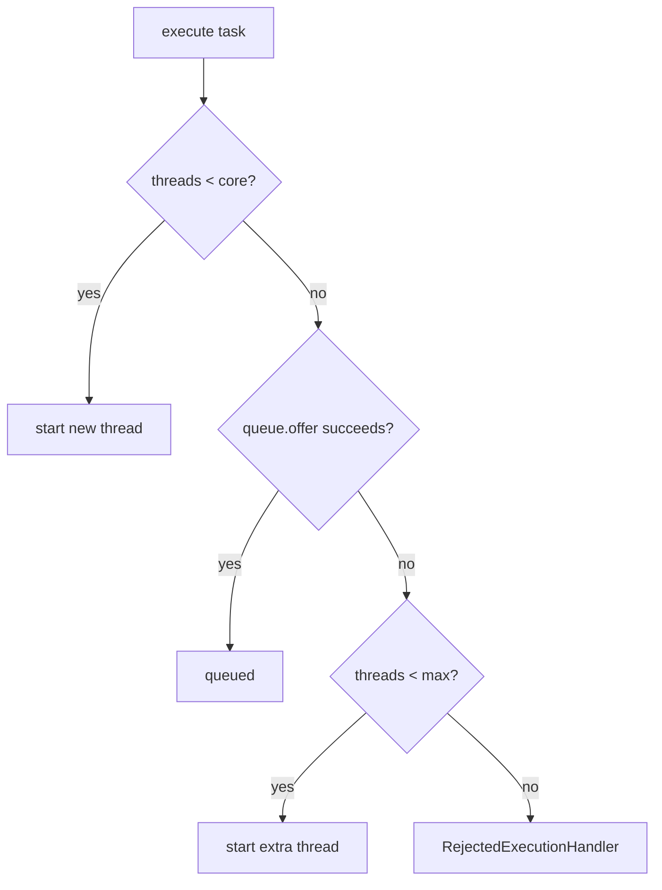

# Executors and Thread Pools

<Outcomes items={[
  "Configure ThreadPoolExecutor and explain how it queues and rejects",
  "Size pools for CPU-bound versus blocking work",
  "Shut down pools gracefully"
]} />

## `ThreadPoolExecutor` parameters

```java
new ThreadPoolExecutor(
    corePoolSize,          // threads kept alive even when idle
    maximumPoolSize,       // upper bound
    keepAliveTime, unit,   // idle time before threads above core are retired
    workQueue,             // holds tasks waiting for a thread
    threadFactory,         // names, daemon flag, uncaught-exception handler
    rejectedExecutionHandler);
```

### The decision order (frequently misunderstood)

When `execute(task)` is called:

1. If fewer than `corePoolSize` threads are running → **start a new thread** (even if others are idle).
2. Else, try to **enqueue** the task.
3. Only if the **queue is full** and fewer than `maximumPoolSize` threads exist → start an extra thread.
4. If the queue is full and max threads are running → **reject**.



Consequence: with an **unbounded** queue (`LinkedBlockingQueue` without capacity) step 3 never happens, so `maximumPoolSize` is **ignored**, the pool never grows beyond core, and under overload the queue grows without limit (memory!). This is the trap behind `Executors.newFixedThreadPool` (unbounded `LinkedBlockingQueue`) and `newSingleThreadExecutor`. `newCachedThreadPool` uses a `SynchronousQueue` and an effectively unbounded max, so it can create thousands of threads under a burst and kill the machine.

I verified the behaviour: a pool of core 1, max 2, queue capacity 1, with three long tasks running, accepts the third task by starting a second thread, and a fourth submission throws `RejectedExecutionException` under the default `AbortPolicy`.

**Production recommendation**: build `ThreadPoolExecutor` explicitly with a **bounded** queue, a named `ThreadFactory`, and a deliberate rejection policy.

```java
ThreadPoolExecutor pool = new ThreadPoolExecutor(
        8, 16,
        60, TimeUnit.SECONDS,
        new ArrayBlockingQueue<>(200),
        new ThreadFactoryBuilder().setNameFormat("pricing-%d").build(),   // Guava; or write your own
        new ThreadPoolExecutor.CallerRunsPolicy());
```

## Rejection policies

| Policy | Behaviour | Use |
| --- | --- | --- |
| `AbortPolicy` (default) | Throws `RejectedExecutionException` | Callers can handle failure, fail fast |
| `CallerRunsPolicy` | The submitting thread runs the task | Natural **back-pressure**: slows producers down |
| `DiscardPolicy` | Silently drops | Only for truly optional work (metrics) |
| `DiscardOldestPolicy` | Drops the oldest queued task | Rarely right; hides loss |

## Sizing

Little's law: `threads ≈ throughput × latency`. Practical rule for a task that spends `W` waiting (I/O) and `C` computing:

```
threads ≈ cores × (1 + W / C)
```

| Workload | Pool size | Notes |
| --- | --- | --- |
| CPU-bound (hashing, parsing) | ≈ cores (or cores + 1) | More threads only add context switching |
| Blocking I/O (HTTP, JDBC) | cores × (1 + W/C), often tens to hundreds | Bounded by the downstream capacity (connection pool, remote rate limits) |
| Mixed | Separate pools per kind | Isolation (bulkheads) so one slow dependency cannot starve others |

Always measure under load. Remember the downstream: a pool of 200 threads calling a database with a 10-connection pool just queues threads on connections. For massive I/O concurrency prefer [virtual threads](virtual-threads.md) and cap concurrency with a `Semaphore`.

## `submit`, `Future` and errors

```java
Future<Integer> f = pool.submit(() -> compute());
Integer result = f.get(2, TimeUnit.SECONDS);       // blocks; always use a timeout
```

- `execute(Runnable)`: an uncaught exception terminates the worker (a replacement is created) and goes to the thread's `UncaughtExceptionHandler`.
- `submit`: the exception is **captured in the Future** and is lost unless someone calls `get()`. Fire-and-forget `submit` silently swallows failures; wrap tasks with try/catch + logging, or use `CompletableFuture` handlers.
- `invokeAll` (wait for all) and `invokeAny` (first success) exist for batches.
- Cancel with `future.cancel(true)`, which interrupts the thread; the task must respond to interruption.

## Graceful shutdown

```java
pool.shutdown();                                       // stop accepting; finish queued tasks
if (!pool.awaitTermination(30, TimeUnit.SECONDS)) {
    List<Runnable> dropped = pool.shutdownNow();       // interrupt running tasks, return never-started ones
    if (!pool.awaitTermination(10, TimeUnit.SECONDS)) {
        log.warn("pool did not terminate");
    }
}
```

Since Java 19 `ExecutorService` is `AutoCloseable`: `close()` does shutdown + await. Spring-managed executors (`ThreadPoolTaskExecutor`) set `setWaitForTasksToCompleteOnShutdown(true)` and `setAwaitTerminationSeconds(...)` so in-flight work finishes during a rolling deploy.

## Scheduled executors

`ScheduledThreadPoolExecutor`: `schedule`, `scheduleAtFixedRate` (period measured from start times; bursts to catch up if a run is slow), `scheduleWithFixedDelay` (delay between end and next start). An exception thrown by a periodic task **cancels all future runs silently**; catch everything inside the task. In Spring, `@Scheduled` uses a single thread by default; long jobs delay others unless you configure a pool.

## ForkJoinPool and work stealing

`ForkJoinPool` runs many small, recursively split tasks. Each worker has its own **deque**; idle workers **steal** from the tail of others' deques, balancing load without a central queue. It powers parallel streams (`ForkJoinPool.commonPool()`), `CompletableFuture` async methods without an executor, and the virtual-thread scheduler.

```java
class SumTask extends RecursiveTask<Long> {
    private static final int THRESHOLD = 10_000;
    private final long[] a; private final int lo, hi;
    SumTask(long[] a, int lo, int hi) { this.a = a; this.lo = lo; this.hi = hi; }

    @Override protected Long compute() {
        if (hi - lo <= THRESHOLD) {
            long s = 0;
            for (int i = lo; i < hi; i++) s += a[i];
            return s;
        }
        int mid = (lo + hi) >>> 1;
        SumTask left = new SumTask(a, lo, mid);
        left.fork();                                   // run asynchronously
        long right = new SumTask(a, mid, hi).compute();   // compute the other half in this thread
        return right + left.join();
    }
}
long total = ForkJoinPool.commonPool().invoke(new SumTask(data, 0, data.length));
```

Do not block inside the common pool: it is shared JVM-wide, so blocking tasks starve parallel streams and `CompletableFuture`s everywhere. Use `ForkJoinPool.ManagedBlocker` or a dedicated executor.

## Spring specifics

- `@Async` uses a `TaskExecutor`; Boot auto-configures a `ThreadPoolTaskExecutor` (`spring.task.execution.pool.*`: core 8, unbounded queue by default, so max is not used). Set `queue-capacity` to a bound to let it grow.
- Spring Boot 3.2+ can switch executors to virtual threads with `spring.threads.virtual.enabled=true`.
- Context propagation (security context, MDC, tracing) does not cross threads automatically; use `TaskDecorator` or Micrometer's context-propagation.
- Expose pool metrics (active, queue size, completed) through Micrometer: `ExecutorServiceMetrics`.

## Check yourself

<Checkpoint questions={[
  {
    "q": "A ThreadPoolExecutor has core size 4, an unbounded queue and max size 20. How many threads will it ever use?",
    "options": [
      "4, because the queue never fills so it never grows past core",
      "20",
      "24",
      "1"
    ],
    "answer": 0,
    "why": "Extra threads are created only when the queue is full. With an unbounded queue, max size is irrelevant."
  },
  {
    "q": "Roughly how many threads suit a CPU-bound pool on an 8-core machine?",
    "options": [
      "About 800",
      "About 8 (cores, perhaps +1)",
      "Exactly 1",
      "64 per core"
    ],
    "answer": 1,
    "why": "More threads than cores only add context switching for CPU-bound work. Blocking work needs more."
  },
  {
    "q": "What is the correct order for graceful shutdown?",
    "options": [
      "shutdownNow() immediately",
      "System.exit()",
      "shutdown(), awaitTermination(), then shutdownNow() if it times out",
      "Let the garbage collector close it"
    ],
    "answer": 2,
    "why": "shutdown stops accepting tasks and lets queued ones finish. shutdownNow interrupts running tasks as a last resort."
  }
]} />

## Common interview questions

**1. Explain how `ThreadPoolExecutor` handles a new task.**
Create a thread until core size; then enqueue; only when the queue is full create threads up to max; otherwise reject. With an unbounded queue max is never reached.

**2. What is wrong with `Executors.newFixedThreadPool` and `newCachedThreadPool`?**
Fixed pool: unbounded queue (memory risk, no back-pressure). Cached pool: unbounded thread creation. Build `ThreadPoolExecutor` explicitly with bounds.

**3. How do you size a thread pool?**
CPU-bound: about the number of cores. I/O-bound: `cores × (1 + wait/compute)` capped by downstream capacity, validated by load testing; use separate pools per dependency.

**4. `execute` vs `submit`?**
`execute` takes a `Runnable` and propagates exceptions to the uncaught handler; `submit` returns a `Future` and captures exceptions inside it, so they vanish if never inspected.

**5. What is `CallerRunsPolicy` good for?**
Back-pressure: when saturated, the caller does the work itself, throttling submission.

**6. How does work stealing work?**
Each worker has a double-ended queue; it pops its own tasks LIFO, and idle workers steal FIFO from the other end of busy workers' queues, reducing contention and balancing load.

**7. `shutdown` vs `shutdownNow`?**
`shutdown` stops intake and lets queued tasks finish; `shutdownNow` attempts to interrupt running tasks and returns the tasks that never started.

**8. Why can a scheduled task suddenly stop running?**
An uncaught exception in a periodic task cancels its subsequent executions; catch and log inside the task.

**9. How do you pass context (MDC, security) to pool threads?**
Capture it when submitting and set/clear it in a wrapper (`TaskDecorator` in Spring), or use context-propagation libraries.

## Pitfalls

- Unbounded queues and `newCachedThreadPool` in production.
- Fire-and-forget `submit` that swallows exceptions.
- Blocking in the common `ForkJoinPool`.
- One shared pool for unrelated workloads (no isolation).
- Forgetting to shut pools down (non-daemon threads keep the JVM alive).
- Sizing pools by guesswork without checking the downstream limits.

## Key takeaways

- Core threads first, then queue, then extra threads, then reject.
- Bounded queue + named threads + chosen rejection policy.
- Size by workload type; isolate dependencies in separate pools.
- Handle task exceptions and shut down gracefully.
