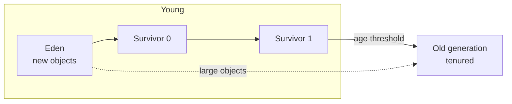

# Garbage Collection

Java manages memory automatically: objects that are no longer **reachable** from GC roots (thread stacks, static fields, JNI references) are reclaimed. The real question is how the collector trades **throughput**, **latency** (pause times) and **footprint**.

<Outcomes items={[
  "Describe the generational heap and the major collectors",
  "Choose a collector for latency versus throughput goals",
  "Recognise memory leaks in a GC language"
]} />

## Generational hypothesis

Most objects die young. Heaps are therefore split by object age so the cheap, frequent collection of short-lived objects does not scan long-lived ones.



- **Minor (young) GC**: copies survivors out of Eden/survivor space, a stop-the-world pause proportional to the **live** data in young, not its size. Typically milliseconds.
- **Promotion**: objects surviving enough collections (tenuring threshold, up to 15 young GCs) move to old.
- **Mixed/major (old) GC**: reclaims old-generation space; the expensive one. A **full GC** collects everything and is the pause you most want to avoid.
- **Metaspace** (native memory, replacing PermGen in Java 8) holds class metadata; it is not part of the heap.

## Core algorithms

| Technique | Idea | Trade-off |
| --- | --- | --- |
| **Mark-sweep** | Mark live objects, sweep dead | Fragmentation |
| **Mark-compact** | Mark, then slide live objects together | No fragmentation; moves objects, longer pause |
| **Copying** | Copy live objects to a new area | Fast and compacting, needs free space (used for young gen) |
| **Concurrent marking** | Mark while the application runs (with write barriers) | Short pauses, CPU overhead |
| **Region-based** | Heap split into many equal regions | Collect the garbage-richest regions first |

**Stop-the-world (STW)**: all application threads pause at a **safepoint** so the collector can work with a consistent view. Modern collectors minimise STW work by doing marking and relocation concurrently.

## The collectors

| Collector | Flag | Strengths | Pause profile |
| --- | --- | --- | --- |
| **Serial** | `-XX:+UseSerialGC` | Tiny footprint, single-threaded | Longer pauses; small heaps, single-core containers |
| **Parallel** | `-XX:+UseParallelGC` | Highest **throughput** | Multi-threaded STW pauses that grow with heap |
| **G1** | `-XX:+UseG1GC` (default since 9) | Balanced; predictable pauses via regions | Target pause `-XX:MaxGCPauseMillis` (default 200 ms, soft goal) |
| **ZGC** | `-XX:+UseZGC` | Sub-millisecond pauses independent of heap size (up to multi-TB) | Almost all work concurrent; generational by default from JDK 23 |
| **Shenandoah** | `-XX:+UseShenandoahGC` (OpenJDK builds) | Low pauses via concurrent compaction | Similar goals to ZGC |
| **Epsilon** | `-XX:+UseEpsilonGC` | No-op collector | Benchmarks, ultra-short-lived jobs |

### G1 in more detail

The heap is divided into ~2,000 equal-sized regions (1-32 MB), each dynamically assigned a role (Eden, Survivor, Old, Humongous).

- **Young collections** evacuate Eden/survivor regions.
- **Concurrent marking cycle** starts when heap occupancy crosses `InitiatingHeapOccupancyPercent` (default 45%) and computes how much garbage each old region holds.
- **Mixed collections** then collect young regions **plus** the old regions with the most garbage, staying within the pause target.
- **Humongous objects** (≥ 50% of a region) are allocated in dedicated contiguous regions straight in old space; many short-lived large arrays (big `byte[]` buffers, huge `ArrayList` growth) cause fragmentation and premature GCs. Fix by right-sizing allocations, pooling, or raising `-XX:G1HeapRegionSize`.
- **Full GC** is the fallback when evacuation fails ("to-space exhausted") or concurrent cycles cannot keep up; it is single-threaded in older versions and slow. If you see Full GCs on G1, you have an allocation/tuning/sizing problem.

### ZGC in more detail

Uses **coloured pointers** and **load barriers** to relocate objects while threads run. Pause times are typically under a millisecond regardless of heap size; the cost is some throughput (barriers) and memory overhead. Generational ZGC (JDK 21, default mode from 23) collects young objects separately, greatly improving throughput and allocation-rate tolerance over the original single-generation ZGC. Good fit: latency-sensitive services, large heaps.

## Choosing a collector

| Priority | Choice |
| --- | --- |
| Don't know / mixed workload | **G1** (default) |
| Batch / maximum throughput, pauses tolerable | Parallel |
| Strict tail latency, large heap | ZGC (or Shenandoah) |
| Tiny containers (under 2 CPUs, under 512 MB heap) | Serial |

Decide with **measurements** on realistic load, comparing p99 latency, throughput and CPU. Changing collectors is a flag change, not a rewrite.

## GC logging (always on in production)

```text
-Xlog:gc*:file=gc.log:time,uptime,level,tags:filecount=5,filesize=20m
```

A G1 line looks like:

```text
[12.345s][info][gc] GC(42) Pause Young (Normal) (G1 Evacuation Pause) 512M->96M(2048M) 8.123ms
```

Read it as: a young pause, heap went from 512 MB to 96 MB (capacity 2 GB), 8 ms. Watch for:

- **Pause times** vs your latency SLO.
- **Allocation rate** (heap growth between collections) and **promotion rate** (how fast old fills).
- **Heap after full/mixed GC** trending upward: a **memory leak**.
- "Pause Full", "to-space exhausted", "Humongous" allocations, "Concurrent Mode Failure".
- GC CPU share: more than ~5-10% of time in GC signals pressure.

Tools: GCeasy, GCViewer, JFR (Java Flight Recorder) GC events, Prometheus `jvm_gc_*` metrics from Micrometer.

## Sizing basics

- `-Xms` = `-Xmx` in production avoids resize pauses and makes capacity predictable.
- In containers, prefer `-XX:MaxRAMPercentage=75.0` (heap as a share of the container limit) over a fixed `-Xmx`; remember non-heap memory (metaspace, thread stacks, direct buffers, code cache, GC structures) needs headroom, or the container is OOM-killed by the kernel even though the heap is fine.
- More heap reduces GC frequency but can lengthen worst-case pauses for non-concurrent collectors, and hides leaks longer.
- Do not set many flags blindly. Start with defaults, set heap size and collector, measure, then tune one thing at a time (`MaxGCPauseMillis`, young gen sizing, IHOP).

## Memory leaks in a GC language

A leak is **unintended reachability**, not lost memory. Typical sources:

- Static collections and caches without eviction (use bounded caches such as Caffeine).
- Listeners/callbacks never deregistered; inner classes holding outer references.
- `ThreadLocal` values in pooled threads (see [Threads](threads-basics.md)).
- Unbounded queues and buffers.
- Classloader leaks on redeploy (metaspace growth).
- Mutable keys or `equals/hashCode` bugs in maps; unclosed resources (streams, connections).

Diagnosis: watch heap-after-GC rising; take a **heap dump** (`jcmd <pid> GC.heap_dump file.hprof`, or `-XX:+HeapDumpOnOutOfMemoryError`), open in Eclipse MAT or VisualVM, and follow **dominator tree** and **path to GC roots** for the largest retained sets.

## References and finalization

| Reference | Collected when | Use |
| --- | --- | --- |
| Strong | Never while reachable | Normal |
| `SoftReference` | Under memory pressure | Memory-sensitive caches (rarely the best choice) |
| `WeakReference` | At next GC if only weakly reachable | `WeakHashMap`, canonicalising maps |
| `PhantomReference` + `Cleaner` | After finalization-eligible | Resource cleanup without `finalize` |

`finalize()` is deprecated for removal: unpredictable, slow, can resurrect objects. Use try-with-resources and `java.lang.ref.Cleaner`.

## Check yourself

<Checkpoint questions={[
  {
    "q": "Which collector is the default on modern JDKs for general server workloads?",
    "options": [
      "G1",
      "Serial",
      "Epoch",
      "CMS"
    ],
    "answer": 0,
    "why": "G1 has been the default since Java 9. ZGC and Shenandoah target very low pauses."
  },
  {
    "q": "How can a Java application leak memory despite garbage collection?",
    "options": [
      "By allocating too fast",
      "By keeping references reachable, for example in static collections or unremoved listeners",
      "By using final fields",
      "By running out of file handles"
    ],
    "answer": 1,
    "why": "The GC only frees unreachable objects. Forgotten references keep objects alive."
  },
  {
    "q": "What is the generational hypothesis?",
    "options": [
      "Old objects die first",
      "All objects live equally long",
      "Most objects die young, so young-generation collection is cheap and frequent",
      "Large objects never die"
    ],
    "answer": 2,
    "why": "Collectors exploit this by separating young and old objects."
  }
]} />

## Common interview questions

**1. How does garbage collection decide what to collect?**
It traces reachability from GC roots (stack frames, statics, JNI handles); anything unreachable is garbage. Reference counting is not used (it cannot handle cycles).

**2. Explain the generational heap and why it exists.**
Most objects die young, so collecting a small young generation frequently is cheap, and long-lived objects are promoted to the old generation which is collected less often.

**3. Minor vs major vs full GC?**
Minor: young only. Major/mixed: old regions (concurrent or mixed collections in G1). Full: whole heap (and metaspace), stop-the-world, the one to avoid.

**4. G1 vs ZGC vs Parallel?**
Parallel maximises throughput with long pauses; G1 balances throughput and pause goals; ZGC targets sub-millisecond pauses at any heap size by doing nearly everything concurrently.

**5. Your service has latency spikes every few minutes; how do you investigate?**
Enable GC logs/JFR and correlate spike times with pauses (young, mixed, full), check allocation/promotion rates, humongous allocations, safepoint pauses; then check non-GC causes (thread contention, downstream latency). Tune or change the collector accordingly.

**6. How do you find a memory leak?**
Confirm heap-after-GC trends up, capture heap dumps at two points, compare retained sizes in MAT, trace to GC roots, and fix the reachability (eviction, deregistration, removing `ThreadLocal`s).

**7. What causes `OutOfMemoryError: Java heap space` vs `Metaspace` vs `unable to create native thread`?**
Heap exhausted (leak or undersized), too many classes/loader leak, or the OS cannot allocate another thread (too many threads or low limits/memory outside the heap).

**8. What is a safepoint?**
A point where all threads are paused at consistent states so the VM can do work such as GC; long time-to-safepoint (e.g. counted loops) shows as pauses unrelated to the collector itself.

**9. Why might a container with `-Xmx2g` be OOM-killed with a 2.5 GB limit?**
Off-heap memory (metaspace, thread stacks, direct buffers, code cache, GC and JIT structures) adds to the heap; leave headroom or use `MaxRAMPercentage`.

## Pitfalls

- Calling `System.gc()` (triggers full GCs unless disabled); disabled with `-XX:+DisableExplicitGC` in some setups.
- Over-tuning with copy-pasted flags from other JVM versions.
- Ignoring off-heap memory.
- No GC logs in production.
- Huge short-lived arrays in G1; unbounded caches.
- Judging a collector by microbenchmarks rather than production-like load.

## Key takeaways

- Generational GC makes young collections cheap; avoid premature promotion and Full GCs.
- G1 is a good default; ZGC for tight latency; Parallel for throughput.
- Always log GC; read heap-after-GC and pause times.
- Leaks are reachability bugs: fix with eviction, deregistration and heap-dump analysis.
