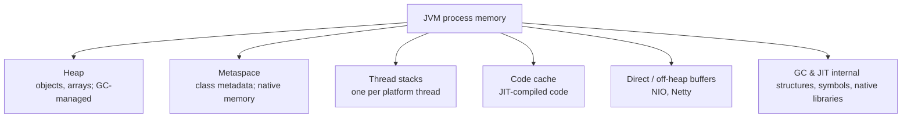

# JVM Memory, JIT, Tuning and Diagnostics

<Outcomes items={[
  "Name the JVM memory areas and what lives in each",
  "Pick the key sizing flags",
  "Use jcmd, jstack and heap dumps to diagnose problems"
]} />

## Runtime memory areas



| Area | Failure | Controlled by |
| --- | --- | --- |
| Heap | `OutOfMemoryError: Java heap space` | `-Xms`, `-Xmx`, `-XX:MaxRAMPercentage` |
| Metaspace | `OutOfMemoryError: Metaspace` | `-XX:MaxMetaspaceSize` (unbounded by default) |
| Thread stacks | `StackOverflowError`, `unable to create native thread` | `-Xss`, thread count, OS limits |
| Direct memory | `OutOfMemoryError: Direct buffer memory` | `-XX:MaxDirectMemorySize` |
| Code cache | JIT stops, performance collapse (`CodeCache is full`) | `-XX:ReservedCodeCacheSize` |

Total resident memory = heap + all of the above. Kubernetes limits apply to the **whole process**; a "healthy" heap can still get the container OOM-killed (exit code 137).

Each thread's stack frames hold local variables and operand stacks; objects live on the heap, though the JIT's **escape analysis** can allocate non-escaping objects in registers/stack (scalar replacement), which is why small short-lived objects are often free.

## How the JIT works

The JVM starts by **interpreting** bytecode, profiles hot code and compiles it:

- **Tiered compilation**: tier 0 interpreter → tier 3 C1 (fast, with profiling) → tier 4 C2 (aggressive optimisation).
- Optimisations: inlining (the most important, enabling the others), escape analysis, loop unrolling, devirtualisation based on class hierarchy and observed call-site types, dead-code elimination, bounds-check elimination.
- **Deoptimisation**: if an assumption is invalidated (a new subclass loaded, an unexpected branch), compiled code is discarded and execution falls back to the interpreter.
- **Warm-up**: the first seconds/minutes are slower. Implications: benchmark with **JMH** (handles warm-up, dead-code elimination, forks), never with `System.nanoTime()` loops; expect cold-start latency spikes after deploys; consider **CDS/AppCDS** (class data sharing), **CRaC** checkpoints or **GraalVM native image** when startup dominates (serverless, CLI).

## Sizing flags that matter

```text
-XX:+UseG1GC                      # or -XX:+UseZGC
-Xms2g -Xmx2g                     # equal: no resize pauses (or use MaxRAMPercentage in containers)
-XX:MaxRAMPercentage=70.0         # container-aware heap sizing (leave headroom for off-heap)
-XX:+HeapDumpOnOutOfMemoryError -XX:HeapDumpPath=/dumps
-XX:+ExitOnOutOfMemoryError       # let the orchestrator restart a poisoned instance
-Xlog:gc*:file=/logs/gc.log:time,uptime,level,tags:filecount=5,filesize=20m
-XX:+AlwaysPreTouch               # optional: commit heap at startup for predictable latency
-Xss512k                          # reduce only if you create many platform threads and know the depth needed
```

Guidelines:

- The JVM is container-aware (cgroups). Set explicit CPU and memory requests/limits; fractional CPU limits (below 1 CPU) make the JVM think it has 1 CPU and choose Serial GC.
- `-XX:ActiveProcessorCount` pins the CPU count seen by thread pools and GC when needed.
- Avoid cargo-cult flags; each flag is a maintenance liability across JDK upgrades.

## Diagnostic toolkit

| Question | Tool |
| --- | --- |
| What threads are doing / is it deadlocked? | `jcmd <pid> Thread.print` (or `jstack`) |
| What is using CPU? | **async-profiler** (flame graphs, low overhead), JFR, `top -H` + thread dump correlation |
| Where are allocations? | JFR allocation events, async-profiler `-e alloc` |
| Heap contents / leak? | `jcmd <pid> GC.heap_dump`, Eclipse **MAT**, VisualVM |
| Class histogram (quick) | `jcmd <pid> GC.class_histogram` |
| GC behaviour | GC logs, JFR |
| Flags actually in effect | `jcmd <pid> VM.flags`, `java -XX:+PrintFlagsFinal -version` |
| Native memory | `-XX:NativeMemoryTracking=summary` then `jcmd <pid> VM.native_memory summary` |
| General profile with low overhead, always-on | **Java Flight Recorder**: `jcmd <pid> JFR.start duration=60s filename=rec.jfr`, open in JDK Mission Control |

### Playbook: CPU is high

1. `top -H -p <pid>` to find the hottest native thread ids; convert to hex and match `nid=0x...` in a thread dump, or run async-profiler for 30-60 s and read the **flame graph** (wide frames = hot).
2. If most time is in GC threads, it is a memory/allocation problem, not code.
3. Look for busy loops, regex backtracking, JSON/logging in hot paths, excessive lock spinning.

### Playbook: latency spikes

1. Correlate spike timestamps with GC pauses (logs) and safepoint logs (`-Xlog:safepoint`).
2. Check thread pools: queue sizes, saturation, blocked threads in dumps.
3. Check downstream dependencies and connection pool waits (Hikari `pending`).
4. Look at cold effects: deploys, JIT deopts, cache evictions.

### Playbook: OutOfMemoryError

1. Which kind? The message tells you the area (heap, Metaspace, direct buffer, native thread).
2. Heap: analyse the `.hprof` in MAT. Open the **Leak Suspects** report and **dominator tree**; identify what holds the retained memory (a cache, a queue, a ThreadLocal map) and its **path to GC roots**.
3. Metaspace growth: classloader leaks (redeploys, dynamic proxies/Groovy/script engines generating classes).
4. Native thread: too many threads; check `ulimit -u`, thread count growth, unbounded pool creation.
5. Fix the cause (bounds, eviction, deregistration) rather than just raising `-Xmx`.

### Playbook: memory grows but heap is stable

Off-heap growth: direct buffers (Netty without pooled-leak fixes), thread stacks, native libraries (zip, SSL, JNI), glibc malloc arena fragmentation (try `MALLOC_ARENA_MAX=2` or jemalloc), memory-mapped files. NMT helps locate JVM-internal growth.

## Observability in Spring Boot

Micrometer exposes `jvm.memory.used`, `jvm.gc.pause`, `jvm.threads.live`, `jvm.buffer.memory.used`, `process.cpu.usage`, Hikari and executor metrics; alert on GC pause p99, heap-after-GC trend, thread count, and pool saturation. Actuator can expose `/actuator/threaddump` and `/actuator/heapdump` (protect them; see [Actuator](../../spring/boot/actuator.md)). Attach JFR continuously with a rolling buffer to capture the minutes before an incident.

## Check yourself

<Checkpoint questions={[
  {
    "q": "A container is OOMKilled although the heap is within -Xmx. Why?",
    "options": [
      "Off-heap memory (metaspace, thread stacks, direct buffers) also counts toward the container limit",
      "Xmx is ignored in containers",
      "The garbage collector is broken",
      "The JIT uses all memory"
    ],
    "answer": 0,
    "why": "Total process memory is heap plus non-heap. Leave headroom, for example with MaxRAMPercentage."
  },
  {
    "q": "Which tool prints thread stacks to find deadlocks?",
    "options": [
      "javac",
      "jstack (or jcmd Thread.print)",
      "jlink",
      "jar"
    ],
    "answer": 1,
    "why": "A thread dump shows thread states and lock owners, and reports deadlocks."
  },
  {
    "q": "What does the JIT compiler do?",
    "options": [
      "Compiles source to bytecode",
      "Collects garbage",
      "Compiles hot bytecode to optimised machine code at runtime",
      "Verifies class files"
    ],
    "answer": 2,
    "why": "JIT profiles running code and optimises hot paths, which is why warm-up matters for benchmarks."
  }
]} />

## Common interview questions

**1. What are the JVM memory areas?**
Heap (objects, GC-managed), Metaspace (class metadata, native), thread stacks, code cache, direct/native memory. Only the heap is bounded by `-Xmx`.

**2. A pod is OOM-killed but heap usage looked fine. Why?**
Off-heap memory (metaspace, direct buffers, thread stacks, code cache, native allocations) plus heap exceeded the container limit; size with headroom and track NMT/direct buffer metrics.

**3. How does the JIT optimise code?**
Tiered C1/C2 compilation based on profiling, with inlining, escape analysis, devirtualisation, loop optimisations and speculative optimisation backed by deoptimisation.

**4. How would you benchmark Java code correctly?**
With JMH: it controls warm-up, forking, dead-code elimination and constant folding pitfalls; naive timing loops measure interpreter/JIT artefacts.

**5. How do you diagnose a CPU spike in production?**
Identify hot threads (`top -H`, thread dump) or profile with async-profiler/JFR, read the flame graph, and distinguish application CPU from GC CPU.

**6. What do you do on `OutOfMemoryError: Java heap space`?**
Capture a heap dump (preferably automatically with `HeapDumpOnOutOfMemoryError`), analyse dominators and GC-root paths in MAT, fix the leak or sizing, and use `ExitOnOutOfMemoryError` so the instance restarts cleanly.

**7. What is Java Flight Recorder?**
A low-overhead event recorder built into the JVM (GC, allocation, locks, I/O, method sampling) suitable for always-on production profiling, analysed with JDK Mission Control.

**8. Why is the first request after deployment slow?**
Cold code runs in the interpreter, classes are loaded lazily, caches/connection pools are empty and JIT hasn't compiled hot paths; use warm-up traffic, readiness gates, CDS, or checkpoint/restore.

**9. When would you choose GraalVM native image?**
When startup time and memory footprint matter more than peak throughput and dynamic features (serverless, CLIs, scale-to-zero); accept longer builds, reflection configuration and lower peak performance.

## Pitfalls

- Setting `-Xmx` equal to the container limit.
- Fractional CPU limits leading to Serial GC and one-thread pools.
- Benchmarks without JMH.
- Heap dumps containing sensitive data left on shared storage.
- Raising `-Xmx` as the only response to OOM.
- Exposing `heapdump`/`threaddump` endpoints publicly.

## Key takeaways

- Process memory is more than the heap; budget for all areas.
- The JIT optimises speculatively; warm-up and JMH matter.
- Know the playbooks: thread dumps, flame graphs, heap dump analysis, GC logs.
- Set a few well-understood flags and measure.
