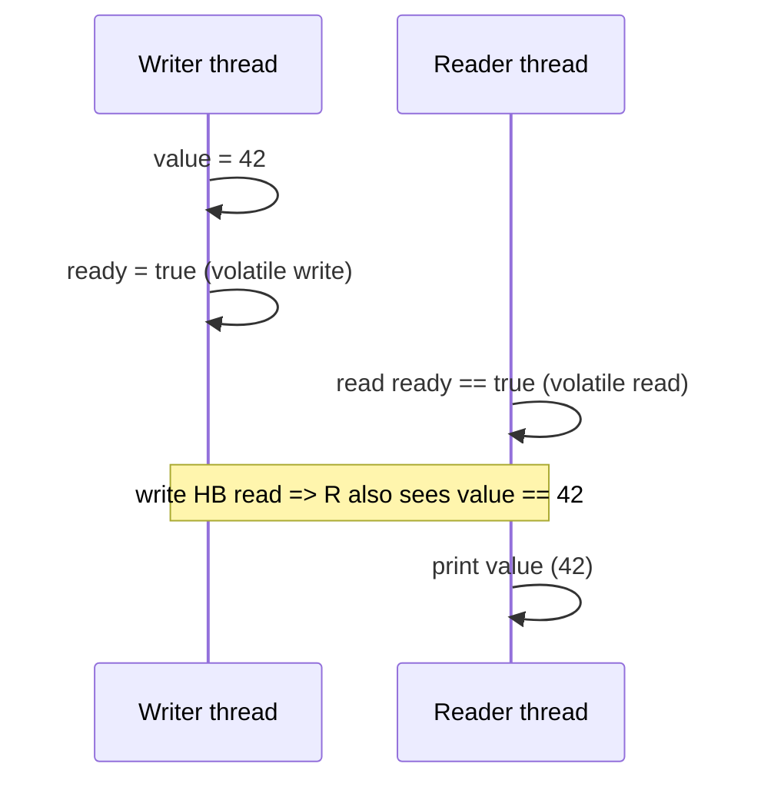

# The Java Memory Model (JMM)

<Outcomes items={[
  "Explain happens-before and why it matters",
  "State what volatile and final guarantee",
  "Spot broken double-checked locking"
]} />

## Why you can see stale or reordered values

Modern systems optimise aggressively:

- **CPU caches and store buffers**: a core writes to its own cache; other cores may not see it yet.
- **Compiler/JIT reordering and hoisting**: the compiler may reorder independent statements, keep a field in a register, or hoist a read out of a loop.
- **CPU out-of-order execution**.

Single-threaded semantics are preserved ("as-if-serial"), but another thread can observe the operations in a different order or not at all.

```java
class Broken {
    boolean ready;           // not volatile
    int value;

    void writer() { value = 42; ready = true; }

    void reader() {
        while (!ready) { }               // the JIT may hoist the read: this loop can spin forever
        System.out.println(value);       // even if it exits, may print 0 (reordered writes)
    }
}
```

Making `ready` `volatile` fixes both problems.

## Happens-before

The JMM is defined in terms of a partial order called **happens-before** (HB). If action A happens-before B, then A's effects are visible to B and A is ordered before B. If there is **no** HB relationship between a write and a read of the same variable, the read may see the old value, the new value, or (for non-volatile `long`/`double` on old 32-bit JVMs) a torn value: this is a **data race**.

The rules that create HB edges:

| Rule | Guarantee |
| --- | --- |
| **Program order** | Within one thread, each action HB the next in program order |
| **Monitor lock** | An unlock of a monitor HB every later lock of the *same* monitor |
| **Volatile** | A write to a volatile variable HB every later read of it |
| **Thread start** | `Thread.start()` HB every action in the started thread |
| **Thread join / termination** | All actions in a thread HB another thread's successful `join()` on it |
| **Interruption** | `interrupt()` HB the interrupted thread detecting it |
| **Final fields** | Special rule (below) |
| **Transitivity** | A HB B and B HB C ⇒ A HB C |
| **Executors/concurrent collections** | Submitting a task HB its execution; actions before putting into a `BlockingQueue`/`ConcurrentHashMap` HB actions after retrieving |

Transitivity makes volatile powerful: in the earlier example, `value = 42` (program order) HB the volatile write of `ready`; that write HB the volatile read that sees `true`; so the reader is guaranteed to see `value == 42`.



## `volatile` semantics

- A volatile read acts as an **acquire**, a volatile write as a **release**: operations before the write cannot be reordered after it; operations after the read cannot be moved before it.
- Reads and writes of volatile `long`/`double` are atomic.
- It does not provide mutual exclusion or atomic compound actions (see [Synchronization](synchronization-and-locks.md)).

## `synchronized` and visibility

Mutual exclusion is half of what a monitor gives; the other half is visibility. Releasing the lock flushes writes; acquiring it sees all writes made before the previous release. This is why **reads of shared mutable state must also be synchronised on the same lock**, otherwise there is no HB edge, even if the writer synchronised.

## `final` field semantics and safe publication

If an object is constructed correctly (`this` does not escape) and its fields are `final`, any thread that sees a reference to it sees those fields fully initialised, even if the reference was published through a data race. Non-final fields get no such guarantee: a racy publication may expose a half-constructed object.

```java
class Holder {
    private final int a;          // visible correctly even through an unsynchronised publication
    private int b;                // may be seen as 0 by another thread that gets the reference racily
    Holder() { a = 1; b = 2; }
}
```

Safe publication idioms: store the reference in a `final` field, a `volatile` field or `AtomicReference`, guard it with a lock, put it in a concurrent collection or `BlockingQueue`, or hand it over via `Thread.start/join` or an executor. Never leak `this` from a constructor (starting a thread or registering a listener inside it).

## Double-checked locking, revisited

Without `volatile`, another thread can see a non-null `instance` reference **before** the constructor's writes become visible (the reference store may be reordered before the field stores). `volatile` forbids that reordering. The holder idiom avoids the issue because class initialisation is guaranteed thread-safe by the JVM.

## Atomicity of reads and writes

Reads/writes of references and primitives (except `long` and `double` on legacy 32-bit VMs) are atomic, but atomicity is not visibility, and `i++` is read-modify-write: three actions, not atomic.

## Out-of-thin-air and tearing

The JMM forbids "out-of-thin-air" values: a racy read returns a value that was actually written by some thread. With `long`/`double` non-volatile on 32-bit JVMs, the halves may tear; on modern 64-bit HotSpot this does not happen but the spec still allows it.

## False sharing (a performance, not correctness, issue)

CPUs move memory in **cache lines** (typically 64 bytes). If two threads write to *different* variables that sit on the **same cache line**, the line ping-pongs between cores, throttling both. Symptom: independent counters that scale badly. Fixes: padding (JDK uses `@Contended` internally in `LongAdder`'s cells and `ForkJoinPool`; user code needs `-XX:-RestrictContended`), splitting data per thread, or using `LongAdder`.

## Reasoning checklist

1. Which variables are shared and mutable?
2. For each, what HB edge connects every write to every read? (lock, volatile, `join`, executor hand-off, concurrent collection)
3. Is every compound action atomic (single lock, atomic class)?
4. Is each object safely published (final fields, volatile, lock)?
5. Can the design avoid sharing altogether?

If you cannot name the HB edge, you have a data race.

## Check yourself

<Checkpoint questions={[
  {
    "q": "What does a happens-before edge guarantee?",
    "options": [
      "Writes before the edge are visible to reads after it",
      "The two threads run in lockstep",
      "The code is atomic",
      "Both threads use the same CPU core"
    ],
    "answer": 0,
    "why": "Happens-before is about visibility and ordering, established by volatile, synchronized, thread start/join and others."
  },
  {
    "q": "Why was classic double-checked locking broken without volatile?",
    "options": [
      "synchronized does not work in constructors",
      "Another thread could see a non-null reference to a partially constructed object",
      "The JIT always removes the null check",
      "Locks cannot be taken twice"
    ],
    "answer": 1,
    "why": "Without volatile, reordering can publish the reference before the constructor's writes become visible."
  },
  {
    "q": "Which gives safe publication of an object's final fields?",
    "options": [
      "Any non-final field",
      "Static non-final fields only",
      "Final fields set in the constructor, once the constructor finishes without leaking this",
      "Fields inside synchronized blocks only"
    ],
    "answer": 2,
    "why": "The JMM guarantees final fields are visible once the object is properly constructed."
  }
]} />

## Common interview questions

**1. What is the Java Memory Model?**
A specification of which values a read may observe and what reorderings are legal, defined through the happens-before relation, so that correctly synchronised programs behave consistently across hardware and JIT optimisations.

**2. What does happens-before mean?**
If A HB B, A's writes are visible to B and A is ordered before B. Without an HB path between a write and a read, the read may see a stale value.

**3. Does `volatile` make `count++` thread-safe?**
No: it gives visibility/ordering but not atomicity of the read-modify-write; use atomics or locks.

**4. How does `final` help thread safety?**
Final fields of a properly constructed object are visible to any thread that obtains the reference, even without synchronisation, which is why immutable objects are safely shareable.

**5. Why is double-checked locking broken without `volatile`?**
The reference can become visible before the object's fields are initialised due to reordering; `volatile` prevents it.

**6. What is a data race?**
Two threads accessing the same variable, at least one writing, with no happens-before ordering between the accesses.

**7. What is false sharing?**
Different threads modifying independent variables on the same cache line, causing cache-coherence traffic that degrades performance; fixed with padding/striping.

**8. What is safe publication?**
Making an object reference available to other threads in a way that guarantees they see its fully constructed state: via `volatile`, `final`, locks, concurrent collections or thread start/join.

## Pitfalls

- Reading shared state without the same lock or volatile used for writing.
- Publishing objects by assigning to a plain static or instance field.
- Letting `this` escape during construction.
- Assuming "it works on my machine" (x86 is a strong memory model; ARM exposes more races).
- Sleeping or printing to "fix" a visibility problem.

## Key takeaways

- Visibility needs a happens-before edge: locks, volatile, start/join, concurrent collections.
- `volatile` + transitivity publishes whole sets of prior writes.
- Final fields and immutable objects publish safely.
- If you cannot identify the HB edge, you have a bug waiting to happen.
