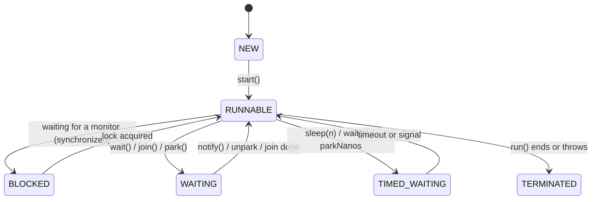

# Threads: The Fundamentals

Everything in the concurrency section builds on this: what a thread is, how it ends, how it can get stuck, and how to see what it is doing.

<Outcomes items={[
  "Describe thread states and what moves a thread between them",
  "Stop a thread cooperatively with interruption",
  "Diagnose deadlock from a thread dump"
]} />

## What a thread is

A platform (OS) thread has its own stack (default 512 KB to 1 MB, `-Xss`), program counter and registers, and shares the heap with other threads. Creating one asks the OS to allocate a kernel thread, which is why platform threads are expensive (stack memory, scheduling cost, thousands at most). **Virtual threads** (Java 21) lift this limit; see [Virtual threads](virtual-threads.md).

Concurrency (interleaving tasks) is not parallelism (running at the same instant on multiple cores). Concurrency problems come from **shared mutable state**, so the strategy is to avoid sharing (confinement), avoid mutating (immutability), or coordinate (locks, atomics, queues).

## Thread states



`RUNNABLE` includes both "running on CPU" and "ready or blocked in native I/O" as far as the JVM can tell. `BLOCKED` is **only** for contention on a `synchronized` monitor; waiting on a `ReentrantLock` shows up as `WAITING` (parked).

## Creating threads

```java
Thread t = new Thread(() -> work(), "order-worker-1");   // always name threads
t.start();                                                // start(), never run(), which would execute on the caller's thread
t.join();                                                 // wait for completion
```

Prefer an **executor** to raw threads in application code (see [Executors](executors.md)): pooling, bounded queues, lifecycle and error handling come for free. Use `Thread.ofPlatform().name("x").start(r)` and `Thread.ofVirtual().start(r)` builders in Java 21.

### Thread-safety of `start()`

`Thread.start()` has a happens-before edge: everything done before `start` is visible to the new thread. `join()` returns after the thread's actions happen-before the joiner continues. These are the simplest correct ways to hand data over (see [Memory model](memory-model.md)).

## Stopping a thread: interruption, not `stop()`

`Thread.stop()` is deprecated for removal and unsafe (it releases locks mid-update). Cancellation is **cooperative** via the interrupt flag:

```java
public void run() {
    while (!Thread.currentThread().isInterrupted()) {
        try {
            Job job = queue.take();                  // blocking call: throws InterruptedException if interrupted
            process(job);
        } catch (InterruptedException e) {
            Thread.currentThread().interrupt();      // blocking methods clear the flag when they throw: restore it
            break;
        }
    }
    cleanup();
}
```

Notes:

- `interrupt()` sets the flag; blocking methods (`sleep`, `wait`, `join`, `BlockingQueue.take`, `Lock.lockInterruptibly`) throw `InterruptedException` and clear it.
- `Thread.interrupted()` **clears** the flag; `isInterrupted()` only reads it.
- Blocking socket reads and `synchronized` acquisition are **not** interruptible; close the socket or use `lockInterruptibly`.
- Code that swallows `InterruptedException` breaks executor shutdown (`shutdownNow` relies on it).

## Daemon threads

A JVM exits when only daemon threads remain. Use daemon threads for housekeeping (metrics, cache cleanup) that must not block shutdown, and never for work that must complete (writing files). A thread inherits the daemon flag of its creator; set it before `start()`.

## `ThreadLocal`

Per-thread storage, commonly used for request context, formatters, security context (Spring `SecurityContextHolder`) and MDC logging.

```java
private static final ThreadLocal<DateTimeFormatter> FORMAT =
        ThreadLocal.withInitial(() -> DateTimeFormatter.ofPattern("yyyy-MM-dd"));
```

Problems:

- **Leaks in thread pools**: pool threads live forever, so values stored and never `remove()`d persist (and can leak across requests, a security bug). Always clear in `finally`.
- **Classloader leaks** in app servers: a `ThreadLocal` value referencing an application class pins its classloader.
- **Inheritance**: `InheritableThreadLocal` copies values at thread creation only, which is surprising with pooled threads.
- **Virtual threads** support them but with millions of threads the per-thread copies cost memory; **scoped values** (final in Java 25) are the modern alternative for immutable context.
- `DateTimeFormatter` is thread-safe and needs no `ThreadLocal`; `SimpleDateFormat` is not.

## Liveness problems

| Problem | Meaning |
| --- | --- |
| **Deadlock** | Two or more threads each hold a lock the other needs, so none progresses |
| **Livelock** | Threads keep reacting to each other and make no progress (two people stepping aside repeatedly) |
| **Starvation** | A thread never gets CPU or a lock because others dominate (priority, unfair locks) |

A deadlock needs **four conditions**: mutual exclusion, hold-and-wait, no preemption, circular wait. Break any one:

```java
// Deadlock-prone: lock order depends on arguments
void transfer(Account from, Account to, long amount) {
    synchronized (from) {
        synchronized (to) { ... }       // transfer(a, b) and transfer(b, a) concurrently can deadlock
    }
}

// Fix: a global lock order
void transfer(Account from, Account to, long amount) {
    Account first = from.id() < to.id() ? from : to;
    Account second = first == from ? to : from;
    synchronized (first) {
        synchronized (second) { ... }
    }
}
```

Other cures: `ReentrantLock.tryLock` with timeout and back-off, acquire all locks at once, reduce lock scope, use higher-level constructs (a single-threaded actor/queue per account).

## Reading a thread dump

`jstack <pid>` or `jcmd <pid> Thread.print` (or `kill -3`). The JVM reports detected monitor deadlocks:

```text
Found one Java-level deadlock:
"worker-1": waiting to lock monitor 0x... (object 0x..., a Account), which is held by "worker-2"
"worker-2": waiting to lock monitor 0x... (object 0x..., a Account), which is held by "worker-1"
```

What to look for: many threads `BLOCKED` on the same lock (contention); pool threads all parked in the same I/O call (downstream dependency slow); `RUNNABLE` threads at 100% in the same method (CPU hot spot); take **several dumps seconds apart** and compare. Name your threads, or the dump is unreadable. Thread dumps for virtual threads are available with `jcmd <pid> Thread.dump_to_file -format=json file`.

## Check yourself

<Checkpoint questions={[
  {
    "q": "How should you ask a running thread to stop?",
    "options": [
      "Call interrupt() and have the task check the flag or handle InterruptedException",
      "Call Thread.stop()",
      "Set the thread to daemon",
      "Call System.exit()"
    ],
    "answer": 0,
    "why": "stop() is unsafe and removed in recent versions. Interruption is a cooperative signal."
  },
  {
    "q": "Two threads each hold one lock and wait for the other's. What is this called?",
    "options": [
      "Livelock",
      "Deadlock",
      "Starvation",
      "Race condition"
    ],
    "answer": 1,
    "why": "Circular wait with no timeout. Fix with consistent lock ordering or tryLock with timeout."
  },
  {
    "q": "What does a JVM exit require regarding daemon threads?",
    "options": [
      "It waits for daemon threads to finish",
      "Daemon threads block shutdown",
      "The JVM can exit once only daemon threads remain",
      "Daemon threads are killed immediately on creation"
    ],
    "answer": 2,
    "why": "Daemon threads do not keep the JVM alive. The JVM exits when all non-daemon threads end."
  }
]} />

## Common interview questions

**1. What are the thread states?**
`NEW`, `RUNNABLE`, `BLOCKED`, `WAITING`, `TIMED_WAITING`, `TERMINATED`. `BLOCKED` is specific to waiting for a `synchronized` monitor.

**2. `start()` vs `run()`?**
`start()` creates a new thread that executes `run()`; calling `run()` directly executes it in the current thread.

**3. How do you stop a thread safely?**
Use interruption (or a `volatile` stop flag for non-blocking loops); check `isInterrupted()`, handle `InterruptedException` by restoring the flag and exiting. Never use `stop()`.

**4. `sleep` vs `wait`?**
`sleep` pauses the current thread without releasing any locks. `wait` must be called while holding the object's monitor, releases that monitor, and resumes on `notify`/`notifyAll`/timeout/interrupt.

**5. Why is `wait()` always in a loop?**
Spurious wakeups and multiple waiters mean the condition must be rechecked: `while (!condition) lock.wait();`.

**6. What are the deadlock conditions and how do you prevent them?**
Mutual exclusion, hold-and-wait, no preemption, circular wait. Impose a global lock ordering, use timeouts with `tryLock`, or avoid nested locks.

**7. What is a `ThreadLocal` leak?**
Values remaining in pooled threads (or pinning a classloader) because `remove()` was never called; they persist after the task finishes and can leak data between requests.

**8. How do you diagnose a hung application?**
Take several thread dumps (`jcmd Thread.print`), look for deadlock reports, groups of blocked/parked threads on the same lock or I/O call, and correlate with GC logs and downstream health.

## Pitfalls

- Swallowing `InterruptedException`.
- Unnamed threads (useless dumps) and unbounded thread creation.
- `ThreadLocal` without `remove()` in pools.
- Calling `run()` instead of `start()`.
- Nested locks acquired in inconsistent order.
- Using `Thread.sleep` to "synchronise" code.

## Key takeaways

- Threads share the heap; the hard part is shared mutable state.
- Cancellation is cooperative: interrupt, then restore the flag.
- Deadlock needs four conditions; break one (lock ordering is the usual fix).
- Name threads and learn to read thread dumps.
