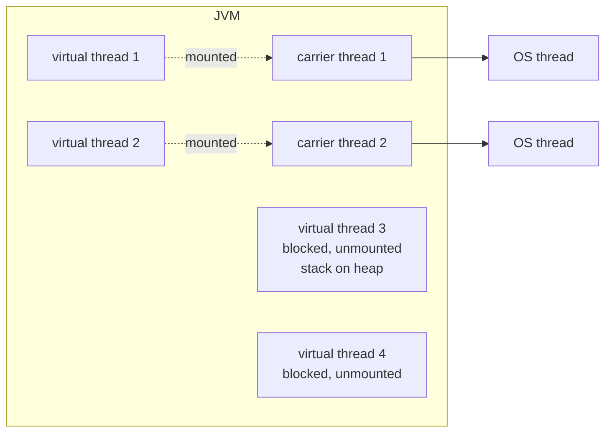

# Virtual Threads

Virtual threads (JEP 444, final in **Java 21**) are lightweight threads managed by the JVM, not the OS. They let you write simple **blocking, thread-per-request** code and still scale to hundreds of thousands of concurrent tasks.

<Outcomes items={[
  "Explain what virtual threads solve and what they do not",
  "Describe pinning and how to avoid it",
  "Decide between virtual threads, reactive and CompletableFuture"
]} />

## The problem they solve

Platform threads map 1:1 to OS threads (~1 MB stack, kernel scheduling), so a server can sustain only a few thousand. With blocking I/O each request thread spends most of its time waiting, so throughput is limited by thread count, not CPU. The alternatives were asynchronous code (callbacks, `CompletableFuture`, reactive), which scales but is harder to write, debug and trace.

Little's law: concurrency = throughput × latency. To serve 10,000 req/s at 200 ms latency you need ~2,000 requests in flight at once: easy with virtual threads, painful with platform threads.

## How they work



- A virtual thread runs **mounted** on a **carrier thread** (a platform thread from a `ForkJoinPool` scheduler, sized by default to the CPU count).
- When it hits a blocking operation that the JDK has made virtual-thread-aware (socket I/O, `Thread.sleep`, `BlockingQueue`, `Lock`, `HttpClient`), the JVM **unmounts** it: its stack is copied to the heap as a **continuation**, and the carrier is freed to run another virtual thread. When the I/O completes, the thread is rescheduled.
- Stacks are small and grow on demand; creating one costs roughly like creating a small object.
- They are always **daemon** threads and are cheap enough that you should create **one per task** and never pool them.

## Using them

```java
try (var executor = Executors.newVirtualThreadPerTaskExecutor()) {       // one new virtual thread per task
    List<Future<String>> futures = urls.stream()
            .map(url -> executor.submit(() -> httpGet(url)))              // plain blocking code
            .toList();
    for (var f : futures) {
        System.out.println(f.get());
    }
}                                                                          // close() waits for all tasks

Thread vt = Thread.ofVirtual().name("worker-", 0).start(() -> handle(request));
Thread.startVirtualThread(() -> handle(request));
```

I ran 10,000 virtual threads that each sleep one second: they all completed in roughly one second on a handful of cores, which 10,000 platform threads could not do comfortably.

### Spring Boot 3.2+

```properties
spring.threads.virtual.enabled=true
```

Tomcat/Jetty request handling, `@Async`, `@Scheduled` and Kafka/RabbitMQ listeners use virtual threads. Your controllers and JDBC code stay unchanged. Check your dependencies (JDBC drivers, connection pools) for pinning, and remember a connection pool is now your concurrency limiter (see below).

## What they do **not** do

- They do not make CPU-bound work faster: parallelism is still bounded by cores. A virtual thread running a tight loop holds its carrier until it blocks or finishes (there is no time-slicing preemption).
- They do not remove the need to limit concurrency against scarce resources (databases, downstream APIs).
- They do not change a shared mutable state problem: the [memory model](memory-model.md) and locking rules apply exactly as before.

## Limiting concurrency

With cheap threads, concurrency limits move from "pool size" to explicit mechanisms:

```java
Semaphore dbPermits = new Semaphore(50);             // never more than 50 concurrent DB calls

String query() throws InterruptedException {
    dbPermits.acquire();
    try { return jdbc.queryForObject(...); } finally { dbPermits.release(); }
}
```

Connection pools (HikariCP) naturally limit DB access: 10,000 virtual threads waiting on a pool of 20 connections queue cheaply, but make sure timeouts are set. Use rate limiters/bulkheads (see [Resilience4j](../../microservices/resilience/resilience4j.md)) for downstream services.

## Pinning

A virtual thread is **pinned** (cannot unmount, so it blocks its carrier) when it blocks:

- inside a `synchronized` block or method (**Java 21-23**; largely fixed in **JDK 24** by JEP 491),
- during a native method or foreign function call.

Pinned threads reduce throughput and can exhaust the few carrier threads (deadlock-like stalls if all carriers are pinned waiting for something a virtual thread must do).

Mitigations on Java 21: replace long-held `synchronized` blocks around I/O with `ReentrantLock`; keep critical sections short; diagnose with `-Djdk.tracePinnedThreads=full` (or JFR event `jdk.VirtualThreadPinned`). Upgrade to JDK 24+ to eliminate most `synchronized` pinning. Old JDBC drivers and some libraries used `synchronized` around I/O; check for updates.

## Thread locals and scoped values

`ThreadLocal` works with virtual threads, but with millions of threads per-thread caches become expensive (e.g., a `ThreadLocal<ByteBuffer>` cache per thread). Treat thread-locals as request-scoped context, not as pooling. **Scoped values** (final in Java 25) give immutable, bounded-lifetime context that child threads inherit cheaply, and are the future replacement for many `ThreadLocal` uses.

```java
static final ScopedValue<User> CURRENT_USER = ScopedValue.newInstance();

ScopedValue.where(CURRENT_USER, user).run(() -> handle());   // visible to code called within handle(), then gone
```

## Structured concurrency (preview)

Structured concurrency (`StructuredTaskScope`) treats concurrent subtasks as a unit: they start and finish within a scope, failures cancel siblings and exceptions propagate. As of Java 25 it is still a **preview API**; verify your JDK before relying on it and expect API changes. It avoids leaked threads, a problem with ad-hoc executors.

## Migration guidance

1. Upgrade to JDK 21+ (24+ if you use lots of `synchronized` with I/O).
2. Enable virtual threads for I/O-bound servers; keep platform-thread pools for CPU-bound work.
3. **Remove pooling** of threads for I/O; replace pool-size-as-throttle with semaphores/rate limiters.
4. Audit libraries for pinning; replace long `synchronized` I/O sections.
5. Load test: compare latency and throughput; watch carrier-thread utilisation and DB pool wait times.
6. Update observability: thread dumps list virtual threads separately (`jcmd Thread.dump_to_file -format=json`); name them for diagnostics.

## Virtual threads vs reactive vs `CompletableFuture`

| | Programming model | Debugging | Back-pressure | Ecosystem |
| --- | --- | --- | --- | --- |
| Virtual threads | Plain blocking code | Normal stack traces | Manual (semaphores, bounded queues) | Whole blocking ecosystem works |
| Reactive (WebFlux) | Operators/streams | Harder | Built in | Needs reactive drivers end to end |
| `CompletableFuture` | Callback chains | Moderate | Manual | Fine for limited fan-out |

Reactive still wins for streaming with back-pressure semantics and where an ecosystem is already reactive; for typical CRUD/microservice request handling, virtual threads give most of the scalability with far simpler code.

## Check yourself

<Checkpoint questions={[
  {
    "q": "What do virtual threads improve most?",
    "options": [
      "Throughput of blocking, I/O-bound code with one thread per request",
      "Raw CPU speed",
      "Memory usage of CPU-bound loops",
      "Garbage collection pauses"
    ],
    "answer": 0,
    "why": "They make blocking cheap. They do not make computation faster."
  },
  {
    "q": "What is pinning?",
    "options": [
      "The thread is pinned to a CPU core by the OS",
      "A virtual thread stays stuck to its carrier thread, for example inside a synchronized block while blocking",
      "The JVM refuses to schedule it",
      "It is a cache optimisation"
    ],
    "answer": 1,
    "why": "While pinned, blocking holds a carrier thread. Prefer ReentrantLock around blocking calls (older JDKs)."
  },
  {
    "q": "Should you pool virtual threads?",
    "options": [
      "Yes, always cap at the core count",
      "Yes, with a fixed pool of 200",
      "No, create one per task; pooling defeats the purpose",
      "Only for CPU-bound work"
    ],
    "answer": 2,
    "why": "They are cheap to create. Limit concurrency with a semaphore if a downstream resource needs protection."
  }
]} />

## Common interview questions

**1. What is a virtual thread and how does it differ from a platform thread?**
A JVM-scheduled lightweight thread that is mounted on a carrier (platform) thread while running and unmounted (stack stored on the heap) while blocked, so many thousands can exist concurrently, versus one OS thread per platform thread.

**2. Do virtual threads make my application faster?**
They increase **throughput for I/O-bound** workloads by removing the thread-count ceiling. They do not speed up CPU-bound code or reduce single-request latency.

**3. What is pinning and how do you avoid it?**
A virtual thread blocked while holding a monitor or in native code keeps its carrier thread blocked. Avoid long `synchronized` I/O on Java 21-23 (use `ReentrantLock`), upgrade to JDK 24+, and detect with JFR/`jdk.tracePinnedThreads`.

**4. Should you pool virtual threads?**
No. They are cheap to create; pooling defeats the point. Limit concurrency with semaphores or other limiters instead.

**5. How do you limit concurrent calls to a downstream service?**
`Semaphore`, bulkhead/rate-limiter libraries, or connection pools; the number of threads is no longer the throttle.

**6. What happens to `ThreadLocal`s?**
They still work, but per-thread caches become costly at scale; prefer scoped values for immutable context and avoid caching heavy objects in thread-locals.

**7. Virtual threads vs WebFlux?**
Virtual threads keep imperative code, normal debugging and the blocking library ecosystem; WebFlux gives built-in back-pressure and streaming operators but requires reactive code and drivers.

**8. How are virtual threads scheduled?**
By a dedicated `ForkJoinPool` in FIFO mode with parallelism equal to the processor count (tunable via `jdk.virtualThreadScheduler.parallelism`); scheduling is cooperative, they yield when they block.

## Pitfalls

- Pooling virtual threads or using fixed pools for I/O out of habit.
- Unlimited concurrency against a fragile database or API.
- Long `synchronized` blocks around I/O (pinning) on JDK 21-23.
- CPU-heavy tasks on virtual threads (starve carriers).
- Heavy `ThreadLocal` caches per thread.
- Treating preview APIs (structured concurrency) as stable.

## Key takeaways

- Virtual threads make blocking code scale; one per task, never pooled.
- They help I/O-bound workloads, not CPU-bound ones.
- Replace thread-pool throttling with explicit limiters.
- Watch for pinning (fixed largely in JDK 24) and thread-local costs.
