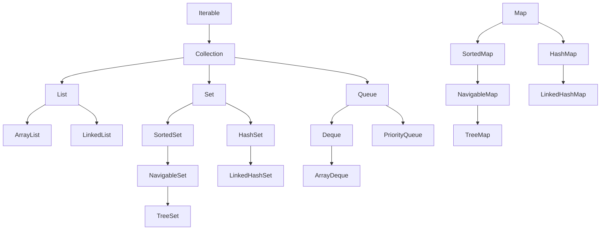

# Java Collections Framework

Choosing a collection is a design decision with performance, memory and concurrency consequences. Know the data structure behind each and you can answer almost any variation.

<Outcomes items={[
  "Pick the right collection for a given access pattern",
  "State the time complexity of common list, set and map operations",
  "Explain fail-fast iterators and unmodifiable versus immutable collections"
]} />

## Hierarchy at a glance



`Map` is not a `Collection`. Sets are backed by maps (`HashSet` wraps a `HashMap`, `TreeSet` a `TreeMap`).

## Complexity cheat sheet

| Structure | get/contains | add | remove | Notes |
| --- | --- | --- | --- | --- |
| `ArrayList` | `O(1)` by index; `O(n)` search | amortised `O(1)` at end; `O(n)` in middle | `O(n)` | Contiguous array, growth ×1.5 |
| `LinkedList` | `O(n)` | `O(1)` at ends | `O(1)` if node known | Poor cache locality; ~24+ bytes/node overhead |
| `ArrayDeque` | `O(1)` ends | `O(1)` ends | `O(1)` ends | Circular array; best stack/queue |
| `HashSet`/`HashMap` | `O(1)` avg | `O(1)` avg | `O(1)` avg | See [HashMap internals](hashmap-internals.md) |
| `LinkedHashMap` | `O(1)` | `O(1)` | `O(1)` | Plus linked order |
| `TreeMap`/`TreeSet` | `O(log n)` | `O(log n)` | `O(log n)` | Red-black tree, sorted, range queries |
| `PriorityQueue` | peek `O(1)` | `O(log n)` | `O(log n)`; `O(n)` arbitrary | Binary heap; iteration order is **not** sorted |

## Lists

**`ArrayList`** is the default. Growth: when full, a new array of 1.5× size is allocated and copied, so appends are amortised `O(1)`. Presize with `new ArrayList<>(n)` when the size is known. Removing from the front or middle shifts elements (`System.arraycopy`, fast but `O(n)`).

**`LinkedList`** is almost never the right answer. The textbook advantage (`O(1)` insertion in the middle) requires already holding the node via an iterator; finding it is `O(n)` with a cache-hostile pointer chase. In practice `ArrayList` beats it for most sizes. Use `ArrayDeque` for queue/stack use.

**`CopyOnWriteArrayList`** copies the array on every write: great for rarely-modified listener lists with many readers, terrible for write-heavy data. Iterators see a snapshot and never throw `ConcurrentModificationException`.

**`Arrays.asList(...)`** is a fixed-size view over an array: `set` is allowed, `add`/`remove` throw `UnsupportedOperationException`, and writes pass through to the array.

## Queues and deques

- **`ArrayDeque`**: use as a stack (`push/pop/peek`) or queue (`offer/poll`). Faster than `Stack` (legacy, synchronized, extends `Vector`) and `LinkedList`. Does not permit nulls.
- **`PriorityQueue`**: heap ordered by natural order or a `Comparator`; `peek`/`poll` return the least element. Iteration and `toString` show heap array order, not sorted order. Not thread-safe; use `PriorityBlockingQueue` across threads.
- **`BlockingQueue`** implementations (`ArrayBlockingQueue`, `LinkedBlockingQueue`, `SynchronousQueue`) underpin thread pools and producer-consumer designs (see [Executors](../concurrency-jvm/executors.md)). **Always bound queues**; an unbounded queue hides overload until memory runs out.

```java
// Top-K with a bounded min-heap: O(n log k), constant extra memory
PriorityQueue<Integer> heap = new PriorityQueue<>();
for (int v : data) {
    heap.offer(v);
    if (heap.size() > k) heap.poll();     // drop the smallest
}
```

## Maps and sets

- `HashMap`/`HashSet` for general use; `LinkedHashMap` for predictable order or LRU (access-order mode); `TreeMap` for sorted keys and navigation (`floorKey`, `ceilingEntry`, `subMap`, `headMap`).
- `EnumMap`/`EnumSet` for enum keys: array/bitset backed, fastest and smallest.
- `TreeMap` uses `compareTo`/`Comparator` for equality, not `equals`. If the comparator is inconsistent with `equals`, the map violates the `Map` contract: `BigDecimal("2.0")` and `BigDecimal("2.00")` are distinct in a `HashSet` but one element in a `TreeSet`.

## Fail-fast iterators

`ArrayList`, `HashMap` and others keep a `modCount`. An iterator records it at creation and throws `ConcurrentModificationException` on `next()` if the collection was structurally modified by anything other than the iterator itself. Single-threaded code triggers it too:

```java
for (String s : list) {
    if (s.isEmpty()) list.remove(s);        // ConcurrentModificationException (usually)
}
list.removeIf(String::isEmpty);             // correct, and efficient
```

Fail-fast is best-effort: do not rely on it for thread safety.

## Immutable, unmodifiable and views

| Creation | Behaviour |
| --- | --- |
| `Collections.unmodifiableList(list)` | **View**: cannot modify through it, but changes to the original show through |
| `List.copyOf(list)` | Immutable **copy** (returns the same instance if already immutable) |
| `List.of(a, b)`, `Set.of`, `Map.of` | Immutable, compact; **reject nulls**; `Set.of`/`Map.of` have **randomised iteration order** per JVM run, and reject duplicates |
| `stream.toList()` (Java 16) | Unmodifiable, allows nulls |
| `Collectors.toList()` | Unspecified mutability (an `ArrayList` in practice); do not rely on it |

`subList(from, to)` returns a view backed by the original; structural changes to the original invalidate the sublist. Copy with `new ArrayList<>(list.subList(a, b))` if you keep it.

## Sequenced collections (Java 21)

`SequencedCollection`, `SequencedSet` and `SequencedMap` unify "first/last" and "reversed" operations across `List`, `Deque`, `LinkedHashSet`, `LinkedHashMap` and `TreeSet`/`TreeMap`:

```java
List<String> list = new ArrayList<>(List.of("a", "b", "c"));
list.getFirst();        // "a"
list.getLast();         // "c"
list.reversed();        // view: c, b, a
```

## Choosing, quickly

| Need | Pick |
| --- | --- |
| General list | `ArrayList` |
| Stack / queue | `ArrayDeque` |
| Lookup by key | `HashMap` |
| Unique elements, order irrelevant | `HashSet` |
| Insertion/access order | `LinkedHashMap`/`LinkedHashSet` |
| Sorted / range queries | `TreeMap`/`TreeSet` |
| Smallest/largest first | `PriorityQueue` |
| Concurrent map | `ConcurrentHashMap` |
| Concurrent sorted map | `ConcurrentSkipListMap` |
| Many readers, rare writes | `CopyOnWriteArrayList` |
| Producer-consumer | bounded `BlockingQueue` |

## Check yourself

<Checkpoint questions={[
  {
    "q": "You need fast append and random access by index. Which List fits best?",
    "options": [
      "ArrayList",
      "LinkedList",
      "Vector with synchronized wrappers",
      "CopyOnWriteArrayList"
    ],
    "answer": 0,
    "why": "ArrayList is a resizable array: O(1) index access and amortised O(1) append. LinkedList is rarely faster in practice."
  },
  {
    "q": "Why does modifying a list inside a for-each loop throw ConcurrentModificationException?",
    "options": [
      "Lists are not allowed to change while iterated in any language",
      "The iterator is fail-fast and detects a structural change via modCount",
      "The list is locked by the loop",
      "It only happens with parallel streams"
    ],
    "answer": 1,
    "why": "Fail-fast iterators compare an expected modification count with the collection's count and throw if they differ. Use iterator.remove() or removeIf."
  },
  {
    "q": "What does List.copyOf(list) return compared with Collections.unmodifiableList(list)?",
    "options": [
      "The same view in both cases",
      "A synchronized list",
      "An independent immutable copy, whereas unmodifiableList is only a read-only view",
      "A list that allows null elements"
    ],
    "answer": 2,
    "why": "unmodifiableList reflects later changes to the backing list; copyOf takes a snapshot that cannot change."
  }
]} />

## Common interview questions

**1. `ArrayList` vs `LinkedList`?**
`ArrayList` has `O(1)` indexed access and excellent cache locality; `LinkedList` has `O(1)` insertion only when you already hold the position and much higher memory overhead. `ArrayList` wins in nearly all real cases.

**2. What is `ConcurrentModificationException` and how do you avoid it?**
Thrown when a collection is structurally modified during iteration. Use the iterator's `remove`, `removeIf`, collect changes then apply them, or a concurrent collection if threads are involved.

**3. `Comparable` vs `Comparator`?**
`Comparable` defines a type's natural order (`compareTo`); `Comparator` defines external, composable orders: `Comparator.comparing(Person::lastName).thenComparing(Person::firstName).reversed()`.

**4. How does `PriorityQueue` order iteration?**
It does not. It is a binary heap; only `peek`/`poll` honour priority. To get sorted output, poll repeatedly or sort a copy.

**5. How does `TreeMap` guarantee order and what is the cost?**
A red-black tree keeps keys sorted with `O(log n)` operations and supports navigation methods; it requires comparable keys or a comparator consistent with `equals`.

**6. `HashSet` implementation?**
A `HashMap` where elements are keys and a shared dummy object is the value.

**7. When is `CopyOnWriteArrayList` appropriate?**
Read-mostly collections like listener registries, where iteration must not be blocked or fail and writes are rare.

**8. Why is `Stack` discouraged?**
It extends `Vector` (synchronized on every call) and exposes list operations that break stack semantics. Use `ArrayDeque`.

## Pitfalls

- `LinkedList` chosen by habit.
- Unbounded queues and lists in services.
- Mutating a list while iterating with a for-each loop.
- Assuming `Collectors.toList()` is immutable or mutable.
- Sorting with a comparator that subtracts ints (`a - b` overflows); use `Integer.compare`.
- Returning internal mutable collections from getters; return unmodifiable copies or views deliberately.

## Key takeaways

- Default to `ArrayList`, `HashMap`, `ArrayDeque`; reach for others for a reason.
- Know each structure's complexity and memory behaviour.
- Prefer immutable copies at API boundaries; understand views versus copies.
- Bound your queues.
