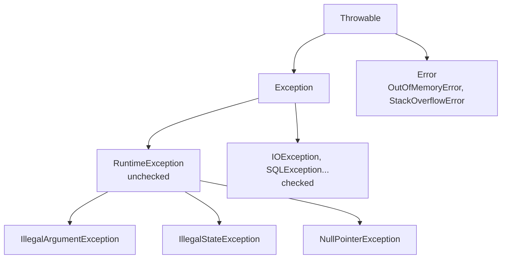

# Exception Handling

<Outcomes items={[
  "Choose checked versus unchecked exceptions for an API",
  "Write correct try-with-resources and avoid finally traps",
  "Handle InterruptedException properly and translate exceptions at boundaries"
]} />

## The hierarchy



- **Checked**: `Exception` subclasses that are not `RuntimeException`. The compiler forces callers to catch or declare them.
- **Unchecked**: `RuntimeException` and `Error`. No compile-time obligation.
- `Error`s signal JVM-level problems (OOM, stack overflow, linkage). Do not catch `Throwable` or `Error` to "recover" in business code, except at a top-level boundary to log and terminate or fail the request.

## Checked or unchecked?

The classic guidance: checked for **recoverable conditions the caller can reasonably handle**, unchecked for **programming errors**. In practice, modern Java and frameworks lean heavily on unchecked exceptions:

- Checked exceptions leak implementation details through layers (`SQLException` in a service interface) and do not compose with lambdas and streams.
- They encourage empty `catch` blocks and blanket `throws Exception`.
- Spring translates `SQLException` into an unchecked `DataAccessException` hierarchy.

A pragmatic rule: use **unchecked** exceptions by default, with meaningful domain types (`OrderNotFoundException`); use **checked** only at API boundaries where forcing the caller to decide is a real benefit (e.g. a library method where failure is expected and handling differs).

## Designing exceptions

```java
public class PaymentDeclinedException extends RuntimeException {
    private final String declineCode;

    public PaymentDeclinedException(String message, String declineCode, Throwable cause) {
        super(message, cause);                 // always keep the cause
        this.declineCode = declineCode;
    }

    public String declineCode() { return declineCode; }
}
```

Guidelines:

- Name by **what went wrong** in domain terms, not by layer.
- Always chain the cause (`new X("msg", e)`); losing it destroys the diagnostic trail.
- Put machine-readable data in fields (codes, ids), not only in the message string; callers should not parse messages.
- Keep messages useful: include the identifiers and the violated rule, but **never** secrets or personal data.
- Do not use exceptions for normal control flow (a loop terminating via `NoSuchElementException`); it is slow and obscure.

## try-with-resources

Any `AutoCloseable` is closed automatically, in reverse order of declaration, even on exception.

```java
try (var in = Files.newInputStream(src);
     var out = Files.newOutputStream(dst)) {
    in.transferTo(out);
}
```

If the body throws and `close()` also throws, the **body's exception is primary** and the close exception is attached as a **suppressed** exception (`e.getSuppressed()`). With a manual `try/finally`, the exception from `finally` would **replace** the original and hide the real cause, a classic bug that try-with-resources fixes.

Implement `AutoCloseable` for your own resources (locks, transactions, scoped contexts) and prefer this pattern over manual cleanup.

## `finally` traps

```java
static int broken() {
    try {
        throw new IllegalStateException("lost");
    } finally {
        return 42;                  // swallows the exception; compiler warns
    }
}
```

- A `return` or `throw` in `finally` overrides the try block's outcome and discards its exception.
- `finally` does not run if the JVM exits (`System.exit`), the thread is killed, or an infinite loop precedes it.
- Keep `finally` for cleanup only, and keep it from throwing.

## Catching: precision and rethrowing

```java
try {
    process();
} catch (IOException | TimeoutException e) {     // multi-catch: unrelated types, e is effectively final
    throw new ProcessingException("processing failed for " + id, e);   // translate and keep the cause
}
```

- Catch the most specific type you can handle; order matters (specific before general, else a compile error).
- Either **handle** an exception or **propagate** it (translated if crossing a layer). Never both log-and-rethrow at every layer; you get the same stack trace logged five times. Log once, at the boundary that handles it.
- Never write an empty `catch`. If ignoring is intended, comment why (and prefer logging at debug).
- Precise rethrow (Java 7): `catch (Exception e) { throw e; }` in a method that declares only specific checked exceptions compiles if the try block throws only those.

## `InterruptedException`

Thread interruption is a cooperative cancellation signal. When you catch `InterruptedException`, the interrupt flag has been **cleared**; swallowing it breaks shutdown logic in executors and frameworks.

```java
try {
    queue.take();
} catch (InterruptedException e) {
    Thread.currentThread().interrupt();       // restore the flag
    return;                                   // and stop, or propagate
}
```

Either propagate the exception or restore the flag. Never ignore it.

## Cost of exceptions

Creating an exception captures the stack trace (`fillInStackTrace`), which is the expensive part (microseconds, proportional to stack depth). Throwing and catching is cheap relative to that. For high-frequency, expected failures consider returning a result type (sealed interface or `Optional`) instead; for rare unexpected failures exceptions are fine. Pre-allocated stackless exceptions (override `fillInStackTrace` or use the 4-argument constructor with `writableStackTrace=false`) are used in some high-performance code but make debugging harder.

## Exception translation at boundaries

```java
public Order find(long id) {
    try {
        return jdbc.queryForObject(SQL, mapper, id);
    } catch (EmptyResultDataAccessException e) {
        throw new OrderNotFoundException(id);              // domain exception, no persistence types leaked
    }
}
```

Controllers then map domain exceptions to HTTP statuses centrally (see [REST exception handling](../../spring/boot/exception-handling.md)).

## Check yourself

<Checkpoint questions={[
  {
    "q": "A resource in try-with-resources and the body both throw. Which exception is thrown?",
    "options": [
      "The body's exception, with the close exception attached as suppressed",
      "The close exception, the body's is lost",
      "A new combined exception",
      "Neither, they cancel out"
    ],
    "answer": 0,
    "why": "try-with-resources keeps the primary exception and records close failures via addSuppressed, unlike try/finally which can mask it."
  },
  {
    "q": "You catch InterruptedException and cannot rethrow it. What should you do?",
    "options": [
      "Ignore it",
      "Restore the flag with Thread.currentThread().interrupt()",
      "Call Thread.stop()",
      "Wrap it in a RuntimeException and continue looping"
    ],
    "answer": 1,
    "why": "Swallowing the interrupt hides a cancellation request from callers. Re-set the flag so higher layers can see it."
  },
  {
    "q": "Where should a database SQLException be translated?",
    "options": [
      "Never, let it propagate to the controller",
      "In the UI",
      "At the boundary, into a domain or runtime exception that does not leak the technology",
      "Inside every getter"
    ],
    "answer": 2,
    "why": "Exception translation keeps layers decoupled from persistence details."
  }
]} />

## Common interview questions

**1. Checked vs unchecked: which do you prefer and why?**
Unchecked for most code, because checked exceptions leak abstractions, clutter signatures and break lambdas; use checked ones sparingly where callers genuinely must react. Wrap low-level checked exceptions into domain unchecked exceptions with the cause attached.

**2. What happens if both the try block and `close()` throw in try-with-resources?**
The try block's exception propagates; the `close()` exception is added to it via `addSuppressed`.

**3. Can `finally` change the returned value?**
If `finally` has its own `return`, it overrides. If it only modifies a variable already evaluated for return, a primitive's returned value is unaffected, but a mutated object reference shows the changes.

**4. What is the difference between `NoClassDefFoundError` and `ClassNotFoundException`?**
`ClassNotFoundException` (checked) occurs when code explicitly loads a class by name (`Class.forName`) and it is not found. `NoClassDefFoundError` (an `Error`) occurs when a class that was present at compile time is missing or failed to initialise at runtime.

**5. How do you handle an exception in a thread pool task?**
`execute` passes it to the thread's uncaught exception handler; `submit` captures it in the `Future` (visible only via `get()`, so unobserved failures vanish). Wrap tasks with logging or call `get()`/handle via `CompletableFuture.exceptionally`.

**6. Why restore the interrupt flag?**
Callers up the stack (executors, shutdown hooks) rely on `Thread.interrupted()` to stop work; swallowing the signal makes cancellation silently fail.

**7. What is `StackOverflowError`, and can you recover from it?**
Thrown when the thread stack is exhausted, usually by unbounded recursion. You can catch it, but state may be inconsistent; fix the recursion or increase stack size (`-Xss`) only if the depth is legitimate.

**8. How should REST services expose errors?**
Translate to a stable error contract (e.g. RFC 9457 problem details) at one place, log with a correlation id, and never leak stack traces or internals.

## Pitfalls

- Catching `Exception`/`Throwable` broadly and continuing.
- Log-and-throw at every layer.
- Losing the cause when wrapping.
- Return inside `finally`.
- Swallowing `InterruptedException`.
- Using exceptions for flow control in hot paths.
- Exposing exception messages containing sensitive data.

## Key takeaways

- Prefer unchecked, domain-specific exceptions; always chain causes.
- Use try-with-resources; learn suppressed exceptions.
- Handle exceptions once, at the right boundary; translate across layers.
- Restore the interrupt flag; never swallow cancellation.
