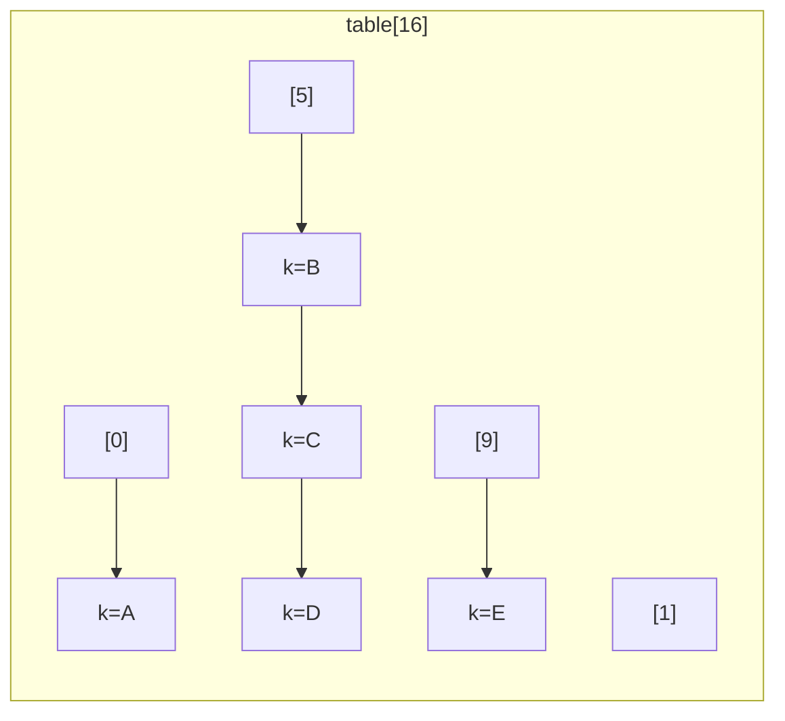

# HashMap Internals

<Outcomes items={[
  "Compute a key's bucket by hand: hashCode, spread, mask",
  'Explain when a bucket turns into a tree and when the table resizes instead',
  'Predict what breaks when a key is mutable or hashCode is poor',
]} />

## Structure

A `HashMap` is an array of **buckets** (`Node<K,V>[] table`). Each bucket holds a singly linked list of `Node` objects (`hash`, `key`, `value`, `next`), which may convert to a red-black tree (`TreeNode`) under heavy collision.



Defaults: initial capacity **16**, load factor **0.75**. The table is allocated lazily on the first `put`. Capacity is always a **power of two**.

## Try it: watch a HashMap work

Add keys and watch where they land. Then use the pile-up button: it adds nine keys that all hash to bucket 0, so you can see the chain grow, the table resize instead of treeifying while it is small, and the tree appear only once the table has 64 buckets.

<HashMapLab />

## `put` step by step

1. **Hash spreading**: `h = key.hashCode(); hash = h ^ (h >>> 16)`. XOR-ing the high 16 bits into the low 16 bits matters because the index uses only the low bits; without it, keys differing only in high bits (e.g., floats, large sequential values) collide.
2. **Index**: `index = (n - 1) & hash`, a bit mask that equals `hash % n` for power-of-two `n`, but faster.
3. **Empty bucket** → store a new node.
4. **Non-empty** → walk the bucket: if a node has the same `hash` **and** (`==` the key or `equals`), replace the value; otherwise append to the end (Java 8+ appends at the tail; Java 7 inserted at the head).
5. If a bucket already holds **8** nodes (`TREEIFY_THRESHOLD`) and another key lands in it, and the table capacity is at least **64** (`MIN_TREEIFY_CAPACITY`), the bucket is converted to a red-black tree. If capacity is smaller, the map **resizes** instead.
6. If `++size > threshold` (capacity × load factor), **resize**.

`get` mirrors this: compute the hash and index, check the first node, then walk the list or search the tree. Average `O(1)`; worst case `O(log n)` in Java 8+ (was `O(n)` before treeification), provided keys are `Comparable` or have a usable tie-breaker.

Treeified bins are untreeified when they shrink to **6** or fewer nodes (the gap between 8 and 6 prevents flapping). Tree bins order first by hash, then by `compareTo` if the keys implement `Comparable` of the same class, then by an identity tie-breaker, so keys that are not `Comparable` make lookups in a degenerate bucket scan both subtrees.

## Resizing

When the entry count exceeds `capacity * 0.75`, the table doubles and entries are redistributed. Because capacity doubles, each node either stays at its index or moves to `index + oldCapacity`, determined by a single bit: `(hash & oldCap) == 0` → stays. Java 8 splits each bucket into a "low" and "high" list in one pass, preserving relative order. Resizing is `O(n)` and allocates a new array, so it is a latency spike in a hot path.

## Capacity planning

If you know you will store `n` entries, presize to avoid repeated resizes:

```java
// Java 19+
Map<String, Integer> m = HashMap.newHashMap(expectedEntries);

// Before Java 19: capacity must be n / 0.75 + 1, otherwise a resize still happens
Map<String, Integer> m2 = new HashMap<>((int) (expectedEntries / 0.75f) + 1);
```

`new HashMap<>(100)` does **not** hold 100 entries without resizing: capacity rounds up to 128, threshold 96. (This is a classic gotcha.)

Memory: each entry costs about 32+ bytes of `Node` (header, hash, key ref, value ref, next ref) plus the boxed key/value objects. Millions of small entries in a `HashMap<Integer,Integer>` waste memory; primitive-specialised collections (Eclipse Collections, fastutil) or arrays are far smaller.

## Keys: the contract that makes it work

- `equals` and `hashCode` must agree: equal objects must have equal hash codes.
- Keys must be **effectively immutable**. Mutating a field used in `hashCode` after insertion makes the entry unreachable (it sits in the old bucket) and leaks memory.
- `null` is allowed as a key (hash 0, bucket 0) and as values in `HashMap` (not in `ConcurrentHashMap` or `Hashtable`).
- Bad hash codes degrade performance, and attackers can exploit it: crafted colliding keys turn a web service into an `O(n²)` hash-flooding victim. Treeification (and `Comparable` keys) mitigates this; keep untrusted keys as `String`s (whose hash is well distributed and cached).

```java
record Point(int x, int y) { }                 // records generate consistent equals/hashCode

Map<Point, String> map = new HashMap<>();
Point p = new Point(1, 2);
map.put(p, "a");
map.get(new Point(1, 2));                      // "a"
```

## Iteration and fail-fast behaviour

`HashMap` iteration order is unspecified and can change after a resize. Iterators are **fail-fast**: structural modification during iteration (other than via the iterator's `remove`) throws `ConcurrentModificationException` on a best-effort basis via the `modCount` field. It is a bug detector, not a concurrency guarantee.

```java
for (var e : map.entrySet()) {
    if (e.getValue() == null) map.remove(e.getKey());     // ConcurrentModificationException
}
map.entrySet().removeIf(e -> e.getValue() == null);       // correct
```

## Thread safety

`HashMap` is not thread-safe. Concurrent writes can lose updates, corrupt sizes and, in Java 7, form a cyclic linked list during resize leading to an infinite loop at 100% CPU. Java 8 changed the transfer algorithm so the infinite loop is gone, but races still cause lost data and `NullPointerException`s inside tree operations. Use `ConcurrentHashMap` (see [next page](concurrenthashmap.md)); `Collections.synchronizedMap` locks the whole map and does not make compound operations atomic.

## Related maps

| Map | Order | Use |
| --- | --- | --- |
| `LinkedHashMap` | Insertion or access order | LRU caches, predictable iteration |
| `TreeMap` | Sorted by key (red-black tree, `O(log n)`) | Range queries (`subMap`, `floorKey`) |
| `IdentityHashMap` | Compares keys by `==` | Graph traversals, serialization frameworks |
| `EnumMap` | Enum ordinal | Compact, fast, enum keys |
| `WeakHashMap` | Keys held weakly | Canonicalising caches (rarely right; prefer Caffeine) |

An LRU cache with `LinkedHashMap`:

```java
class LruCache<K, V> extends LinkedHashMap<K, V> {
    private final int capacity;

    LruCache(int capacity) {
        super(16, 0.75f, true);              // true = access order
        this.capacity = capacity;
    }

    @Override
    protected boolean removeEldestEntry(Map.Entry<K, V> eldest) {
        return size() > capacity;
    }
}
```

This is not thread-safe; wrap with `Collections.synchronizedMap` for light use, or use Caffeine for real caches.

## Check yourself

<Checkpoint questions={[
  {
    q: 'A HashMap has capacity 16. A key has spread hash 37. Which bucket does it use?',
    options: ['37', '5', '16', '0'],
    answer: 1,
    why: 'index = hash & (n - 1) = 37 & 15 = 5. The mask keeps the low 4 bits (37 is 100101 in binary, low four bits 0101).',
  },
  {
    q: 'Nine keys collide in one bucket of a 16-bucket map. What happens?',
    options: ['The bucket becomes a red-black tree', 'The table resizes to 32 instead of treeifying', 'put throws an exception', 'The oldest key is evicted'],
    answer: 1,
    why: 'Treeification needs a table of at least 64 buckets (MIN_TREEIFY_CAPACITY). With a smaller table, HashMap resizes instead, hoping the keys spread out.',
  },
  {
    q: 'Why is a mutable object a dangerous HashMap key?',
    options: ['It uses more memory', 'If its hashCode changes after insertion, lookups search the wrong bucket', 'Mutable keys cannot be compared', 'It forces a resize on every put'],
    answer: 1,
    why: 'The bucket is chosen from the hash at insertion time. If the fields behind hashCode change later, get() computes a different index and the entry looks lost.',
  },
]} />

## Common interview questions

**1. How does `HashMap` work internally?**
An array of buckets indexed by `(n-1) & spread(hashCode)`. Collisions form a linked list that becomes a red-black tree at 8 nodes (when the table has at least 64 buckets). The table doubles when size exceeds capacity × 0.75.

**2. Why is capacity a power of two?**
It lets the index be computed with a bit mask instead of modulo, and makes resize splitting trivial (each node keeps its index or moves by `oldCapacity`).

**3. What happens when two different keys have the same hash code?**
They land in the same bucket; the map compares `hash` then `equals` while walking the chain, so both are stored and retrieved correctly, with slower lookups for that bucket.

**4. What changed in Java 8?**
Treeified buckets, tail insertion, simplified hash spreading (`h ^ h>>>16`), and order-preserving resize splitting.

**5. Why must keys be immutable?**
The bucket is chosen at insertion from the hash; a later change to the key's state changes the hash, so `get` looks in a different bucket and fails to find the entry.

**6. `HashMap` vs `Hashtable` vs `ConcurrentHashMap`?**
`Hashtable`: legacy, fully synchronized, no nulls. `ConcurrentHashMap`: scalable concurrent access, no nulls, atomic compound operations. `HashMap`: fastest, unsynchronized, allows one null key.

**7. How would you size a map for 1 million entries?**
`HashMap.newHashMap(1_000_000)` (Java 19+) or `new HashMap<>((int)(1_000_000 / 0.75f) + 1)`. Also consider the memory cost of boxing, and whether a specialised primitive map fits.

**8. What is the time complexity of `get`?**
Average `O(1)`, worst case `O(log n)` with treeification (`O(n)` if all keys collide and are not comparable, since tree search degenerates).

## Pitfalls

- Mutable keys, or `equals` without `hashCode`.
- Assuming iteration order, or that `new HashMap<>(n)` holds `n` entries without resizing.
- Sharing a `HashMap` between threads "because it is mostly reads".
- Using `Object[]`/arrays as keys (identity hash, not content).
- `Objects.hash(...)` in a hot path creates an array and boxes primitives; compute manually when profiling shows it matters.

## Key takeaways

- Index = `(n-1) & (h ^ h>>>16)`; collisions are lists, then trees at 8 (capacity ≥ 64).
- Resize doubles capacity and is `O(n)`; presize when you know the size.
- Correct `equals`/`hashCode` and immutable keys are non-negotiable.
- Use `ConcurrentHashMap` for shared mutable maps.
