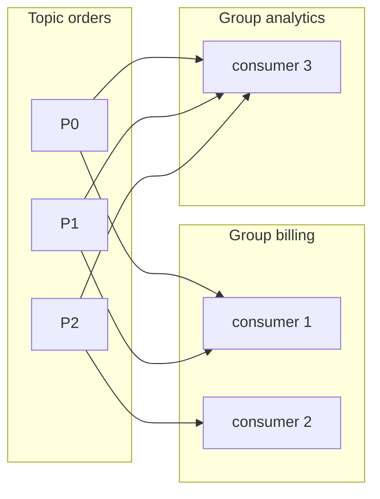

# Consumers, Offsets and Delivery Semantics

<Outcomes items={[
  "Explain consumer groups, offsets and rebalancing",
  "Choose commit strategy for at-least-once delivery",
  "Monitor consumer lag"
]} />

## Consumer groups

A **consumer group** is a set of consumers that cooperate to read a topic. Kafka assigns each partition to **exactly one** consumer in the group at a time; different groups are independent and each receives **every** record.



I verified this on an embedded broker: two consumers in the group `billing` split the partitions between them with no overlap, while a separate group `analytics` received all 30 test messages.

Rules that follow:

- **Max parallelism of a group = number of partitions.** Consumers beyond that sit idle.
- Fewer consumers than partitions: some consumers read several partitions.
- Ordering within a partition is preserved for the consumer that owns it.
- Adding a new use case (new group) never affects existing consumers: Kafka's main advantage over queue semantics.

## Offsets

The consumer tracks its position per partition. **Committing** an offset records "I have processed up to here" in the internal topic `__consumer_offsets`, keyed by (group, topic, partition). After a restart or rebalance, a consumer resumes from the **last committed offset**.

- `auto.offset.reset` applies only when the group has **no committed offset** (new group) or it is out of range: `earliest` (start from the beginning) or `latest` (only new records). `none` fails.
- **Committed offset = next record to read** (last processed + 1).
- You can **seek** to any offset or timestamp to replay (`consumer.seek`, `kafka-consumer-groups --reset-offsets`), a powerful tool for reprocessing after a bug fix.

### Commit strategies

| Strategy | Behaviour | Risk |
| --- | --- | --- |
| **Auto commit** (`enable.auto.commit=true`, every 5 s) | Commits offsets of records returned by `poll()` periodically | May commit **before** processing finishes: message loss on crash (at-most-once) |
| **Manual, after processing** | Process, then `commitSync()`/`commitAsync()` | Crash after processing but before commit: reprocessing (**at-least-once**) |
| **Per record / per batch commit** | Finer granularity | More commit overhead |
| **Transactional (exactly-once)** | Offsets committed with output records in a Kafka transaction | Complexity, Kafka-only scope |

In Spring Kafka set `enable-auto-commit: false` and an `AckMode`:

```java
@KafkaListener(topics = "orders", groupId = "billing")
void handle(ConsumerRecord<String, String> record, Acknowledgment ack) {
    process(record);          // business logic (idempotent!)
    ack.acknowledge();        // commit after success (AckMode.MANUAL / MANUAL_IMMEDIATE)
}
```

Default `AckMode.BATCH` commits after the whole batch returned by `poll()` is processed successfully; an exception triggers the error handler (retry/skip/DLT, see [Ordering and design](kafka-ordering-design.md)).

## Rebalancing

When group membership or topic metadata changes (consumer joins, leaves, crashes, partitions added), the group **rebalances**: partitions are reassigned.

- **Eager** (classic) rebalancing: all consumers **stop and give up all partitions**, then get new assignments: a stop-the-world pause for the whole group.
- **Cooperative** rebalancing (`CooperativeStickyAssignor`, default in newer clients combined with the sticky assignor): only the partitions that need to move are revoked, the rest keep processing.
- **Static membership** (`group.instance.id`) lets a restarting consumer reclaim its partitions without triggering a rebalance if it returns within `session.timeout.ms`: great for rolling restarts and Kubernetes pods with stable identity.

What triggers **unwanted** rebalances:

- Processing a batch takes longer than **`max.poll.interval.ms`** (default 5 min): the consumer is considered stuck and kicked out. Fix by processing faster, lowering `max.poll.records`, or moving slow work to another thread pool (and managing offsets carefully).
- Missed heartbeats within **`session.timeout.ms`** (default 45 s in recent clients; heartbeats run on a background thread every `heartbeat.interval.ms`): GC pauses, container CPU throttling, network issues.
- Frequent deployments with eager rebalancing; autoscaling flapping.

Keep the processing code **fast, bounded and idempotent**; do not block inside the listener on slow remote calls without timeouts.

## Delivery semantics

| Semantics | Meaning | How |
| --- | --- | --- |
| **At-most-once** | May lose, never duplicate | Commit **before** processing (auto-commit can behave like this) |
| **At-least-once** | Never lose, may duplicate | Commit **after** processing; the default recommended approach |
| **Exactly-once** | Effects happen once | Idempotent producer + **transactions** + `isolation.level=read_committed`, or idempotent processing |

### Exactly-once: what it really means

Kafka's exactly-once semantics (EOS) covers **consume → process → produce within Kafka**: the consumed offsets and produced records commit atomically in one transaction, and downstream consumers using `read_committed` never see aborted writes. Kafka Streams enables it with `processing.guarantee=exactly_once_v2`.

```java
// spring.kafka.producer.transaction-id-prefix=tx- ; listener container uses transactions
@KafkaListener(topics = "payments")
@Transactional("kafkaTransactionManager")
void process(PaymentRequested e) {
    kafkaTemplate.send("payment-results", e.orderId(), compute(e));   // output + offset commit are atomic
}
```

EOS does **not** extend to external systems: writing to a database or calling an HTTP API is not part of the Kafka transaction. For those, achieve **effectively-once** by making the effect **idempotent**:

- Natural idempotence (upsert by id, set absolute state).
- **Deduplication table**: store the processed event id (or `topic-partition-offset`) with a unique constraint **in the same database transaction** as the business change (see [Outbox and idempotency](../microservices/data-consistency/outbox-idempotency.md)).
- Business keys and conditional updates (`UPDATE ... WHERE status = 'NEW'`).

The practical standard: **at-least-once delivery + idempotent consumers**.

### Writing to a database and Kafka

Dual writes (database + Kafka) are not atomic. Use the **transactional outbox** (write the event in the same DB transaction; a relay or CDC publishes it) for database → Kafka, and idempotent consumers for Kafka → database.

## Consumer lag

**Lag** = latest offset in a partition − the group's committed offset: how far behind the consumer is. It is the most important consumer health metric.

- Rising lag means consumers are slower than producers: add consumers (up to the partition count), speed up processing, increase batch size/`fetch` settings, or add partitions.
- Monitor per partition (one stuck partition indicates a poison message or slow key) with Burrow, Kafka UI, Prometheus kafka-exporter or Micrometer consumer metrics; alert on lag growth and age, not just absolute values.
- `kafka-consumer-groups.sh --describe --group billing` shows current offset, log end offset and lag per partition.

## Poll loop and throughput tuning

| Setting | Effect |
| --- | --- |
| `max.poll.records` (500) | Records per `poll()`; lower for slow processing |
| `fetch.min.bytes` / `fetch.max.wait.ms` | Batch fetches for throughput vs latency |
| `max.partition.fetch.bytes` | Per-partition fetch size cap |
| `max.poll.interval.ms` | Max time between polls before eviction |
| `session.timeout.ms` / `heartbeat.interval.ms` | Failure detection speed vs false positives |
| Spring `concurrency` (listener threads) | Number of consumers in this instance (≤ partitions in total) |
| Batch listeners (`List<ConsumerRecord>`) | Process in batches (e.g. bulk DB inserts) |

A `KafkaConsumer` is **not thread-safe**; Spring runs one consumer per concurrency thread. Do not share it across threads.

For processing that is slow per record, scale partitions and consumers rather than spawning threads inside the listener (which breaks ordering and offset-commit correctness).

## Consumer isolation levels

`isolation.level=read_committed` hides records from open or aborted transactions (required for EOS pipelines); `read_uncommitted` (default) sees everything. A hanging transaction can delay `read_committed` consumers (the last stable offset does not advance).

## Check yourself

<Checkpoint questions={[
  {
    "q": "When should a consumer commit its offset to get at-least-once delivery?",
    "options": [
      "After the record has been processed",
      "Before processing",
      "Never",
      "Only at shutdown"
    ],
    "answer": 0,
    "why": "Committing after processing means a crash causes a re-read, so handlers must be idempotent."
  },
  {
    "q": "What triggers a rebalance?",
    "options": [
      "A new message arriving",
      "A consumer joining, leaving or being considered dead (missed poll or heartbeat)",
      "A producer restart",
      "A topic being read"
    ],
    "answer": 1,
    "why": "Rebalances pause consumption, so keep poll loops short and use static membership or cooperative rebalancing."
  },
  {
    "q": "What does consumer lag measure?",
    "options": [
      "Network latency to the broker",
      "Disk usage",
      "How far the group's committed offset is behind the end of the partition",
      "Producer speed only"
    ],
    "answer": 2,
    "why": "Growing lag means consumers cannot keep up."
  }
]} />

## Common interview questions

**1. How does a consumer group work?**
Partitions of a topic are divided among the consumers of a group, each partition read by one consumer at a time; groups are independent, so each receives all records. Maximum parallelism equals the partition count.

**2. What is an offset and where is it stored?**
The record's position within a partition; consumers commit the next offset to read in the internal `__consumer_offsets` topic, per group and partition.

**3. What causes rebalances and how do you reduce them?**
Joins/leaves/crashes, slow processing exceeding `max.poll.interval.ms`, missed heartbeats. Use cooperative sticky assignor, static membership, smaller poll batches, fast bounded processing.

**4. At-least-once vs at-most-once vs exactly-once?**
Commit after processing (duplicates possible) vs commit before (loss possible) vs transactional atomic consume-process-produce within Kafka; practically use at-least-once with idempotent processing.

**5. Is Kafka exactly-once?**
Within Kafka (transactions + idempotent producer + read_committed). Side effects in external systems need idempotency or the outbox; EOS does not cover them.

**6. What happens to a message that always fails?**
A poison message blocks its partition if retried forever; use bounded retries with backoff and a dead-letter topic, so the consumer continues.

**7. How do you replay data?**
Reset the group's offsets (to earliest, a timestamp, or specific offsets) with the CLI or `seek`, with consumers stopped; consumers must be idempotent to tolerate reprocessing.

**8. What is consumer lag and how do you act on it?**
Distance between the log end and the group's committed offset; add consumers/partitions, optimise processing, check for stuck partitions or poison messages.

**9. Auto commit: good or bad?**
Convenient but it can acknowledge records before they are processed, risking loss; use manual/after-processing commits for important data.

## Pitfalls

- Auto commit with asynchronous processing.
- Processing longer than `max.poll.interval.ms`, causing endless rebalances.
- Consumers outnumbering partitions (idle) or one hot partition (key skew).
- Non-idempotent handlers with at-least-once delivery.
- Assuming exactly-once covers database writes.
- Sharing a `KafkaConsumer` across threads.
- Blocking indefinitely in the listener on remote calls.

## Key takeaways

- One consumer per partition per group; groups are independent.
- Commit after processing; make handlers idempotent; expect duplicates.
- Reduce rebalances with cooperative assignors, static membership and bounded processing time.
- Watch lag per partition; it is your primary health signal.

Next: [Ordering, partitioning and error-handling design](kafka-ordering-design.md).
