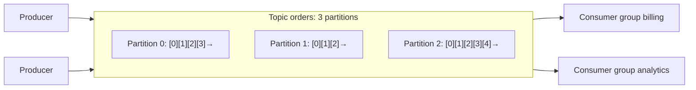
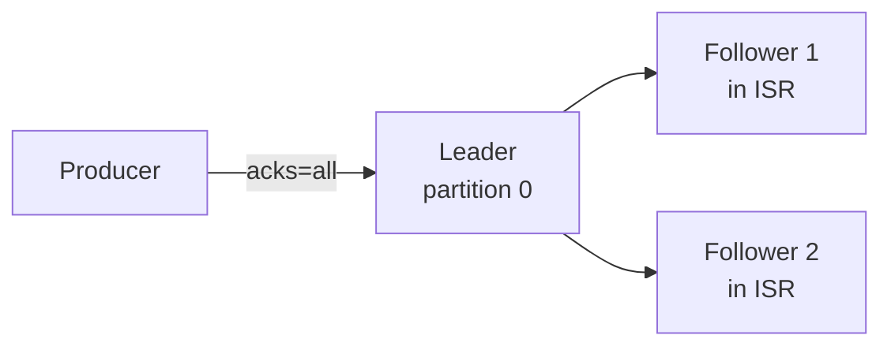

# Kafka Fundamentals

<Outcomes items={[
  'Describe topics, partitions and offsets, and where ordering is guaranteed',
  'Predict which partition a keyed record lands in and why partition count matters',
  'Explain how replication and acks decide whether a record can be lost',
]} />

## Core concepts



| Concept | Meaning |
| --- | --- |
| **Topic** | Named stream of records (a category such as `orders`) |
| **Partition** | An ordered, append-only log; the unit of **parallelism** and **ordering** |
| **Offset** | A record's sequential position within its partition (not global) |
| **Record** | Key (optional), value, timestamp, headers |
| **Broker** | A Kafka server; a cluster has several |
| **Consumer group** | Consumers sharing the work of a topic: each partition goes to **one** consumer in the group (see [Consumers and offsets](kafka-consumers-offsets.md)) |
| **Controller** | Manages cluster metadata and leader election. **KRaft** (Raft-based, built into Kafka) replaced ZooKeeper; ZooKeeper mode is removed in Kafka 4.0 |

**Ordering is guaranteed only within a partition**, never across a topic. Records with the same key go to the same partition (hash of the key), so per-key order is preserved (see [Ordering and design](kafka-ordering-design.md)).

## Try it: partitions and consumers

Send records with different keys, then change the partition count and the consumer count. Watch two things: the same key always lands in the same partition, and extra consumers sit idle once they outnumber partitions.

<KafkaLab />

## Storage: why Kafka is fast

Each partition is a directory of **segment files** (default 1 GB or 7 days per segment); records are appended sequentially, and an index maps offsets to file positions. Old segments are deleted or compacted according to retention policy.

- **Sequential disk I/O** is fast, close to memory speed on modern disks, and writes go to the OS **page cache**; Kafka relies on the page cache rather than its own heap cache.
- **Zero-copy**: consumers' reads are served from the page cache to the socket with `sendfile`, skipping user-space copies (when not using TLS).
- **Batching and compression**: producers and brokers handle batches, with `lz4`/`zstd`/`snappy`/`gzip` compression.
- Partitioning spreads load across brokers and consumers.

## Replication and durability

Each partition has a **leader** and **followers** (replication factor, typically 3). Producers and consumers talk to the leader; followers fetch from it. The **in-sync replicas (ISR)** are the followers caught up with the leader.



Durability settings (set together):

| Setting | Recommended for important data | Meaning |
| --- | --- | --- |
| `replication.factor` | 3 | Copies of each partition |
| `min.insync.replicas` | 2 | Writes with `acks=all` need at least this many in-sync replicas, else they fail (`NotEnoughReplicas`) |
| `acks` (producer) | `all` | Leader acknowledges after the full ISR has the record |
| `unclean.leader.election.enable` | `false` | Never elect an out-of-sync replica (avoids data loss, risks unavailability) |

With RF=3, `min.insync.replicas=2`, `acks=all`, the cluster survives **one** broker failure without losing acknowledged data or availability; two failures stop writes (consistency over availability, a CP choice). `acks=1` risks losing records if the leader fails before replication; `acks=0` is fire-and-forget.

## Producers

```java
@Bean
ProducerFactory<String, String> producerFactory() {
    Map<String, Object> cfg = Map.of(
        ProducerConfig.BOOTSTRAP_SERVERS_CONFIG, "kafka:9092",
        ProducerConfig.KEY_SERIALIZER_CLASS_CONFIG, StringSerializer.class,
        ProducerConfig.VALUE_SERIALIZER_CLASS_CONFIG, StringSerializer.class,
        ProducerConfig.ACKS_CONFIG, "all",
        ProducerConfig.ENABLE_IDEMPOTENCE_CONFIG, true,
        ProducerConfig.COMPRESSION_TYPE_CONFIG, "lz4",
        ProducerConfig.LINGER_MS_CONFIG, 10,                       // wait up to 10 ms to fill a batch
        ProducerConfig.BATCH_SIZE_CONFIG, 64 * 1024,
        ProducerConfig.DELIVERY_TIMEOUT_MS_CONFIG, 120_000);
    return new DefaultKafkaProducerFactory<>(cfg);
}

kafkaTemplate.send("orders", order.customerId(), json)       // key = customerId: per-customer ordering
             .whenComplete((result, ex) -> {
                 if (ex != null) { /* handle failure: retry, alert, outbox */ }
             });
```

Key producer behaviours:

- **Batching**: records for a partition accumulate until `batch.size` is full or `linger.ms` elapses. A small `linger.ms` raises throughput at the cost of latency.
- **Retries and ordering**: with retries enabled and `max.in.flight.requests.per.connection > 1`, a retried batch can land **after** a later one, reordering. **`enable.idempotence=true`** (default since Kafka 3.0) assigns sequence numbers so the broker de-duplicates retries and preserves order (up to 5 in-flight requests).
- **Idempotent producer** removes duplicates caused by producer retries **within a session and partition**, not duplicates from your application sending the same business event twice.
- `send` is **asynchronous**; failures show up in the callback. Do not ignore it, and do not call `.get()` per message in a hot path.
- **Transactions** (`transactional.id`) let a producer write to several partitions/topics atomically and commit consumer offsets in the same transaction (exactly-once within Kafka).
- Large messages (> 1 MB) are an anti-pattern: store payloads in object storage and send a reference.

## Retention and compaction

| Policy | Behaviour | Use |
| --- | --- | --- |
| **Delete** (`retention.ms`, `retention.bytes`) | Segments older/larger than the limit are removed | Event streams, logs |
| **Compact** (`cleanup.policy=compact`) | Keeps at least the **latest record per key**; a record with a `null` value (tombstone) deletes the key | Changelogs, current-state tables (customer profile), Kafka Streams state, `__consumer_offsets` |

Compaction does not give a consistent snapshot instantly (the active segment is not compacted) and tombstones live for `delete.retention.ms`.

## Topic and cluster design basics

- **Partitions** set max consumer parallelism per group and throughput; you can **add** partitions but not remove them, and adding changes key → partition mapping for new records (breaking per-key ordering for existing keys). Plan with headroom (a common start is 6 to 30 per topic, sized from target throughput ÷ per-partition throughput).
- Too many partitions increase broker memory, file handles, leader election time and end-to-end latency; thousands per broker needs care.
- Topic naming and ownership conventions, ACLs per topic, quotas.
- Monitor: under-replicated partitions, ISR shrink events, request latency, disk usage, consumer lag, controller status.

## Kafka vs traditional message queues

| | Kafka | RabbitMQ / classic MQ |
| --- | --- | --- |
| Model | Distributed log, pull-based consumers, retention | Broker routes messages to queues, push-based, deleted on ack |
| Replay | Yes (seek to any offset) | No (stream/queue types aside) |
| Ordering | Per partition | Per queue (one consumer) |
| Throughput | Very high (millions msg/s cluster) | Moderate (tens of thousands/s per node) |
| Routing | Topic + key (simple) | Rich exchanges (topic, headers) |
| Consumers per message | Many independent groups reading the same data | Competing consumers per queue; fan-out via multiple queues |
| Per-message features | Basic (headers) | TTL, priorities, delayed delivery, per-message routing |

See [RabbitMQ basics](rabbitmq-basics.md). Pick Kafka for event streaming, event sourcing, data pipelines and high-volume integration; pick RabbitMQ for task queues with complex routing and per-message semantics.

## Spring Boot configuration

```yaml
spring:
  kafka:
    bootstrap-servers: kafka:9092
    producer:
      acks: all
      key-serializer: org.apache.kafka.common.serialization.StringSerializer
      value-serializer: org.springframework.kafka.support.serializer.JsonSerializer
      properties:
        enable.idempotence: true
        linger.ms: 10
        compression.type: lz4
    consumer:
      group-id: billing
      auto-offset-reset: earliest
      enable-auto-commit: false
```

Create topics declaratively with a `NewTopic` bean (`TopicBuilder.name("orders").partitions(6).replicas(3).build()`), or manage them with infrastructure tooling.

## Check yourself

<Checkpoint questions={[
  {
    q: 'You have 4 partitions and 6 consumers in one group. How many consumers do useful work?',
    options: ['6', '4', '2', '1'],
    answer: 1,
    why: 'Within a consumer group each partition is read by exactly one consumer, so at most 4 are active and 2 are idle. Add partitions to scale further.',
  },
  {
    q: 'Where does Kafka guarantee record ordering?',
    options: ['Across the whole topic', 'Within a partition', 'Across a consumer group', 'Only with a single broker'],
    answer: 1,
    why: 'Ordering is per partition. Using the same key for related records sends them to the same partition, which preserves their order.',
  },
  {
    q: 'You increase a topic from 3 to 6 partitions. What happens to keyed records?',
    options: ['Nothing, keys keep their partitions', 'New records for a key may go to a different partition, breaking per-key order across the change', 'All old records are re-partitioned automatically', 'Producers fail until restarted'],
    answer: 1,
    why: 'The partition is murmur2(key) % partitions, so changing the count changes the mapping. Existing records stay where they are. Plan partition counts up front.',
  },
]} />

## Common interview questions

**1. What is a Kafka partition and why does it matter?**
An ordered, append-only log that is the unit of ordering and parallelism: a topic's throughput and a consumer group's concurrency are bounded by its partition count.

**2. How does Kafka guarantee ordering?**
Only within a partition. Use a key so all events for an entity land in one partition and are consumed in order by one consumer.

**3. What do `acks`, `min.insync.replicas` and replication factor do together?**
`acks=all` waits for the whole ISR; `min.insync.replicas` sets the minimum ISR size for a write to succeed; replication factor sets the copies. RF=3, min ISR=2, `acks=all` tolerates one broker failure without data loss.

**4. Why is Kafka fast?**
Sequential I/O, page cache and zero-copy transfer, batching and compression, partitioned parallelism.

**5. What does the idempotent producer fix?**
Duplicates and reordering caused by producer retries to the same partition, using producer ids and sequence numbers.

**6. Retention vs compaction?**
Retention deletes data by age/size; compaction keeps the latest value per key (and tombstones delete keys), turning a topic into a changelog of current state.

**7. Why can't you freely change the partition count?**
Partitions cannot be reduced, and adding them changes the hash mapping for keys, breaking per-key ordering for continuing keys; plan capacity ahead.

**8. How is Kafka different from a database?**
It is an append-only log with time-based retention and sequential access by offset; not designed for random queries or updates (although compaction gives table-like semantics).

## Pitfalls

- `acks=1` or default durability settings for critical data.
- Unbounded retries with `max.in.flight > 1` and no idempotence.
- Too few partitions (cannot scale consumers) or far too many.
- Large messages and unbounded payload growth.
- Ignoring producer callbacks, silently losing sends.
- Treating Kafka as a database or as a synchronous RPC channel.

## Key takeaways

- A topic is a set of partitioned, replicated logs; offsets are per partition; ordering is per partition.
- Durable setup: RF=3, `min.insync.replicas=2`, `acks=all`, idempotence on.
- Batching and compression drive throughput; retention and compaction shape storage.
- Choose partition counts and keys early; they are hard to change.

Next: [Consumers, offsets and delivery semantics](kafka-consumers-offsets.md).
