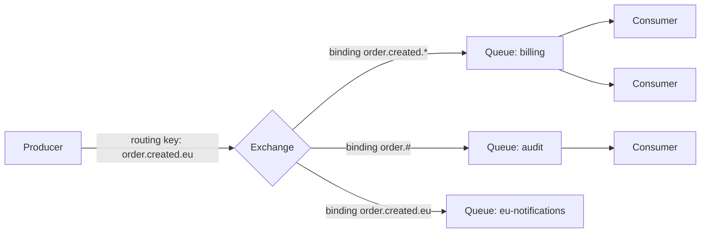

# RabbitMQ Basics

RabbitMQ is a **message broker** implementing AMQP: a smart broker routes messages from producers through **exchanges** to **queues**, and consumers receive (are pushed) messages from queues. Messages are removed when acknowledged. It excels at **task queues, work distribution and flexible routing** with per-message semantics.

<Outcomes items={[
  "Describe exchanges, bindings and queues",
  "Make delivery reliable with confirms, durable queues and acks",
  "Compare RabbitMQ with Kafka"
]} />

## The model



- **Producers never write to queues directly**; they publish to an **exchange** with a **routing key**.
- A **binding** links an exchange to a queue with a matching rule.
- **Queues** buffer messages; multiple consumers on one queue are **competing consumers** (each message to one consumer), giving load balancing.
- For fan-out to several services, give each its own **queue** bound to the exchange.

### Exchange types

| Type | Routing |
| --- | --- |
| **Direct** | Exact routing-key match |
| **Fanout** | Copies to all bound queues (key ignored): broadcast |
| **Topic** | Pattern match on dotted keys: `*` = one word, `#` = zero or more words (`order.*.eu`, `order.#`) |
| **Headers** | Match on message header attributes |
| Default (nameless) | Routes by queue name; convenient for simple cases |

## Reliable delivery: the three links

Loss can occur producer → broker, inside the broker, or broker → consumer.

1. **Producer → broker**: enable **publisher confirms** (the broker acks once the message is safely handled; for durable queues, persisted/replicated), and handle **returns** for unroutable messages (`mandatory` flag). Without confirms, a publish is fire-and-forget.
2. **Inside the broker**: **durable** queues and exchanges plus **persistent** messages (delivery mode 2) survive a broker restart. For replication and HA use **quorum queues** (Raft-based, replicated across nodes; the recommended queue type for important data) rather than classic mirrored queues (deprecated/removed in 4.x).
3. **Broker → consumer**: **manual acknowledgements**. With auto-ack the broker deletes the message as soon as it is sent: a crash loses it. Acknowledge **after** processing; `nack`/`reject` (with or without requeue) on failure. An unacknowledged message is redelivered if the consumer's channel closes.

This gives **at-least-once delivery**; duplicates are possible (redelivery after a lost ack), so consumers must be [idempotent](../microservices/data-consistency/outbox-idempotency.md). Exactly-once is not provided.

## Prefetch (QoS)

`basic.qos(prefetchCount)` limits unacknowledged messages per consumer. With unlimited prefetch, one consumer can hoard thousands of messages while others are idle, and a slow consumer delays them all. A small value (for example 10-50) gives fair dispatch for tasks of uneven duration; `prefetch=1` is the strictest fairness for long jobs at a throughput cost. Tune from message processing time and network latency.

## Dead-lettering, TTL and retry

A **dead-letter exchange (DLX)** receives messages that are **rejected without requeue**, **expire** (TTL), or overflow a queue length limit.

```java
@Bean
Queue ordersQueue() {
    return QueueBuilder.durable("orders")
            .quorum()
            .withArgument("x-dead-letter-exchange", "orders.dlx")
            .withArgument("x-delivery-limit", 5)             // quorum queues: poison message limit, then dead-letter
            .build();
}
@Bean DirectExchange dlx() { return new DirectExchange("orders.dlx"); }
@Bean Queue deadLetters() { return QueueBuilder.durable("orders.dead").build(); }
@Bean Binding dlBinding() { return BindingBuilder.bind(deadLetters()).to(dlx()).with("orders"); }
```

**Delayed retry**: a retry queue with `x-message-ttl` and `x-dead-letter-exchange` pointing back to the main exchange creates a delay-then-requeue loop (the delayed-message plugin is an alternative). Always cap retries (delivery limits or a retry counter header), otherwise a poison message loops forever.

## Spring AMQP

```java
@Configuration
class RabbitConfig {
    @Bean TopicExchange orders() { return new TopicExchange("orders"); }
    @Bean Queue billingQueue() { return QueueBuilder.durable("billing").quorum().build(); }
    @Bean Binding billingBinding() { return BindingBuilder.bind(billingQueue()).to(orders()).with("order.created.*"); }

    @Bean Jackson2JsonMessageConverter converter() { return new Jackson2JsonMessageConverter(); }
}

@Service
class OrderPublisher {
    private final RabbitTemplate rabbit;
    OrderPublisher(RabbitTemplate rabbit) { this.rabbit = rabbit; }

    void publish(OrderCreated e) {
        rabbit.convertAndSend("orders", "order.created." + e.region(), e);    // exchange, routing key, payload
    }
}

@Component
class BillingListener {
    @RabbitListener(queues = "billing")
    void on(OrderCreated e) { /* throw to reject (requeue or DLX depending on config) */ }
}
```

```yaml
spring:
  rabbitmq:
    publisher-confirm-type: correlated       # confirms
    publisher-returns: true
    template:
      mandatory: true
    listener:
      simple:
        acknowledge-mode: auto               # ack on successful return, nack on exception
        prefetch: 20
        concurrency: 2
        max-concurrency: 8
        default-requeue-rejected: false      # do not requeue forever: send failures to the DLX
        retry:
          enabled: true
          max-attempts: 3
          initial-interval: 1s
          multiplier: 2.0
```

`AcknowledgeMode.AUTO` in Spring means "container acks when the listener returns normally, rejects on exception" (it is **not** the broker's auto-ack). With `default-requeue-rejected: true` (the default), a failing message is requeued immediately and can spin hot in a loop; set it to `false` with a DLX or use retry with backoff.

## Ordering and concurrency

RabbitMQ preserves the order of messages **within a queue** for a single consumer. With several competing consumers or after requeues/redeliveries, processing order is not guaranteed. For per-entity ordering use consistent-hash exchange / single active consumer queues (a queue feature letting only one consumer receive at a time, others as standby), or partition work across queues by key.

## Streams

RabbitMQ **Streams** (3.9+) are an append-only, replicated log with non-destructive consumption and offsets, giving Kafka-like replay and fan-out inside RabbitMQ with a separate protocol. Useful when you want one system for tasks and some event-log use cases, but Kafka remains the ecosystem standard for large-scale event streaming.

## RabbitMQ vs Kafka

| | RabbitMQ | Kafka |
| --- | --- | --- |
| Model | Smart broker, dumb consumers; push; messages removed on ack | Dumb broker, smart consumers; pull; retained log |
| Routing | Rich (exchanges, patterns, headers) | Topic + key |
| Ordering | Per queue (single consumer) | Per partition |
| Replay | No (except streams) | Yes |
| Throughput | Tens of thousands msg/s per node | Hundreds of thousands to millions msg/s |
| Per-message features | TTL, priority, delays, DLX, request/reply | Retention, compaction, headers |
| Fan-out | Multiple queues bound to one exchange | Multiple consumer groups |
| Best for | Task queues, workflows, RPC-style, complex routing, low-latency small messages | Event streaming, event sourcing, analytics pipelines, high volume |

Choose by **semantics**: work distribution and routing (RabbitMQ) vs durable event log and replay (Kafka).

## Operational notes

- Monitor queue depth, consumer count, unacked messages, publish/deliver rates, memory/disk alarms (a broker blocks publishers when alarms trigger: **flow control**).
- Long queues use memory and disk; set max length, TTL and overflow behaviour (`reject-publish` for back-pressure vs `drop-head`).
- Use **quorum queues** for durability, connection recovery on clients, and separate connections for publishing and consuming.
- Keep messages small; do not use queues as databases.

## Check yourself

<Checkpoint questions={[
  {
    "q": "What does a producer publish to in RabbitMQ?",
    "options": [
      "An exchange, which routes to queues by bindings",
      "Directly to a consumer",
      "To a partition",
      "To a file"
    ],
    "answer": 0,
    "why": "The exchange type (direct, topic, fanout, headers) decides routing."
  },
  {
    "q": "A consumer crashes before acknowledging a message. What happens?",
    "options": [
      "It is lost",
      "The broker redelivers it to another consumer",
      "It is deleted",
      "It is moved to Kafka"
    ],
    "answer": 1,
    "why": "Manual acks give at-least-once delivery."
  },
  {
    "q": "Which fits better: replaying old events for a new consumer?",
    "options": [
      "RabbitMQ classic queues, always",
      "Neither can",
      "Kafka, because it retains the log",
      "Both identically"
    ],
    "answer": 2,
    "why": "RabbitMQ removes acknowledged messages; streams are the exception."
  }
]} />

## Common interview questions

**1. Explain exchanges, queues and bindings.**
Producers publish to exchanges; bindings with rules connect exchanges to queues; the exchange type decides routing; consumers read from queues.

**2. Direct vs topic vs fanout exchange?**
Direct matches the exact key, topic matches key patterns with `*` and `#`, fanout broadcasts to all bound queues.

**3. How do you avoid losing messages?**
Publisher confirms and mandatory flag, durable quorum queues with persistent messages, manual (or after-success) acks; accept at-least-once and make consumers idempotent.

**4. What is a dead-letter exchange?**
An exchange that receives rejected, expired or overflowed messages, used for retry flows and parking poison messages for inspection.

**5. What does prefetch do?**
Limits unacknowledged messages per consumer, enabling fair dispatch and bounding memory/latency; too high causes hoarding, too low reduces throughput.

**6. How do you retry failed messages without a hot loop?**
Reject without requeue to a DLX routing to a TTL'd delay queue that dead-letters back, with attempt limits and a final dead-letter queue.

**7. RabbitMQ or Kafka for an order-processing pipeline?**
Kafka for an event backbone with replay and many consumers; RabbitMQ for task-style processing with complex routing and per-message TTL/priority. Many organisations use both.

**8. How is high availability achieved?**
Clustering with quorum queues (Raft replication), client reconnection, and load balancing across nodes.

## Pitfalls

- Auto-ack with important messages.
- Requeue-on-failure loops (poison messages spinning).
- Non-durable queues or transient messages for important data.
- Unbounded queues without alerts.
- Large prefetch with slow consumers.
- Assuming exactly-once or strict ordering with multiple consumers.
- Publishing without confirms, or ignoring returned unroutable messages.

## Key takeaways

- Exchange → binding → queue; routing is the broker's job.
- Reliability = confirms + durable quorum queues + acks after processing + idempotent consumers.
- Use DLX, delivery limits and bounded retries; tune prefetch.
- Pick RabbitMQ for routing-rich task queues, Kafka for event streaming.
