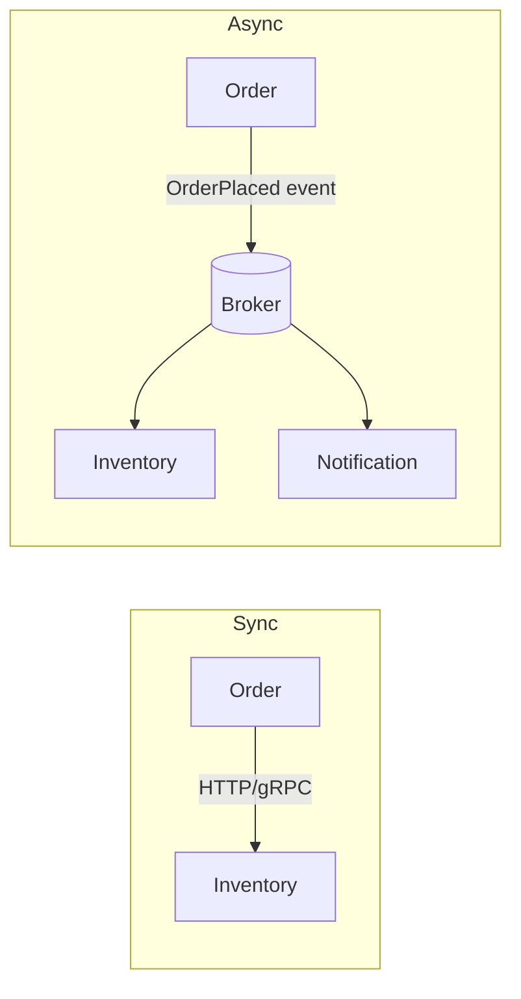

# Inter-Service Communication

Services must talk to each other. The first decision is **synchronous** (caller waits for a reply) versus **asynchronous** (caller sends a message and moves on). Everything else follows from that.

| | Synchronous (REST, gRPC) | Asynchronous (Kafka, RabbitMQ) |
| --- | --- | --- |
| Coupling | Temporal: callee must be up | Loose: broker buffers |
| Latency to get answer | Immediate | Eventual |
| Failure handling | Timeouts, retries, circuit breakers | Retries, dead-letter queues |
| Good for | Queries, validation needing an answer now | Events, workflows, fan-out, spikes |



A long chain of synchronous calls multiplies failure probability and latency. If A calls B calls C and each is 99.9% available, the chain is about 99.7%, and any slow link slows everything.

<Outcomes items={[
  "Choose between REST, gRPC and messaging for a given interaction",
  "Set timeouts and handle failures on remote calls",
  "Evolve APIs without breaking consumers"
]} />

## REST with `RestClient`

`RestClient` (Spring Framework 6.1) is the modern synchronous client, replacing most uses of `RestTemplate`.

```java
@Service
class PricingClient {

    private final RestClient client;

    PricingClient(RestClient.Builder builder) {
        this.client = builder
                .baseUrl("http://pricing-service")
                .build();
    }

    BigDecimal priceOf(String sku) {
        return client.get()
                .uri("/prices/{sku}", sku)
                .retrieve()
                .onStatus(HttpStatusCode::is4xxClientError, (req, res) -> {
                    throw new UnknownProductException(sku);
                })
                .body(BigDecimal.class);
    }
}
```

Always configure **connect and read timeouts** on the underlying request factory; the defaults can wait indefinitely.

## Declarative clients: HTTP interfaces and OpenFeign

Spring 6 offers HTTP interface clients; Spring Cloud OpenFeign is the long-standing alternative integrated with discovery and load balancing.

```java
@FeignClient(name = "inventory-service")
public interface InventoryApi {

    @GetMapping("/stock/{sku}")
    StockDto stock(@PathVariable("sku") String sku);

    @PostMapping("/reservations")
    ReservationDto reserve(@RequestBody ReserveRequest request);
}
```

Enable with `@EnableFeignClients`, inject `InventoryApi` like any bean. Feign resolves `inventory-service` through the load balancer. Configure timeouts (`spring.cloud.openfeign.client.config.default.connect-timeout`/`read-timeout`) and error decoding explicitly.

## gRPC

gRPC uses HTTP/2 and Protocol Buffers: compact binary messages, strongly typed contracts generated from `.proto` files, streaming (server, client, bidirectional) and built-in deadlines.

```proto
syntax = "proto3";
service Inventory {
  rpc GetStock (StockRequest) returns (StockReply);
}
message StockRequest { string sku = 1; }
message StockReply  { int32 available = 1; }
```

Pick gRPC for internal, high-throughput, low-latency calls and polyglot services. Choose REST/JSON for public APIs and browser clients (browsers need gRPC-Web). Evolve protobuf schemas by adding new field numbers; never reuse or renumber.

## Messaging

Publish events when something **happened** (`OrderPlaced`) rather than commanding others, so consumers can be added without changing the producer. Delivery is usually at-least-once, so consumers must be [idempotent](../data-consistency/outbox-idempotency.md). Kafka and RabbitMQ are covered in the Messaging section.

## Choosing

| Situation | Prefer |
| --- | --- |
| Need the answer to continue (price lookup) | Synchronous REST or gRPC, with timeout and fallback |
| Notify many consumers of a fact | Event via broker |
| Long-running business process across services | [Saga](../data-consistency/saga.md) over events |
| Public API for third parties | REST + OpenAPI |
| Internal high-volume, polyglot | gRPC |

## API compatibility

Services deploy independently, so contracts must evolve compatibly: add optional fields, never remove or repurpose them, tolerate unknown fields (`FAIL_ON_UNKNOWN_PROPERTIES=false` is Boot's default), version when breaking changes are unavoidable, and consider consumer-driven contract tests (Spring Cloud Contract, Pact).

## Check yourself

<Checkpoint questions={[
  {
    "q": "When is asynchronous messaging a better fit than REST?",
    "options": [
      "When the work can finish later or several services need to react",
      "When the caller needs the result immediately",
      "When there is only one caller and one response",
      "When the payload is tiny"
    ],
    "answer": 0,
    "why": "Events decouple services in time. Use REST or gRPC when the answer is needed now."
  },
  {
    "q": "What should every remote call have?",
    "options": [
      "An unlimited wait",
      "A timeout (and a bounded retry policy)",
      "A larger thread pool",
      "A shared database"
    ],
    "answer": 1,
    "why": "Without timeouts a slow dependency can exhaust threads and cascade."
  },
  {
    "q": "Which change is generally backward compatible for a JSON API?",
    "options": [
      "Renaming a field",
      "Removing a field",
      "Adding an optional field",
      "Changing a field's type"
    ],
    "answer": 2,
    "why": "Consumers that ignore unknown fields keep working. Renames and removals break them."
  }
]} />

## Common interview questions

**1. REST vs gRPC?**
REST/JSON is human-readable, universal and cache-friendly; gRPC is faster, typed and supports streaming but needs tooling and is awkward for browsers.

**2. Synchronous vs asynchronous: how do you choose?**
Use synchronous when the caller cannot proceed without the answer; use asynchronous for events, long processes and to decouple availability. Prefer async between core domain services to avoid call chains.

**3. What is OpenFeign and what does it add over `RestTemplate`?**
A declarative client: define an interface with annotations and Feign generates the implementation, integrated with discovery, load balancing, and resilience. `RestClient` and HTTP interface clients offer similar ergonomics without Spring Cloud.

**4. How do you handle a downstream service being slow?**
Timeouts, bulkheads to limit concurrent calls, circuit breakers, retries with backoff for idempotent calls, and fallbacks. See [Resilience4j](../resilience/resilience4j.md).

**5. How do you prevent breaking consumers?**
Backward-compatible changes, versioned APIs, contract tests, and consumer-driven contracts in CI.

**6. What is the difference between orchestration and choreography?**
Orchestration: a central coordinator tells services what to do. Choreography: services react to each other's events. Details in [Saga](../data-consistency/saga.md).

## Pitfalls

- No timeouts, or timeouts longer than the caller's own.
- Retrying non-idempotent operations (double charges).
- Sharing DTO libraries between services, which silently couples release cycles.
- Using a message broker as a synchronous RPC substitute (request/reply everywhere).

## Key takeaways

- Default to events for cross-domain notifications; use sync calls sparingly and defensively.
- REST for public/simple APIs, gRPC for internal performance.
- Always set timeouts, and design contracts to evolve compatibly.
