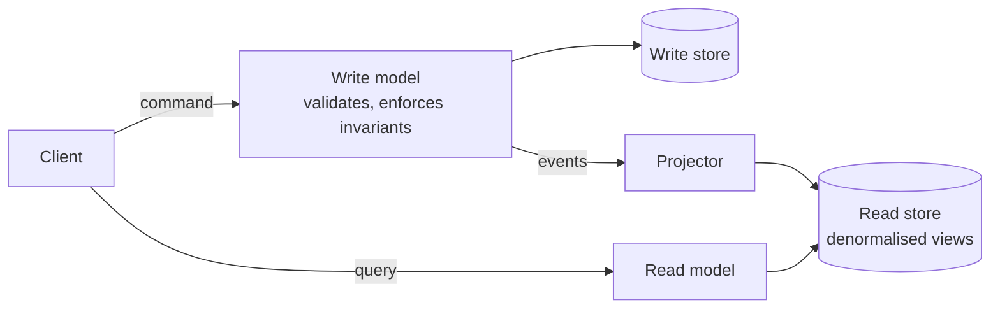

# CQRS and Event Sourcing

<Outcomes items={[
  "Separate the command side from the query side",
  "Explain event sourcing and replay",
  "Judge when the extra complexity is justified"
]} />

## CQRS: Command Query Responsibility Segregation

Use different models for **changing** state (commands) and **reading** state (queries).



Why separate them?

- Reads and writes have different shapes. Writes need normalised, invariant-protecting aggregates; reads want flat, join-free, pre-computed views.
- They scale differently (reads usually dominate).
- Each side can use the best store: relational for writes, Elasticsearch or Redis for reads.
- It solves cross-service queries: build a read model by consuming events from several services instead of joining across databases.

The price is **eventual consistency**: after a command the read model updates a moment later. The UI must tolerate this (return the created resource from the command, show "processing" states).

Simplest CQRS needs no broker: separate command and query handlers in code, same database, perhaps read-only views. Add separate stores only when needed.

## Event sourcing

Instead of storing the current state, store the **append-only sequence of events** that led to it. Current state is derived by replaying them.

A bank account example:

```java
public sealed interface AccountEvent {
    record Opened(String accountId, long at) implements AccountEvent { }
    record Deposited(long amountCents) implements AccountEvent { }
    record Withdrawn(long amountCents) implements AccountEvent { }
}

public class Account {

    private long balanceCents;
    private boolean open;

    /** Rebuild state from history. */
    public static Account replay(List<AccountEvent> history) {
        Account account = new Account();
        history.forEach(account::apply);
        return account;
    }

    /** Command: validate against current state, return new events (nothing is mutated here). */
    public List<AccountEvent> withdraw(long amountCents) {
        if (!open) {
            throw new IllegalStateException("Account is not open");
        }
        if (amountCents <= 0 || amountCents > balanceCents) {
            throw new IllegalArgumentException("Invalid withdrawal");
        }
        return List.of(new AccountEvent.Withdrawn(amountCents));
    }

    /** Apply an event: pure state change, no validation, no side effects. */
    public void apply(AccountEvent event) {
        switch (event) {
            case AccountEvent.Opened e -> open = true;
            case AccountEvent.Deposited e -> balanceCents += e.amountCents();
            case AccountEvent.Withdrawn e -> balanceCents -= e.amountCents();
        }
    }

    public long balanceCents() { return balanceCents; }
}
```

The separation is the heart of it: commands **decide** (and may be rejected), events are **facts** that have already happened and are applied without validation, so replaying history always works.

Benefits:

- Complete audit trail by design.
- Time travel and debugging: rebuild state as of any moment.
- New read models can be built later by replaying history.
- Natural source of integration events.

Costs and challenges:

- **Event schema evolution**: events are immutable and live forever; you need versioning and upcasters.
- **Replay performance**: use periodic **snapshots** so you load the latest snapshot plus recent events.
- **Concurrency**: use an expected version on append (optimistic locking) to detect conflicting writers.
- **Querying** is only practical through projections, so event sourcing nearly always comes with CQRS.
- Corrections require compensating events; privacy deletion (GDPR) needs crypto-shredding or careful design.
- Unfamiliar to most teams; learning curve and tooling (Axon Framework, EventStoreDB, Kafka-based stores).

## When to use

| Use it when | Avoid it when |
| --- | --- |
| Audit history is a core requirement (finance, trading, ledgers) | Simple CRUD |
| Complex domain with many state transitions | Team lacks experience and the domain is not complex |
| Heavy read/write asymmetry | Strong immediate consistency is required for reads |
| Need multiple tailored read views | You would only be adding layers |

## Check yourself

<Checkpoint questions={[
  {
    "q": "What does CQRS separate?",
    "options": [
      "The model used for writes from the model used for reads",
      "The frontend from the backend",
      "Two databases of the same schema",
      "Tests from production code"
    ],
    "answer": 0,
    "why": "Each side can be shaped and scaled for its own needs."
  },
  {
    "q": "What does event sourcing store?",
    "options": [
      "Only the latest state",
      "The sequence of events, from which current state is derived",
      "Only logs",
      "Screenshots"
    ],
    "answer": 1,
    "why": "State is rebuilt by replaying events, often with snapshots for speed."
  },
  {
    "q": "What is a typical cost of CQRS with separate read models?",
    "options": [
      "Slower writes only",
      "No ability to query",
      "Eventual consistency between the write and read sides",
      "Loss of SQL"
    ],
    "answer": 2,
    "why": "Readers may briefly see stale data. The UI and API must tolerate that."
  }
]} />

## Common interview questions

**1. What is CQRS?**
A pattern that splits the model for updating information (commands) from the model for reading it (queries), allowing each to be optimised and scaled independently.

**2. What is event sourcing?**
Persisting changes to application state as an immutable sequence of events and deriving the current state by replaying them.

**3. Are CQRS and event sourcing the same?**
No. CQRS is about separate read/write models; event sourcing is about how state is stored. They complement each other.

**4. How do you handle eventual consistency in the UI?**
Return the result of the command (id, new state), update the client optimistically, poll or push (WebSocket/SSE) for read-model updates, or show a "pending" indicator.

**5. How are snapshots used?**
A snapshot stores the aggregate state at version N. To load, read the latest snapshot and replay only events after N.

**6. How do you change an event's structure?**
Never edit stored events. Add a new event version and an upcaster that converts old versions on read, or use tolerant readers with optional fields.

**7. Event sourcing vs outbox?**
Event sourcing stores events *as* the source of truth. The [outbox pattern](outbox-idempotency.md) stores a normal state change and an event record together to publish reliably. Many systems need only the outbox.

## Pitfalls

- Applying CQRS/ES to a CRUD service because it sounds modern.
- Putting side effects (emails) in `apply`, which re-executes on every replay.
- Events named after data changes (`UserUpdated`) instead of business facts (`AddressChanged`).
- Treating the read model as authoritative for validation instead of the write side.

## Key takeaways

- CQRS: different models for commands and queries; accept eventual consistency.
- Event sourcing: store facts, derive state; gain audit and replay, pay in complexity.
- Use them selectively, in the parts of the system that truly benefit.
