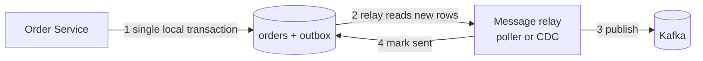
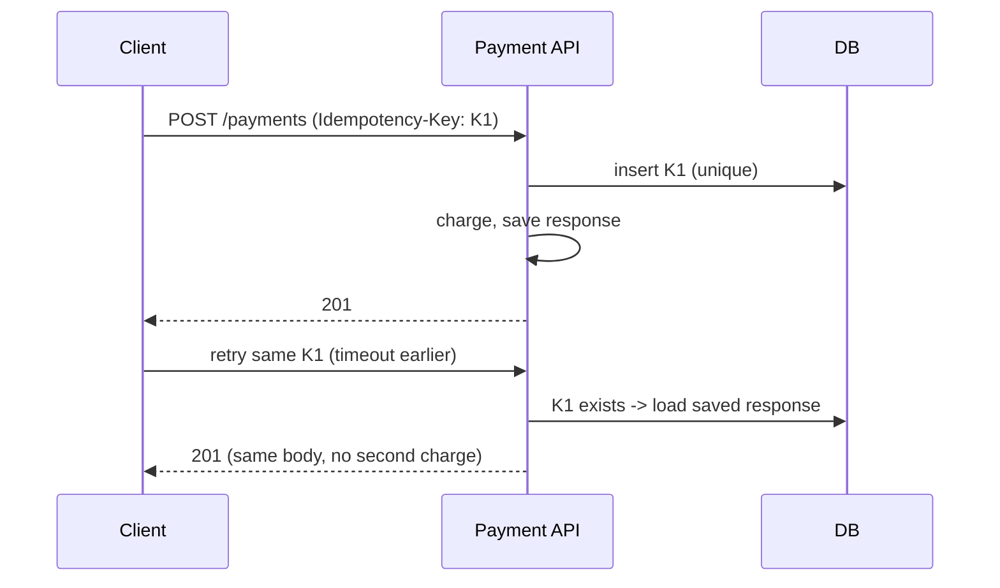

# Transactional Outbox and Idempotency

Two problems appear in almost every event-driven microservice:

1. **Dual write**: you must update your database *and* publish a message, and a crash can do one without the other.
2. **Duplicates**: brokers and retries deliver messages (and HTTP requests) more than once.

The outbox pattern solves the first; idempotency solves the second.

<Outcomes items={[
  "Explain the dual-write problem",
  "Describe the transactional outbox and how events get published",
  "Design idempotent consumers and APIs"
]} />

## The dual-write problem

```java
@Transactional
public void placeOrder(Order order) {
    orderRepository.save(order);          // commits with the transaction
    kafkaTemplate.send("orders", event);  // NOT part of the DB transaction
}
```

- If the transaction rolls back after `send`, consumers hear about an order that does not exist.
- If the app crashes after the commit but before `send`, the event is lost forever.

You cannot make a database and a broker commit atomically without 2PC. Instead, use only the database transaction.

## Transactional outbox

Write the event to an **outbox table in the same local transaction** as the business change. A separate process reads the table and publishes to the broker.



```sql
CREATE TABLE outbox (
    id           UUID PRIMARY KEY,
    aggregate_id VARCHAR(64)  NOT NULL,
    type         VARCHAR(100) NOT NULL,
    payload      JSONB        NOT NULL,
    created_at   TIMESTAMP    NOT NULL DEFAULT now(),
    published_at TIMESTAMP
);
CREATE INDEX idx_outbox_unpublished ON outbox (created_at) WHERE published_at IS NULL;
```

```java
@Service
class OrderService {

    private final OrderRepository orders;
    private final OutboxRepository outbox;
    private final ObjectMapper mapper;

    OrderService(OrderRepository orders, OutboxRepository outbox, ObjectMapper mapper) {
        this.orders = orders;
        this.outbox = outbox;
        this.mapper = mapper;
    }

    @Transactional
    public void placeOrder(Order order) throws JsonProcessingException {
        orders.save(order);
        outbox.save(new OutboxEvent(
                UUID.randomUUID(),
                String.valueOf(order.getId()),
                "OrderPlaced",
                mapper.writeValueAsString(new OrderPlaced(order.getId(), order.getTotal()))));
    }
}
```

Relay options:

- **Polling publisher**: a scheduled job selects unpublished rows (`FOR UPDATE SKIP LOCKED` to allow several instances), publishes, then marks them published. Simple, adds a little latency and database load.
- **Change Data Capture (CDC)**: a tool such as Debezium tails the database log and streams outbox rows to Kafka. Low latency, no polling, but more infrastructure.

```java
@Component
class OutboxRelay {

    private final OutboxRepository outbox;
    private final KafkaTemplate<String, String> kafka;

    OutboxRelay(OutboxRepository outbox, KafkaTemplate<String, String> kafka) {
        this.outbox = outbox;
        this.kafka = kafka;
    }

    @Scheduled(fixedDelay = 500)
    @Transactional
    void publishPending() {
        for (OutboxEvent e : outbox.findNextBatchForUpdateSkipLocked(100)) {
            kafka.send("orders", e.getAggregateId(), e.getPayload()).join();
            e.markPublished();
        }
    }
}
```

The relay can crash after sending but before marking, so it sends the event again later. The outbox therefore guarantees **at-least-once**, never lost, sometimes duplicated, which leads to idempotency. Key by aggregate id so events for one order land in one partition and keep their order.

## Idempotency

An operation is idempotent if performing it several times has the same effect as performing it once. Setting `status = SHIPPED` is idempotent; `balance = balance + 10` is not.

### Idempotent message consumer

Record processed message IDs in the **same transaction** as the business effect:

```java
@Component
class PaymentEventHandler {

    private final ProcessedMessageRepository processed;
    private final PaymentService payments;

    PaymentEventHandler(ProcessedMessageRepository processed, PaymentService payments) {
        this.processed = processed;
        this.payments = payments;
    }

    @Transactional
    public void handle(UUID messageId, OrderPlaced event) {
        if (!processed.insertIfAbsent(messageId)) {   // unique constraint on message_id
            return;                                    // duplicate, ignore
        }
        payments.charge(event.orderId(), event.total());
    }
}
```

The unique constraint is the real guard; a "check then insert" without it is racy. Clean old IDs periodically.

### Idempotent API: idempotency keys

For `POST /payments` the client sends `Idempotency-Key: <uuid>`. The server stores the key with the stored response. A retry with the same key returns the saved response instead of charging again. Concurrent requests with the same key are serialised by the unique constraint on the key.



## Check yourself

<Checkpoint questions={[
  {
    "q": "What is the dual-write problem?",
    "options": [
      "Writing to the database and a broker separately can leave them inconsistent after a crash",
      "Writing two tables in one transaction",
      "Using two databases on purpose",
      "Writing logs twice"
    ],
    "answer": 0,
    "why": "The outbox writes the event in the same local transaction as the state change."
  },
  {
    "q": "How does the outbox event reach Kafka?",
    "options": [
      "The browser sends it",
      "A relay (polling publisher or CDC such as Debezium) reads the table and publishes",
      "The database calls Kafka directly by magic",
      "It is never published"
    ],
    "answer": 1,
    "why": "Publishing is at-least-once, so consumers must tolerate duplicates."
  },
  {
    "q": "How can a consumer be idempotent?",
    "options": [
      "Process every message twice",
      "Disable retries",
      "Record processed message ids (or use natural unique keys) and skip duplicates",
      "Use bigger messages"
    ],
    "answer": 2,
    "why": "A unique constraint on a dedup table makes the check atomic with the work."
  }
]} />

## Common interview questions

**1. What is the dual-write problem?**
Updating two systems (database and broker) without a shared transaction, so a failure between them leaves them inconsistent.

**2. How does the outbox pattern fix it?**
It records the event in the database in the same transaction as the state change, then publishes it asynchronously. Either both the data and the event exist or neither does.

**3. Polling vs CDC for the relay?**
Polling is simple and portable but adds latency and load. CDC (Debezium) reads the transaction log: near real-time and efficient, but needs Kafka Connect and database configuration.

**4. Does the outbox give exactly-once delivery?**
No: at-least-once. Combine with idempotent consumers to get effectively-once processing.

**5. How do you make a consumer idempotent?**
Natural idempotence (upserts, absolute state), or deduplicate with a processed-message table updated in the same transaction as the effect.

**6. Which HTTP methods are idempotent?**
GET, PUT, DELETE, HEAD, OPTIONS by definition. POST and PATCH are not, so use idempotency keys for payments and orders.

**7. How do you preserve ordering?**
Use the aggregate id as the Kafka message key so all events for an entity go to one partition, and process per key sequentially.

## Pitfalls

- Publishing inside the transaction with `@TransactionalEventListener(AFTER_COMMIT)` and thinking it is reliable; a crash after commit still loses it.
- Dedupe by "check then insert" without a unique constraint.
- Unbounded outbox growth: archive or delete published rows.
- Relay with several instances processing the same row without row-level locking.

## Key takeaways

- Never write to the database and the broker separately; use the outbox.
- Delivery is at-least-once, so consumers and APIs must be idempotent.
- Enforce idempotency with unique constraints in the same transaction as the effect.

Related: [Saga](saga.md), [Communication](../communication/service-communication.md).
