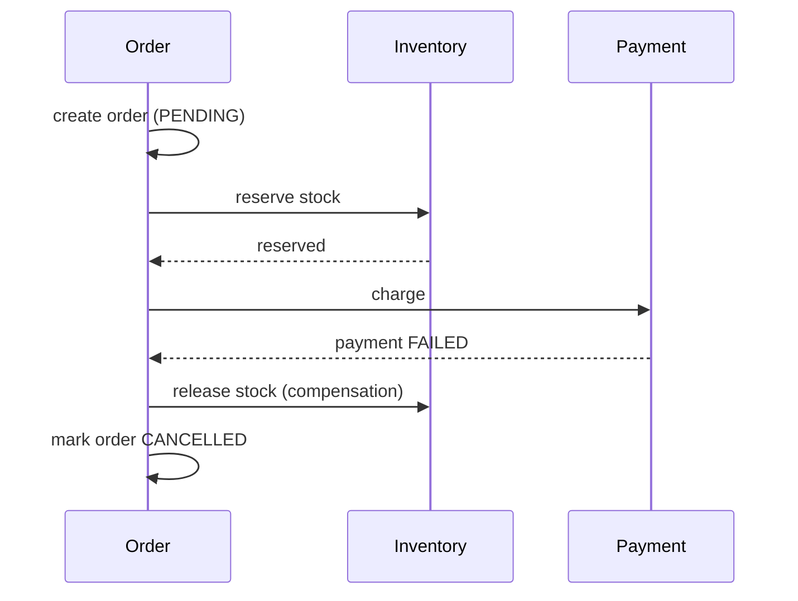
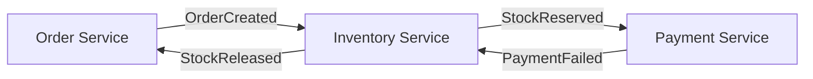

# Saga Pattern

With a database per service, one business operation (place an order) touches several databases: orders, inventory, payments. A single ACID transaction cannot span them. Distributed two-phase commit (2PC) is rarely used: it blocks resources, needs every participant to support it, and hurts availability.

A **saga** is a sequence of **local transactions**, one per service. Each commits independently and then triggers the next step. If a step fails, the saga runs **compensating transactions** to semantically undo the earlier steps.

<Outcomes items={[
  'Explain why a saga replaces a distributed transaction',
  'Trace a failure through compensating transactions',
  'Choose between choreography and orchestration, and name what makes a saga reliable',
]} />

## Example: place an order

Steps: create order (pending) → reserve inventory → charge payment → confirm order.



Compensations are business-level, not rollbacks: "release reservation", "refund", "mark cancelled". Some steps cannot be undone (an email already sent); order such steps last, or make the compensation a follow-up message.

## Try it: run the saga

Run the happy path first, then reset, untick "Payment succeeds" and run it again. The state machine behind this lab has the same transitions as the Java class in the orchestration section.

<SagaLab />

## Two styles

### Choreography

No central controller. Services publish events and react to others' events.



- Pros: simple for 2-4 steps, no single coordinator, loosely coupled.
- Cons: the flow is implicit and spread across services, so it is hard to see, test and change; risk of cyclic dependencies.

### Orchestration

A coordinator (the saga orchestrator) tells each participant what to do and tracks state.

```java
public enum SagaState { STARTED, STOCK_RESERVED, PAID, COMPLETED, COMPENSATING, CANCELLED }

public class OrderSaga {

    private final String orderId;
    private SagaState state = SagaState.STARTED;

    public OrderSaga(String orderId) { this.orderId = orderId; }

    public SagaState state() { return state; }

    /** Returns the next command to send, or null when finished. */
    public String on(String event) {
        switch (state) {
            case STARTED -> {
                if (event.equals("OrderCreated")) { return "ReserveStock:" + orderId; }
                if (event.equals("StockReserved")) { state = SagaState.STOCK_RESERVED; return "ChargePayment:" + orderId; }
                if (event.equals("StockRejected")) { state = SagaState.CANCELLED; return "CancelOrder:" + orderId; }
            }
            case STOCK_RESERVED -> {
                if (event.equals("PaymentSucceeded")) { state = SagaState.COMPLETED; return "ConfirmOrder:" + orderId; }
                if (event.equals("PaymentFailed")) { state = SagaState.COMPENSATING; return "ReleaseStock:" + orderId; }
            }
            case COMPENSATING -> {
                if (event.equals("StockReleased")) { state = SagaState.CANCELLED; return "CancelOrder:" + orderId; }
            }
            default -> { }
        }
        return null;
    }
}
```

This is the essence: an explicit state machine, persisted after every step, that maps events to commands. Production implementations use frameworks (Temporal, Camunda, Axon, Netflix Conductor, Eventuate Tram) that provide durable state, timers and retries.

- Pros: flow visible in one place, easier to reason about, add steps and handle timeouts.
- Cons: extra component; avoid putting business rules in the orchestrator.

## Making sagas reliable

1. **Atomically update state and send the message.** Use the [transactional outbox](outbox-idempotency.md); otherwise a crash between the database commit and the publish loses an event.
2. **Idempotent participants.** Messages are delivered at least once, so repeated commands must not repeat effects.
3. **Compensations must be retryable and idempotent**, and must not fail permanently.
4. **Timeouts.** A participant that never replies needs a deadline and a compensation path.
5. **Semantic locks / pending states.** Because intermediate states are visible (order is `PENDING`), model them explicitly so other flows can see and handle them. Sagas give *ACD* without *I* (no isolation); countermeasures include pending flags, commutative updates and version checks.

## Check yourself

<Checkpoint questions={[
  {
    q: 'Payment fails after stock was reserved. What does the saga do?',
    options: ['Rolls back the database transaction', 'Runs a compensating transaction that releases the stock', 'Retries the payment forever', 'Leaves the stock reserved and marks the order paid'],
    answer: 1,
    why: 'Earlier local transactions are already committed, so they cannot be rolled back. A new compensating transaction (release stock) undoes their business effect.',
  },
  {
    q: 'Which property do sagas NOT provide?',
    options: ['Atomicity (eventually)', 'Consistency (eventually)', 'Isolation', 'Durability'],
    answer: 2,
    why: 'Intermediate states are visible to other requests, for example an order that is PENDING. Pending states, versions and commutative updates are the usual countermeasures.',
  },
  {
    q: 'A flow has six steps, branching and timeouts. Which style fits best?',
    options: ['Choreography', 'Orchestration', 'Two-phase commit', 'A single shared database'],
    answer: 1,
    why: 'An orchestrator keeps the flow in one explicit state machine, which is far easier to follow, test and change than events scattered across services.',
  },
]} />

## Common interview questions

**1. What is the saga pattern and why use it?**
A way to maintain data consistency across services using a chain of local transactions and compensating actions, avoiding blocking distributed transactions.

**2. Choreography vs orchestration?**
Choreography: event-driven, no coordinator, simple but implicit. Orchestration: central coordinator with an explicit state machine, clearer for complex flows. A rule of thumb is choreography for short flows, orchestration beyond about four steps or with branching and timeouts.

**3. What is a compensating transaction?**
A new transaction that semantically reverses a previously committed step (refund for charge). It is not a database rollback and may leave a visible history.

**4. What happens if a compensation fails?**
Retry with backoff; make it idempotent; after repeated failure raise an alert for manual intervention. Design compensations so they cannot logically fail.

**5. How do you handle lack of isolation?**
Use pending/reserved states, optimistic versioning, and design reads to tolerate intermediate states.

**6. Why not 2PC/XA?**
It holds locks across services and a coordinator failure blocks participants, reducing availability; many modern stores and brokers do not support it.

## Pitfalls

- Publishing events outside the local transaction (dual-write problem).
- Non-idempotent handlers causing double reservations or charges.
- Forgetting timeouts and stuck sagas.
- Orchestrator that contains domain logic from several services.

## Key takeaways

- Saga = local transactions + compensations; eventual consistency is the trade-off.
- Choreography for simple flows, orchestration for complex ones.
- Reliability rests on outbox, idempotency, retries and timeouts.

Related: [Outbox and idempotency](outbox-idempotency.md), [CQRS and event sourcing](cqrs-event-sourcing.md).
