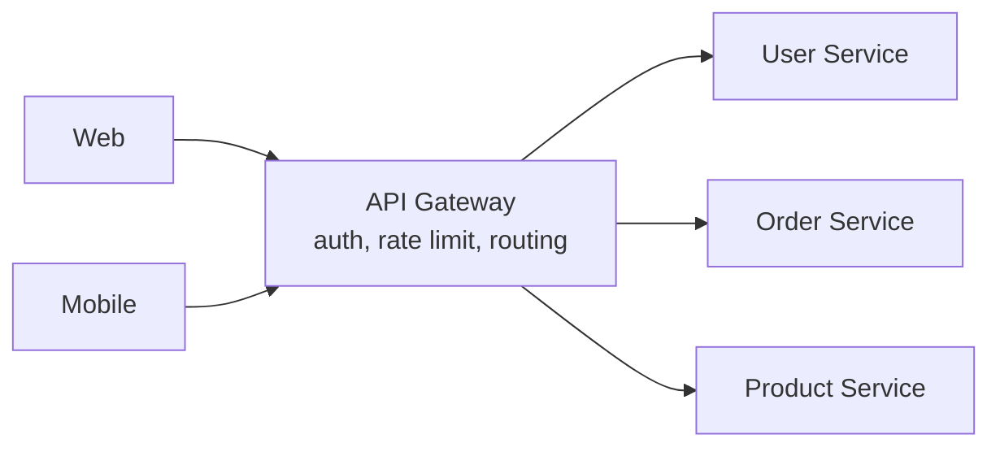

# API Gateway

An API gateway is the single entry point for external clients. It routes requests to the right service and handles cross-cutting concerns once, instead of in every service.



<Outcomes items={[
  "List what an API gateway should and should not do",
  "Compare a gateway with a Backend-for-Frontend",
  "Place rate limiting, auth and routing correctly"
]} />

## Typical responsibilities

- **Routing** by path, host, header or method.
- **Authentication** (validate JWT) and coarse authorization.
- **Rate limiting** and quotas.
- **TLS termination**, CORS, request/response header manipulation.
- **Resilience**: timeouts, retries and circuit breakers on downstream calls.
- **Observability**: access logs, metrics, trace-ID creation.

Keep **business logic out of the gateway**. A gateway that orchestrates domain workflows becomes a bottleneck and a single team's dependency.

## Spring Cloud Gateway

Built on Spring WebFlux (reactive, Netty). Three core terms:

- **Route**: an ID, a destination URI, predicates and filters.
- **Predicate**: a condition that must match (path, method, header...).
- **Filter**: modifies the request or response (strip prefix, add header, rate limit...).

```yaml
spring:
  cloud:
    gateway:
      routes:
        - id: order-service
          uri: lb://order-service          # resolved via service discovery + load balancer
          predicates:
            - Path=/api/orders/**
          filters:
            - StripPrefix=1
            - name: CircuitBreaker
              args:
                name: orderCb
                fallbackUri: forward:/fallback/orders
            - name: RequestRateLimiter
              args:
                redis-rate-limiter.replenishRate: 10
                redis-rate-limiter.burstCapacity: 20
                key-resolver: "#{@userKeyResolver}"
```

Matching `GET /api/orders/42`: `StripPrefix=1` removes `/api`, so the order service receives `/orders/42`. `lb://order-service` asks the load balancer for an instance registered under that name (see [Service Discovery](service-discovery.md)).

The key resolver decides who is being limited:

```java
@Bean
KeyResolver userKeyResolver() {
    return exchange -> Mono.justOrEmpty(exchange.getRequest().getHeaders().getFirst("X-User-Id"))
            .defaultIfEmpty("anonymous");
}
```

### A custom global filter

```java
@Component
public class CorrelationIdFilter implements GlobalFilter, Ordered {

    private static final String HEADER = "X-Correlation-Id";

    @Override
    public Mono<Void> filter(ServerWebExchange exchange, GatewayFilterChain chain) {
        String id = exchange.getRequest().getHeaders().getFirst(HEADER);
        if (id == null) {
            id = UUID.randomUUID().toString();
        }
        ServerHttpRequest request = exchange.getRequest().mutate().header(HEADER, id).build();
        return chain.filter(exchange.mutate().request(request).build());
    }

    @Override
    public int getOrder() {
        return Ordered.HIGHEST_PRECEDENCE;
    }
}
```

Never block inside a gateway filter: it runs on a small number of event-loop threads.

## Gateway versus Backend-for-Frontend (BFF)

A **BFF** is a gateway tailored to one client type (web, mobile), shaping and aggregating data for that UI. Use a generic gateway for routing and policy, and BFFs where clients genuinely need different payloads.

## Check yourself

<Checkpoint questions={[
  {
    "q": "Which job belongs in the API gateway?",
    "options": [
      "Routing, authentication, rate limiting and TLS termination",
      "Business rules for pricing",
      "Database transactions",
      "Domain validation of orders"
    ],
    "answer": 0,
    "why": "Keep the gateway thin. Domain logic belongs in services."
  },
  {
    "q": "What is a Backend-for-Frontend?",
    "options": [
      "A database replica",
      "A gateway tailored to one kind of client, such as mobile or web",
      "A load balancer",
      "A message broker"
    ],
    "answer": 1,
    "why": "BFFs shape responses for each client so clients do not make many calls."
  },
  {
    "q": "What is a risk of a single gateway?",
    "options": [
      "It stops services from scaling",
      "It forbids HTTPS",
      "It is a potential single point of failure and bottleneck",
      "It requires one database"
    ],
    "answer": 2,
    "why": "Run several instances and keep it stateless."
  }
]} />

## Common interview questions

**1. Why do we need an API gateway?**
To give clients one stable entry point and centralise authentication, rate limiting, routing and monitoring, so internal services can change freely and stay simple.

**2. What are the downsides?**
It is a potential single point of failure and a latency hop, so run multiple instances, keep it thin and monitor it closely.

**3. How is the gateway different from a load balancer?**
A load balancer spreads traffic across identical instances (mostly L4/L7 without application awareness). A gateway understands APIs: path-based routing, auth, transformation, quotas.

**4. Where should authentication happen?**
Validate the token at the gateway for a fast reject, and still verify authorization inside services that own sensitive data (defence in depth). See the Security section.

**5. How do you do rate limiting in a distributed gateway?**
A shared store such as Redis keeps token-bucket counters, so all gateway instances see the same state.

**6. Spring Cloud Gateway vs Zuul?**
Zuul 1 was blocking servlet-based and is retired from Spring Cloud. Spring Cloud Gateway is non-blocking and the supported option.

## Pitfalls

- Business logic or heavy aggregation in the gateway.
- Blocking calls inside reactive filters.
- Forgetting timeouts, so slow services exhaust gateway resources.
- Exposing internal service ports directly, bypassing the gateway's security.

## Key takeaways

- The gateway is for routing and cross-cutting policy, not business logic.
- Spring Cloud Gateway: routes = predicates + filters, reactive.
- `lb://` URIs integrate with discovery; use Redis for distributed rate limits.
- Run it highly available and keep it thin.
