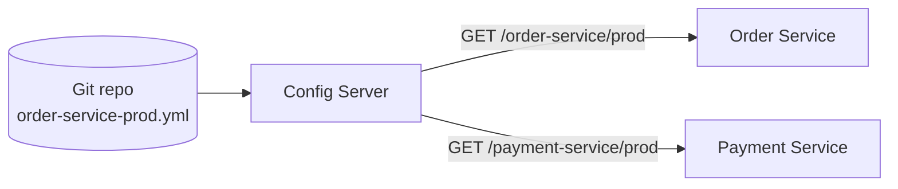

# Centralised Configuration

With dozens of services across several environments, copying `application.yml` into each repository becomes unmanageable. A **config server** stores configuration centrally, versions it (usually in Git) and serves it over HTTP to clients at startup.



<Outcomes items={[
  "Describe what a config server provides",
  "Refresh configuration without restart and know its limits",
  "Decide when Kubernetes ConfigMaps are enough"
]} />

## Server

```java
@SpringBootApplication
@EnableConfigServer
public class ConfigServerApplication {
    public static void main(String[] args) {
        SpringApplication.run(ConfigServerApplication.class, args);
    }
}
```

```yaml
spring:
  cloud:
    config:
      server:
        git:
          uri: https://github.com/example/config-repo
          default-label: main
          search-paths: '{application}'
server:
  port: 8888
```

The repository holds files named by application and profile: `order-service.yml`, `order-service-prod.yml`, and a shared `application.yml`. A request to `/order-service/prod` merges them with more specific files winning.

## Client

Modern Boot imports config via `spring.config.import`:

```yaml
spring:
  application:
    name: order-service
  config:
    import: "optional:configserver:http://config-server:8888"
  profiles:
    active: prod
```

`optional:` lets the service start (with local defaults) if the server is down; drop it if configuration is mandatory to start, so the app fails fast instead of running misconfigured.

## Refreshing without restart

```java
@RefreshScope
@RestController
class FeatureController {

    @Value("${feature.new-checkout:false}")
    private boolean newCheckout;

    @GetMapping("/feature")
    boolean enabled() {
        return newCheckout;
    }
}
```

After changing Git, `POST /actuator/refresh` on an instance re-binds `@RefreshScope` beans and `@ConfigurationProperties`. For many instances, Spring Cloud Bus (RabbitMQ/Kafka) broadcasts one refresh event via `/actuator/busrefresh`. Plain singleton beans that copied the value earlier are *not* updated.

## Secrets

Do not commit plain-text secrets. Options:

- Config Server symmetric/asymmetric encryption: values stored as `{cipher}...` and decrypted on the way out.
- HashiCorp Vault backend, or cloud secret managers.
- Kubernetes Secrets mounted as env vars or files.

## Do you still need it on Kubernetes?

Often not. ConfigMaps and Secrets mounted as environment variables or files (consumed with Boot's `configtree:` import) provide centralised, versioned (via GitOps) configuration without another server to run. Config Server remains useful for non-Kubernetes estates, per-application Git history and encryption features.

## Check yourself

<Checkpoint questions={[
  {
    "q": "What does Spring Cloud Config typically store configuration in?",
    "options": [
      "A Git repository, versioned per application and profile",
      "Browser local storage",
      "A CSV file on each laptop",
      "The service jar"
    ],
    "answer": 0,
    "why": "Git gives history and review for configuration changes."
  },
  {
    "q": "What does @RefreshScope enable?",
    "options": [
      "Reloading all classes",
      "Rebuilding annotated beans with new property values when refresh is triggered",
      "Restarting the JVM",
      "Encrypting properties"
    ],
    "answer": 1,
    "why": "It only affects beans in that scope, not everything."
  },
  {
    "q": "Where should secrets be kept?",
    "options": [
      "In plain YAML in Git",
      "In comments",
      "Encrypted or in a dedicated secret store, not plain in the config repo",
      "In the README"
    ],
    "answer": 2,
    "why": "Use encryption, Vault or cloud secret managers."
  }
]} />

## Common interview questions

**1. Why centralise configuration?**
Consistency across instances and environments, change without rebuilding, audit history through Git, and one place to manage secrets.

**2. How does a client get its configuration?**
At startup, the client (via `spring.config.import=configserver:`) calls `/{application}/{profile}/{label}` and merges the returned property sources ahead of its local files.

**3. How do you change a property without restarting?**
Mark beans `@RefreshScope` and call `/actuator/refresh`, or use Spring Cloud Bus for a fan-out.

**4. What if the Config Server is down?**
With `optional:` the app starts with local defaults; otherwise it fails fast. Make the server highly available, enable `fail-fast`/retry, and rely on local fallbacks for critical settings.

**5. How do you keep secrets safe?**
Encrypt values or use Vault/Secrets Manager; restrict access to the config repo; never expose `/env` on Actuator publicly.

**6. Config Server versus Kubernetes ConfigMap?**
ConfigMap is platform-native and simpler on Kubernetes; Config Server adds Git-backed multi-environment resolution and runtime refresh for Spring apps.

## Pitfalls

- Putting environment-specific secrets in the shared `application.yml`.
- Expecting `@Value` fields in normal singletons to change after refresh.
- Config server as a single point of failure at startup of the whole fleet.
- Large unreviewed changes pushed straight to the production branch; use pull requests.

## Key takeaways

- Config Server = Git-backed, per-app and per-profile configuration over HTTP.
- Use `spring.config.import`, `@RefreshScope` and Bus for dynamic changes.
- Keep secrets encrypted or in a secret manager; on Kubernetes consider ConfigMaps first.
