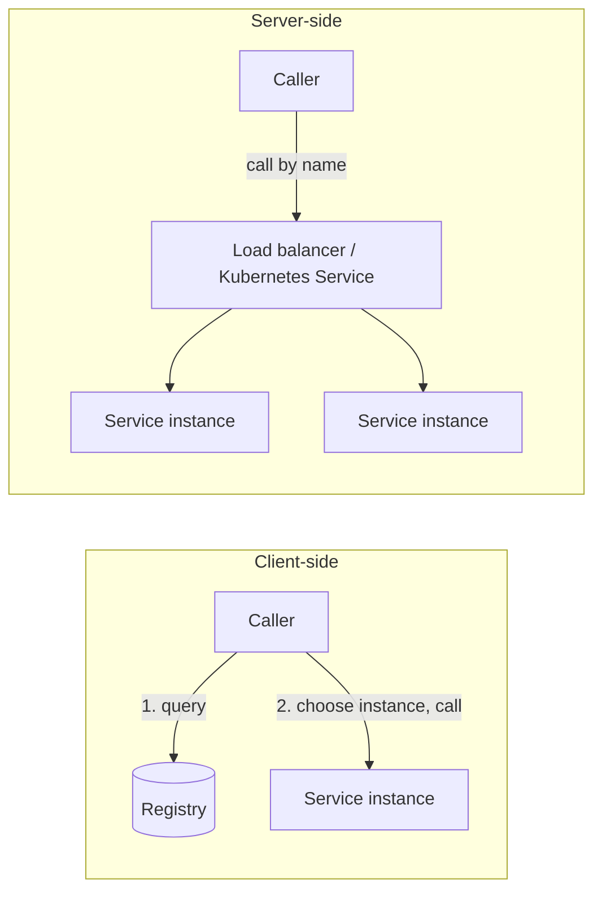

# Service Discovery

<Outcomes items={[
  "Explain registration, heartbeats and lookup",
  "Compare client-side and server-side discovery",
  "Know why Kubernetes often makes a registry unnecessary"
]} />

## The three steps

1. **Register**: an instance announces its name, host and port on startup.
2. **Heartbeat / health check**: the registry keeps only instances that are alive.
3. **Lookup**: a caller resolves the name to one or more instances.

## Client-side versus server-side discovery



| | Client-side (Eureka + Spring Cloud LoadBalancer) | Server-side (Kubernetes Service, cloud LB) |
| --- | --- | --- |
| Who picks the instance | The client library | The infrastructure |
| Language coupling | Needs a client library | None |
| Extra components | Registry to run | Provided by the platform |

On **Kubernetes**, you usually do not need Eureka: a `Service` gives a stable DNS name (`http://inventory-service`) and kube-proxy balances across ready pods. Interviewers like to hear that discovery is a *pattern* and that the platform may already implement it.

## Eureka with Spring Cloud

Registry server:

```java
@SpringBootApplication
@EnableEurekaServer
public class DiscoveryServerApplication {
    public static void main(String[] args) {
        SpringApplication.run(DiscoveryServerApplication.class, args);
    }
}
```

```yaml
server:
  port: 8761
eureka:
  client:
    register-with-eureka: false
    fetch-registry: false
```

Client service (the Eureka client starter registers it automatically):

```yaml
spring:
  application:
    name: inventory-service
eureka:
  client:
    service-url:
      defaultZone: http://localhost:8761/eureka
  instance:
    prefer-ip-address: true
```

Calling by name with a load-balanced client:

```java
@Configuration
class HttpClientConfig {

    @Bean
    @LoadBalanced
    RestClient.Builder loadBalancedRestClientBuilder() {
        return RestClient.builder();
    }
}

@Service
class InventoryClient {

    private final RestClient client;

    InventoryClient(RestClient.Builder builder) {
        this.client = builder.baseUrl("http://inventory-service").build();
    }

    Integer stockFor(String sku) {
        return client.get().uri("/stock/{sku}", sku).retrieve().body(Integer.class);
    }
}
```

`@LoadBalanced` adds an interceptor that replaces the host `inventory-service` with a concrete `host:port` chosen by Spring Cloud LoadBalancer (round-robin by default).

## Health, caching and self-preservation

- Clients **cache** the registry and refresh periodically (30 s default), so a dead instance can still be called briefly. Combine discovery with [retries and circuit breakers](../resilience/resilience4j.md).
- Eureka favours **availability over consistency** (AP): during a network partition it enters *self-preservation* and stops evicting instances to avoid mass removal, so stale entries are possible.
- Use Actuator health (`eureka.client.healthcheck.enabled=true`) so an instance whose dependencies are down reports `DOWN`.

## Check yourself

<Checkpoint questions={[
  {
    "q": "How does a registry know an instance has died?",
    "options": [
      "Missing heartbeats cause the entry to expire",
      "The instance calls a delete API on crash",
      "DNS tells it",
      "Users report it"
    ],
    "answer": 0,
    "why": "Instances renew leases periodically. Crashes cannot deregister themselves."
  },
  {
    "q": "In client-side discovery, who picks the instance?",
    "options": [
      "The database",
      "The calling client, using the registry list and a load-balancing rule",
      "The registry always forwards traffic",
      "The browser"
    ],
    "answer": 1,
    "why": "Server-side discovery uses a load balancer or router instead."
  },
  {
    "q": "On Kubernetes, what normally replaces a separate registry?",
    "options": [
      "A shared database",
      "A message queue",
      "Services and cluster DNS",
      "ConfigMaps"
    ],
    "answer": 2,
    "why": "The Service object gives a stable name and balances across healthy pods."
  }
]} />

## Common interview questions

**1. What is service discovery and why is it needed?**
A registry-based mechanism letting services locate each other by logical name despite dynamic IPs, enabling scaling and failover without configuration changes.

**2. Client-side versus server-side discovery?**
Client-side: the caller queries the registry and balances itself. Server-side: a router or load balancer does the lookup. Kubernetes provides server-side discovery natively.

**3. How does Eureka know an instance is down?**
Instances send heartbeats every 30 s; after the lease expires (90 s default) the registry evicts them. Self-preservation can pause evictions.

**4. Eureka vs Consul vs ZooKeeper?**
Eureka: AP, simple, Netflix/Spring-native. Consul: registry plus health checks, key-value store and optionally CP via Raft. ZooKeeper: CP coordination service used for discovery in some stacks.

**5. How does load balancing work with `@LoadBalanced`?**
An interceptor resolves the service ID through the `ServiceInstanceListSupplier` and a `ReactorLoadBalancer` (round-robin, random or custom) before sending the request.

**6. Do you need Eureka on Kubernetes?**
Usually not. Use Kubernetes `Service` DNS; Spring Cloud Kubernetes can also read the API server if you need client-side behaviour.

## Pitfalls

- Treating the registry as always-correct; stale entries exist, so you need timeouts and retries.
- Registering with `localhost` or a container-internal IP unreachable from other services.
- Running a single Eureka server in production; run peers that replicate to each other.
- Using the registry for configuration; that is the job of the [Config Server](config-server.md).

## Key takeaways

- Discovery maps a logical name to live instances through register, heartbeat and lookup.
- Client-side (Eureka) and server-side (Kubernetes) achieve the same goal differently.
- Registries are eventually consistent; pair them with resilience patterns.
