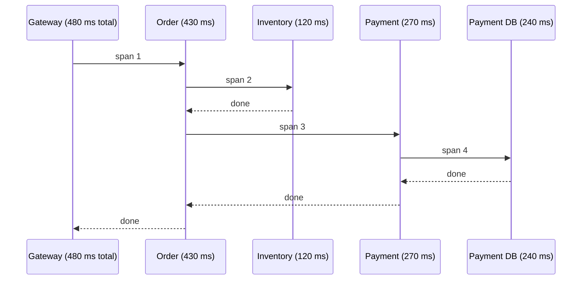

# Observability

In a monolith, a stack trace tells you what happened. In microservices one user request crosses many processes, so you need tooling to reconstruct it. **Observability** means being able to ask new questions about a running system from the data it emits: **logs, metrics and traces**.

| Pillar | Answers | Example tool |
| --- | --- | --- |
| **Metrics** | Is something wrong? How bad? (aggregated numbers) | Micrometer → Prometheus → Grafana |
| **Logs** | What exactly happened? (events) | Structured JSON → Loki / ELK |
| **Traces** | Where did this request spend its time? | OpenTelemetry → Tempo / Jaeger / Zipkin |

The usual workflow: an **alert** from metrics → find the slow/failing **trace** → read the **logs** for that trace ID.

<Outcomes items={[
  "Distinguish metrics, logs and traces and when to use each",
  "Propagate trace ids across services and into logs",
  "Set up Micrometer tracing in Spring Boot 3"
]} />

## Distributed tracing concepts

- **Trace**: the whole journey of one request, identified by a trace ID.
- **Span**: one unit of work within the trace (an HTTP call, a DB query), with start time, duration, tags and a parent span.
- **Context propagation**: trace ID and span ID travel in headers (W3C `traceparent`) so the next service continues the same trace.



Reading this: the payment service and its query take most of the time, so you look there, not at inventory.

## Setup in Spring Boot 3

Spring Boot 3 replaced Spring Cloud Sleuth with **Micrometer Tracing**, bridged to OpenTelemetry.

```xml
<dependency>
    <groupId>org.springframework.boot</groupId>
    <artifactId>spring-boot-starter-actuator</artifactId>
</dependency>
<dependency>
    <groupId>io.micrometer</groupId>
    <artifactId>micrometer-tracing-bridge-otel</artifactId>
</dependency>
<dependency>
    <groupId>io.opentelemetry</groupId>
    <artifactId>opentelemetry-exporter-otlp</artifactId>
</dependency>
<dependency>
    <groupId>io.micrometer</groupId>
    <artifactId>micrometer-registry-prometheus</artifactId>
</dependency>
```

```yaml
management:
  tracing:
    sampling:
      probability: 0.1          # 100% in dev (1.0), a fraction in production
  otlp:
    tracing:
      endpoint: http://otel-collector:4318/v1/traces
  endpoints:
    web:
      exposure:
        include: health,prometheus
logging:
  pattern:
    level: "%5p [${spring.application.name:},%X{traceId:-},%X{spanId:-}]"
```

Outbound calls made via `RestClient.Builder`, `RestTemplateBuilder`, `WebClient.Builder` and Feign (all obtained as Spring beans) are instrumented automatically, and so are Spring Kafka producers/consumers when observation is enabled. Instrumentation applies to clients built from the **injected builder**; a client created with `new RestTemplate()` is not traced.

Add a custom span for important business work:

```java
@Service
class ShippingService {

    private final Tracer tracer;

    ShippingService(Tracer tracer) {
        this.tracer = tracer;
    }

    void arrange(String orderId) {
        Span span = tracer.nextSpan().name("arrange-shipping").tag("order.id", orderId).start();
        try (Tracer.SpanInScope ws = tracer.withSpan(span)) {
            // ... work ...
        } finally {
            span.end();
        }
    }
}
```

Or use `@Observed(name = "shipping.arrange")` with the observation aspect.

## Logging that you can search

- Log in **JSON** (Boot 3.4+ supports structured logging: `logging.structured.format.console=ecs` or `logstash`), including the `traceId`.
- Log events with identifiers, not sentences you have to regex.
- Use levels consistently; log an exception once, where it is handled.
- Never log secrets, tokens or personal data.
- The trace ID is also returned to the client (a response header) so support can quote it.

## Metrics

Three families to watch for any service (the "RED" method): **R**ate of requests, **E**rrors, **D**uration (latency percentiles). For resources use USE: **U**tilisation, **S**aturation, **E**rrors (CPU, thread pools, connection pools, queue lag).

Define SLOs (for example 99.9% of requests under 500 ms) and alert on **burn rate** rather than single spikes. Expose histograms/percentiles (`management.metrics.distribution.percentiles-histogram.http.server.requests=true`) so Prometheus can compute p95/p99 across instances.

## Health and dependency visibility

Combine [Actuator health probes](../../spring/boot/actuator.md) with dashboards and alerts for [circuit breaker state](../resilience/resilience4j.md), consumer lag and error rates.

## Check yourself

<Checkpoint questions={[
  {
    "q": "Which signal tells you which service in a call chain was slow?",
    "options": [
      "Distributed traces",
      "Heap dumps",
      "Git history",
      "Unit tests"
    ],
    "answer": 0,
    "why": "A trace links spans from every hop of one request."
  },
  {
    "q": "Why put the trace id in every log line?",
    "options": [
      "It makes logs smaller",
      "So you can find all logs for one request across services",
      "It encrypts logs",
      "It replaces metrics"
    ],
    "answer": 1,
    "why": "Correlation ids connect logs, traces and metrics."
  },
  {
    "q": "Which is a good metric to alert on for a user-facing API?",
    "options": [
      "CPU colour",
      "Number of classes",
      "Error rate and latency percentiles (RED)",
      "Git commits per day"
    ],
    "answer": 2,
    "why": "RED stands for rate, errors, duration. Alert on symptoms users feel."
  }
]} />

## Common interview questions

**1. What is distributed tracing and why is it needed?**
It follows one request across services by propagating a trace ID and recording spans, so you can see the call graph and where latency or errors originate.

**2. How does the trace ID get from service A to B?**
Instrumented clients add the `traceparent` header (W3C Trace Context); the server-side instrumentation reads it and continues the trace. For messaging it travels in message headers.

**3. Sleuth vs Micrometer Tracing?**
Sleuth was the Spring Boot 2 solution. From Boot 3 Micrometer Tracing is the facade, with bridges to OpenTelemetry or Brave.

**4. What is a correlation ID and how is it different from a trace ID?**
A correlation ID is an application-level identifier for a business request, often generated at the gateway. A trace ID is the tracing system's identifier. Many setups simply use the trace ID as the correlation ID.

**5. Metrics vs logs vs traces?**
Metrics are cheap aggregates for alerting and trends, logs are detailed event records, traces show request flow and latency breakdown across services.

**6. How would you debug a request that is slow only sometimes?**
Find slow examples via latency percentiles, open their traces to see which span is long, check that dependency's metrics (pool saturation, GC, circuit breaker), then read logs correlated by trace ID. Intermittent slowness often points to timeouts and retries, connection pool exhaustion or a cold cache.

**7. Why sample traces?**
Tracing every request in a high-volume system is costly. Head-based sampling keeps a percentage; tail-based sampling (in the collector) keeps all slow or failed traces.

## Pitfalls

- High-cardinality metric labels (user IDs).
- 100% trace sampling in production without capacity planning.
- Creating HTTP clients manually, which breaks propagation.
- Context lost across async boundaries (custom thread pools): use Spring-managed executors with context propagation.
- Logs without trace IDs, making cross-service correlation manual.

## Key takeaways

- Metrics tell you something is wrong, traces where, logs why.
- Use Micrometer Tracing with OpenTelemetry and propagate context through every hop.
- Structured logs with trace IDs, RED metrics and SLO-based alerts are the baseline.
