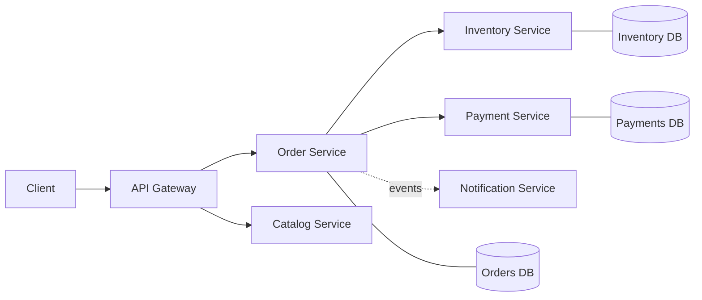

# Microservices: Architecture and Decomposition

<Outcomes items={[
  "Decide when microservices are worth their cost",
  "Find service boundaries using bounded contexts",
  "Explain why each service owns its database"
]} />

## Monolith versus microservices

| Concern | Modular monolith | Microservices |
| --- | --- | --- |
| Deployment | One unit | Many independent units |
| Calls between modules | In-process, fast, transactional | Network, can fail, latency |
| Data consistency | ACID transactions | Eventual consistency, sagas |
| Team scaling | Merge conflicts, shared release | Teams own services end to end |
| Operational cost | Low | High (discovery, tracing, CI/CD for each) |
| Scaling | Whole app | Per service |

Microservices solve an **organisational and scaling** problem. If one team owns the whole product, a well-structured modular monolith is often the better answer, and a strong interview answer says so.

## How to find service boundaries

1. **Bounded contexts (DDD).** A bounded context is a part of the domain where a term has one precise meaning. "Customer" in Billing (payment details) differs from "Customer" in Shipping (addresses). Each context is a candidate service.
2. **Business capability.** Order Management, Inventory, Payments, Notifications.
3. **Change together, stay together.** If two pieces always change in the same release, they likely belong in one service.
4. **Data ownership.** Each service is the single owner of its data; no one else touches its tables.

## Database per service

Sharing a database couples services through the schema: one team's migration breaks another. The rule is that other services must use the owner's API or consume its events. The consequence is that you lose cross-service joins and ACID transactions, which leads to the patterns in this section:

- Queries across services: API composition or [CQRS](data-consistency/cqrs-event-sourcing.md) read models.
- Updates across services: [Saga](data-consistency/saga.md).
- Reliable event publishing: [Outbox](data-consistency/outbox-idempotency.md).

## The cross-cutting platform

Each service needs the same supporting capabilities. Most of this section is about them:

| Capability | Page |
| --- | --- |
| Single entry point, auth, routing | [API Gateway](infrastructure/api-gateway.md) |
| Finding instances | [Service Discovery](infrastructure/service-discovery.md) |
| Central configuration | [Config Server](infrastructure/config-server.md) |
| Service-to-service calls | [Communication](communication/service-communication.md) |
| Surviving failure | [Resilience4j](resilience/resilience4j.md) |
| Seeing what happens | [Observability](observability/observability.md) |

## Check yourself

<Checkpoint questions={[
  {
    "q": "What is the main danger of splitting services without clear boundaries?",
    "options": [
      "A distributed monolith: services that must change and deploy together",
      "Faster deployments",
      "Smaller databases",
      "Lower network use"
    ],
    "answer": 0,
    "why": "Chatty, tightly coupled services give you the costs of distribution without independence."
  },
  {
    "q": "How should you find service boundaries?",
    "options": [
      "By database table",
      "Around business capabilities or bounded contexts, not technical layers",
      "By programming language",
      "By team size only"
    ],
    "answer": 1,
    "why": "A boundary should let one team change its service without coordinating with others."
  },
  {
    "q": "Why does each microservice own its database?",
    "options": [
      "Because databases are expensive",
      "To avoid using SQL",
      "So services stay independently deployable and cannot couple through shared tables",
      "To make joins faster"
    ],
    "answer": 2,
    "why": "Shared schemas create hidden coupling. Other services use APIs or events."
  }
]} />

## Common interview questions

**1. What are the advantages and disadvantages of microservices?**
Advantages: independent deployment and scaling, team autonomy, fault isolation, technology freedom. Disadvantages: distributed-system complexity (latency, partial failure, eventual consistency), operational overhead, harder debugging and testing, data duplication.

**2. How do you decide the size of a service?**
Not by lines of code. Use bounded contexts and team ownership: a service should be small enough for one team to understand and own, and large enough to complete a business operation without chatty calls to others.

**3. How would you migrate a monolith?**
Strangler fig: put a gateway in front, extract one capability at a time (starting with a loosely coupled, high-change one), route traffic to the new service, and retire the old code. Avoid a big-bang rewrite.

**4. How do services share data?**
Through APIs and events, never a shared schema. Duplicated read-only copies (built from events) are acceptable and often necessary.

**5. What is a distributed monolith?**
Services that must be deployed together, share a database, or call each other synchronously in long chains. You get all the cost of microservices and none of the benefit.

**6. What is the CAP theorem's relevance?**
During a network partition you choose consistency or availability. Most microservice designs choose availability with eventual consistency and compensate for inconsistencies.

## Pitfalls

- Splitting by technical layer (a "database service", a "validation service") instead of business capability.
- Too many tiny services (nano-services) created before the domain is understood.
- Synchronous call chains: availability is the product of each service's availability.
- Skipping automation: without CI/CD, tracing and centralised logging, microservices are unmanageable.

## Key takeaways

- Use microservices for team and scaling reasons, not by default.
- Draw boundaries around bounded contexts and data ownership.
- Database per service means eventual consistency, sagas and events.
- Invest in platform capabilities (discovery, config, tracing) from the start.
