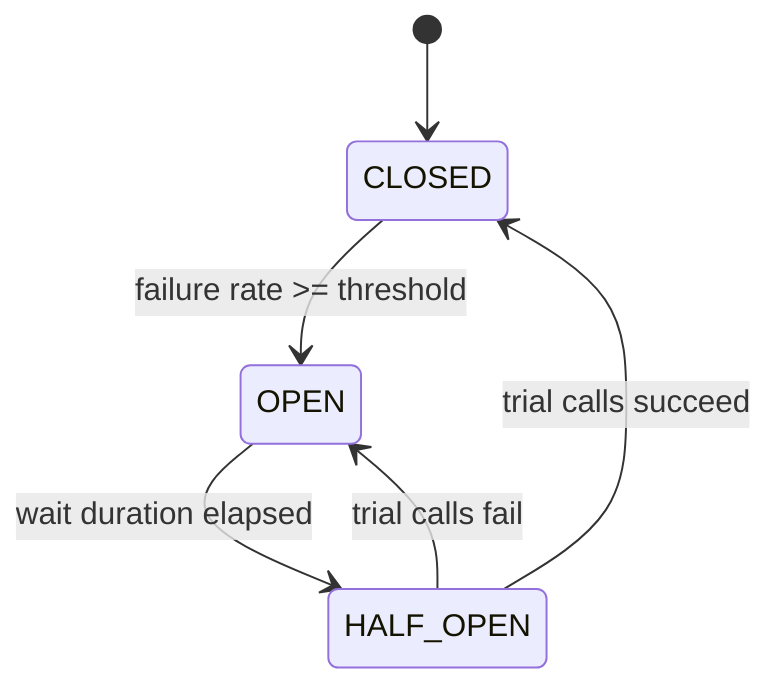

# Resilience4j: Failing Safely

In a distributed system something is always slow or down. Resilience patterns stop a local failure from becoming a cascading outage. Resilience4j is the standard lightweight library in the Spring ecosystem (the successor to Netflix Hystrix, which is in maintenance mode).

```xml
<dependency>
    <groupId>io.github.resilience4j</groupId>
    <artifactId>resilience4j-spring-boot3</artifactId>
</dependency>
<dependency>
    <groupId>org.springframework.boot</groupId>
    <artifactId>spring-boot-starter-aop</artifactId>
</dependency>
```

<Outcomes items={[
  "Describe closed, open and half-open circuit breaker states",
  "Combine retry, timeout, bulkhead and fallback sensibly",
  "Avoid retry storms"
]} />

## The patterns

| Pattern | Protects against | Idea |
| --- | --- | --- |
| **Timeout / TimeLimiter** | Hanging calls | Give up after a deadline |
| **Retry** | Transient faults | Try again, with backoff and jitter |
| **Circuit breaker** | Sustained failure | Stop calling a failing service; let it recover |
| **Bulkhead** | Resource exhaustion | Cap concurrent calls so one dependency cannot take all threads |
| **Rate limiter** | Overload | Limit calls per period |
| **Fallback** | User-visible failure | Return a degraded but useful result |

## Circuit breaker states



- **CLOSED**: calls flow; results are recorded in a sliding window.
- **OPEN**: calls are rejected immediately with `CallNotPermittedException`, giving the dependency time to recover and returning failures fast instead of tying up threads.
- **HALF_OPEN**: a few trial calls decide whether to close again.

## Try it: trip the breaker

Mark the downstream service unhealthy and send calls until the breaker opens. Then heal the service, wait out the open period and send the trial calls. The numbers match the configuration shown next.

<CircuitBreakerLab />

## Configuration

```yaml
resilience4j:
  circuitbreaker:
    instances:
      inventory:
        sliding-window-type: COUNT_BASED
        sliding-window-size: 20
        minimum-number-of-calls: 10
        failure-rate-threshold: 50
        slow-call-duration-threshold: 2s
        slow-call-rate-threshold: 80
        wait-duration-in-open-state: 30s
        permitted-number-of-calls-in-half-open-state: 3
  retry:
    instances:
      inventory:
        max-attempts: 3
        wait-duration: 200ms
        enable-exponential-backoff: true
        exponential-backoff-multiplier: 2
        retry-exceptions:
          - java.io.IOException
          - org.springframework.web.client.ResourceAccessException
        ignore-exceptions:
          - com.example.BusinessRuleException
  bulkhead:
    instances:
      inventory:
        max-concurrent-calls: 10
        max-wait-duration: 0
  timelimiter:
    instances:
      inventory:
        timeout-duration: 2s
```

## Using annotations

```java
@Service
class InventoryService {

    private static final Logger log = LoggerFactory.getLogger(InventoryService.class);

    private final InventoryApi api;

    InventoryService(InventoryApi api) {
        this.api = api;
    }

    @CircuitBreaker(name = "inventory", fallbackMethod = "stockFallback")
    @Retry(name = "inventory")
    @Bulkhead(name = "inventory")
    public StockDto stock(String sku) {
        return api.stock(sku);
    }

    // Same parameters + the exception as last parameter
    StockDto stockFallback(String sku, Throwable t) {
        log.warn("Inventory unavailable for {}: {}", sku, t.toString());
        return StockDto.unknown(sku);
    }
}
```

### Aspect order matters

By default Resilience4j applies aspects in this order, outermost first: **Retry ( CircuitBreaker ( RateLimiter ( TimeLimiter ( Bulkhead ( method ) ) ) ) )**. So retry wraps the circuit breaker: each retry attempt is recorded by the breaker, and when the breaker opens, the retry sees `CallNotPermittedException`. Adjust through `resilience4j.*.aspect-order` properties if you need a different layering.

### Fallbacks and what they hide

A fallback returns a degraded answer, which is perfect for non-critical data (recommendations) and dangerous for critical operations (payments). A fallback that fabricates "in stock" for inventory will oversell. Decide per call whether the right behaviour is to fail, return cached data, or return a safe default.

## Programmatic use

```java
CircuitBreaker cb = CircuitBreaker.ofDefaults("pricing");
Supplier<BigDecimal> guarded = CircuitBreaker.decorateSupplier(cb, () -> pricingClient.priceOf("ABC-12345"));
BigDecimal price = Try.ofSupplier(guarded).recover(t -> BigDecimal.ZERO).get();
```

(`Try` is from Vavr, a Resilience4j dependency.)

## Observability

Resilience4j registers Micrometer metrics (`resilience4j_circuitbreaker_state`, call counts, failure rate). Alert when breakers open. Actuator exposes `/actuator/circuitbreakers` and health indicators when enabled. See [Observability](../observability/observability.md).

## Check yourself

<Checkpoint questions={[
  {
    "q": "What does an open circuit breaker do with new calls?",
    "options": [
      "Rejects them immediately without calling the dependency",
      "Queues them forever",
      "Retries them 10 times",
      "Sends them to the database"
    ],
    "answer": 0,
    "why": "Failing fast protects threads and gives the dependency time to recover."
  },
  {
    "q": "A bulkhead is mainly used to...",
    "options": [
      "Encrypt traffic",
      "Limit concurrent calls so one slow dependency cannot use all resources",
      "Cache responses",
      "Compress payloads"
    ],
    "answer": 1,
    "why": "It isolates failure like watertight compartments in a ship."
  },
  {
    "q": "Why should retries use backoff and a cap?",
    "options": [
      "Retries are illegal",
      "Backoff makes calls faster",
      "Unbounded immediate retries multiply load on a struggling service",
      "To save disk space"
    ],
    "answer": 2,
    "why": "Exponential backoff with jitter and a retry budget prevents retry storms."
  }
]} />

## Common interview questions

**1. Explain the circuit breaker pattern.**
It monitors calls to a dependency. When the failure or slow-call rate crosses a threshold, it opens and rejects calls immediately. After a wait it half-opens and lets a few trial calls through; success closes it, failure re-opens it. This prevents wasting resources and cascading failures.

**2. When is retry dangerous?**
For non-idempotent operations, and when many clients retry together (a retry storm that overloads a recovering service). Use exponential backoff with jitter, a small attempt count, and retry only on transient errors.

**3. Bulkhead: semaphore vs thread-pool?**
Semaphore bulkhead limits concurrent calls on the caller thread (cheap). Thread-pool bulkhead runs calls in a dedicated pool (isolates blocking calls and pairs with TimeLimiter) at the cost of thread handoff.

**4. How do you choose thresholds?**
From measured latency and error baselines, not guesses. Set the minimum number of calls so a single failure does not trip the breaker, and timeouts slightly above the p99 of healthy latency.

**5. Where do you place a circuit breaker: gateway, client or both?**
Primarily around each outbound dependency call in the service making it (so you can pick a meaningful fallback). The gateway can add a coarse breaker per route.

**6. How does a timeout relate to the breaker?**
Slow calls are failures too. Without a timeout, a hung call never completes and never gets recorded. Configure client timeouts and slow-call thresholds.

## Pitfalls

- Missing `spring-boot-starter-aop`, so annotations silently do nothing.
- Calling an annotated method from within the same class (self-invocation bypasses the proxy).
- Fallback signature mismatch (parameters or exception type), which fails at call time.
- Retrying inside every layer (client, gateway, service), multiplying attempts.
- Catching exceptions inside the guarded method, so the breaker never sees failures.

## Key takeaways

- Combine timeout, retry (idempotent only), circuit breaker and bulkhead; they solve different problems.
- Know the breaker state machine and the default aspect order.
- Design fallbacks deliberately; some operations should simply fail.
- Monitor breaker state and failure rate.
