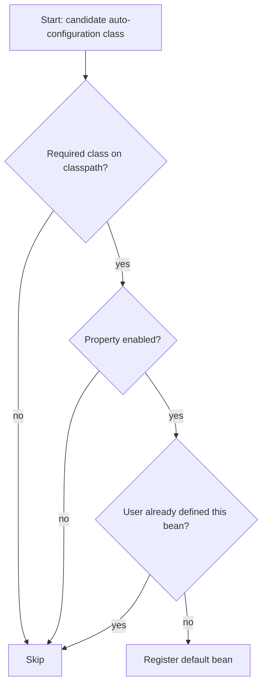

# Auto-Configuration

<Outcomes items={[
  "Explain how auto-configuration decides what to create",
  "Inspect and override decisions",
  "Write a simple custom auto-configuration"
]} />

## The mechanism

1. `@EnableAutoConfiguration` (inside `@SpringBootApplication`) imports an `AutoConfigurationImportSelector`.
2. The selector reads the file `META-INF/spring/org.springframework.boot.autoconfigure.AutoConfiguration.imports` from every JAR on the classpath. Each line is a configuration class name. (Older Boot versions used `spring.factories` for this.)
3. Each candidate class is evaluated. Its `@Conditional...` annotations decide whether it contributes beans.
4. Auto-configuration is processed **after** your own configuration, which is why your beans win.



## Common conditions

| Annotation | Applies when |
| --- | --- |
| `@ConditionalOnClass` / `@ConditionalOnMissingClass` | A class is (not) on the classpath |
| `@ConditionalOnBean` / `@ConditionalOnMissingBean` | A bean of that type is (not) already defined |
| `@ConditionalOnProperty` | A property has a given value |
| `@ConditionalOnWebApplication` | Servlet or reactive web app |
| `@ConditionalOnResource` | A file exists |

## Seeing what Boot decided

Start the app with `--debug` (or `debug=true`). The **conditions evaluation report** lists:

- **Positive matches**: configurations that were applied and why.
- **Negative matches**: configurations skipped and which condition failed.
- **Exclusions** and **Unconditional classes**.

The Actuator `conditions` endpoint exposes the same data on a running app.

## Overriding and excluding

Define your own bean and the default backs off:

```java
@Configuration
class JsonConfig {

    @Bean
    ObjectMapper objectMapper() {
        // JacksonAutoConfiguration's mapper is @ConditionalOnMissingBean, so this wins.
        return new ObjectMapper().findAndRegisterModules();
    }
}
```

Be careful: replacing the mapper this way drops Boot's defaults (for example `spring.jackson.*` properties). Often a `Jackson2ObjectMapperBuilderCustomizer` bean is the better tool.

To turn a configuration off entirely:

```java
@SpringBootApplication(exclude = DataSourceAutoConfiguration.class)
public class App { }
```

or `spring.autoconfigure.exclude=...` in properties.

## Writing your own auto-configuration

This is how starters for your company's shared libraries work. A tiny example: a `GreetingService` that is created unless the application provides one, and can be switched off by property.

```java
public class GreetingService {
    private final String greeting;

    public GreetingService(String greeting) {
        this.greeting = greeting;
    }

    public String greet(String name) {
        return greeting + ", " + name + "!";
    }
}
```

```java
@ConfigurationProperties(prefix = "greeting")
public class GreetingProperties {
    private String message = "Hello";

    public String getMessage() { return message; }
    public void setMessage(String message) { this.message = message; }
}
```

```java
@AutoConfiguration
@EnableConfigurationProperties(GreetingProperties.class)
@ConditionalOnProperty(prefix = "greeting", name = "enabled", matchIfMissing = true)
public class GreetingAutoConfiguration {

    @Bean
    @ConditionalOnMissingBean
    GreetingService greetingService(GreetingProperties props) {
        return new GreetingService(props.getMessage());
    }
}
```

Register it in `src/main/resources/META-INF/spring/org.springframework.boot.autoconfigure.AutoConfiguration.imports`:

```text
com.example.greeting.GreetingAutoConfiguration
```

Note that auto-configuration classes must **not** be found by component scanning of the consuming app; that is why they are listed in the imports file instead of being annotated with `@Component`.

## Check yourself

<Checkpoint questions={[
  {
    "q": "How does Boot decide to create a DataSource automatically?",
    "options": [
      "Conditions on the classpath and properties, such as @ConditionalOnClass",
      "It always creates one",
      "It asks the user at startup",
      "It reads a database file"
    ],
    "answer": 0,
    "why": "Auto-configuration classes are guarded by conditions and back off when you define your own bean."
  },
  {
    "q": "Which flag shows which auto-configurations matched or not?",
    "options": [
      "--verbose-gc",
      "--debug (the conditions report)",
      "--spring.cloud",
      "-Xdump"
    ],
    "answer": 1,
    "why": "The report lists positive and negative matches."
  },
  {
    "q": "You define your own DataSource bean. What happens to the auto-configured one?",
    "options": [
      "Two data sources are created",
      "The application fails",
      "It backs off because of @ConditionalOnMissingBean",
      "Boot deletes your bean"
    ],
    "answer": 2,
    "why": "User configuration takes precedence."
  }
]} />

## Common interview questions

**1. How does Spring Boot auto-configuration work?**
`@EnableAutoConfiguration` loads candidate configuration class names from `AutoConfiguration.imports` files on the classpath. Each class is guarded by conditions; those that pass register beans. Since they are processed after user configuration and mostly use `@ConditionalOnMissingBean`, user-defined beans take precedence.

**2. How do you find out why a bean was or was not created?**
Run with `--debug` or call the Actuator `/actuator/conditions` endpoint. Negative matches show the failed condition.

**3. How would you disable one auto-configuration?**
`exclude` on `@SpringBootApplication` / `@EnableAutoConfiguration`, or the `spring.autoconfigure.exclude` property.

**4. How do you create a custom starter?**
Two modules by convention: an `-autoconfigure` module holding the `@AutoConfiguration` class, properties and the imports file, and a thin `-starter` module that depends on it plus the needed libraries. Name it `acme-spring-boot-starter`, not `spring-boot-starter-acme` (that prefix is reserved for the Boot team).

**5. What is the difference between `@ConditionalOnBean` and `@ConditionalOnMissingBean` in terms of ordering?**
Both depend on what has been registered *so far*, so they are only reliable in auto-configuration classes ordered with `@AutoConfiguration(after = ...)`. In ordinary user configuration, ordering is not guaranteed and these conditions can behave unexpectedly.

## Pitfalls

- Using `@ConditionalOnBean` in application configuration, where bean registration order is unpredictable.
- Overriding a bean by name or type and unintentionally losing property-driven customisation.
- Component-scanning an auto-configuration package, which bypasses the conditions.
- Forgetting the imports file after renaming a class; the configuration silently stops applying.

## Key takeaways

- Auto-configuration = conditional `@Configuration` classes listed in `AutoConfiguration.imports`.
- It runs after user configuration and backs off via `@ConditionalOnMissingBean`.
- Debug with `--debug` or `/actuator/conditions`.
- Custom starters are an autoconfigure module plus a thin starter module.

Next: [Starters and dependency management](starters.md).
