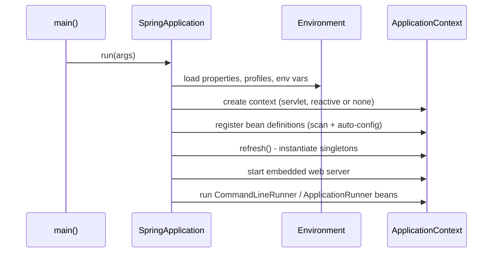

# Spring Boot Overview

<Outcomes items={[
  "Describe what Spring Boot adds on top of Spring",
  "Walk through what happens at startup",
  "Explain convention over configuration with auto-configuration"
]} />

## What Boot gives you

| Problem in plain Spring | What Boot does | Page |
| --- | --- | --- |
| Hundreds of compatible library versions to pick | Curated dependency management and **starters** | [Starters](starters.md) |
| Manual `DataSource`, `ObjectMapper`, `DispatcherServlet` setup | **Auto-configuration** that backs off when you define your own | [Auto-configuration](auto-configuration.md) |
| Scattered `.properties` and environment handling | **Externalized configuration** with type-safe binding | [Configuration](configuration.md) |
| Separate WAR and app server | **Embedded** Tomcat/Jetty/Undertow and executable JAR | this page |
| No visibility in production | **Actuator** endpoints | [Actuator](actuator.md) |

## What happens at startup

`@SpringBootApplication` is a shortcut for three annotations:

- `@SpringBootConfiguration`: this class is a `@Configuration`.
- `@EnableAutoConfiguration`: turn on auto-configuration.
- `@ComponentScan`: scan the current package and its sub-packages for components.

```java
@SpringBootApplication
public class OrderServiceApplication {
    public static void main(String[] args) {
        SpringApplication.run(OrderServiceApplication.class, args);
    }
}
```

`SpringApplication.run` does roughly this:



Because the web server starts as part of `refresh()`, a Boot app is just a Java program with a server inside it, which is why it containerises so easily.

## Check yourself

<Checkpoint questions={[
  {
    "q": "What is Spring Boot mainly responsible for?",
    "options": [
      "Opinionated defaults: auto-configuration, starters and an embedded server",
      "Replacing the Spring Framework",
      "Providing a new language",
      "Running only on the cloud"
    ],
    "answer": 0,
    "why": "Boot builds on Spring to remove boilerplate configuration."
  },
  {
    "q": "What does @SpringBootApplication combine?",
    "options": [
      "@Controller, @Service and @Repository",
      "@Configuration, @EnableAutoConfiguration and @ComponentScan",
      "@Transactional and @Async",
      "@Profile and @Value"
    ],
    "answer": 1,
    "why": "It is a convenience meta-annotation for the three."
  },
  {
    "q": "How is a Boot web app usually started?",
    "options": [
      "Deploy a WAR to a standalone server only",
      "Open a browser",
      "Run the executable jar with an embedded Tomcat",
      "Compile with javac only"
    ],
    "answer": 2,
    "why": "Embedded servers make the app self-contained."
  }
]} />

## Common interview questions

**1. What is the difference between Spring and Spring Boot?**
Spring is the framework: IoC container, AOP, data access, MVC. Boot is a set of conventions on top of it: starters, auto-configuration, embedded servers, Actuator and externalized config. You can use Spring without Boot, but you cannot use Boot without Spring.

**2. What does `@SpringBootApplication` do?**
It combines `@SpringBootConfiguration`, `@EnableAutoConfiguration` and `@ComponentScan`. Component scanning starts at the package of the annotated class, so put the main class in the root package of your app.

**3. How does Boot run without an external Tomcat?**
The `spring-boot-starter-web` dependency brings an embedded Tomcat. A `ServletWebServerFactory` bean (auto-configured) creates and starts it during context refresh. The Maven/Gradle plugin repackages the app into a "fat JAR" whose launcher loads nested dependency JARs.

**4. How do you change the embedded server?**
Exclude `spring-boot-starter-tomcat` from the web starter and add `spring-boot-starter-jetty` (or undertow). Auto-configuration picks whichever is on the classpath.

**5. What is the difference between `CommandLineRunner` and `ApplicationRunner`?**
Both run after the context is ready. `CommandLineRunner` receives raw `String...` args; `ApplicationRunner` receives a parsed `ApplicationArguments` (options such as `--flag=value` vs plain arguments).

## Pitfalls

- Putting the main class in the default package, or in a package that does not contain your components, so scanning misses them.
- Treating Boot as magic. When something is wired unexpectedly, run with `--debug` to see the auto-configuration report (see [Auto-configuration](auto-configuration.md)).
- Running heavy logic inside `CommandLineRunner` and delaying readiness. Prefer readiness probes (see [Actuator](actuator.md)).

## Key takeaways

- Boot is Spring plus defaults: starters, auto-configuration, embedded server, Actuator.
- `@SpringBootApplication` = configuration + auto-configuration + component scan.
- Everything happens inside `SpringApplication.run`: environment, context, bean creation, server start, runners.
- Your own beans always take priority over auto-configured ones.
