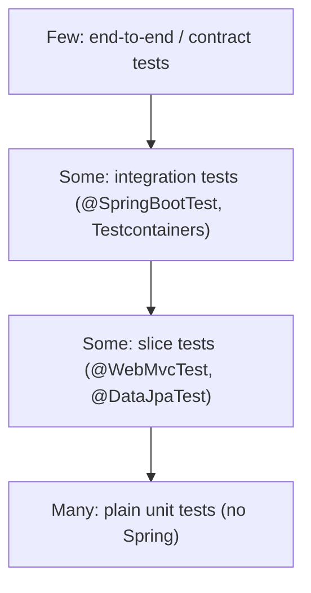

# Testing Basics: JUnit 5 and Mockito

`spring-boot-starter-test` gives you JUnit Jupiter, Mockito, AssertJ, Hamcrest, JSONassert and Spring Test. The key skill is choosing the **cheapest test that gives confidence**.



Business logic should be testable **without starting Spring**. Constructor injection makes this easy: just call `new`.

<Outcomes items={[
  "Write fast unit tests without starting Spring",
  "Use Mockito to stub and verify",
  "Tell mocks, spies and fakes apart"
]} />

## A unit test without Spring

Code under test:

```java
public record Order(long id, BigDecimal total, boolean vip) { }

public interface DiscountPolicy {
    BigDecimal discountFor(Order order);
}

public interface OrderRepository {
    Order save(Order order);
}

public class CheckoutService {

    private final DiscountPolicy discounts;
    private final OrderRepository repository;

    public CheckoutService(DiscountPolicy discounts, OrderRepository repository) {
        this.discounts = discounts;
        this.repository = repository;
    }

    public Order checkout(Order order) {
        BigDecimal discount = discounts.discountFor(order);
        if (discount.compareTo(order.total()) > 0) {
            throw new IllegalStateException("Discount exceeds total");
        }
        Order finalOrder = new Order(order.id(), order.total().subtract(discount), order.vip());
        return repository.save(finalOrder);
    }
}
```

The test:

```java
import static org.assertj.core.api.Assertions.*;
import static org.mockito.ArgumentMatchers.any;
import static org.mockito.Mockito.*;

@ExtendWith(MockitoExtension.class)
class CheckoutServiceTest {

    @Mock DiscountPolicy discounts;
    @Mock OrderRepository repository;
    @InjectMocks CheckoutService service;

    @Test
    void appliesDiscountBeforeSaving() {
        Order in = new Order(1, new BigDecimal("100.00"), true);
        when(discounts.discountFor(in)).thenReturn(new BigDecimal("10.00"));
        when(repository.save(any(Order.class))).thenAnswer(inv -> inv.getArgument(0));

        Order saved = service.checkout(in);

        assertThat(saved.total()).isEqualByComparingTo("90.00");
        ArgumentCaptor<Order> captor = ArgumentCaptor.forClass(Order.class);
        verify(repository).save(captor.capture());
        assertThat(captor.getValue().total()).isEqualByComparingTo("90.00");
    }

    @Test
    void rejectsDiscountLargerThanTotal() {
        Order in = new Order(2, new BigDecimal("5.00"), false);
        when(discounts.discountFor(in)).thenReturn(new BigDecimal("6.00"));

        assertThatThrownBy(() -> service.checkout(in))
                .isInstanceOf(IllegalStateException.class)
                .hasMessageContaining("exceeds");

        verifyNoInteractions(repository);
    }
}
```

Points worth noting:

- `MockitoExtension` uses *strict stubs*: an unused stubbing fails the test, which catches dead setup.
- Compare `BigDecimal` with `isEqualByComparingTo`, not `equals` (`90.0` and `90.00` are not `equals`).
- `ArgumentCaptor` lets you assert on what was passed to a collaborator.

## Parameterised tests

```java
@ParameterizedTest
@CsvSource({"0,false", "1,true", "-1,false"})
void isPositive(int value, boolean expected) {
    assertThat(value > 0).isEqualTo(expected);
}
```

## Mockito cheatsheet

| Need | Code |
| --- | --- |
| Stub return | `when(x.foo()).thenReturn(v)` |
| Stub exception | `when(x.foo()).thenThrow(new E())` |
| Stub void method | `doThrow(new E()).when(x).bar()` |
| Verify call count | `verify(x, times(2)).foo()` |
| Never called | `verify(x, never()).foo()` |
| Spy (partial mock) | `@Spy` or `spy(obj)`; prefer `doReturn(...).when(spy).foo()` |

## Mock vs Spy vs Fake

A **mock** has no real behaviour until stubbed. A **spy** wraps a real object. A **fake** is a simple working implementation (an in-memory repository). Fakes often give more robust tests than heavy mocking because they do not encode call sequences.

## Check yourself

<Checkpoint questions={[
  {
    "q": "What is the main advantage of a unit test without Spring?",
    "options": [
      "It runs in milliseconds and isolates the class under test",
      "It tests the database",
      "It starts the web server",
      "It is easier to deploy"
    ],
    "answer": 0,
    "why": "Constructor injection lets you pass mocks directly."
  },
  {
    "q": "When do you use a spy?",
    "options": [
      "To replace every method with a no-op",
      "To wrap a real object and stub only some methods",
      "To measure memory",
      "To spy on network traffic"
    ],
    "answer": 1,
    "why": "A mock is fully fake; a spy delegates to the real implementation unless stubbed."
  },
  {
    "q": "What does verify(mock, times(1)).send(any()) check?",
    "options": [
      "That send returned true",
      "That the mock is serialisable",
      "That send was called exactly once with any argument",
      "That send is final"
    ],
    "answer": 2,
    "why": "Verification asserts interactions; prefer asserting results when possible."
  }
]} />

## Common interview questions

**1. What is the difference between `@Mock` and `@MockBean`?**
`@Mock` is Mockito only; no Spring context involved. `@MockBean` (Boot, deprecated in favour of Spring Framework's `@MockitoBean` from Boot 3.4) replaces or adds a bean in the Spring context. Using it forces context customisation and can slow the suite because contexts are cached per distinct configuration.

**2. What does `@InjectMocks` do?**
Creates the object under test and injects the `@Mock` fields through the constructor, then setters or fields.

**3. How do you test private methods?**
Do not. Test through the public API; if a private method is complex enough to need its own test, extract it into a collaborator.

**4. How do you test a method that returns `void`?**
Verify its side effects: interactions with mocks, state changes, or thrown exceptions.

**5. What makes a test flaky and how do you avoid it?**
Time, randomness, ordering, shared state, real network. Inject a `Clock`, seed random generators, isolate data per test, and use fakes or Testcontainers instead of shared environments.

## Pitfalls

- Over-mocking: verifying every internal call makes tests fail on harmless refactors.
- Starting a `@SpringBootTest` for logic that has no Spring dependency.
- Asserting only that "no exception was thrown".
- Tests that depend on execution order.

## Key takeaways

- Most tests should be plain unit tests with constructor-injected collaborators.
- Use Mockito for collaborators, AssertJ for readable assertions, parameterised tests for tables of cases.
- Verify behaviour that matters, not implementation details.

Next: [Slice tests and Testcontainers](testing-slices-testcontainers.md).
