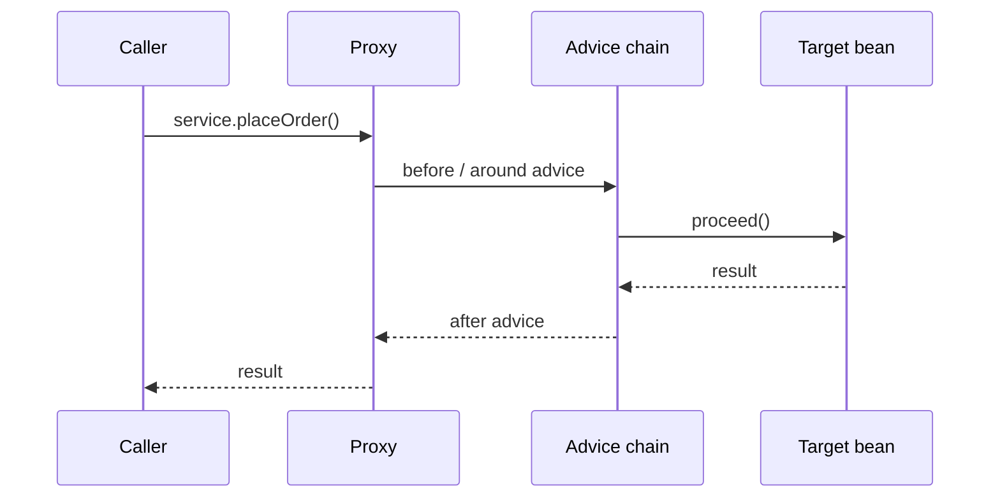

# AOP and Proxies

<Outcomes items={[
  "Explain how Spring AOP uses proxies",
  "Say why self-invocation bypasses @Transactional and other aspects",
  "Debug an annotation that seems to do nothing"
]} />

## Vocabulary

| Term | Meaning |
| --- | --- |
| **Join point** | A point in execution where advice can apply. In Spring AOP: a **method execution** on a Spring bean |
| **Pointcut** | A predicate selecting join points (`execution(* com.shop..*Service.*(..))`) |
| **Advice** | Code to run at a join point: `@Before`, `@AfterReturning`, `@AfterThrowing`, `@After` (finally), `@Around` |
| **Aspect** | A class bundling pointcuts and advice (`@Aspect`) |
| **Weaving** | Linking aspects with targets. Spring does it at runtime via proxies |
| **Target / Proxy** | The real object / the wrapper that callers actually hold |

## How the proxy works

When a bean matches an advisor's pointcut, a `BeanPostProcessor` replaces it with a proxy after initialisation. Callers invoke the proxy, which runs the advice chain and then delegates to the target.



### JDK dynamic proxy vs CGLIB

| | JDK dynamic proxy | CGLIB |
| --- | --- | --- |
| Mechanism | Implements the target's **interfaces** (`java.lang.reflect.Proxy`) | Generates a **subclass** of the target |
| Requires | At least one interface; inject by interface type | Non-final class and non-final, non-private methods; a constructor (Spring uses Objenesis, so no constructor call) |
| Injection by concrete class | Fails (the proxy is not an instance of the class) | Works |

**Spring Boot defaults to CGLIB** (`spring.aop.proxy-target-class=true`), which avoids "bean is not of type X" surprises. Plain Spring Framework (`@EnableAspectJAutoProxy` without `proxyTargetClass = true`) uses JDK proxies when an interface exists. I verified both: a Boot-less context created a `$$SpringCGLIB$$` subclass only when CGLIB was requested, and with JDK proxies, asking the container for the concrete class failed.

## Writing an aspect

```java
@Aspect
@Component
class TimingAspect {

    private static final Logger log = LoggerFactory.getLogger(TimingAspect.class);

    @Around("execution(* com.shop.orders..*Service.*(..))")
    Object time(ProceedingJoinPoint pjp) throws Throwable {
        long start = System.nanoTime();
        try {
            return pjp.proceed();                         // call the target (or the next advice)
        } finally {
            long ms = (System.nanoTime() - start) / 1_000_000;
            log.info("{} took {} ms", pjp.getSignature().toShortString(), ms);
        }
    }
}
```

Rules for `@Around`: you must call `proceed()` (or deliberately skip the target), return its result, and rethrow exceptions (or handle them on purpose). It is the most powerful advice and the easiest to get wrong; use `@Before`/`@AfterReturning` when sufficient.

### Pointcut expressions

```java
execution(* com.shop..*Service.*(..))            // any method of classes named *Service in com.shop and sub-packages
execution(public * *(..))                        // any public method
within(com.shop.orders.OrderService)             // all methods of a type
@annotation(com.shop.Audited)                    // methods annotated with @Audited
@within(org.springframework.stereotype.Service)  // methods of classes annotated @Service
bean(*Repository)                                // Spring-specific: by bean name
args(String, ..)                                 // by argument types
```

Custom annotations make aspects explicit and discoverable:

```java
@Target(ElementType.METHOD) @Retention(RetentionPolicy.RUNTIME)
@interface Audited { String action(); }

@Around("@annotation(audited)")
Object audit(ProceedingJoinPoint pjp, Audited audited) throws Throwable {
    // audited.action() available here
    return pjp.proceed();
}
```

### Ordering

Several advisors on the same method form a chain; control it with `@Order(n)` on aspects (lower runs outermost). This matters: **retry must wrap the transaction** (so each attempt gets a fresh one), and **security checks usually run before caching**. `@Transactional` advice has `Ordered.LOWEST_PRECEDENCE` by default (innermost); `@EnableTransactionManagement(order = ...)` changes it.

## What is built on this

| Annotation | Proxy advice |
| --- | --- |
| `@Transactional` | Begin/commit/rollback around the call |
| `@Cacheable`, `@CacheEvict` | Check/update the cache |
| `@Async` | Submit the call to an executor |
| `@Retryable` (Spring Retry), Resilience4j annotations | Retry, circuit breaker, bulkhead |
| `@PreAuthorize` (method security) | Authorisation check |
| `@Validated` | Method parameter validation |
| Micrometer `@Timed`/`@Observed` | Metrics and tracing |

They all share the same limitations, below.

## Limitations of proxy-based AOP

1. **Self-invocation bypasses the proxy.** A call from one method to another on `this` is a plain Java call, so no advice runs.

```java
@Component
class GreeterImpl {
    public String greet(String n) { return "hi " + n; }       // advised when called from outside
    public String outer(String n) { return greet(n); }        // calls greet on 'this': greet's advice does NOT run
}
```

A test with an `@Around` aspect logged `before outer, after outer` but nothing for the inner `greet`. Fixes: move the method to another bean, inject the bean into itself (`@Lazy` self reference), use `AopContext.currentProxy()` with `exposeProxy = true` (works, but couples code to AOP), or apply the behaviour programmatically (`TransactionTemplate`).

2. **Only public methods** (for JDK proxies, interface methods) are intercepted by the standard proxy mechanisms; `private`/package-private calls are not advised.
3. **Final classes and methods** cannot be overridden by CGLIB subclassing: advice silently does not apply to `final` methods.
4. **Only Spring-managed beans** are proxied; objects created with `new` are not.
5. **Only method executions** are join points: not field access, constructors or calls within the same object.
6. Proxies add small overhead per call, rarely relevant.
7. Beans that are advised appear to other code as proxies; `getClass()` shows the generated class, so use `AopUtils.getTargetClass(bean)` and `AopProxyUtils.ultimateTargetClass` in infrastructure code.

If you need to advise constructors, field access, internal calls or non-Spring objects, use **AspectJ** with compile-time or load-time weaving (`@EnableLoadTimeWeaving`, the aspectj-maven-plugin): much more powerful, more complex to build and run.

## Debugging "my aspect/annotation does nothing"

1. Is the class a Spring bean (component-scanned or `@Bean`)? Is the call coming **through the bean reference** (not `this`)?
2. Is the method public and non-final, class non-final?
3. Is the starter present (`spring-boot-starter-aop`/AspectJ weaver on classpath for `@Aspect`)? Is `@EnableTransactionManagement`/`@EnableCaching`/`@EnableAsync` active?
4. Does the pointcut match? Turn on debug logging for `org.springframework.aop` and `org.springframework.transaction.interceptor`.
5. Print the bean's class: `bean.getClass()` should contain `$$SpringCGLIB$$` or `$Proxy`.
6. Check ordering with other advisors (retry vs transaction vs cache).

## Check yourself

<Checkpoint questions={[
  {
    "q": "A @Transactional method is called from another method in the same class. Is a transaction started?",
    "options": [
      "No, the call bypasses the proxy",
      "Yes, always",
      "Only for private methods",
      "Only if the class is final"
    ],
    "answer": 0,
    "why": "Proxy-based AOP intercepts calls that come through the proxy. A this.method() call skips it."
  },
  {
    "q": "Which proxy types does Spring use?",
    "options": [
      "Only bytecode rewriting at compile time",
      "JDK dynamic proxies for interfaces and CGLIB subclasses for classes",
      "Only reflection",
      "Servlet filters"
    ],
    "answer": 1,
    "why": "Boot defaults to CGLIB (proxyTargetClass=true)."
  },
  {
    "q": "Why does @Transactional on a private method have no effect?",
    "options": [
      "Private methods run in a different thread",
      "Spring forbids private methods",
      "The proxy can only intercept calls to methods it can override",
      "The JVM inlines them"
    ],
    "answer": 2,
    "why": "CGLIB subclasses cannot override private methods and JDK proxies only expose interface methods."
  }
]} />

## Common interview questions

**1. How does Spring AOP work?**
A BPP wraps matching beans in a JDK or CGLIB proxy. Calls through the proxy run an interceptor chain (advice) and then the target method.

**2. JDK dynamic proxy vs CGLIB?**
JDK proxies implement interfaces and require interface-based injection; CGLIB subclasses the target class (needs non-final classes/methods). Boot uses CGLIB by default.

**3. Why does `@Transactional` not work when I call another method in the same class?**
Self-invocation bypasses the proxy, so the transactional advice never runs. Call through another bean or the proxy, or use `TransactionTemplate`.

**4. Spring AOP vs AspectJ?**
Spring AOP: runtime proxies, method execution on beans only, simple. AspectJ: bytecode weaving at compile/load time, any join point (fields, constructors, internal calls), no proxy limits, more complex tooling.

**5. How do you control the order of multiple aspects?**
`@Order` on aspect classes (or implement `Ordered`); lower value is outermost.

**6. What are the advice types and when do you use `@Around`?**
`@Before`, `@AfterReturning`, `@AfterThrowing`, `@After`, `@Around`. Use `@Around` when you must control execution (timing, retries, caching, short-circuiting); prefer simpler advice otherwise.

**7. Can you advise a `private` or `final` method?**
Not with Spring AOP proxies. Make it public/non-final, move it to a bean, or use AspectJ weaving.

**8. How would you implement an audit log for sensitive service methods?**
A custom `@Audited` annotation plus an `@Around` aspect matching `@annotation(audited)`, recording actor, action and outcome, ordered outside the transaction if audit must persist even on rollback (and using `REQUIRES_NEW` persistence).

## Pitfalls

- Self-invocation, final methods and private methods silently skipping advice.
- Aspects that forget to call `proceed()` or swallow exceptions.
- Heavy work in aspects on hot paths.
- Wrong advisor order (retry inside a transaction; cache before security).
- Pointcuts too broad (`execution(* *(..))`) advising framework beans.
- Using `getClass()` on beans and comparing with the target class.

## Key takeaways

- Spring AOP = proxies around beans; advice runs only for calls that go through the proxy.
- CGLIB is the Boot default; self-invocation and final/private methods escape advice.
- Order advisors deliberately: retry → transaction → cache/security as needed.
- Reach for AspectJ weaving only when proxy limits truly block you.

Next: [Configuration, profiles and conditions](configuration-profiles-conditions.md).
