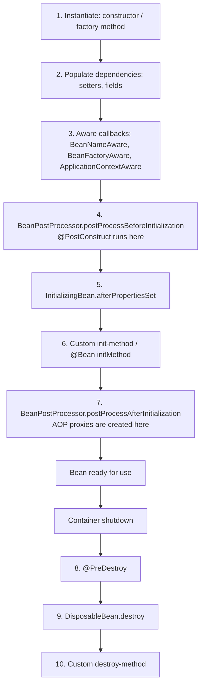

# Bean Lifecycle and Scopes

<Outcomes items={[
  "Describe the bean lifecycle from instantiation to destruction",
  "Choose between singleton, prototype and request scope",
  "Explain thread-safety implications of singleton beans"
]} />

## Lifecycle of a singleton bean



I recorded the order from a real context to be sure:

```text
constructor
BeanNameAware.setBeanName
BPP before init
@PostConstruct
afterPropertiesSet
init-method
BPP after init
--- shutdown ---
@PreDestroy
DisposableBean.destroy
destroy-method
```

Practical consequences:

- **Do not use injected dependencies in the constructor body of a field-injected bean**: they are not populated yet (another reason to prefer constructor injection).
- Do initialisation that needs injected collaborators in `@PostConstruct` (or a constructor with parameters).
- **Proxies appear at step 7.** The object other beans receive may be a proxy wrapping your instance, and your own `@PostConstruct` runs on the *raw* target. A `@Transactional` method called from `@PostConstruct` is **not** transactional because the proxy does not exist yet.
- Use `@PreDestroy` to release resources (flush buffers, close clients). It runs on orderly shutdown only (not on `kill -9`).
- Prototype-scoped beans get initialisation callbacks but **no destruction callbacks**: the container hands them over and forgets them.

```java
@Component
class CacheWarmer {
    private final ProductRepository repository;
    private final Map<Long, Product> cache = new ConcurrentHashMap<>();

    CacheWarmer(ProductRepository repository) { this.repository = repository; }

    @PostConstruct
    void warm() { repository.findAll().forEach(p -> cache.put(p.id(), p)); }   // blocks startup: keep it quick or do it after startup

    @PreDestroy
    void clear() { cache.clear(); }
}
```

For work that should run **after the application is up** (not block context refresh), use `ApplicationRunner`/`CommandLineRunner` or `@EventListener(ApplicationReadyEvent.class)`.

### `SmartLifecycle`

For components that start and stop with the context in a defined order (message listener containers, schedulers, gRPC servers) implement `SmartLifecycle`: `start()`, `stop()`, `isRunning()`, and `getPhase()` (lower phase starts first, stops last). `isAutoStartup()` controls whether it starts automatically. Graceful shutdown in Boot (`server.shutdown=graceful`) uses this: web server stops accepting requests first, in-flight requests complete, then beans are destroyed.

## Scopes

| Scope | Instances | Notes |
| --- | --- | --- |
| **singleton** (default) | One per container | Shared, must be thread-safe |
| **prototype** | New instance for each injection/lookup | Container does not manage destruction |
| **request** | One per HTTP request | Web only |
| **session** | One per HTTP session | Web only; state per user |
| **application** | One per `ServletContext` | Web only |
| **websocket** | One per WebSocket session | Web only |
| custom (`Scope` SPI) | Your own (e.g. thread, tenant, Spring Cloud `refresh`) | `@RefreshScope` is a custom scope |

```java
@Component
@Scope("prototype")
class ShoppingCartDraft { }

@Component
@RequestScope                                   // composed annotation: request scope + scoped proxy
class RequestContext { String correlationId; }
```

### The prototype-in-singleton problem

A singleton is created once, so its injected prototype is also resolved **once**, effectively making it a singleton:

```java
@Component
class Singleton {
    private final Proto proto;                        // resolved once at construction
    private final ObjectProvider<Proto> provider;     // asks the container each time

    Singleton(Proto proto, ObjectProvider<Proto> provider) {
        this.proto = proto;
        this.provider = provider;
    }

    Proto fresh() { return provider.getObject(); }    // new instance each call
}
```

I confirmed: `proto` is always the same object, `provider.getObject()` returns a new one each time. Alternatives: `@Lookup` method injection, injecting `Supplier`/`Provider` (jakarta.inject), or a **scoped proxy**.

### Scoped proxies

Injecting a request-scoped bean into a singleton fails (there is no request at singleton creation) unless the injected bean is a **proxy** that resolves the real instance per call:

```java
@Component
@Scope(value = WebApplicationContext.SCOPE_REQUEST, proxyMode = ScopedProxyMode.TARGET_CLASS)
class RequestContext { ... }     // @RequestScope does exactly this
```

The proxy is shared; each method call is routed to the current request's instance. This works on request threads only: using it from an `@Async` thread or a new thread fails with "no thread-bound request".

## Scope and thread safety quick guide

- **Singleton**: shared across threads, so no mutable per-request state.
- **Request/session scope**: safe per request (a session-scoped bean is shared by concurrent requests of the same session, so still needs care).
- **Prototype**: not shared unless you pass it around.

## Lazy initialisation

`@Lazy` defers creation until first use. Boot's `spring.main.lazy-initialization=true` makes **all** beans lazy to speed up startup, at the cost of moving wiring errors and first-request latency to runtime. Use selectively.

## Check yourself

<Checkpoint questions={[
  {
    "q": "What is Spring's default bean scope?",
    "options": [
      "Singleton: one instance per container",
      "Prototype",
      "Request",
      "Session"
    ],
    "answer": 0,
    "why": "A singleton is shared by all threads, so it must be stateless or thread-safe."
  },
  {
    "q": "A singleton bean holds a mutable field updated per request. What is the risk?",
    "options": [
      "Memory leak in the JVM only",
      "Race conditions, because all requests share the same instance",
      "The field resets automatically",
      "Spring will clone the bean"
    ],
    "answer": 1,
    "why": "Keep per-request state in local variables or request-scoped beans."
  },
  {
    "q": "Which runs first for a bean?",
    "options": [
      "@PostConstruct, then the constructor",
      "Dependency injection, then the constructor",
      "Constructor, then dependency injection, then @PostConstruct",
      "Destroy callbacks, then the constructor"
    ],
    "answer": 2,
    "why": "The object must exist before it can be injected and initialised."
  }
]} />

## Common interview questions

**1. Describe the Spring bean lifecycle.**
Instantiate → populate properties → Aware callbacks → `BeanPostProcessor` before-init (`@PostConstruct`) → `afterPropertiesSet` → custom init method → BPP after-init (proxies) → in use → `@PreDestroy` → `destroy` → custom destroy.

**2. Where are AOP proxies created?**
In `postProcessAfterInitialization` of a BPP (`AnnotationAwareAspectJAutoProxyCreator`), after initialisation callbacks.

**3. Why does `@Transactional` not apply inside `@PostConstruct`?**
At that point the bean is the raw target; the transactional proxy is created after initialisation.

**4. What are the bean scopes?**
Singleton, prototype, request, session, application, websocket, plus custom scopes.

**5. How do you inject a prototype bean into a singleton so you get a new instance each time?**
`ObjectProvider<T>`/`Provider<T>`, `@Lookup`, or a scoped proxy.

**6. Does Spring call destroy methods for prototype beans?**
No; the container does not track prototypes after creation. Clean them up yourself.

**7. `@PostConstruct` vs `InitializingBean` vs `initMethod`?**
All run after dependency injection, in that order. `@PostConstruct` (Jakarta annotation) is the usual choice; `InitializingBean` couples code to Spring; `initMethod` is useful for third-party classes.

**8. How does graceful shutdown work in Spring Boot?**
`server.shutdown=graceful` stops accepting new requests, waits up to `spring.lifecycle.timeout-per-shutdown-phase` for in-flight requests, then the context closes and destroy callbacks run.

## Pitfalls

- Using injected fields in a constructor (field injection) and getting `NullPointerException`.
- Heavy work in `@PostConstruct` delaying startup and readiness.
- Expecting `@Transactional`, `@Async` or `@Cacheable` to work inside initialisation callbacks.
- Mutable state in singleton beans.
- Prototype beans that hold resources and are never closed.
- Using request-scoped beans from background threads.

## Key takeaways

- Know the order: construct → inject → init callbacks → proxy → use → destroy.
- Proxies appear after initialisation; self-calls and init-time calls bypass them.
- Singleton by default; use `ObjectProvider` or scoped proxies for shorter-lived dependencies.
- Prefer lifecycle events and runners for post-startup work.

Next: [AOP and proxies](aop-and-proxies.md).
