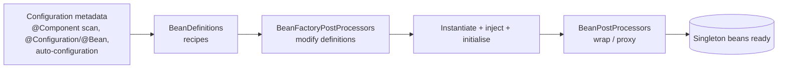

# IoC Container and Dependency Injection

<Outcomes items={[
  "Explain inversion of control and what the container does",
  "Prefer constructor injection and say why",
  "Resolve ambiguity and circular dependencies"
]} />

## Container basics



| | `BeanFactory` | `ApplicationContext` |
| --- | --- | --- |
| Role | Basic container | Full-featured: extends BeanFactory |
| Singleton creation | Lazy (on first `getBean`) | **Eager** at startup (fail-fast) |
| Extras | none | Events, message sources, resource loading, environment/profiles, AOP/BPP auto-registration |

In practice you always use an `ApplicationContext` (Spring Boot creates one). Eager singleton creation is why wiring errors fail the application at **startup** rather than in production at first use.

A **bean** is simply an object managed by the container, described by a `BeanDefinition` (class, scope, dependencies, init/destroy methods).

## Defining beans

```java
@Service                                   // stereotype: @Component specialisations (@Service, @Repository, @Controller)
class PricingService { }

@Configuration
class AppConfig {
    @Bean                                  // explicit factory method, for third-party classes or conditional/complex construction
    Clock clock() { return Clock.systemUTC(); }
}
```

`@Repository` additionally enables persistence exception translation; `@Controller` marks web handlers; semantically `@Service` is just `@Component` with intent.

## Injection styles

```java
@Service
class OrderService {
    private final PaymentGateway gateway;          // constructor injection: immutable, explicit, testable
    private final Clock clock;

    OrderService(PaymentGateway gateway, Clock clock) {   // @Autowired is optional with a single constructor
        this.gateway = gateway;
        this.clock = clock;
    }
}
```

| Style | Verdict |
| --- | --- |
| **Constructor** | Preferred: dependencies are required, fields can be `final`, class is usable in plain unit tests (`new OrderService(fake, clock)`), cycles surface immediately, a constructor with many parameters is a visible smell of too many responsibilities |
| Setter | For genuinely optional or re-configurable dependencies |
| Field (`@Autowired` on a field) | Avoid: hides dependencies, no `final`, needs reflection or a container to test |

## Resolving ambiguity

Injection is **by type** first. When several beans match:

```java
interface PaymentMethod { }
@Component @Primary class CardPayment implements PaymentMethod { }     // default choice
@Component class WalletPayment implements PaymentMethod { }

OrderService(PaymentMethod method) { }                                  // gets CardPayment
OrderService(@Qualifier("walletPayment") PaymentMethod method) { }      // explicit by bean name / qualifier
OrderService(List<PaymentMethod> all) { }                               // ALL matching beans (ordered by @Order/Ordered)
OrderService(Map<String, PaymentMethod> byName) { }                     // all, keyed by bean name
```

Collection injection is the idiomatic way to implement the strategy pattern with Spring: new implementation = new bean, no changes to callers. Parameter-name matching as a fallback needs `-parameters` compilation (Boot's Maven/Gradle plugins enable it).

Optional and lazy lookups:

```java
OrderService(ObjectProvider<AuditService> audit) {        // may be absent, or created later / multiple times
    audit.ifAvailable(a -> a.log("created"));
}
```

`ObjectProvider` also solves "prototype inside a singleton" (see [Lifecycle and scopes](bean-lifecycle-and-scopes.md)) and breaks some cycles. `@Lazy` on an injection point injects a lazy-resolution proxy.

## Circular dependencies

A needs B and B needs A.

- **Constructor injection** cannot satisfy this: Spring throws `BeanCurrentlyInCreationException` at startup. That is a feature: it flags a design problem.
- **Field/setter injection** historically allowed it through "early references" (a half-initialised singleton exposed to the other bean). Spring Boot 2.6+ **prohibits circular references by default** (`spring.main.allow-circular-references=false`).

I verified both: with constructor injection the context fails to start; field cycles work in a plain context but fail once `allowCircularReferences` is false (Boot's default).

Fixes, best first: **redesign** (extract the shared logic into a third bean, or have one side publish an event), invert the dependency through an interface or callback, or as a last resort break the cycle with `@Lazy` or `ObjectProvider` on one edge.

## Customising the container

- **`BeanFactoryPostProcessor`**: runs after bean definitions load, before any bean is created; modifies definitions. Example: `PropertySourcesPlaceholderConfigurer` resolves `${...}`. Declare these `static @Bean` methods, otherwise the configuration class is instantiated too early.
- **`BeanPostProcessor`**: runs around each bean's initialisation; can replace a bean with a **proxy**. `@Autowired` processing, `@Transactional`, `@Async`, `@Cacheable`, `@Validated` are all implemented as BPPs (see [AOP](aop-and-proxies.md)).
- **`FactoryBean<T>`**: a bean whose job is to produce another object (`getObject()`); `&beanName` retrieves the factory itself. Used by Spring Data repositories, `RestClient` builders, MyBatis mappers.
- **`@Import`/`ImportSelector`**: how auto-configuration pulls in configuration classes (see [Auto-configuration](../boot/auto-configuration.md)).

## Singleton scope and thread safety

Beans are singletons by default: one instance per container, **shared by all threads**. Therefore singleton beans must be **stateless** or thread-safe. Common bug: storing request data in a field of a `@Service`.

```java
@Service
class ReportService {
    private User currentUser;                   // BUG: shared between concurrent requests
    String run(User u) { this.currentUser = u; return render(); }
}
```

Keep per-request state in method parameters, request-scoped beans or a context object.

## Check yourself

<Checkpoint questions={[
  {
    "q": "Why is constructor injection preferred over field injection?",
    "options": [
      "Dependencies are explicit and final, and the class is testable without Spring",
      "It is faster at runtime",
      "Field injection is deprecated and removed",
      "It avoids needing @Component"
    ],
    "answer": 0,
    "why": "Constructor injection makes required dependencies visible, supports immutability and works in plain unit tests."
  },
  {
    "q": "Two beans implement the same interface and injection fails. What are valid fixes?",
    "options": [
      "Delete the interface",
      "@Primary on one, or @Qualifier at the injection point",
      "Make both beans prototype scoped",
      "Add @Autowired twice"
    ],
    "answer": 1,
    "why": "Spring needs a single candidate. @Primary sets a default and @Qualifier selects by name."
  },
  {
    "q": "Beans A and B depend on each other through constructors. What happens by default in Spring Boot?",
    "options": [
      "One is created lazily and it works silently",
      "Spring uses field injection instead",
      "Startup fails with a circular reference error",
      "The beans are merged"
    ],
    "answer": 2,
    "why": "Boot disallows circular references by default. Break the cycle by redesigning or using @Lazy as a last resort."
  }
]} />

## Common interview questions

**1. What is IoC and what is DI?**
IoC is the principle that a framework controls object creation and the flow; DI is the technique of supplying an object's dependencies from outside (constructor, setter or field) instead of the object creating or looking them up.

**2. `BeanFactory` vs `ApplicationContext`?**
`ApplicationContext` extends `BeanFactory` with eager singleton instantiation, events, internationalisation, resource loading and automatic BPP registration. Always use the context.

**3. Why prefer constructor injection?**
Immutability (`final`), mandatory dependencies, easier unit tests without Spring, early detection of cycles, and visible class complexity.

**4. How does Spring resolve which bean to inject?**
By type; ties are broken by `@Primary`, then `@Qualifier`, then by matching the parameter/field name to the bean name. `List<T>`/`Map<String,T>` inject all candidates.

**5. How do you handle circular dependencies?**
Prefer redesign. With constructor injection it fails at startup. If unavoidable, use `@Lazy` or `ObjectProvider` on one side, or setter injection while allowing circular references (disabled by default in Boot 2.6+).

**6. What is the difference between `@Component` and `@Bean`?**
`@Component` (and stereotypes) marks your own class for scanning; `@Bean` is a factory method in a `@Configuration` class, used for third-party types or when construction logic is needed.

**7. What is a `BeanPostProcessor`?**
A hook invoked around bean initialisation that can modify or replace beans (for example wrapping them in proxies); the foundation of AOP-based features.

**8. Are Spring beans thread-safe?**
No automatically. Singletons are shared; they must be stateless or internally thread-safe.

**9. What does `@Autowired` do on a constructor with one parameter list?**
Nothing extra: since Spring 4.3 a single constructor is used automatically; `@Autowired` is needed only to choose among several constructors.

## Pitfalls

- Field injection everywhere, then discovering that unit tests need the container.
- State in singleton beans.
- Hiding cycles behind `@Lazy` instead of fixing the design.
- Declaring `BeanFactoryPostProcessor` methods non-static.
- Relying on bean-name fallback matching and then renaming a class.
- Component scanning too broadly, pulling in unintended beans.

## Key takeaways

- The container builds the object graph at startup and can wrap beans in proxies.
- Constructor injection by default; `List<T>` injection for strategies.
- Avoid circular dependencies by design; Boot rejects them by default.
- Singletons are shared across threads: keep them stateless.

Next: [Bean lifecycle and scopes](bean-lifecycle-and-scopes.md).
