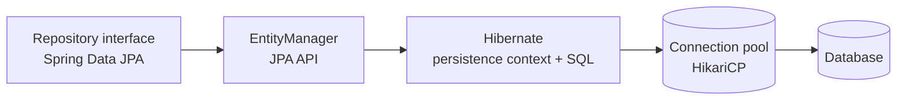
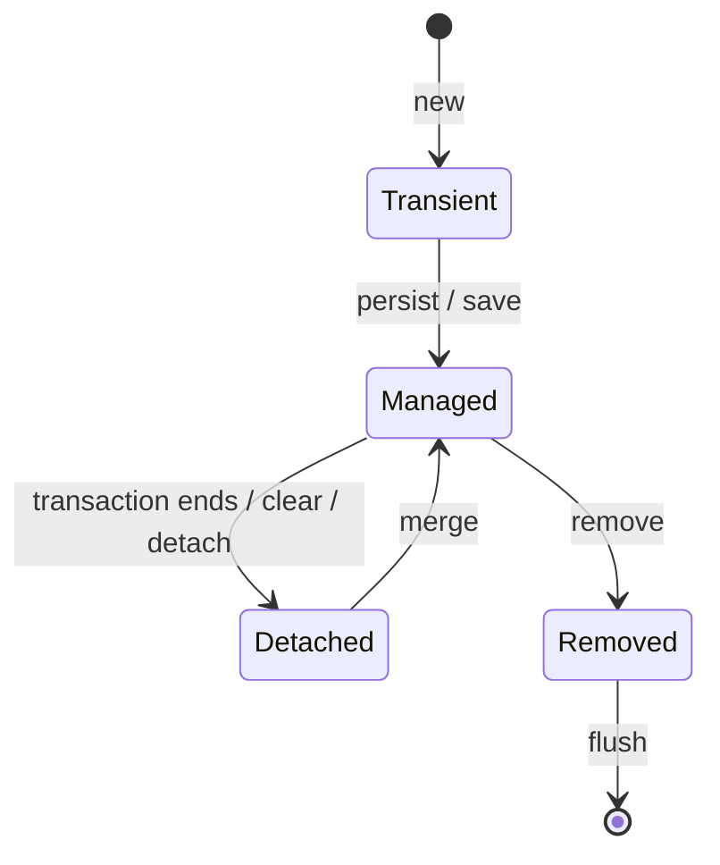

# Spring Data JPA and Hibernate Basics

Three layers are often confused. Interviewers like candidates who can separate them.

| Layer | What it is |
| --- | --- |
| **JPA** (Jakarta Persistence) | A specification: annotations (`@Entity`) and the `EntityManager` API |
| **Hibernate** | The most common JPA implementation: generates SQL, manages entity state |
| **Spring Data JPA** | A convenience layer that writes repository implementations for you, on top of JPA |



<Outcomes items={[
  "Explain the persistence context and entity states",
  "Say when changes are flushed to the database",
  "Avoid Open Session in View problems"
]} />

## A small domain

The examples across this section use customers, orders and order items.

```java
@Entity
@Table(name = "purchase_orders", indexes = @Index(name = "idx_orders_status", columnList = "status"))
class PurchaseOrder {

    @Id @GeneratedValue(strategy = GenerationType.IDENTITY)
    Long id;

    @ManyToOne(fetch = FetchType.LAZY, optional = false)
    @JoinColumn(name = "customer_id")
    Customer customer;

    @Column(nullable = false)
    String status;

    @Version
    long version;                       // used for optimistic locking, see the Locking page

    @OneToMany(mappedBy = "order", cascade = CascadeType.ALL, orphanRemoval = true)
    List<OrderItem> items = new ArrayList<>();

    protected PurchaseOrder() { }       // JPA needs a no-arg constructor
    PurchaseOrder(Customer customer, String status) { this.customer = customer; this.status = status; }

    void addItem(String sku, int quantity) {
        items.add(new OrderItem(this, sku, quantity));
    }
}
```

Details that matter:

- `@ManyToOne` and `@OneToOne` default to **EAGER**; set `LAZY` explicitly. `@OneToMany` and `@ManyToMany` default to LAZY.
- `mappedBy` marks the **inverse side**. The side with the foreign key (`OrderItem.order`) owns the relationship, and only changes on the owning side are written to the database. Keep both sides in sync in a helper such as `addItem`.
- `cascade = ALL` plus `orphanRemoval = true` makes items part of the order's lifecycle.
- Use `GenerationType.IDENTITY` or `SEQUENCE`; avoid `AUTO` surprises and `TABLE`. `IDENTITY` disables JDBC insert batching; `SEQUENCE` allows it.
- Avoid Lombok's `@Data` on entities (it generates `equals/hashCode/toString` that touch lazy collections).

## The persistence context

Inside a transaction, Hibernate keeps a **persistence context**: a first-level cache of managed entities, keyed by id.

Entity states:



Consequences you should be able to explain:

1. **Identity guarantee**: two `findById(1)` calls in one transaction return the same Java object, with only one query.
2. **Dirty checking**: modify a managed entity and Hibernate issues the `UPDATE` at flush/commit; you do not need to call `save`.
3. **Write-behind**: SQL is deferred until flush (commit, before a query that may be affected, or an explicit `flush()`).
4. **Lazy loading** only works while the context is open (see [N+1 and lazy loading](n-plus-one-lazy-loading.md)).

```java
@Transactional
void markPaid(Long id) {
    PurchaseOrder order = orders.findById(id).orElseThrow();
    order.status = "PAID";            // no save() needed: dirty checking issues the UPDATE on commit
}
```

## Repositories

Extend `JpaRepository` and Spring generates the implementation at startup:

```java
interface PurchaseOrderRepository extends JpaRepository<PurchaseOrder, Long> {

    List<PurchaseOrder> findByStatus(String status);                 // derived query

    Page<PurchaseOrder> findByStatus(String status, Pageable pageable);

    @Query("select distinct o from PurchaseOrder o join fetch o.items where o.status = :status")
    List<PurchaseOrder> findWithItems(@Param("status") String status);
}
```

- **Derived queries**: the method name is parsed (`findByCustomerIdAndStatus`, `existsByEmail`, `countByStatus`, `deleteByStatus`). Good for simple cases; long names are a sign to use `@Query`.
- **`@Query`** with JPQL (entity names and fields) or `nativeQuery = true` for SQL.
- Prefer `@Query` or Specifications for anything complex; the Criteria API is verbose.

### Pagination and sorting

```java
Page<PurchaseOrder> page = orders.findByStatus("NEW", PageRequest.of(0, 20, Sort.by("id").descending()));
page.getContent();        // the 20 rows
page.getTotalElements();  // triggers an extra COUNT query
```

`Page` runs a count query; use `Slice` (no count) for infinite scroll. Never paginate a query that `join fetch`es a collection: Hibernate would fetch everything and paginate in memory (Hibernate logs a "firstResult/maxResults specified with collection fetch; applying in memory" warning). Page the parent ids first, then fetch the children.

For deep pages, `OFFSET` gets slower as the offset grows; use **keyset (seek) pagination** (`where id < :lastId order by id desc limit 20`), see [SQL tuning](sql-tuning-indexing.md).

### Projections

Fetching whole entities when you need two columns wastes memory and prevents index-only scans.

```java
interface PurchaseOrderRepository extends JpaRepository<PurchaseOrder, Long> {

    interface Summary {          // interface-based projection
        Long getId();
        String getStatus();
    }

    List<Summary> findSummaryByStatus(String status);
}

record OrderSummaryDto(Long id, String status) { }   // class/record-based (DTO) projection, via constructor expression
```

Projections return read-only data and are not managed entities.

## `save`, `saveAll`, `deleteAll`

- `save` calls `persist` for new entities (id is null / `@Version` null) and `merge` for existing ones. `merge` may issue a `SELECT` first.
- `deleteAll()` loads and deletes entity by entity; use `deleteAllInBatch()` or a `@Modifying @Query("delete ...")` for bulk deletes (these bypass the persistence context and entity callbacks).
- `@Modifying` queries should usually use `clearAutomatically = true`, otherwise managed entities show stale state.

## Open Session in View

Spring Boot enables `spring.jpa.open-in-view=true` by default: the persistence context stays open during the whole web request, so lazy loading works in controllers and view serialisation. It also holds a database connection for the whole request and hides N+1 queries. A common production setting is `false`, with services returning fully-loaded DTOs.

## Check yourself

<Checkpoint questions={[
  {
    "q": "You load an entity inside a transaction and change a field without calling save(). What happens at commit?",
    "options": [
      "Hibernate detects the change (dirty checking) and issues an UPDATE",
      "Nothing, you must call save",
      "The change is discarded",
      "An exception is thrown"
    ],
    "answer": 0,
    "why": "Managed entities are tracked by the persistence context and flushed on commit."
  },
  {
    "q": "What does the first-level cache guarantee?",
    "options": [
      "Cache across all users",
      "Within one session, loading the same id returns the same instance",
      "Cache across application restarts",
      "Cache between microservices"
    ],
    "answer": 1,
    "why": "It is scoped to the EntityManager/session."
  },
  {
    "q": "What is the main risk of Open Session in View?",
    "options": [
      "It disables transactions",
      "It breaks JSON serialisation",
      "Lazy loading in the view layer causes hidden queries and long-held connections",
      "It makes entities immutable"
    ],
    "answer": 2,
    "why": "Many teams disable it with spring.jpa.open-in-view=false and fetch what they need explicitly."
  }
]} />

## Common interview questions

**1. JPA vs Hibernate vs Spring Data JPA?**
JPA is the standard API, Hibernate implements it, and Spring Data JPA removes repository boilerplate by generating implementations on top of JPA.

**2. What is the persistence context and what is dirty checking?**
The persistence context is the first-level cache of managed entities in a transaction. On flush Hibernate compares each managed entity with its loaded snapshot and issues `UPDATE`s for the changes automatically.

**3. `save()` vs `saveAndFlush()`?**
`save` schedules the change; `saveAndFlush` also flushes immediately, forcing SQL (and constraint violations) to surface now.

**4. `getReferenceById` vs `findById`?**
`findById` hits the database and returns the entity or empty. `getReferenceById` returns a lazy proxy without querying, useful to set a foreign key (`order.setCustomer(customers.getReferenceById(id))`), and throws only when you touch the data if it does not exist.

**5. What is the difference between `persist` and `merge`?**
`persist` makes a new transient entity managed. `merge` copies the state of a detached (or new) instance onto a managed instance and returns that managed instance; the object you passed stays detached.

**6. What do `FetchType.LAZY` and `EAGER` mean, and what are the defaults?**
LAZY loads on first access; EAGER loads with the owner. To-one associations default to EAGER, to-many to LAZY; best practice is LAZY everywhere and fetching explicitly per use case.

**7. Why avoid `@Data` and field-based `equals/hashCode` on entities?**
They can trigger lazy loading, and an id-based `hashCode` changes after the entity is persisted, which breaks `HashSet`s. Use a business key or a stable id strategy.

## Pitfalls

- Relying on EAGER mappings, which produce unexpected joins and extra queries everywhere.
- Updating only one side of a bidirectional relationship.
- Using `deleteAll()` for large tables.
- Returning entities directly from controllers (lazy proxies, over-exposure, infinite recursion in JSON); return DTOs.
- Importing `jakarta.persistence.*` and `org.springframework.data.jpa.repository.*` with wildcards: `Query` and `EntityGraph` exist in both packages and the compiler reports "ambiguous reference".

## Key takeaways

- JPA is the API, Hibernate the engine, Spring Data the productivity layer.
- Managed entities are dirty-checked automatically inside a transaction.
- Make associations LAZY and choose how to fetch per query.
- Use projections and DTOs for reads; page carefully.

Next: [N+1 problem and lazy loading](n-plus-one-lazy-loading.md).
