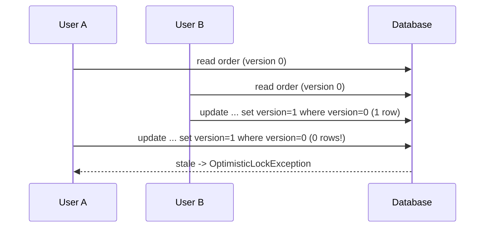
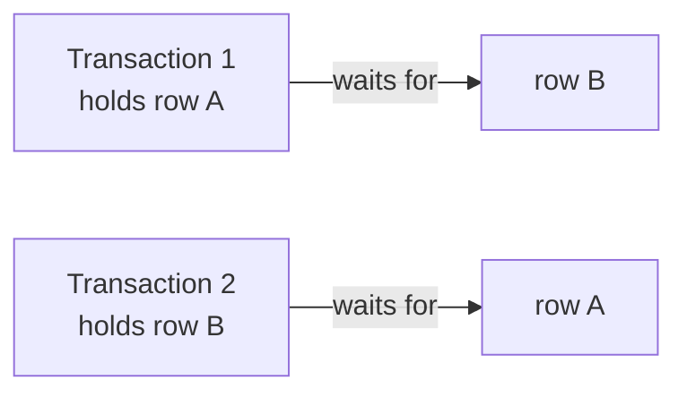

# Optimistic and Pessimistic Locking

Two users load the same order, both edit it, both save. Without protection the second save silently overwrites the first: a **lost update**. Locking strategies decide how to prevent that.



<Outcomes items={[
  "Choose optimistic or pessimistic locking",
  "Use @Version correctly and handle conflicts",
  "Avoid deadlocks with consistent ordering"
]} />

## Optimistic locking

Assume conflicts are rare. Do not lock; detect conflicts at write time with a **version column**.

```java
@Entity
class PurchaseOrder {
    @Id @GeneratedValue(strategy = GenerationType.IDENTITY)
    Long id;

    String status;

    @Version
    long version;
}
```

Hibernate adds the version to every update: `update purchase_orders set status=?, version=? where id=? and version=?`. If zero rows are updated, someone else changed the row and Spring throws `ObjectOptimisticLockingFailureException` (wrapping JPA's `OptimisticLockException`).

A test of the scenario above:

```java
PurchaseOrder stale = orders.findById(id).orElseThrow();                          // A reads (version 0)
tx.executeWithoutResult(s -> orders.findById(id).orElseThrow().status = "PAID");  // B commits (version 1)
stale.status = "CANCELLED";
assertThatThrownBy(() -> orders.saveAndFlush(stale))                              // A's write is rejected
        .isInstanceOf(OptimisticLockingFailureException.class);
```

### Handling the failure

- **UI/API flow**: return `409 Conflict` (or `412 Precondition Failed` with ETags) and let the user reload and retry. Expose the version in the DTO and send it back on update, otherwise the check only covers the short window inside one transaction.
- **Background flow**: retry the whole transaction a few times (re-read, re-apply, save). With Spring Retry:

```java
@Retryable(retryFor = ObjectOptimisticLockingFailureException.class, maxAttempts = 3,
           backoff = @Backoff(delay = 50, multiplier = 2))
@Transactional
public void addItem(Long orderId, String sku) { ... }
```

The retry must wrap the transaction (the proxy order matters; the retry advice should be the outer one), not run inside it.

### Version and bulk updates

JPQL bulk updates do not touch `@Version` unless you write `update versioned PurchaseOrder ...`. Also note that `@Version` protects only the entity's own row; changes to child collections owned by the entity increment the parent version only when the collection is modified (owned collections are versioned by default).

## Pessimistic locking

Assume conflicts are likely or costly. Take a database lock when reading so others must wait.

```java
@Lock(LockModeType.PESSIMISTIC_WRITE)
@Query("select o from PurchaseOrder o where o.id = :id")
Optional<PurchaseOrder> findForUpdate(@Param("id") Long id);
```

This issues `SELECT ... FOR UPDATE`. Other transactions that try to lock or update that row block until the first commits or rolls back. It only works inside a transaction.

| Mode | Meaning |
| --- | --- |
| `PESSIMISTIC_READ` | Shared lock: others can read, but not write |
| `PESSIMISTIC_WRITE` | Exclusive lock: others cannot lock or write |
| `PESSIMISTIC_FORCE_INCREMENT` | Write lock and also bump the version |

Set a lock timeout so waiting does not hang forever:

```java
@QueryHints(@QueryHint(name = "jakarta.persistence.lock.timeout", value = "3000"))
```

For work queues use `SKIP LOCKED` (`jakarta.persistence.lock.timeout = -2` in Hibernate) so several workers pick different rows without blocking each other. This is how a polling outbox relay scales (see [Outbox](../../microservices/data-consistency/outbox-idempotency.md)).

## Deadlocks

Two transactions each hold a lock the other needs:



The database detects the cycle and aborts one transaction (a deadlock exception). Prevent them by **always locking rows in the same order** (for example by ascending id), keeping transactions short, and being ready to retry.

## Which one to use

| | Optimistic | Pessimistic |
| --- | --- | --- |
| Conflict frequency | Low | High |
| Cost on happy path | Almost none | Lock held, waiting, reduced concurrency |
| On conflict | Exception, retry | Wait (or timeout) |
| Works across HTTP requests | Yes (send the version) | No (lock lasts one transaction) |
| Risks | Retry storms under heavy contention | Deadlocks, blocked threads, pool exhaustion |

Examples: editing a profile or document uses optimistic. Decrementing a hot inventory counter or allocating a unique ticket number often uses pessimistic locking, or better, an atomic SQL update (`update stock set qty = qty - 1 where sku = ? and qty > 0`) which needs neither.

## Other tools against lost updates

- **Atomic statements**: `set counter = counter + 1`, and check the affected row count.
- **Unique constraints** to enforce "only one" rules; handle the violation.
- **Higher isolation** (serializable) with retry on serialization failure.
- **Distributed locks** (Redis, ZooKeeper) are for cross-service mutual exclusion, and are not a substitute for database constraints.

## Check yourself

<Checkpoint questions={[
  {
    "q": "How does optimistic locking detect a conflict?",
    "options": [
      "A version column is checked in the UPDATE's WHERE clause",
      "It locks the row on read",
      "It uses a distributed lock",
      "It blocks readers"
    ],
    "answer": 0,
    "why": "If another transaction changed the row, zero rows update and an OptimisticLockException is raised."
  },
  {
    "q": "When is pessimistic locking appropriate?",
    "options": [
      "Read-mostly data with rare conflicts",
      "High contention on hot rows where retries would be frequent",
      "Static reference data",
      "Caches"
    ],
    "answer": 1,
    "why": "SELECT FOR UPDATE serialises writers but holds locks and risks deadlocks."
  },
  {
    "q": "How do you reduce deadlock risk?",
    "options": [
      "Use longer transactions",
      "Retry forever without delay",
      "Acquire locks in a consistent order and keep transactions short",
      "Lock tables"
    ],
    "answer": 2,
    "why": "Consistent ordering removes circular waits."
  }
]} />

## Common interview questions

**1. Optimistic vs pessimistic locking?**
Optimistic detects conflicts at commit using a version column and fails/retries; pessimistic prevents conflicts by taking database locks while reading. Optimistic scales better when conflicts are rare.

**2. How does `@Version` work?**
Hibernate includes `where version = ?` in updates and increments it. If no row matches, the entity is stale and an optimistic lock exception is thrown.

**3. What is a lost update?**
Two transactions read the same data and each writes back changes based on the old value, so one change overwrites the other without anyone noticing.

**4. How do you handle `ObjectOptimisticLockingFailureException`?**
Retry the business operation from the start for system flows, or return 409 so a user can reload and resubmit.

**5. How do you avoid deadlocks?**
Lock in a consistent order, keep transactions short, avoid user interaction inside transactions, and retry on deadlock errors.

**6. Does `@Transactional` alone prevent lost updates?**
No. At the default `READ_COMMITTED` level, two transactions can still read-then-write over each other. You need a version column, locking, atomic updates or stricter isolation.

**7. How do you let many workers consume rows from a table without conflicts?**
`SELECT ... FOR UPDATE SKIP LOCKED` so each worker claims a different batch.

## Pitfalls

- Using `@Version` but not sending the version through the API, so conflicts across user sessions go undetected.
- Retrying inside the failed transaction instead of starting a new one.
- Long transactions holding pessimistic locks while calling remote services.
- Locking rows in inconsistent order.
- Forgetting that bulk JPQL updates bypass versioning and the persistence context.

## Key takeaways

- Choose optimistic locking by default; use pessimistic for hot rows with real contention.
- `@Version` turns lost updates into detectable exceptions.
- Always have a retry or conflict-response strategy.
- Consistent lock ordering and short transactions prevent deadlocks.

Next: [SQL tuning and indexing](sql-tuning-indexing.md).
