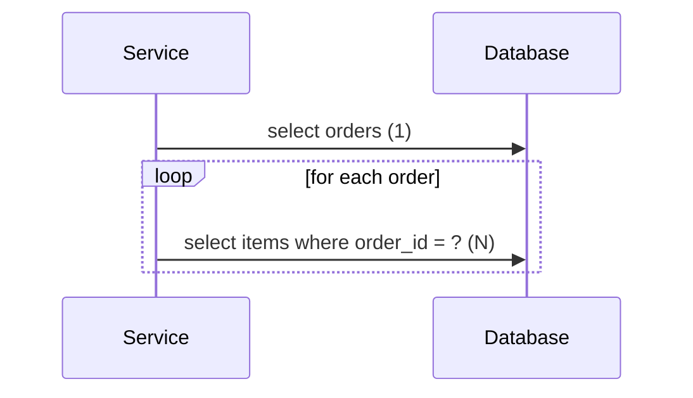

# N+1 Problem and Lazy Loading

<Outcomes items={[
  "Recognise the N+1 query problem and detect it",
  "Fix it with join fetch, entity graphs or batch fetching",
  "Explain LazyInitializationException"
]} />

## What it is

You load N parent rows with one query (the "1"), then touch a lazy association on each parent and Hibernate runs one extra query per parent (the "N").

```java
List<PurchaseOrder> list = orders.findByStatus("NEW");   // 1 query: select * from purchase_orders where status = ?
for (PurchaseOrder o : list) {
    total += o.items.size();                              // N queries: select * from order_items where order_id = ?
}
```

With 5 orders and 3 items each this issues **6** statements (verified with Hibernate statistics). With 1,000 orders, 1,001 round trips, each with network latency. It works fine on a developer laptop with ten rows and collapses in production.



## Detecting it

- Enable SQL logging in dev: `spring.jpa.show-sql=true` or logger `org.hibernate.SQL=DEBUG` (avoid in production, it is slow).
- Turn on Hibernate statistics (`spring.jpa.properties.hibernate.generate_statistics=true`) and assert the **statement count** in tests: `sessionFactory.getStatistics().getPrepareStatementCount()`.
- Libraries such as `datasource-proxy` or `hypersistence-utils` can fail a test when the query count exceeds an expectation.
- APM traces showing the same query repeated many times per request.

## Fix 1: `join fetch`

```java
@Query("select distinct o from PurchaseOrder o join fetch o.items where o.status = :status")
List<PurchaseOrder> findWithItems(@Param("status") String status);
```

One query with a `JOIN`, children populated. Result: **1** statement. Notes:

- `distinct` removes duplicate parents caused by the join (Hibernate 6 de-duplicates in memory automatically, but keeping `distinct` is harmless and explicit).
- Do not combine collection `join fetch` with `Pageable` (in-memory pagination).
- Fetching **two** collections in one query creates a Cartesian product (`MultipleBagFetchException` for `List`s). Fetch one collection per query.

## Fix 2: Entity graphs

```java
@EntityGraph(attributePaths = "items")
List<PurchaseOrder> findByCustomerId(Long customerId);
```

Same effect without writing JPQL; works on derived queries. Result: **1** statement.

## Fix 3: Batch fetching

When you cannot fetch everything up front, make lazy loads cheaper: load children for many parents with a single `IN (...)` query.

```properties
spring.jpa.properties.hibernate.default_batch_fetch_size=50
```

or `@BatchSize(size = 50)` on the association. For 5 orders this becomes 1 + 1 = **2** statements. It is a good global safety net with little downside.

## Fix 4: Fetch only what you need

If the screen shows order id and status only, use a projection (see [JPA basics](jpa-basics.md)) and the problem disappears. If you need aggregates, let the database compute them:

```java
@Query("select o.id, count(i) from PurchaseOrder o left join o.items i group by o.id")
List<Object[]> itemCounts();
```

## Choosing a strategy

| Situation | Choice |
| --- | --- |
| Always need the child for this use case | `join fetch` / entity graph |
| Parent list is paginated | Page parent ids first, then fetch children with `where id in (:ids)`; or batch fetching |
| Many different screens touch different associations | LAZY + batch fetch size, fetch per use case |
| Read-only list or report | DTO projection or native query |

## Lazy loading and `LazyInitializationException`

A lazy collection or association is a **proxy** that loads when first accessed, but only while the session (persistence context) is open.

```java
PurchaseOrder o = orders.findByStatus("NEW").get(0);   // the repository's transaction has ended
o.items.size();                                         // LazyInitializationException: no session
```

Typical fixes, in order of preference:

1. Fetch what you need inside the service transaction (join fetch, entity graph) and map to a DTO **before** returning.
2. Make the service method `@Transactional` and touch the association inside it.
3. Use `Hibernate.initialize(entity.getItems())` inside the transaction for one-off cases.

Anti-fixes: switching the association to EAGER (it applies to every query and creates hidden N+1 problems of its own) and enabling `open-in-view` just to make the exception go away (it hides N+1 and keeps connections busy during view rendering).

### EAGER is not a fix

EAGER fetching on a `@ManyToOne` still causes N+1 when you load a list through JPQL: Hibernate loads the orders with one query and then issues extra selects for each customer. Fetch strategy should be chosen **per query**, not baked into the mapping.

## Check yourself

<Checkpoint questions={[
  {
    "q": "You load 100 orders and then access each order's lazy items. How many queries run?",
    "options": [
      "101: one for orders and one per order for items",
      "1",
      "2",
      "200"
    ],
    "answer": 0,
    "why": "That is the N+1 problem. Fetch the items together with a join fetch or entity graph."
  },
  {
    "q": "Which fix loads the association in the same query?",
    "options": [
      "@Transactional(readOnly = true) alone",
      "JOIN FETCH",
      "FetchType.LAZY",
      "Calling size() in a loop"
    ],
    "answer": 1,
    "why": "JOIN FETCH or an entity graph tells Hibernate to load the association eagerly for that query."
  },
  {
    "q": "Why do you get LazyInitializationException?",
    "options": [
      "The database is down",
      "The entity is immutable",
      "A lazy association is accessed after the session is closed",
      "The query was too slow"
    ],
    "answer": 2,
    "why": "Fetch what you need inside the transaction or use projections."
  }
]} />

## Common interview questions

**1. What is the N+1 select problem and how do you solve it?**
One query to load N parents plus one lazy query per parent. Solve it with `join fetch`, entity graphs, batch fetching (`@BatchSize` / `default_batch_fetch_size`), or projections that avoid loading associations.

**2. What causes `LazyInitializationException`?**
Accessing a lazy association after the persistence context has closed. Fetch the data inside the transaction or map to a DTO within it.

**3. Why shouldn't you use `join fetch` with pagination?**
Pagination applies to rows, not parents. With a collection join, Hibernate cannot limit in SQL so it loads everything and paginates in memory, which is slow and memory-hungry.

**4. What is `MultipleBagFetchException`?**
Fetching two `List` collections in one query. Use `Set`s (still a Cartesian product), or better, fetch collections in separate queries.

**5. Is `FetchType.EAGER` a good solution to lazy-loading errors?**
No. It forces the loading on every access path, causes extra queries and joins, and cannot be turned off per query.

**6. How do you prove a fix works?**
Write a test that asserts the statement count using Hibernate statistics, so a future change that reintroduces N+1 fails the build.

## Pitfalls

- Marking the association EAGER "to fix" exceptions.
- Using `join fetch` with `Pageable`.
- Serialising entities to JSON in controllers, which walks lazy associations.
- Ignoring N+1 because the dev database has a handful of rows.
- Fetching a large collection only to call `.size()`; use a `count` query.

## Key takeaways

- N+1 = one query for parents + one per parent for a lazy association.
- Detect it by counting statements; fix it per query with join fetch, entity graphs or batch size.
- LAZY mappings plus explicit fetching per use case is the sustainable approach.
- Return DTOs from the transactional service layer.

Next: [Transactions](transactions.md).
