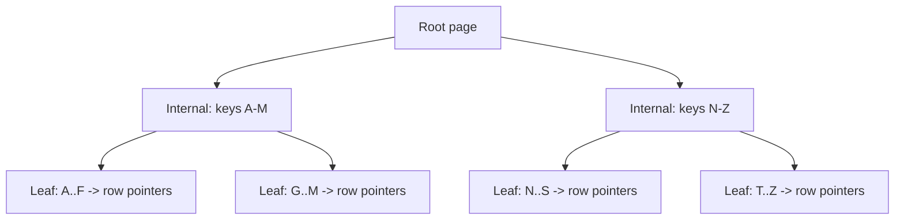

# SQL Tuning and Indexing

<Outcomes items={[
  "Explain how a B-tree index speeds up queries",
  "Apply the leftmost-prefix rule to composite indexes",
  "Read EXPLAIN output and fix slow queries"
]} />

## How an index works

A typical index is a **B-tree**: a sorted structure that lets the database find rows by key in `O(log n)` instead of scanning the whole table.



Trade-offs: indexes make reads faster but slow down inserts, updates and deletes (every index must be maintained) and use disk and memory. Index what you query, not everything.

| Term | Meaning |
| --- | --- |
| **Clustered index** | Table rows are stored in index order (InnoDB primary key). One per table |
| **Secondary index** | Separate structure pointing to rows (or to the primary key in InnoDB) |
| **Covering index** | Contains all columns the query needs, so the table is never touched (index-only scan) |
| **Selectivity** | How well a column narrows results: unique email is high, boolean flag is low |

## Declaring indexes

In JPA for documentation and schema generation:

```java
@Table(name = "purchase_orders",
       indexes = @Index(name = "idx_orders_status", columnList = "status"))
```

In production, manage the schema with **migrations** (Flyway or Liquibase), not `ddl-auto=update`:

```sql
CREATE INDEX idx_orders_customer_status_created
    ON purchase_orders (customer_id, status, created_at DESC);
```

## Composite indexes and the leftmost-prefix rule

An index on `(customer_id, status, created_at)` can serve queries that filter on:

- `customer_id`
- `customer_id` and `status`
- `customer_id`, `status` and `created_at`

but not efficiently on `status` alone or `created_at` alone. Put columns in this order: **equality filters first** (most selective first), then range filters, then sort columns. A range condition (`>`, `between`) stops later columns from being used for seeking.

## Reading `EXPLAIN`

```sql
EXPLAIN ANALYZE
SELECT id, status FROM purchase_orders
WHERE customer_id = 42 AND status = 'NEW'
ORDER BY created_at DESC LIMIT 20;
```

What to look for (PostgreSQL wording; MySQL uses `type`, `key`, `rows`):

| You see | Meaning |
| --- | --- |
| `Seq Scan` / `type: ALL` on a big table | Full scan, probably missing or unusable index |
| `Index Scan` / `Index Only Scan` | Index used (index only = covering) |
| `Sort` with high cost | Not using index order; consider matching the index to `ORDER BY` |
| Estimated rows far from actual rows | Stale statistics; run `ANALYZE` |
| `Nested Loop` with many loops | Per-row lookups, possibly the N+1 problem inside SQL |

Always test with production-like data volumes: the planner chooses differently on 100 rows than on 50 million.

## Common reasons an index is not used

- **Function or cast on the column**: `where lower(email) = ?` or `where date(created_at) = ?` cannot use a plain index. Use a functional index, or rewrite as a range: `created_at >= ? and created_at < ?`.
- **Leading wildcard**: `like '%abc'` cannot seek; `like 'abc%'` can.
- **Type mismatch**: comparing a `varchar` column to a number forces an implicit cast.
- **Low selectivity**: the planner may prefer a scan if the query returns a large share of the table.
- **`OR` across different columns** and `NOT IN` patterns; consider `UNION ALL` or `NOT EXISTS`.
- **Leftmost prefix violated** in a composite index.

## Pagination at scale

`OFFSET` pagination reads and discards all earlier rows, so page 10,000 is slow.

```sql
-- slow for deep pages
SELECT * FROM purchase_orders ORDER BY id DESC LIMIT 20 OFFSET 200000;

-- keyset (seek) pagination: constant time per page
SELECT * FROM purchase_orders WHERE id < :lastSeenId ORDER BY id DESC LIMIT 20;
```

Keyset pagination needs a stable, indexed sort key (use a tuple such as `(created_at, id)` if the key is not unique) and cannot jump to an arbitrary page. Spring Data offers `ScrollPosition` for this.

## Anti-patterns in Java code

| Problem | Fix |
| --- | --- |
| N+1 queries | Join fetch, entity graph, batch size ([details](n-plus-one-lazy-loading.md)) |
| `select *` for list screens | Projections / DTOs |
| Loading a collection to filter or count it in Java | Do it in SQL (`where`, `count`, `exists`) |
| One `INSERT` per row in a loop | JDBC batching: `hibernate.jdbc.batch_size=50`, `order_inserts=true` (needs `SEQUENCE` ids, not `IDENTITY`) |
| `findAll()` on a large table | Pagination, streaming (`Stream`/`ScrollPosition`) |
| `deleteAll()` row by row | `deleteAllInBatch()` or bulk `@Modifying` query |
| Long transactions | Short, focused transactions ([details](transactions.md)) |

## Connection pool sizing

HikariCP is Boot's default pool. Bigger is **not** better: a database can only run so many queries in parallel (roughly proportional to its CPU cores and disk capability), and extra connections just queue inside the database.

```yaml
spring:
  datasource:
    hikari:
      maximum-pool-size: 10        # start small, measure
      connection-timeout: 3000     # fail fast instead of hanging threads
      max-lifetime: 1800000
```

A rule of thumb from the HikariCP project: `connections = (core_count * 2) + effective_spindle_count`, then tune with measurements. Multiply by the number of service instances to check the **total** against the database's `max_connections`. If requests wait for connections, the cause is usually slow queries or transactions held too long, not a small pool.

## Finding slow queries

- Database tools: `pg_stat_statements` (PostgreSQL), slow query log and Performance Schema (MySQL).
- Application: Hibernate statistics, `datasource-proxy`, Micrometer metrics for Hikari (`hikaricp.connections.pending`, `.usage`), and traces showing database spans (see [Observability](../../microservices/observability/observability.md)).

## Check yourself

<Checkpoint questions={[
  {
    "q": "An index exists on (a, b, c). Which query can use it efficiently?",
    "options": [
      "WHERE a = 1 AND b = 2",
      "WHERE b = 2",
      "WHERE c = 3",
      "WHERE b = 2 AND c = 3"
    ],
    "answer": 0,
    "why": "Composite indexes work from the leftmost column onward."
  },
  {
    "q": "Why can WHERE LOWER(email) = ? ignore an index on email?",
    "options": [
      "LOWER is deprecated",
      "The function applied to the column prevents a normal index lookup",
      "Indexes only support numbers",
      "It forces a table lock"
    ],
    "answer": 1,
    "why": "Use a functional index or store a normalised column."
  },
  {
    "q": "Why is OFFSET 100000 slow?",
    "options": [
      "It locks the table",
      "It forgets the index",
      "The database still reads and discards all skipped rows",
      "It requires a cursor"
    ],
    "answer": 2,
    "why": "Keyset pagination (WHERE id > last ORDER BY id LIMIT n) avoids the scan."
  }
]} />

## Common interview questions

**1. How does a database index speed up queries?**
It keeps keys sorted in a B-tree so lookups, range scans and ordered reads avoid scanning the full table, at the cost of extra storage and slower writes.

**2. What is a composite index and why does column order matter?**
An index on several columns, usable from the leftmost column onward. Equality columns go first, then range, then sort columns, matching how queries filter.

**3. What is a covering index?**
An index containing every column a query selects and filters on, so the database never reads the table.

**4. A query is slow in production. What do you do?**
Capture the exact SQL and parameters, run `EXPLAIN ANALYZE` on production-like data, look for scans, sorts, row-estimate errors, then add or adjust an index, rewrite the query, or reduce the data fetched. Verify with timing and re-check write overhead.

**5. When do indexes hurt?**
On write-heavy tables with many indexes, low-selectivity columns, and tiny tables. Every index costs on `INSERT/UPDATE/DELETE`.

**6. Why is `OFFSET` pagination slow, and what is the alternative?**
The database must walk and discard all skipped rows. Keyset pagination filters on the last seen key and stays fast.

**7. How do you size a connection pool?**
Start small (tens, not hundreds), measure pending requests and connection usage, and keep total connections across instances below the database limit.

**8. How do you speed up bulk inserts with JPA?**
Use `SEQUENCE` id generation, enable `hibernate.jdbc.batch_size`, `order_inserts`, and flush/clear the persistence context every batch; or use JDBC batch updates / bulk loaders for very large volumes.

## Pitfalls

- Adding an index for every column "just in case".
- Testing with tiny datasets.
- Relying on `ddl-auto=update` in production.
- Functions on indexed columns in `where` clauses.
- Increasing pool size to fix slow queries.
- Optimising without measuring.

## Key takeaways

- Indexes trade write cost for read speed; design them for your queries.
- Learn to read `EXPLAIN`; test with realistic data.
- Fix the SQL pattern first (N+1, select *, in-memory filtering), then the index, then the pool.
- Use keyset pagination for deep paging and manage schema through migrations.

Next: [Caching](caching.md).
