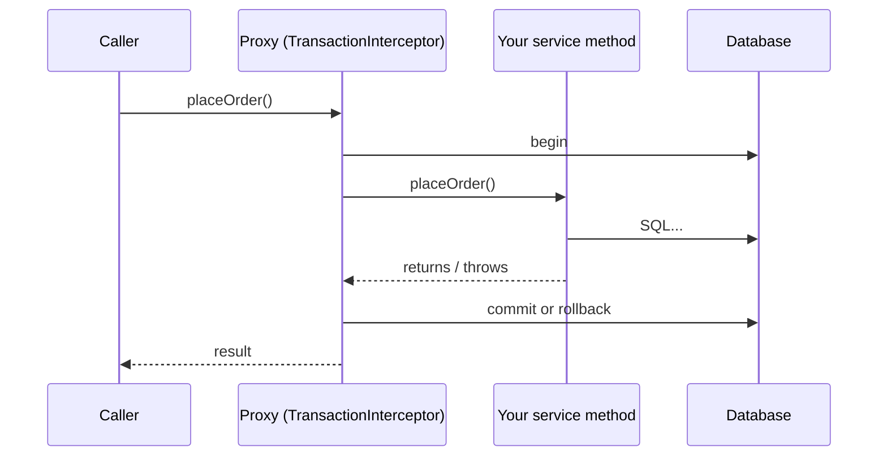

# Transactions: Propagation, Isolation and Rollback

<Outcomes items={[
  "Explain how @Transactional works via proxies",
  "Choose propagation and isolation settings",
  "Know which exceptions roll back by default"
]} />

## How `@Transactional` works

Spring wraps the bean in a **proxy**. A call from outside goes to the proxy, which starts (or joins) a transaction, calls your method, then commits, or rolls back if the method throws.



Everything that confuses people about `@Transactional` follows from this proxy model.

### Pitfall 1: self-invocation

```java
public boolean outer() {
    return inner();            // direct call on 'this', never passes through the proxy
}

@Transactional(propagation = Propagation.REQUIRES_NEW)
public boolean inner() {
    return TransactionSynchronizationManager.isActualTransactionActive();
}
```

Calling `outer()` returns `false`: `inner()` ran with no transaction because the call bypassed the proxy (verified by a test). Fixes: move `inner` to another bean, or inject the bean into itself / use `TransactionTemplate` for programmatic control.

### Pitfall 2: visibility and final methods

Proxies can only intercept public methods on non-final classes (CGLIB). Annotating a `private` method does nothing. Put `@Transactional` on the public service method, not on repositories' callers' internals, and not on `@Controller`s.

### Pitfall 3: rollback rules

By default, Spring rolls back only on **unchecked** exceptions (`RuntimeException`) and `Error`. A **checked** exception commits.

```java
@Transactional
public void saveThenThrowChecked() throws Exception {
    orders.save(newOrder());
    throw new Exception("checked");        // the order IS committed
}

@Transactional(rollbackFor = Exception.class)
public void saveThenThrowCheckedWithRollback() throws Exception {
    orders.save(newOrder());
    throw new Exception("checked");        // rolled back
}
```

Also: if you catch the exception inside the method and swallow it, the proxy never sees it and commits. And an exception thrown in an inner `REQUIRED` method marks the shared transaction **rollback-only**, so the outer method's commit later fails with `UnexpectedRollbackException` even if the outer code caught the exception.

## Propagation

What happens when a transactional method is called while a transaction already exists:

| Propagation | Behaviour |
| --- | --- |
| `REQUIRED` (default) | Join the existing transaction, or create one if none |
| `REQUIRES_NEW` | Suspend the current one, run in a brand-new independent transaction |
| `NESTED` | Savepoint inside the current transaction (JDBC only; roll back to the savepoint without losing the outer work) |
| `SUPPORTS` | Join if one exists, otherwise run without |
| `NOT_SUPPORTED` | Suspend the current transaction, run without |
| `MANDATORY` | Must be called inside a transaction, else exception |
| `NEVER` | Must **not** be called inside a transaction, else exception |

Typical use of `REQUIRES_NEW`: write an audit record that must survive even if the main transaction rolls back.

```java
@Service
class AuditService {
    @Transactional(propagation = Propagation.REQUIRES_NEW)
    public void log(String message) {
        repository.save(new AuditLog(message));
    }
}

@Service
class OrderCommandService {
    @Transactional
    public void placeAndFail() {
        newOrder();
        audit.log("attempted order");                       // committed independently
        throw new IllegalStateException("payment failed");  // order rolled back, audit row stays
    }
}
```

A test confirms: after `placeAndFail()`, there are 0 orders and 1 audit row. Be aware that `REQUIRES_NEW` takes a **second database connection** while the first is held; under load and with a small pool this can deadlock the pool.

## Isolation levels

Isolation controls what concurrent transactions can see of each other's uncommitted or newly committed changes.

| Anomaly | Meaning |
| --- | --- |
| **Dirty read** | Reading another transaction's uncommitted data |
| **Non-repeatable read** | Same row read twice returns different values (another transaction committed an update) |
| **Phantom read** | Same query returns different **sets** of rows (another transaction inserted/deleted) |

| Level | Dirty read | Non-repeatable read | Phantom read |
| --- | --- | --- | --- |
| `READ_UNCOMMITTED` | possible | possible | possible |
| `READ_COMMITTED` | prevented | possible | possible |
| `REPEATABLE_READ` | prevented | prevented | possible (prevented in MySQL InnoDB via gap locks; PostgreSQL's snapshot isolation also avoids it) |
| `SERIALIZABLE` | prevented | prevented | prevented |

Databases differ in their defaults and implementation: **PostgreSQL** and Oracle default to `READ_COMMITTED`, **MySQL InnoDB** defaults to `REPEATABLE_READ`. PostgreSQL never allows dirty reads (its `READ_UNCOMMITTED` behaves as `READ_COMMITTED`). Higher isolation costs throughput, and may raise serialization failures that the application must retry.

```java
@Transactional(isolation = Isolation.REPEATABLE_READ)
public Report monthlyReport() { ... }
```

Most applications stay at the default and protect specific critical sections with [locking](locking.md) or constraints.

## `readOnly`, timeouts and sizing

- `@Transactional(readOnly = true)` is a hint: Hibernate skips dirty checking (faster, less memory) and some drivers/pools route to replicas. It does not forbid writes on every database.
- `timeout` bounds the transaction duration.
- Keep transactions **short**. Never do slow remote calls (HTTP, messaging) inside a database transaction: you hold a connection and locks while waiting. Do the remote call before or after, or use the [outbox pattern](../../microservices/data-consistency/outbox-idempotency.md).

## Doing something after commit

Sending an email or publishing an event inside the transaction fires even if the transaction later rolls back. Use:

```java
@TransactionalEventListener(phase = TransactionPhase.AFTER_COMMIT)
void onOrderPlaced(OrderPlacedEvent event) { ... }
```

This still loses the event if the application crashes right after commit; for reliable publishing use the outbox.

## Programmatic transactions

```java
TransactionTemplate tx = new TransactionTemplate(transactionManager);
Long id = tx.execute(status -> repository.save(new PurchaseOrder(c, "NEW")).id);
```

Useful when you need several transactions in one method, or fine control, and it avoids the proxy pitfalls.

## Check yourself

<Checkpoint questions={[
  {
    "q": "Which exceptions roll a @Transactional method back by default?",
    "options": [
      "Unchecked exceptions (RuntimeException and Error)",
      "All checked exceptions",
      "Every exception",
      "None"
    ],
    "answer": 0,
    "why": "Checked exceptions commit unless you set rollbackFor."
  },
  {
    "q": "What does Propagation.REQUIRES_NEW do?",
    "options": [
      "Joins the existing one",
      "Suspends the current transaction and starts an independent one",
      "Runs without a transaction",
      "Throws if one exists"
    ],
    "answer": 1,
    "why": "The inner transaction commits or rolls back independently. It also uses another connection."
  },
  {
    "q": "What does readOnly = true mainly provide?",
    "options": [
      "A guarantee that writes fail on every database",
      "Encryption",
      "A hint that enables optimisations such as skipping dirty checking",
      "Higher isolation"
    ],
    "answer": 2,
    "why": "It is a hint; behaviour depends on the driver and database."
  }
]} />

## Common interview questions

**1. How does `@Transactional` work internally?**
Spring AOP creates a proxy; its `TransactionInterceptor` obtains a connection and transaction through the `PlatformTransactionManager`, invokes your method, then commits or rolls back based on the outcome.

**2. Why does `@Transactional` not work on an internal method call?**
Self-invocation bypasses the proxy, so no interceptor runs. Move the method to another bean or use `TransactionTemplate`.

**3. Which exceptions trigger rollback by default?**
`RuntimeException` and `Error`. Checked exceptions commit unless you set `rollbackFor`.

**4. Explain `REQUIRED` vs `REQUIRES_NEW`.**
`REQUIRED` joins the caller's transaction (a failure rolls back both). `REQUIRES_NEW` suspends the caller's transaction and uses a separate one that commits or rolls back independently.

**5. What are the isolation levels and which anomalies do they prevent?**
See the table: read uncommitted, read committed, repeatable read, serializable, with dirty reads, non-repeatable reads and phantoms respectively eliminated as you go up; actual guarantees depend on the database engine.

**6. What does `readOnly = true` do?**
A hint that disables Hibernate flushing/dirty checking and may enable driver or routing optimisations. It is not a security feature.

**7. What is `UnexpectedRollbackException`?**
The outer transaction tried to commit but an inner participating transaction had already marked it rollback-only. It shows that an exception crossed a `REQUIRED` boundary even though someone caught it.

**8. Where should `@Transactional` go?**
On the public methods of the service layer that represent a business operation, not on controllers or repositories' low-level calls.

**9. What happens to lazy loading outside a transaction?**
It fails with `LazyInitializationException` (see [N+1 and lazy loading](n-plus-one-lazy-loading.md)).

## Pitfalls

- Self-invocation, private or final methods.
- Swallowing exceptions inside the transactional method.
- Expecting checked exceptions to roll back.
- Remote calls inside transactions.
- `REQUIRES_NEW` in loops, exhausting the connection pool.
- Assuming `readOnly` prevents writes.
- Overly broad transactions spanning an entire request.

## Key takeaways

- `@Transactional` is proxy-based: external, public calls only.
- Default rollback is on runtime exceptions; use `rollbackFor` for checked ones.
- Propagation decides joining versus new transactions; `REQUIRES_NEW` costs a connection.
- Isolation trades correctness for concurrency; know the anomalies and your database's defaults.
- Keep transactions short and free of remote calls.

Next: [Locking](locking.md).
