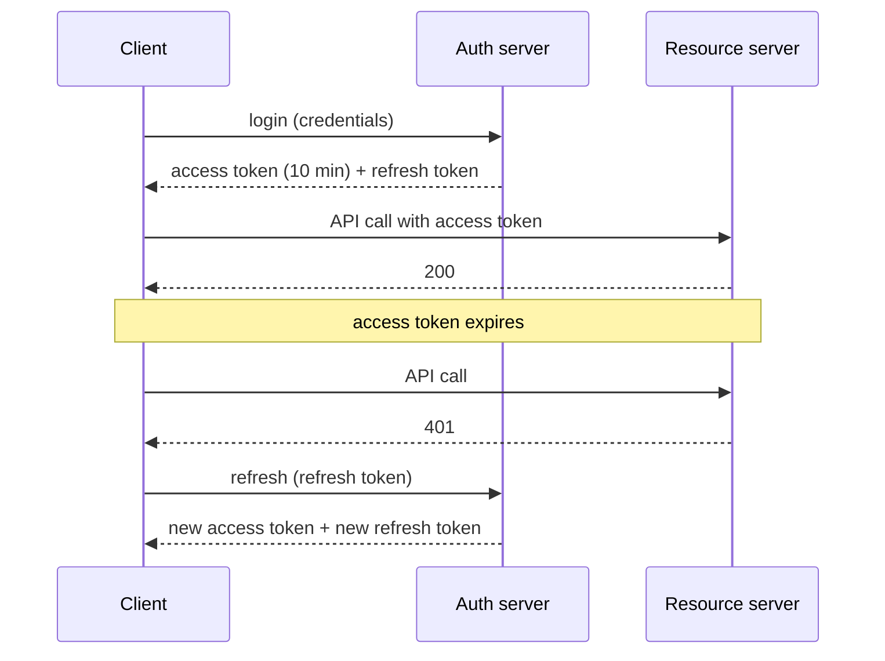

# JWT

A **JSON Web Token** is a compact, URL-safe, **signed** (JWS) token carrying claims. A server can verify it **without a database lookup**, which makes it popular for stateless APIs and microservices. It also has sharp edges that interviewers love.

<Outcomes items={[
  "Explain the three parts of a JWT and what is signed",
  "List what a resource server must validate",
  "Describe the revocation problem and token storage trade-offs"
]} />

## Structure

```text
eyJhbGciOiJIUzI1NiJ9.eyJzdWIiOiJhbGljZSIsInNjb3BlIjoib3JkZXJzLnJlYWQifQ.<signature>
      header                          payload (claims)                  signature
```

Three Base64URL-encoded parts separated by dots:

1. **Header**: `{"alg":"HS256","typ":"JWT","kid":"key-2025-01"}`.
2. **Payload**: claims, e.g. `sub` (subject), `iss` (issuer), `aud` (audience), `exp` (expiry), `nbf` (not before), `iat` (issued at), `jti` (id), plus custom ones (`scope`, `roles`).
3. **Signature**: `sign(base64(header) + "." + base64(payload))` with a key.

**The payload is encoded, not encrypted.** Anyone holding the token can read it. Never put secrets or sensitive personal data in a JWS. (JWE exists for encrypted tokens but is less common.)

## Signing: symmetric vs asymmetric

| | HS256 (HMAC-SHA-256) | RS256 / ES256 (RSA / ECDSA) |
| --- | --- | --- |
| Keys | One **shared secret** signs and verifies | **Private key** signs, **public key** verifies |
| Who can mint tokens | Anyone who can verify | Only the holder of the private key |
| Distribution | Secret must be shared with every verifier (risky across teams/services) | Publish public keys via a **JWKS** endpoint (`/.well-known/jwks.json`); key rotation via `kid` |
| Use | Single service verifying its own tokens | Identity provider issuing tokens to many resource servers |

For microservices use asymmetric keys: a compromised resource server then cannot forge tokens. Prefer `ES256`/`RS256` with a JWKS and rotate keys periodically.

## What a resource server must validate

Verify **everything**, never just decode:

1. **Signature**, using the expected algorithm and key chosen by *your configuration*, not by the token header.
2. **`exp`** (not expired), **`nbf`** (valid yet), allowing a small clock skew (Spring defaults to 60 s).
3. **`iss`**: matches the trusted issuer.
4. **`aud`**: the token is meant for **this** API (prevents using a token issued for service A against service B).
5. Application checks: scopes/roles, token type.

Spring does 1-3 by default when you set `issuer-uri`/`jwk-set-uri`; add an audience validator yourself:

```java
@Bean
JwtDecoder jwtDecoder(@Value("${spring.security.oauth2.resourceserver.jwt.issuer-uri}") String issuer) {
    NimbusJwtDecoder decoder = JwtDecoders.fromIssuerLocation(issuer);
    OAuth2TokenValidator<Jwt> audience = new JwtClaimValidator<List<String>>("aud", aud -> aud != null && aud.contains("orders-api"));
    decoder.setJwtValidator(new DelegatingOAuth2TokenValidator<>(JwtValidators.createDefaultWithIssuer(issuer), audience));
    return decoder;
}
```

I tested a resource server and confirmed that **expired tokens, tokens from a different issuer and tokens with a tampered signature are all rejected with 401**, valid tokens with the right scope get 200, and a valid token lacking the scope gets 403.

### Mapping claims to authorities

```java
JwtAuthenticationConverter converter = new JwtAuthenticationConverter();
JwtGrantedAuthoritiesConverter scopes = new JwtGrantedAuthoritiesConverter();      // scope/scp -> SCOPE_x
converter.setJwtGrantedAuthoritiesConverter(jwt -> {
    Collection<GrantedAuthority> out = new ArrayList<>(scopes.convert(jwt));
    List<String> roles = jwt.getClaimAsStringList("roles");                       // custom claim
    if (roles != null) roles.forEach(r -> out.add(new SimpleGrantedAuthority("ROLE_" + r)));
    return out;
});
```

Identity providers differ in claim shapes (Keycloak nests roles under `realm_access.roles`), so a converter is almost always needed.

## Access and refresh tokens

- **Access token**: short-lived (5-15 minutes), sent on every API call. Short life limits damage if stolen.
- **Refresh token**: long-lived, used **only** with the authorisation server to get new access tokens. Stored more safely, never sent to resource servers.
- **Refresh token rotation**: each use returns a new refresh token and invalidates the old one; reuse of an old token signals theft and revokes the family.



## The revocation problem

A self-contained JWT is valid until `exp`; you cannot "log out" a stolen token without extra state. Options:

- **Short TTLs** + refresh-token revocation (the standard answer).
- A **deny-list** of `jti`/subject checked on each request (reintroduces state/lookups, but small and cacheable).
- **Token introspection** (opaque tokens): the resource server asks the auth server each time (centralised control, extra latency; cacheable). Many teams prefer opaque tokens for external clients and JWTs internally.
- Versioning: store a per-user "tokens valid after" timestamp and compare with `iat`.

## Where to store tokens in a browser

| Location | Risk |
| --- | --- |
| `localStorage` / `sessionStorage` | Readable by any JavaScript: **XSS steals the token** |
| **HttpOnly, Secure, SameSite cookie** | Not readable by JS (XSS cannot exfiltrate it), but browsers attach it automatically so you need **CSRF protection** |
| In memory (SPA variable) + refresh via HttpOnly cookie | Good compromise; survives XSS less well but short-lived |

The **Backend-for-Frontend (BFF)** pattern keeps tokens entirely on the server: the browser has only a session cookie to the BFF, which calls APIs with tokens (recommended by current OAuth security guidance for browser apps).

## Common attacks and mistakes

| Issue | Defence |
| --- | --- |
| **`alg: none`** accepted | Libraries must reject unsigned tokens; pin allowed algorithms in configuration |
| **Algorithm confusion** (RS256 public key used as an HS256 secret) | Never let the token header choose the algorithm; configure it |
| Weak HMAC secret | 256+ bits of random key from a secret store, not a dictionary word |
| Not checking `aud`/`iss` | Always validate both |
| Secrets/PII in payload | Payload is readable; keep claims minimal |
| Long-lived access tokens | Short TTL + refresh |
| Trusting `kid`/`jku`/`x5u` header URLs from the token | Resolve keys only from configured, trusted JWKS URIs |
| Token in URL query strings | Leaks via logs and referrers; use the `Authorization` header |
| No rotation | Rotate signing keys, publish old and new keys during overlap |

## JWT vs server-side sessions

| | Server session (cookie + session id) | JWT |
| --- | --- | --- |
| State | Server-side (store/replicate) | Client-side (self-contained) |
| Revocation | Immediate | Hard (until expiry) |
| Scaling | Needs sticky/shared session store | Stateless verification |
| Size | Tiny cookie | Larger per request |
| Best for | Server-rendered web apps | APIs, microservices, third-party access |

JWT is not "more secure"; it fits distributed verification. For a classic monolith web app, sessions are often simpler and safer.

## Check yourself

<Checkpoint questions={[
  {
    "q": "A JWT is signed. Does that hide its contents?",
    "options": [
      "No, the payload is only Base64URL-encoded; signing prevents tampering",
      "Yes, signing encrypts it",
      "Yes, but only for HS256",
      "It depends on the browser"
    ],
    "answer": 0,
    "why": "Anyone can read the payload. Never put secrets in it. Use JWE if you need encryption."
  },
  {
    "q": "Which checks must a resource server perform?",
    "options": [
      "Only the expiry",
      "Signature, expiry, issuer and audience",
      "Only the signature",
      "Only that the string starts with eyJ"
    ],
    "answer": 1,
    "why": "Skipping any of these opens known attacks."
  },
  {
    "q": "Why is revoking a JWT hard?",
    "options": [
      "The signature changes every minute",
      "JWTs live forever by design",
      "It is self-contained, so servers accept it until it expires unless you add a deny list",
      "Browsers cache them"
    ],
    "answer": 2,
    "why": "Use short-lived access tokens with refresh tokens and a revocation strategy."
  }
]} />

## Common interview questions

**1. What is a JWT and what are its parts?**
A signed, base64url-encoded JSON token with header, payload (claims) and signature, verifiable without server-side state.

**2. Is a JWT encrypted?**
No, a standard signed JWT is only encoded; anyone can read the claims. Do not store secrets in it.

**3. HS256 vs RS256?**
HS256 shares one secret for signing and verifying; RS256 uses a private key to sign and a public key to verify, which is better when many services validate tokens and only the issuer should mint them.

**4. What must you validate on a received JWT?**
Signature with a configured algorithm/key, `exp`, `nbf`, `iss`, `aud`, then authorisation claims.

**5. How do you invalidate a JWT?**
You can't directly; use short expiry with refresh-token revocation, deny-lists by `jti`, per-user `tokens valid after` timestamps, or opaque tokens with introspection.

**6. Where should a SPA store the token?**
Preferably not in `localStorage`; use HttpOnly SameSite cookies (with CSRF protection) or the BFF pattern, keeping access tokens short-lived.

**7. What is the `alg: none` attack?**
Forging a token with the header `alg: none` and no signature; vulnerable libraries accept it. Prevent by enforcing allowed algorithms server-side.

**8. What are access vs refresh tokens?**
Access tokens are short-lived credentials for APIs; refresh tokens are long-lived credentials used only to obtain new access tokens, ideally rotated on each use.

**9. How do microservices share JWT verification keys?**
Via the identity provider's JWKS endpoint, cached with refresh on unknown `kid`, so key rotation needs no redeploy.

## Pitfalls

- Treating decode as verify.
- No audience check; tokens usable across APIs.
- Long-lived access tokens, no refresh rotation.
- Sensitive data in claims.
- Using a weak or shared HMAC secret across many services.
- Storing tokens in `localStorage` without XSS defences.
- Putting authorisation decisions only in the token, never rechecking resource ownership.

## Key takeaways

- JWTs are signed, not encrypted; validate signature, expiry, issuer and audience.
- Prefer asymmetric signing with a JWKS for multi-service setups.
- Short access tokens plus rotated refresh tokens; plan for revocation.
- Keep tokens out of JavaScript-readable storage where possible.

Next: [OAuth2 and OIDC](oauth2-oidc.md).
