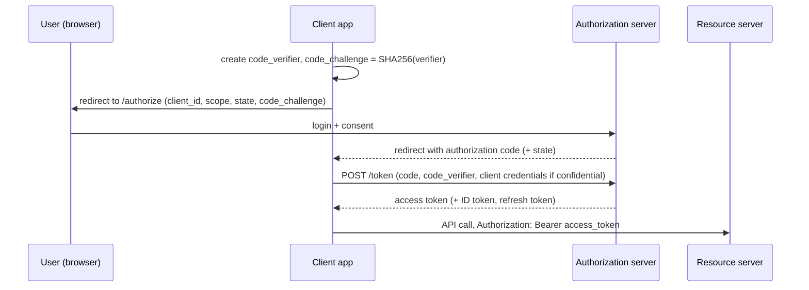
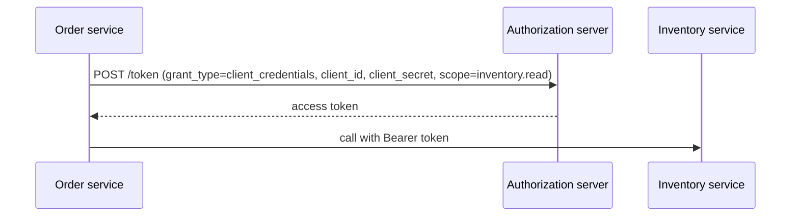
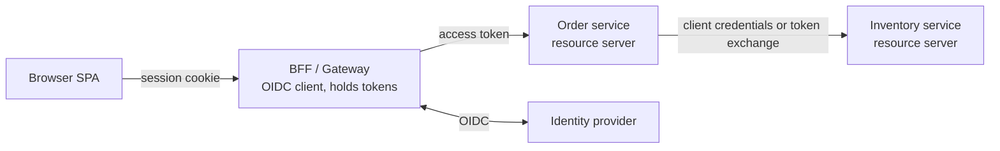

# OAuth 2.0 and OpenID Connect

**OAuth 2.0** is a framework for **delegated authorisation**: a user lets an application access their resources on another service **without sharing their password**. **OpenID Connect (OIDC)** is a thin identity layer on top that adds **authentication**: it tells the application *who* the user is.

| | OAuth 2.0 | OIDC |
| --- | --- | --- |
| Question answered | "May this app access these resources?" | "Who logged in?" |
| Token | Access token (and refresh token) | + **ID token** (a JWT about the user) |
| Standard scopes | Custom (`orders.read`) | `openid`, `profile`, `email` |

<Outcomes items={[
  "Name the OAuth 2.0 roles and choose a grant type",
  "Distinguish OAuth 2.0 (authorisation) from OIDC (authentication)",
  "Pick a service-to-service pattern"
]} />

## Roles

- **Resource owner**: the user.
- **Client**: the application requesting access (web app, SPA, mobile app, another service).
- **Authorization server (AS) / Identity provider (IdP)**: authenticates the user and issues tokens (Keycloak, Auth0, Okta, Azure AD, Spring Authorization Server).
- **Resource server (RS)**: the API that accepts access tokens.

## Grant types (flows)

| Flow | Use | Status |
| --- | --- | --- |
| **Authorization Code + PKCE** | Web apps, SPAs, mobile: user logs in at the IdP | **Recommended for all user-facing clients** |
| **Client Credentials** | Service-to-service, no user | Standard for machine access |
| Refresh Token | Get new access tokens without re-login | Standard, rotate tokens |
| Device Code | TVs, CLIs with no browser | Standard |
| Implicit | Tokens in the URL fragment | **Deprecated**, insecure |
| Resource Owner Password (ROPC) | App collects the user's password | **Deprecated**, avoid |

### Authorization Code with PKCE



The code travels through the browser, which is exposed. **PKCE** (Proof Key for Code Exchange) binds the code to the client that started the flow: an attacker who steals the code cannot redeem it without the `code_verifier`. The `state` parameter protects the redirect from CSRF. PKCE is required for public clients and is recommended for confidential ones too.

### Client Credentials



The token represents the **service**, not a user; keep scopes minimal per service.

## OIDC: the ID token and UserInfo

With the `openid` scope the AS also returns an **ID token**: a JWT for the **client**, proving the user's authentication (`sub`, `iss`, `aud` = client id, `exp`, `nonce`, optional `name`, `email`). The client must validate it. **Never send an ID token to an API as authorisation**: the access token is for APIs; the ID token is for the client. The `/userinfo` endpoint returns more claims. A **discovery document** (`/.well-known/openid-configuration`) lists endpoints and the JWKS URI, which is why Spring needs only an `issuer-uri`.

## Spring Security setups

### Resource server (your API)

```yaml
spring:
  security:
    oauth2:
      resourceserver:
        jwt:
          issuer-uri: https://idp.example.com/realms/shop
```

```java
http.authorizeHttpRequests(a -> a.anyRequest().authenticated())
    .oauth2ResourceServer(o -> o.jwt(Customizer.withDefaults()));
```

Spring discovers the JWKS from the issuer, verifies signature, `iss` and `exp` (add an audience check and a role/scope converter; see [JWT](jwt.md)).

### Login with an IdP (OIDC client for a web app)

```yaml
spring:
  security:
    oauth2:
      client:
        registration:
          keycloak:
            client-id: web-app
            client-secret: ${CLIENT_SECRET}
            scope: openid,profile,email
            authorization-grant-type: authorization_code
        provider:
          keycloak:
            issuer-uri: https://idp.example.com/realms/shop
```

```java
http.authorizeHttpRequests(a -> a.anyRequest().authenticated())
    .oauth2Login(Customizer.withDefaults());
```

The user is redirected to the IdP, comes back, and Spring creates a **session** holding an `OAuth2AuthenticationToken` with an `OidcUser`. This is the right shape for a server-rendered app or BFF.

### Calling other services

**With the user's token** (propagate identity). For servlet stacks, a `RestClient`/`WebClient` interceptor copies the incoming bearer token. Spring Cloud Gateway has a `TokenRelay` filter. Use this when the downstream service must act as the user.

**As the service** (client credentials), with Spring's `OAuth2AuthorizedClientManager`:

```java
@Bean
RestClient inventoryClient(RestClient.Builder builder, OAuth2AuthorizedClientManager manager) {
    return builder.baseUrl("http://inventory-service")
            .requestInterceptor((request, body, execution) -> {
                OAuth2AuthorizedClient client = manager.authorize(
                        OAuth2AuthorizeRequest.withClientRegistrationId("inventory").principal("order-service").build());
                request.getHeaders().setBearerAuth(client.getAccessToken().getTokenValue());
                return execution.execute(request, body);
            }).build();
}
```

The manager caches tokens until near expiry, so you do not fetch one per call.

**Token exchange** (RFC 8693) lets a service swap the user's token for a narrower one for a downstream call, keeping the user identity but limiting scope/audience.

## Microservice architecture patterns



- Terminate user login at a **gateway/BFF**; keep tokens off the browser.
- Every service is a **resource server** that validates tokens itself (zero trust inside the cluster); do not rely on the gateway alone.
- Use `aud` and scopes to limit what each token can do. Consider **mTLS** or a service mesh for transport-level service identity.

## Scopes vs roles vs permissions

- **Scopes** describe what the **client** may do on the user's behalf (`orders.read`). They limit an application, not the user.
- **Roles/permissions** describe what the **user** may do. A request needs both: the client has the scope **and** the user is permitted.
- Authorise **resources** too (is this order the caller's?), not just endpoints; see [method security](method-security.md).

## Check yourself

<Checkpoint questions={[
  {
    "q": "Which flow should a modern browser or mobile app use?",
    "options": [
      "Authorization Code with PKCE",
      "Implicit",
      "Resource Owner Password",
      "Basic auth"
    ],
    "answer": 0,
    "why": "Implicit and password grants are discouraged. PKCE protects the code exchange for public clients."
  },
  {
    "q": "What does OIDC add to OAuth 2.0?",
    "options": [
      "A faster token",
      "An ID token that tells the client who the user is",
      "Encryption of all traffic",
      "A new database"
    ],
    "answer": 1,
    "why": "OAuth 2.0 delegates authorisation. OIDC standardises authentication on top."
  },
  {
    "q": "Two backend services call each other with no user. Which grant fits?",
    "options": [
      "Authorization Code",
      "Implicit",
      "Client Credentials",
      "Refresh Token"
    ],
    "answer": 2,
    "why": "Client credentials issues a token for the service identity itself."
  }
]} />

## Common interview questions

**1. OAuth2 vs OIDC?**
OAuth2 delegates authorisation (access tokens); OIDC adds authentication (ID token, `openid` scope, userinfo, discovery) on top of OAuth2.

**2. Explain Authorization Code with PKCE and why PKCE.**
The client redirects the user to the IdP, receives a one-time code, and exchanges it for tokens. PKCE ties the code to a secret verifier created by the client, so an intercepted code is useless to an attacker; required for public clients.

**3. Which flow for service-to-service?**
Client credentials, with minimal scopes, tokens cached until expiry; or token exchange if the user context must be preserved.

**4. ID token vs access token?**
The ID token is for the client to learn who authenticated; the access token is for calling APIs. APIs must not accept ID tokens.

**5. Why are Implicit and ROPC deprecated?**
Implicit exposes tokens in URLs/browser history; ROPC requires giving the app the user's password, defeating delegation and MFA.

**6. Where does Spring validate JWTs?**
In the resource server filter (`BearerTokenAuthenticationFilter` → `JwtAuthenticationProvider` with a `JwtDecoder`).

**7. How do you propagate identity across microservices?**
Forward the user's access token (gateway token relay), or exchange it; use client credentials for service-owned calls; always validate `iss`/`aud` at each service.

**8. What is the purpose of the `state` and `nonce` parameters?**
`state` prevents CSRF on the redirect; `nonce` binds the ID token to the client's session to prevent replay.

**9. What is a BFF and why use it?**
A server-side component that performs the OAuth flow and keeps tokens, giving the SPA only a session cookie; this removes tokens from JavaScript-accessible storage.

## Pitfalls

- Using the ID token as an API credential.
- Implementing flows yourself instead of using a vetted IdP and libraries.
- Treating scopes as user permissions.
- Over-privileged service clients and long-lived access tokens.
- Not validating `aud` (confused deputy across services).
- Storing refresh tokens in browsers without rotation and protections.
- Open redirect URIs: register exact redirect URIs at the IdP.

## Key takeaways

- OAuth2 authorises, OIDC authenticates; use Authorization Code + PKCE for users, client credentials for services.
- Validate tokens at every resource server; check issuer and audience.
- Keep tokens off the browser with a BFF where possible.
- Combine scopes (client limits) with user roles/permissions and resource checks.

Next: [Method security](method-security.md).
